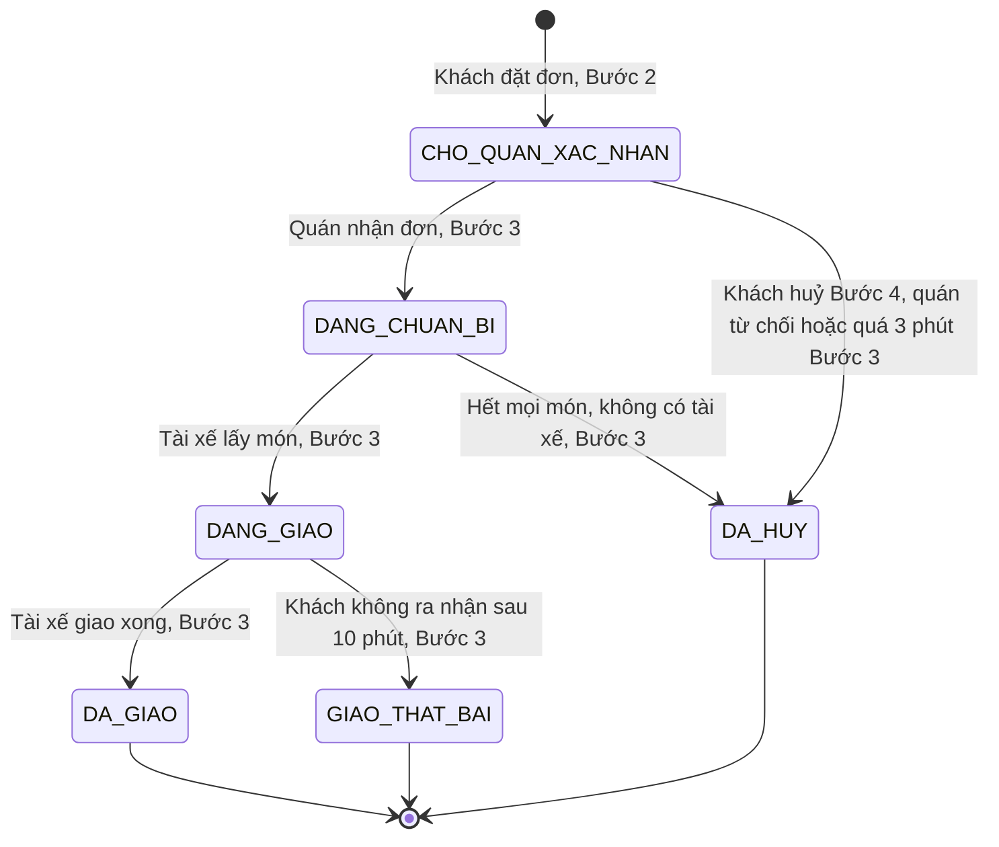
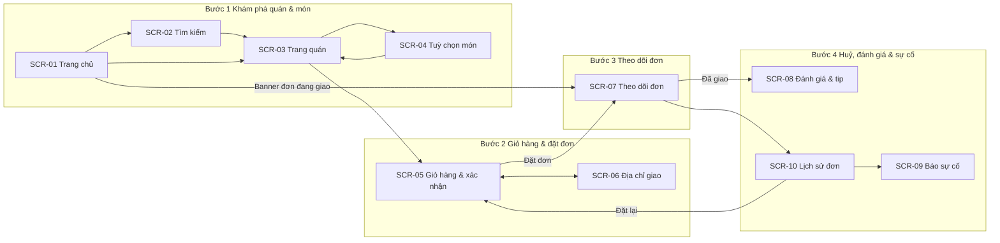

# Đề 6 · Đặt ship đồ ăn

> **Mã:** DE06 · **Độ khó:** 6/8 · **Vai trò:** 1 (khách đặt đồ ăn) · **Nền tảng:** App khách iOS / Android

Ứng dụng đặt đồ ăn giao tận nơi, nhìn từ phía khách: chọn quán và món, đặt đơn, theo dõi quán chuẩn bị và tài xế giao tới trên bản đồ, nhận đồ rồi đánh giá, báo sự cố nếu có. Quán và tài xế dùng ứng dụng riêng, **ngoài phạm vi đề**; đề chỉ thiết kế những gì khách thấy và làm khi đơn đi qua quán và tài xế. Đề gồm **1 tính năng**, là **1 luồng** gồm 4 bước và các màn hình; tài liệu gồm 1 PRD và 1 SRS.

## Tính năng

| **Tính năng** | **Luồng** | **PRD** | **SRS** |
| --- | --- | --- | --- |
| Đặt ship đồ ăn | Khám phá quán & món → Giỏ hàng & đặt đơn → Theo dõi đơn → Huỷ, đánh giá & sự cố | [PRD](docs/PRD.md) | [SRS](docs/SRS.md) |

## Các bước và màn hình của luồng

| **Bước** | **Tên bước** | **Màn hình** | **Phạm vi** |
| --- | --- | --- | --- |
| Bước 1 | Khám phá quán & món | SCR-01, SCR-02, SCR-03, SCR-04 | Địa chỉ giao, danh mục, thẻ quán, tìm kiếm, lọc, menu, tuỳ chọn món |
| Bước 2 | Giỏ hàng & đặt đơn | SCR-05, SCR-06 | Giỏ 1 quán, địa chỉ chi tiết, người nhận, bảng phí, tiền mặt hoặc ví, đặt đơn |
| Bước 3 | Theo dõi đơn | SCR-07 | Chờ quán xác nhận, món hết, giờ giao dự kiến, tìm tài xế, bản đồ, gọi và nhắn tài xế, tài xế đã tới, giao xong hoặc thất bại |
| Bước 4 | Huỷ, đánh giá & sự cố | SCR-08, SCR-09, SCR-10 | Khách huỷ, hoàn ví, đánh giá quán và tài xế, tip, báo sự cố, bồi hoàn, lịch sử, đặt lại |

Luồng: Bước 1 Khám phá quán & món → Bước 2 Giỏ hàng & đặt đơn → Bước 3 Theo dõi đơn → Bước 4 Huỷ, đánh giá & sự cố.

## Vòng đời đơn hàng (nhìn từ phía khách)



Trong `DANG_CHUAN_BI`, khách còn thấy các giai đoạn con: quán đang chuẩn bị, đang tìm tài xế, tài xế đang tới quán (Bước 3 mục 4.2). Các trạng thái do quán và tài xế cập nhật trên ứng dụng của họ; khách chỉ thấy kết quả. Sau `DA_GIAO`, khách có thể đánh giá, tip, báo sự cố (Bước 4).

## Bản đồ màn hình



## Bối cảnh chung

Giờ trưa và tối là cao điểm: khách đói, muốn đồ ăn tới nhanh và nóng, biết rõ tổng tiền và giờ tới. Sau khi đặt, đơn đi qua quán và tài xế trong khoảng 30–45 phút; khách không thấy họ làm gì, chỉ thấy app báo. Bài toán thiết kế chính là **chọn và đặt nhanh**, **cho khách biết đơn đang ở đâu một cách trung thực**, và **xử lý công bằng khi có sự cố**.

| **Nhóm người dùng** | **Nhu cầu chính** |
| --- | --- |
| Dân văn phòng | Chọn nhanh trong giờ nghỉ trưa, biết giờ tới để xuống sảnh |
| Sinh viên | Quan tâm phí, khuyến mãi của quán, để đồ ở bảo vệ |
| Gia đình đặt tối | Đơn nhiều món, cần đủ và đúng món |

Ngoài phạm vi cả đề: ứng dụng của quán (nhận đơn, chuẩn bị, quản lý món) và của tài xế (nhận đơn, lấy món, giao), web quản lý quán, trang quản trị và màn xử lý của nhân viên hỗ trợ, ví điện tử (dùng ví liên kết có sẵn), mã giảm giá và khuyến mãi của nền tảng, đặt hẹn giờ, giao hàng không phải đồ ăn.

## Quy ước dùng chung

- Màn hình mã `SCR-..` (App khách).
- Tiền tệ VND, không có số lẻ; phí làm tròn tới 1.000 ₫.
- Mã đơn 6 ký tự chữ và số, in hoa, hiện cho khách trong chi tiết đơn.
- Đăng nhập bằng số điện thoại và OTP theo luồng chuẩn, không mô tả trong bộ tài liệu này.
- Liên lạc giữa khách và tài xế qua số trung gian và tin nhắn trong app (Bước 3 BR-30).
- Mã BR, MSG, UC đánh số liên tục trong cả đề: Bước 1 dùng BR-01–10, MSG-01–06, UC-01–02; Bước 2 dùng BR-11–22, MSG-07–16, UC-03–04; Bước 3 dùng BR-23–34, MSG-17–26, UC-05–06; Bước 4 dùng BR-35–46, MSG-27–36, UC-07–09.

## Danh sách màn hình

| **Mã** | **Màn hình** | **Mô tả chi tiết ở** |
| --- | --- | --- |
| SCR-01 | Trang chủ | Bước 1 |
| SCR-02 | Tìm kiếm | Bước 1 |
| SCR-03 | Trang quán | Bước 1 |
| SCR-04 | Tuỳ chọn món | Bước 1 |
| SCR-05 | Giỏ hàng & xác nhận đơn | Bước 2 |
| SCR-06 | Địa chỉ giao | Bước 2 |
| SCR-07 | Theo dõi đơn | Bước 3 |
| SCR-08 | Đánh giá & tip | Bước 4 |
| SCR-09 | Báo sự cố | Bước 4 |
| SCR-10 | Lịch sử đơn & chi tiết | Bước 4 |

## Cấu trúc repo

```text
de06-dat-ship-do-an/
├── README.md
└── docs/
    ├── PRD.md    Bối cảnh, phạm vi, luồng, use case theo từng bước
    └── SRS.md    Quy tắc, trạng thái, use case, màn hình, API, thông báo theo từng bước
```

## Cách dùng bộ tài liệu

1. Đọc README để nắm vòng đời đơn và khách thấy đơn ở bước nào.
2. Đọc PRD để nắm toàn bộ tính năng và luồng, rồi đọc SRS theo từng bước của luồng.
3. Ở mỗi trạng thái đơn, thiết kế rõ khách thấy gì và làm được gì; quán và tài xế chỉ xuất hiện qua thông tin họ cập nhật.
4. Thiết kế màn hình theo đúng mã SCR, mã MSG trong SRS để dễ đối chiếu khi review.
5. Sơ đồ viết bằng Mermaid, xem trực tiếp trên GitHub hoặc trình xem Markdown có hỗ trợ Mermaid.
