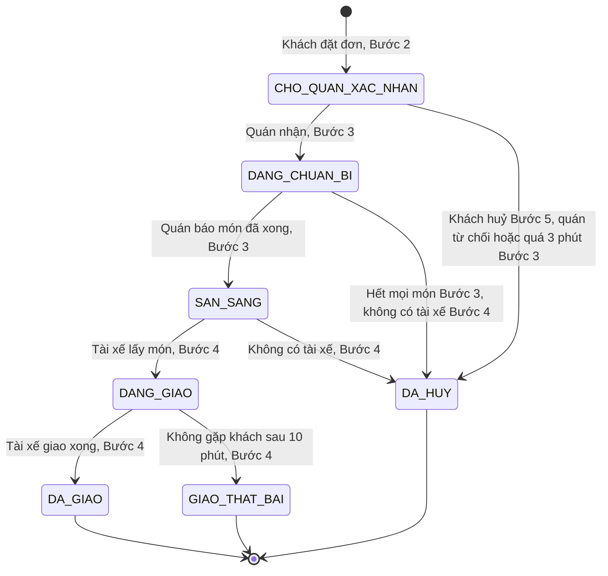
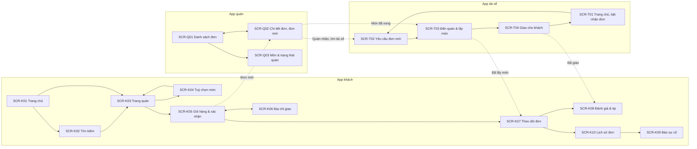

# Đề 6 · Đặt ship đồ ăn

> **Mã:** DE06 · **Độ khó:** 6/8 · **Vai trò:** 3 (khách, quán, tài xế) · **Nền tảng:** App khách iOS / Android · App quán (điện thoại hoặc tablet) · App tài xế iOS / Android

Nền tảng giao đồ ăn: khách chọn quán và món, đặt đơn; quán nhận và chuẩn bị; hệ thống tìm tài xế đúng lúc món xong; tài xế lấy món, giao tới khách; khách theo dõi trên bản đồ, đánh giá, báo sự cố nếu có. Đây là đề có **ba bên cùng thao tác trên một đơn** và **thời điểm phải khớp nhau** (món xong – tài xế tới). Đề gồm **1 tính năng**, là **1 luồng** gồm 5 bước và các màn hình; tài liệu gồm 1 PRD và 1 SRS.

## Tính năng

| **Tính năng** | **Luồng** | **PRD** | **SRS** |
| --- | --- | --- | --- |
| Đặt ship đồ ăn | Khám phá quán & món → Giỏ hàng & đặt đơn → Quán nhận & chuẩn bị đơn → Tài xế nhận & giao đơn → Huỷ, đánh giá & sự cố | [PRD](docs/PRD.md) | [SRS](docs/SRS.md) |

## Các bước và màn hình của luồng

| **Bước** | **Tên bước** | **Màn hình** | **Phạm vi** |
| --- | --- | --- | --- |
| Bước 1 | Khám phá quán & món | SCR-K01, SCR-K02, SCR-K03, SCR-K04 | Địa chỉ giao, danh mục, thẻ quán, tìm kiếm, lọc, menu, tuỳ chọn món |
| Bước 2 | Giỏ hàng & đặt đơn | SCR-K05, SCR-K06 | Giỏ 1 quán, địa chỉ chi tiết, người nhận, bảng phí, tiền mặt hoặc ví, đặt đơn |
| Bước 3 | Quán nhận & chuẩn bị đơn | SCR-Q01, SCR-Q02, SCR-Q03 | Chuông đơn mới, nhận hoặc từ chối, báo hết món, gia hạn, báo xong, tạm ngưng |
| Bước 4 | Tài xế nhận & giao đơn | SCR-T01, SCR-T02, SCR-T03, SCR-T04, SCR-K07 | Thời điểm tìm, ghép tài xế, lấy món đối chiếu mã, giao, ảnh xác nhận, không gặp khách, theo dõi đơn |
| Bước 5 | Huỷ, đánh giá & sự cố | SCR-K08, SCR-K09, SCR-K10 | Khách huỷ, hoàn ví, đánh giá quán và tài xế, tip, báo sự cố, bồi hoàn, lịch sử, đặt lại |

Luồng: Bước 1 Khám phá quán & món → Bước 2 Giỏ hàng & đặt đơn → Bước 3 Quán nhận & chuẩn bị đơn → Bước 4 Tài xế nhận & giao đơn → Bước 5 Huỷ, đánh giá & sự cố.

## Vòng đời đơn hàng (dùng chung cả đề)



Song song với trạng thái đơn, **tài xế** có tiến trình riêng trong đơn (`DANG_DEN_QUAN` → `DA_DEN_QUAN` → `DA_LAY_MON` → `DANG_DEN_KHACH` → `DA_DEN_NOI_GIAO`), xem Bước 4 mục 4.2. Việc tìm tài xế bắt đầu khi quán nhận đơn hoặc khi còn 10 phút tới giờ món xong (Bước 4 BR-34). Sau `DA_GIAO`, khách có thể đánh giá, tip, báo sự cố (Bước 5).

## Bản đồ màn hình



## Bối cảnh chung

Giờ trưa và tối là cao điểm: khách đói, muốn đồ ăn tới nhanh và nóng; quán vừa bán tại chỗ vừa nhận đơn online; tài xế muốn chạy được nhiều đơn, ít phải chờ. Một đơn đi qua ba ứng dụng, ba người, trong khoảng 30–45 phút. Bài toán thiết kế chính là **giữ ba bên cùng thấy một trạng thái**, đưa tài xế tới quán **đúng lúc món xong**, và xử lý công bằng khi có sự cố.

| **Nhóm người dùng** | **Nhu cầu chính** |
| --- | --- |
| Khách văn phòng, sinh viên | Chọn nhanh, biết tổng tiền và giờ tới, theo dõi được đơn |
| Chủ quán, nhân viên quầy | Không bỏ lỡ đơn, nhận một chạm, kiểm soát khi quá tải |
| Tài xế | Biết thu nhập trước, lấy đúng đơn, ít chờ, có quy trình khi không gặp khách |

Ngoài phạm vi cả đề: web quản lý quán (menu, giá, báo cáo, đối soát), trang quản trị và màn xử lý của nhân viên hỗ trợ, đăng ký và duyệt quán, tài xế, ví điện tử (dùng ví liên kết có sẵn), mã giảm giá và khuyến mãi của nền tảng, đặt hẹn giờ, ghép nhiều đơn cho một tài xế, giao hàng không phải đồ ăn.

## Quy ước dùng chung

- Màn App khách mã `SCR-K..`, App quán `SCR-Q..`, App tài xế `SCR-T..`.
- Tiền tệ VND, không có số lẻ; phí làm tròn tới 1.000 ₫.
- Mã đơn 6 ký tự chữ và số, in hoa, dùng để quán và tài xế đối chiếu.
- Đăng nhập cả ba app bằng số điện thoại và OTP theo luồng chuẩn, không mô tả trong bộ tài liệu này.
- Liên lạc giữa khách và tài xế qua số trung gian và tin nhắn trong app (Bước 4 BR-41).
- Mã BR, MSG, UC đánh số liên tục trong cả đề: Bước 1 dùng BR-01–10, MSG-01–06, UC-01–02; Bước 2 dùng BR-11–22, MSG-07–16, UC-03–04; Bước 3 dùng BR-23–33, MSG-17–24, UC-05–07; Bước 4 dùng BR-34–46, MSG-25–34, UC-08–10; Bước 5 dùng BR-47–58, MSG-35–44, UC-11–13.

## Danh sách màn hình

| **Mã** | **Màn hình** | **App** | **Mô tả chi tiết ở** |
| --- | --- | --- | --- |
| SCR-K01 | Trang chủ | Khách | Bước 1 |
| SCR-K02 | Tìm kiếm | Khách | Bước 1 |
| SCR-K03 | Trang quán | Khách | Bước 1 |
| SCR-K04 | Tuỳ chọn món | Khách | Bước 1 |
| SCR-K05 | Giỏ hàng & xác nhận đơn | Khách | Bước 2 |
| SCR-K06 | Địa chỉ giao | Khách | Bước 2 |
| SCR-Q01 | Danh sách đơn | Quán | Bước 3 |
| SCR-Q02 | Chi tiết đơn / Đơn mới | Quán | Bước 3 |
| SCR-Q03 | Món & trạng thái quán | Quán | Bước 3 |
| SCR-T01 | Trang chủ tài xế | Tài xế | Bước 4 |
| SCR-T02 | Yêu cầu đơn mới | Tài xế | Bước 4 |
| SCR-T03 | Đến quán & lấy món | Tài xế | Bước 4 |
| SCR-T04 | Giao cho khách | Tài xế | Bước 4 |
| SCR-K07 | Theo dõi đơn | Khách | Bước 4 |
| SCR-K08 | Đánh giá & tip | Khách | Bước 5 |
| SCR-K09 | Báo sự cố | Khách | Bước 5 |
| SCR-K10 | Lịch sử đơn & chi tiết | Khách | Bước 5 |

## Cấu trúc repo

```text
de06-dat-ship-do-an/
├── README.md
└── docs/
    ├── PRD.md    Bối cảnh, phạm vi, luồng, use case theo từng bước
    └── SRS.md    Quy tắc, trạng thái, use case, màn hình, API, thông báo theo từng bước
```

## Cách dùng bộ tài liệu

1. Đọc README để nắm vòng đời đơn và app nào thấy đơn ở bước nào.
2. Đọc PRD để nắm toàn bộ tính năng và luồng, rồi đọc SRS theo từng bước của luồng. Luôn thiết kế **cả ba phía** ở mỗi trạng thái: khách thấy gì, quán thấy gì, tài xế thấy gì.
3. App quán và App tài xế dùng trong môi trường ồn, bận tay, đang di chuyển: ưu tiên chữ to, nút lớn, ít thao tác.
4. Thiết kế màn hình theo đúng mã SCR, mã MSG trong SRS để dễ đối chiếu khi review.
5. Sơ đồ viết bằng Mermaid, xem trực tiếp trên GitHub hoặc trình xem Markdown có hỗ trợ Mermaid.
