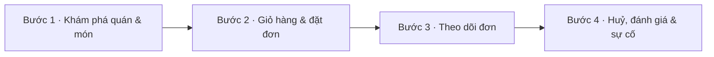
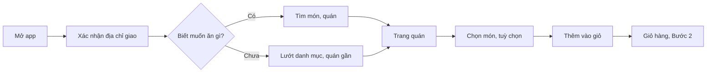
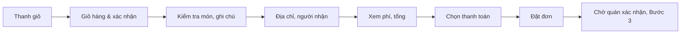
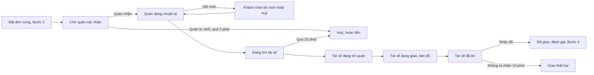
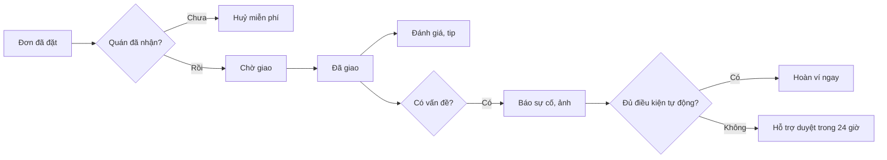

> **Mã:** DE06-PRD · **Trạng thái:** đã chốt · **Người viết:** Design · **SRS:** [SRS.md](SRS.md)

# PRD Đặt ship đồ ăn

> Đề gồm **1 tính năng**, là **1 luồng** gồm 4 bước và các màn hình: Khám phá quán & món → Giỏ hàng & đặt đơn → Theo dõi đơn → Huỷ, đánh giá & sự cố. Sơ đồ chung xem [README](../README.md).

## 1. Bối cảnh và vấn đề

### 1.1 Bối cảnh

Ứng dụng đặt đồ ăn giao tận nơi, nhìn từ phía khách: chọn quán và món, đặt đơn, theo dõi quán chuẩn bị và tài xế giao tới trên bản đồ, nhận đồ rồi đánh giá, báo sự cố nếu có. Quán và tài xế dùng ứng dụng riêng, **ngoài phạm vi đề**; đề chỉ thiết kế những gì khách thấy và làm khi đơn đi qua quán và tài xế.

Giờ trưa và tối là cao điểm: khách đói, muốn đồ ăn tới nhanh và nóng, biết rõ tổng tiền và giờ tới. Sau khi đặt, đơn đi qua quán và tài xế trong khoảng 30–45 phút; khách không thấy họ làm gì, chỉ thấy app báo. Bài toán thiết kế chính là **chọn và đặt nhanh**, **cho khách biết đơn đang ở đâu một cách trung thực**, và **xử lý công bằng khi có sự cố**.

### 1.2 Vấn đề

| **Vấn đề** | **Hệ quả** |
| --- | --- |
| Danh sách quán dài, không biết quán nào giao nhanh | Chọn quán xa, chờ 1 tiếng |
| Chọn món xong mới biết quán đã đóng hoặc tạm ngưng | Mất công chọn lại |
| Phí giao chỉ biết ở bước cuối | Thấy đắt, bỏ đơn |
| Món nhiều tuỳ chọn (size, topping, cay) nhưng giao diện rối | Chọn sai, nhận món không như ý |
| Món đã hết vẫn hiện trên menu | Quán phải gọi khách đổi món, đơn chậm |
| Tổng tiền có nhiều loại phí khó hiểu | Khách thấy "phí chồng phí", bỏ đơn |
| Địa chỉ trong toà nhà, hẻm không rõ | Tài xế gọi hỏi nhiều lần, đồ ăn nguội |
| Đặt hộ người khác nhưng số điện thoại là của mình | Tài xế không liên lạc được người nhận |
| Món hết, giá đổi sau khi đã thêm vào giỏ | Đặt xong quán từ chối |
| Bấm đặt nhiều lần vì mạng chậm | Hai đơn trùng |
| Không biết quán đã nhận đơn chưa | Khách huỷ, đặt lại quán khác, đơn trùng |
| Giờ giao dự kiến không đổi dù quán chậm | Khách thấy bị lừa, đánh giá thấp |
| Quán hết món phải gọi điện cho khách | Khách không nghe máy, đơn treo |
| Không thấy tài xế đang ở đâu | Gọi hỏi liên tục, hoặc đi vắng khi tài xế tới |
| Lộ số điện thoại cá nhân cho tài xế | Lo ngại riêng tư |
| Tài xế tới mà khách không biết | Tài xế chờ, giao thất bại |
| Đặt nhầm nhưng không biết còn huỷ được không | Gọi hỗ trợ, hoặc để mặc rồi không nhận |
| Thiếu món phải chat với hỗ trợ, chờ lâu | Khách bực, đánh giá 1 sao cả quán lẫn app |
| Hoàn tiền lâu, không rõ hoàn bao nhiêu | Mất niềm tin |
| Đánh giá chung chung "ngon", "dở" | Quán không biết sửa gì |
| Khách đặt tiền mặt rồi không nhận | Tài xế, quán thiệt |

### 1.3 Mục tiêu

- ≥ 50% phiên mở app có thêm ít nhất 1 món vào giỏ.
- Thời gian từ mở app tới thêm món đầu tiên ≤ 90 giây (trung vị).
- Tỉ lệ đơn bị quán từ chối vì hết món ≤ 3%.
- Tỉ lệ từ mở giỏ tới đặt đơn thành công ≥ 65%.
- Tỉ lệ đơn tài xế phải gọi hỏi địa chỉ ≤ 15%.
- 0 đơn trùng do bấm đặt nhiều lần.
- Giảm 50% cuộc gọi khách hỏi "đơn tới đâu rồi".
- ≥ 85% đơn giao trước giờ dự kiến cuối cùng hiển thị cho khách.
- Tỉ lệ giao thất bại do khách không ra nhận ≤ 1%.
- ≥ 70% sự cố thiếu món, sai món được hoàn tiền tự động trong 5 phút.
- ≥ 35% đơn đã giao có đánh giá.
- Tỉ lệ khách đặt lại trong 30 ngày sau khi có sự cố được xử lý ≥ 60%.

## 2. Người dùng

| **Nhóm** | **Nhu cầu với tính năng này** |
| --- | --- |
| Dân văn phòng đặt trưa | Quán gần, giao nhanh, giá ổn; đặt lại món quen |
| Sinh viên | Rẻ, ít phí giao, đang có ưu đãi của quán; Biết rõ từng khoản phí, trả tiền mặt |
| Gia đình đặt tối | Quán nhiều món, đặt cho nhiều người; Biết đơn lớn có đủ món, khi nào tới |
| Người chưa biết ăn gì | Gợi ý theo danh mục, món bán chạy |
| Dân văn phòng | Giao tới toà nhà, ghi rõ tầng, sảnh; trả bằng ví; Biết giờ tới để xuống sảnh đúng lúc |
| Người đặt hộ gia đình | Đổi tên, số điện thoại người nhận |
| Sinh viên ở ký túc xá | Nhắn tài xế để ở bảo vệ, không phải xuống |
| Khách lo riêng tư | Liên lạc tài xế không lộ số thật |
| Khách đặt nhầm | Huỷ nhanh, không mất tiền |
| Khách nhận thiếu, sai món | Báo bằng vài chạm, hoàn tiền ngay |
| Khách hài lòng | Khen quán, tip tài xế dễ dàng |
| Quán | Nhận đánh giá cụ thể để cải thiện |

## 3. Phạm vi

### 3.1 Trong phạm vi (MVP)

**Bước 1 · Khám phá quán & món**

- Chọn địa chỉ giao; danh sách quán theo địa chỉ giao.
- Trang chủ: danh mục món (Cơm, Bún phở, Trà sữa…), quán gần bạn, đặt lại.
- Thẻ quán: ảnh, tên, khoảng cách, thời gian giao dự kiến, phí giao ước tính, trạng thái mở, đánh giá.
- Tìm kiếm quán và món, không dấu; lọc: đang mở, miễn phí giao, khoảng cách; sắp xếp.
- Trang quán: menu theo nhóm, món bán chạy, món hết hàng, giờ mở cửa.
- Tuỳ chọn món: size, topping, mức cay, ghi chú; giá cập nhật theo lựa chọn.

**Bước 2 · Giỏ hàng & đặt đơn**

- Giỏ hàng: sửa số lượng, tuỳ chọn, xoá món; ghi chú cho quán; dụng cụ ăn uống.
- Địa chỉ giao: chọn đã lưu, tìm mới, ghim bản đồ, chi tiết toà nhà, ghi chú cho tài xế; người nhận.
- Bảng giá: tạm tính, phí giao, phí dịch vụ, phí đơn nhỏ, phụ phí cao điểm, giảm phí giao của quán; giải thích từng khoản.
- Thanh toán: tiền mặt, ví liên kết.
- Đặt đơn, chống đặt trùng.

**Bước 3 · Theo dõi đơn**

- Màn theo dõi đơn: trạng thái, tiến trình, giờ giao dự kiến cập nhật liên tục.
- Chờ quán xác nhận (đếm ngược); quán từ chối hoặc không phản hồi → huỷ và hoàn tiền.
- Quán báo hết món sau khi nhận → khách chọn bỏ món hoặc huỷ đơn.
- Quán cần thêm thời gian → khách được báo giờ mới.
- Đang tìm tài xế; không tìm được → huỷ và hoàn tiền.
- Thông tin tài xế, vị trí trên bản đồ, gọi và nhắn tin qua số trung gian.
- Tài xế đã tới; giao thành công (kèm ảnh nếu để theo ghi chú); giao thất bại.
- Banner đơn đang giao trên trang chủ.

**Bước 4 · Huỷ, đánh giá & sự cố**

- Khách huỷ đơn trước khi quán nhận; hướng dẫn khi không huỷ được nữa.
- Hoàn tiền về ví cho các trường hợp huỷ không do lỗi khách.
- Đánh giá quán (sao, nhãn, bình luận, ảnh) và tài xế (sao, nhãn).
- Tip tài xế bằng ví.
- Báo sự cố: thiếu món, sai món, đổ vỡ, chất lượng, không nhận được đơn; hoàn tiền tự động hoặc qua duyệt.
- Lịch sử đơn, chi tiết đơn, đặt lại.
- Khoá tiền mặt với khách nhiều lần không nhận.

### 3.2 Ngoài phạm vi

- Mã giảm giá của nền tảng, chương trình khuyến mãi → phase sau (chỉ có giá giảm do quán đặt sẵn trên món).
- Đặt trước theo giờ.
- Đặt nhóm, nhiều người cùng chọn món.
- Gợi ý cá nhân hoá bằng AI.
- Mã giảm giá nền tảng, điểm thưởng.
- Đặt hẹn giờ.
- Thanh toán thẻ trực tiếp.
- Tách hoá đơn, xuất hoá đơn VAT.
- Ứng dụng của quán (nhận đơn, chuẩn bị) và của tài xế (nhận đơn, giao) – hệ thống bên ngoài, khách chỉ thấy kết quả.
- Đổi địa chỉ, đổi món sau khi đặt.
- Chia sẻ hành trình đơn cho người khác.
- Chat với nhân viên hỗ trợ trong app (dùng kênh hỗ trợ chung).
- Màn xử lý sự cố của nhân viên hỗ trợ (chỉ mô tả kết quả khách thấy).
- Quán trả lời đánh giá → phase sau.
- Chat trực tiếp với hỗ trợ trong app (dùng kênh hỗ trợ chung).
- Bồi thường bằng mã giảm giá.

## 4. Nguyên tắc sản phẩm

### 4.1 Ba con số luôn có mặt

Mỗi thẻ quán đều có **thời gian giao dự kiến**, **phí giao ước tính** và **khoảng cách**, tính theo địa chỉ giao đang chọn.

### 4.2 Không cho chọn thứ không đặt được

Quán đóng cửa hoặc tạm ngưng, món hết đều hiện rõ và không thêm vào giỏ được.

### 4.3 Tuỳ chọn món rõ như thực đơn giấy

Nhóm tuỳ chọn bắt buộc đánh dấu rõ, có giá cộng thêm từng lựa chọn, tổng giá cập nhật ngay.

### 4.4 Mọi khoản phí đều có lời giải thích

Chạm vào khoản phí nào cũng có một câu giải thích vì sao có phí đó.

### 4.5 Địa chỉ cho tài xế, không chỉ cho bản đồ

Ngoài ghim bản đồ, luôn có chỗ cho chi tiết "Toà A, tầng 5" và ghi chú cho tài xế.

### 4.6 Kiểm tra trước khi gửi quán

Giá, món hết, quán mở đều được kiểm tra lại khi mở giỏ và khi bấm đặt.

### 4.7 Một câu nói rõ đơn đang ở đâu

Tiêu đề màn theo dõi luôn là một câu dễ hiểu ("Quán đang chuẩn bị", "Tài xế đang giao tới bạn") kèm giờ dự kiến.

### 4.8 Giờ dự kiến phải trung thực

Mỗi khi quán chậm hoặc tài xế đổi đường, giờ dự kiến cập nhật ngay và khách được báo nếu trễ hơn.

### 4.9 Khách quyết định khi có thay đổi

Món hết sau khi đã đặt: khách chọn bỏ món hay huỷ đơn, không để quán tự quyết.

### 4.10 Liên lạc an toàn

Gọi, nhắn với tài xế qua số trung gian; tin nhắn nhanh cho tình huống thường gặp.

### 4.11 Tin khách trước, kiểm tra sau

Sự cố nhỏ có ảnh được hoàn tiền tự động; kiểm tra lạm dụng dựa trên lịch sử, không bắt mọi khách chờ.

### 4.12 Nói rõ còn huỷ được không

Nút huỷ chỉ xuất hiện khi huỷ được; khi không, nói vì sao và có lối tới hỗ trợ.

### 4.13 Đánh giá để cải thiện, không để trút giận

Nhãn cụ thể giúp quán biết sửa gì; đánh giá thấp có gợi ý báo sự cố để được hoàn tiền.

## 5. Quy tắc nghiệp vụ

| **Quy tắc** | **Giá trị** |
| --- | --- |
| Bán kính giao | Tối đa 10 km theo đường đi từ quán tới địa chỉ giao |
| Phí giao ước tính | 15.000 ₫ cho 3 km đầu + 5.000 ₫ mỗi km tiếp theo, làm tròn 1.000 ₫ |
| Thời gian giao dự kiến | Thời gian chuẩn bị trung bình của quán + thời gian đi từ quán tới khách |
| Trạng thái quán | Đang mở, Sắp đóng (≤ 30 phút), Đóng cửa, Tạm ngưng |
| Giỏ hàng | Chỉ chứa món của 1 quán |
| Món hết | Quán tự bật tắt trên ứng dụng quán; hết món thì không thêm được |
| Phí giao | Theo khoảng cách (Bước 1) + phụ phí cao điểm hoặc thời tiết xấu 5.000 ₫ khi có |
| Phí dịch vụ | 3.000 ₫ mỗi đơn |
| Phí đơn nhỏ | 5.000 ₫ khi tạm tính < 40.000 ₫ |
| Giới hạn đơn | Tạm tính tối đa 3.000.000 ₫; tối đa 30 món |
| Tiền mặt | Tổng ≤ 1.000.000 ₫ |
| Đơn đang chạy | Tối đa 3 đơn cùng lúc mỗi khách |
| Dụng cụ ăn uống | Mặc định không lấy |
| Chờ quán xác nhận | Tối đa 3 phút; quá thì đơn tự huỷ, hoàn ví |
| Chọn khi món hết | 3 phút; không chọn thì món tự được bỏ |
| Tìm tài xế | Tối đa 25 phút; không tìm được thì huỷ, hoàn ví |
| Vị trí tài xế | Cập nhật mỗi 5 giây |
| Chờ khách khi tài xế tới | 10 phút; tài xế gọi ít nhất 2 lần |
| Liên lạc tài xế | Qua số trung gian, tới 1 giờ sau khi kết thúc đơn |
| Khách tự huỷ | Chỉ khi quán chưa nhận đơn; miễn phí |
| Hoàn tiền về ví | ≤ 5 phút |
| Đánh giá | Trong 7 ngày sau khi giao |
| Tip | 5.000, 10.000, 20.000 ₫ hoặc số khác ≤ 200.000 ₫; trong 24 giờ sau khi giao |
| Báo sự cố | Trong 2 giờ sau khi giao; 1 yêu cầu mỗi đơn |
| Hoàn tự động | Tổng hoàn ≤ 100.000 ₫ và khách có ≤ 2 sự cố được duyệt trong 30 ngày |
| Khoá tiền mặt | 2 lần không nhận đơn tiền mặt trong 90 ngày → chỉ dùng ví 30 ngày |

- Đơn giá phí giao, bán kính là **cấu hình theo thành phố**.
- Các mức phí là **cấu hình theo thành phố**.

## 6. Luồng trải nghiệm

### 6.1 Toàn bộ luồng

### 6.2 Bước 1 · Khám phá quán & món

| **Bước** | **Giai đoạn** | **Trải nghiệm** | **Đầu ra** |
| --- | --- | --- | --- |
| 1 | Địa chỉ giao | Tự định vị hoặc chọn địa chỉ đã lưu | Địa chỉ giao |
| 2 | Khám phá | Danh mục, quán gần, đặt lại, tìm kiếm | Quán muốn xem |
| 3 | Xem menu | Nhóm món, món bán chạy, giá | Món muốn đặt |
| 4 | Tuỳ chọn | Size, topping, cay, ghi chú | Món trong giỏ |

### 6.3 Bước 2 · Giỏ hàng & đặt đơn

| **Bước** | **Giai đoạn** | **Trải nghiệm** | **Đầu ra** |
| --- | --- | --- | --- |
| 1 | Giỏ | Danh sách món, sửa nhanh, ghi chú cho quán | Món cuối |
| 2 | Địa chỉ | Địa chỉ đã lưu hoặc mới, chi tiết toà nhà, người nhận | Nơi giao rõ ràng |
| 3 | Tiền | Từng khoản phí, tổng | Khách biết trả bao nhiêu |
| 4 | Đặt | Thanh toán, nút "Đặt đơn · {tổng}" | Đơn gửi quán |

### 6.4 Bước 3 · Theo dõi đơn

| **Bước** | **Giai đoạn** | **Khách thấy** | **Khách làm** |
| --- | --- | --- | --- |
| 1 | Chờ quán | "Chờ quán xác nhận", đếm ngược | Huỷ miễn phí nếu muốn (Bước 4) |
| 2 | Quán chuẩn bị | Giờ giao dự kiến | Chọn khi món hết |
| 3 | Tìm, chờ tài xế | "Đang tìm tài xế", rồi thông tin tài xế | – |
| 4 | Đang giao | Bản đồ, giờ tới | Gọi, nhắn tài xế |
| 5 | Tài xế tới | "Tài xế đã tới", nút gọi nổi bật | Ra nhận đồ |
| 6 | Kết thúc | Đã giao, ảnh giao (nếu có) | Đánh giá (Bước 4) |

### 6.5 Bước 4 · Huỷ, đánh giá & sự cố

| **Bước** | **Giai đoạn** | **Trải nghiệm** | **Đầu ra** |
| --- | --- | --- | --- |
| 1 | Huỷ (nếu cần) | Nút huỷ khi còn chờ quán; lý do | Đơn huỷ, hoàn ví |
| 2 | Đánh giá | Sao, nhãn cho quán và tài xế; tip | Đánh giá |
| 3 | Sự cố | Chọn vấn đề, món, ảnh; thấy số tiền hoàn | Hoàn tiền |
| 4 | Đặt lại | Từ lịch sử đơn | Giỏ mới |

## 7. Use Cases, User Stories và Acceptance Criteria

### Bước 1 · Khám phá quán & món

#### UC1. Địa chỉ giao và danh sách quán

##### US1.1 Chọn địa chỉ giao

User Story: Là khách, tôi muốn app biết tôi đang ở đâu để chỉ hiện quán giao được tới tôi.

AC01: Mở app tự định vị; hiện địa chỉ ở đầu trang chủ, chạm để đổi.

AC02: Chọn từ địa chỉ đã lưu (Nhà, Công ty) hoặc tìm địa chỉ mới.

AC03: Đổi địa chỉ → danh sách quán, thời gian, phí giao cập nhật.

AC04: Địa chỉ ngoài vùng phục vụ → báo rõ, không hiện quán.

##### US1.2 Lướt quán

AC01: Trang chủ có danh mục, Quán gần bạn, Đặt lại (đơn đã giao gần đây).

AC02: Mỗi thẻ quán có thời gian dự kiến, phí giao, khoảng cách, trạng thái, điểm đánh giá.

AC03: Quán đóng cửa xếp cuối, ghi giờ mở cửa lại.

#### UC2. Tìm kiếm và lọc

##### US2.1 Tìm món, quán

User Story: Là khách, tôi muốn gõ "bun bo" và thấy các quán có bún bò gần tôi.

AC01: Tìm theo tên quán và tên món, không dấu.

AC02: Kết quả nhóm theo quán, hiện món khớp trong quán.

AC03: Lọc: Đang mở, Miễn phí giao, ≤ 3 km; sắp xếp: Phù hợp, Gần nhất, Giao nhanh nhất, Đánh giá cao.

#### UC3. Xem menu và tuỳ chọn món

##### US3.1 Xem menu quán

AC01: Menu theo nhóm do quán đặt; thanh nhóm dính đầu trang, chạm để nhảy tới nhóm.

AC02: Món hết hiện mờ, ghi "Hết món".

AC03: Quán đóng cửa vẫn xem được menu, không thêm giỏ được.

##### US3.2 Chọn tuỳ chọn món

User Story: Là khách, tôi muốn chọn size, topping, mức cay và thấy giá ngay.

AC01: Nhóm bắt buộc ghi "Bắt buộc · chọn 1"; nhóm tuỳ chọn ghi "Chọn tối đa {n}".

AC02: Mỗi lựa chọn có giá cộng thêm; tổng cập nhật theo số lượng.

AC03: Thiếu nhóm bắt buộc → nút Thêm vào giỏ chỉ rõ nhóm còn thiếu.

AC04: Giỏ đang có món của quán khác → hỏi thay giỏ mới hay giữ giỏ cũ.

### Bước 2 · Giỏ hàng & đặt đơn

#### UC4. Xem và sửa giỏ

##### US4.1 Sửa món trong giỏ

AC01: Mỗi dòng: tên, tuỳ chọn, ghi chú, số lượng, giá; chạm để sửa tuỳ chọn.

AC02: Giảm số lượng về 0 → xoá, có Hoàn tác.

AC03: Món hết, giá đổi kể từ lúc thêm → đánh dấu rõ; món hết không được đặt.

##### US4.2 Ghi chú, dụng cụ

AC01: Ghi chú cho quán ≤ 200 ký tự.

AC02: Công tắc "Lấy dụng cụ ăn uống", mặc định tắt.

#### UC5. Địa chỉ và người nhận

##### US5.1 Giao đúng chỗ

User Story: Là khách ở toà nhà, tôi muốn ghi rõ toà, tầng để tài xế khỏi gọi hỏi.

AC01: Chọn địa chỉ đã lưu hoặc tìm mới; kéo ghim cho chính xác.

AC02: Ô chi tiết (toà, tầng, phòng) và ghi chú cho tài xế.

AC03: Lưu địa chỉ mới với tên (Nhà, Công ty, khác).

##### US5.2 Đặt hộ

AC01: Đổi tên, số điện thoại người nhận cho đơn này; không đổi hồ sơ.

#### UC6. Phí và thanh toán

##### US6.1 Hiểu tổng tiền

User Story: Là khách, tôi muốn biết từng khoản phí là gì để thấy giá hợp lý.

AC01: Liệt kê tạm tính, phí giao, phí dịch vụ, phí đơn nhỏ (nếu có), phụ phí (nếu có), giảm phí giao (nếu có), tổng.

AC02: Chạm biểu tượng ⓘ cạnh mỗi khoản → giải thích.

AC03: Phí đơn nhỏ → gợi ý "Thêm {x} ₫ để bỏ phí đơn nhỏ".

##### US6.2 Chọn thanh toán

AC01: Tiền mặt (ẩn khi tổng > 1.000.000 ₫, ghi lý do) hoặc ví liên kết (hiện số dư).

AC02: Ví không đủ số dư → báo, gợi ý tiền mặt.

#### UC7. Đặt đơn

AC01: Bấm "Đặt đơn" chỉ tạo 1 đơn dù bấm nhiều lần.

AC02: Quán vừa đóng, món vừa hết, giá đổi → báo cụ thể, không tạo đơn.

AC03: Đặt thành công → màn theo dõi đơn ở trạng thái "Chờ quán xác nhận".

### Bước 3 · Theo dõi đơn

#### UC8. Theo dõi trạng thái

##### US8.1 Biết đơn đang ở đâu

User Story: Là khách, tôi muốn thấy đơn đang ở bước nào và mấy giờ tới để chủ động.

AC01: Tiêu đề trạng thái và tiến trình: Đã đặt → Quán chuẩn bị → Đang giao → Đã giao.

AC02: Giờ giao dự kiến dạng khoảng ("12:25–12:35"); trễ hơn 5 phút so với lần báo trước → push.

AC03: Trang chủ có banner đơn đang giao; chạm mở màn theo dõi.

##### US8.2 Khi quán không nhận đơn

AC01: Đếm ngược 3 phút chờ quán; quán từ chối hoặc hết giờ → báo lý do, hoàn tiền nếu đã trả ví, gợi ý quán khác.

#### UC9. Thay đổi trong lúc quán chuẩn bị

##### US9.1 Món hết

User Story: Là khách, tôi muốn được chọn bỏ món hay huỷ đơn khi quán báo hết một món.

AC01: Popup nêu món hết, số tiền sẽ hoàn nếu bỏ món; nút "Bỏ món", "Huỷ đơn".

AC02: 3 phút không chọn → món tự được bỏ; mọi món đều hết → đơn huỷ, hoàn toàn bộ.

##### US9.2 Quán cần thêm thời gian

AC01: Push giờ giao mới; màn theo dõi cập nhật.

#### UC10. Tài xế và nhận đồ

##### US10.1 Thấy tài xế

AC01: Khi có tài xế: ảnh, tên, biển số; bản đồ vị trí cập nhật mỗi 5 giây; "Cập nhật {n} giây trước" khi mất tín hiệu.

AC02: Không tìm được tài xế sau 25 phút → đơn huỷ, hoàn tiền, xin lỗi kèm nút đặt lại.

##### US10.2 Liên lạc tài xế

AC01: Gọi qua số trung gian; nhắn tin trong app với tin nhắn nhanh ("Tôi đang xuống", "Để ở bảo vệ giúp tôi").

##### US10.3 Ra nhận đồ

AC01: Tài xế tới → push, màn theo dõi đổi sang "Tài xế đã tới", nút gọi nổi bật.

AC02: Giao để ở bảo vệ, lễ tân → ảnh xác nhận hiện trên màn.

AC03: Không ra nhận trong 10 phút và tài xế đã gọi ít nhất 2 lần → giao thất bại, đơn vẫn tính tiền.

### Bước 4 · Huỷ, đánh giá & sự cố

#### UC11. Huỷ đơn

##### US11.1 Huỷ khi quán chưa nhận

User Story: Là khách đặt nhầm, tôi muốn huỷ ngay khi quán chưa nhận để không mất tiền.

AC01: Đơn chờ quán xác nhận → nút "Huỷ đơn"; chọn lý do; huỷ ngay, hoàn ví.

AC02: Quán vừa nhận đúng lúc khách bấm huỷ → báo không huỷ được nữa.

##### US11.2 Khi không còn huỷ được

AC01: Quán đã nhận → không có nút huỷ; hiện "Quán đã bắt đầu chuẩn bị" và nút "Cần hỗ trợ".

#### UC12. Đánh giá và tip

##### US12.1 Đánh giá quán, tài xế

AC01: Sau khi giao, màn đánh giá hiện tự động một lần; vào lại được từ chi tiết đơn trong 7 ngày.

AC02: Quán: 1–5 sao, nhãn theo số sao, bình luận ≤ 300 ký tự, ≤ 3 ảnh. Tài xế: 1–5 sao, nhãn.

AC03: Quán ≤ 2 sao → bắt buộc chọn ít nhất 1 nhãn; nhãn Thiếu món, Sai món → gợi ý báo sự cố.

##### US12.2 Tip tài xế

AC01: Chọn mức tip; trừ ví; tài xế nhận 100%.

AC02: Ví không đủ → báo; không ảnh hưởng đánh giá.

#### UC13. Báo sự cố

##### US13.1 Thiếu, sai, đổ vỡ, chất lượng

User Story: Là khách nhận thiếu món, tôi muốn báo trong vài chạm và được hoàn tiền ngay.

AC01: Chọn vấn đề, chọn món và số lượng bị ảnh hưởng, chụp ảnh (bắt buộc).

AC02: Hiện số tiền hoàn trước khi gửi.

AC03: Đủ điều kiện → hoàn ví ngay, báo thành công; không đủ → hỗ trợ duyệt trong 24 giờ.

##### US13.2 Không nhận được đơn

AC01: Đơn báo đã giao nhưng khách không nhận → gửi yêu cầu; hỗ trợ đối chiếu ảnh, vị trí giao.

#### UC14. Lịch sử và đặt lại

AC01: Lịch sử 6 tháng; mỗi đơn: quán, ngày, món, tổng, trạng thái.

AC02: "Đặt lại" thêm món còn bán vào giỏ (Bước 2).

## 8. Chỉ số theo dõi

| **Chỉ số** | **Định nghĩa** | **Mục tiêu MVP** |
| --- | --- | --- |
| Tỉ lệ thêm giỏ | Phiên có thêm món / phiên mở app | ≥ 50% |
| Thời gian tới món đầu tiên | Mở app → thêm món đầu tiên | ≤ 90 giây (trung vị) |
| Tỉ lệ tìm có kết quả | Lượt tìm có kết quả / tổng lượt tìm | ≥ 85% |
| Tỉ lệ dùng Đặt lại | Đơn từ Đặt lại / tổng đơn | Theo dõi |
| Từ chối vì hết món | Đơn quán từ chối lý do hết món / tổng đơn | ≤ 3% |
| Tỉ lệ đặt đơn | Đơn thành công / phiên mở giỏ | ≥ 65% |
| Tỉ lệ có chi tiết địa chỉ | Đơn có chi tiết toà, tầng hoặc ghi chú tài xế / tổng đơn | Theo dõi |
| Tỉ lệ tài xế gọi hỏi địa chỉ | Đơn tài xế gọi khách trước khi tới / tổng đơn | ≤ 15% |
| Tỉ lệ chạm giải thích phí | Phiên chạm ⓘ / phiên mở giỏ | Theo dõi |
| Đơn trùng | Đơn trùng do bấm nhiều lần | 0 |
| Cuộc gọi hỏi đơn | Cuộc gọi, chat hỗ trợ hỏi trạng thái / tổng đơn | Giảm 50% |
| Đúng giờ | Đơn giao trước giờ dự kiến cuối / tổng đơn | ≥ 85% |
| Huỷ vì quán, không có tài xế | Đơn huỷ do quán từ chối, quá giờ, không có tài xế / tổng đơn | ≤ 4% |
| Chọn khi món hết | Khách chọn trong 3 phút / lần quán báo hết món | Theo dõi |
| Dùng nhắn tin | Đơn có tin nhắn khách – tài xế / tổng đơn | Theo dõi |
| Giao thất bại | Đơn `GIAO_THAT_BAI` / tổng đơn | ≤ 1% |
| Hoàn tự động | Sự cố hoàn tự động trong 5 phút / sự cố thiếu, sai món | ≥ 70% |
| Tỉ lệ đánh giá | Đơn có đánh giá / đơn đã giao | ≥ 35% |
| Tỉ lệ tip | Đơn có tip / đơn đã giao | Theo dõi |
| Tỉ lệ sự cố | Đơn có sự cố / đơn đã giao | ≤ 3% |
| Quay lại sau sự cố | Khách đặt lại trong 30 ngày sau sự cố được xử lý | ≥ 60% |
| Huỷ bởi khách | Đơn khách huỷ / tổng đơn | Theo dõi |

## 9. Phụ thuộc và rủi ro

| **Mục** | **Mô tả** | **Hướng xử lý** |
| --- | --- | --- |
| Dữ liệu menu do quán nhập | Ảnh xấu, giá sai, quên tắt món hết | Quán bật tắt món nhanh trên ứng dụng quán; nhắc khi bị từ chối vì hết món |
| Thời gian dự kiến | Sai lệch giờ cao điểm | Tính từ dữ liệu thực tế 7 ngày, cập nhật mỗi 15 phút |
| Dịch vụ bản đồ | Tính đường đi chậm | Ước tính theo đường chim bay × 1,3 khi chưa có kết quả |
| Ví liên kết | Lỗi, chậm khi trừ tiền | Thời gian chờ 15 giây, báo lỗi rõ, gợi ý tiền mặt |
| Phụ phí thời tiết | Khách phản ứng | Hiện nhãn và giải thích; chỉ áp khi vận hành bật theo khu vực |
| Đơn tiền mặt bị bom | Khách không nhận hàng | Giới hạn tiền mặt; khoá tiền mặt với khách có 2 lần không nhận (Bước 4) |
| Ứng dụng quán, tài xế | Cập nhật trạng thái chậm | Đồng bộ thời gian thực, dự phòng làm mới mỗi 10 giây |
| Định vị tài xế | Mất GPS trong hẻm, toà nhà | Hiện thời điểm cập nhật cuối, không đoán vị trí |
| Số trung gian | Lỗi nhà mạng | Nhắn tin trong app luôn khả dụng |
| Lạm dụng hoàn tiền | Báo sự cố giả | Ngưỡng tự động theo lịch sử; ảnh bắt buộc; hỗ trợ duyệt khi vượt ngưỡng |
| Đánh giá ác ý | Quán bị đánh giá thấp không công bằng | Chỉ khách đã nhận đơn mới đánh giá; ẩn bình luận vi phạm theo báo cáo |
| Tranh chấp với quán | Quán không đồng ý bị trừ tiền | Quán khiếu nại trên web quản lý (ngoài phạm vi) |

## 10. Câu hỏi mở

> Mọi câu hỏi dưới đây đã được PO chốt ngày 20/11/2026; quyết định ghi sau mỗi câu và đã cập nhật vào SRS.

- Có cho đặt món của nhiều quán trong một đơn? → **Đã chốt:** Không. Giỏ chỉ có 1 quán (SRS BR-09).
- Quán đóng cửa có hiện trong kết quả tìm kiếm? → **Đã chốt:** Có, xếp cuối, ghi giờ mở lại (SRS BR-04).
- Thời gian dự kiến hiện một số hay khoảng? → **Đã chốt:** Khoảng 10 phút, ví dụ "25–35 phút" (SRS BR-03).
- Có hiện quán ngoài bán kính 10 km? → **Đã chốt:** Không (SRS BR-02).
- Trừ tiền ví lúc nào? → **Đã chốt:** Ngay khi đặt đơn; hoàn tự động nếu đơn bị huỷ không do lỗi khách (SRS BR-16).
- Tip cho tài xế đặt ở bước nào? → **Đã chốt:** Sau khi giao, ở màn đánh giá (Bước 4), không ở bước đặt đơn.
- Giỏ hàng giữ bao lâu? → **Đã chốt:** 24 giờ, lưu theo tài khoản (SRS BR-11).
- Có cho đổi phương thức thanh toán sau khi đặt? → **Đã chốt:** Không (SRS BR-16).
- Khách có huỷ được khi quán đã nhận? → **Đã chốt:** Không trong app; nút "Cần hỗ trợ" (Bước 4 BR-35).
- Có cho đổi địa chỉ khi đang giao? → **Đã chốt:** Không; khách nhắn tài xế (SRS BR-33).
- Ảnh giao có hiện cho khách? → **Đã chốt:** Có, trên màn theo dõi và chi tiết đơn (SRS BR-32).
- Giờ dự kiến trễ bao nhiêu thì báo? → **Đã chốt:** Trễ hơn 5 phút so với lần báo trước (SRS BR-25).
- Đơn tiền mặt có sự cố thì hoàn bằng gì? → **Đã chốt:** Hoàn vào ví của khách (SRS BR-41).
- Đánh giá tài xế có công khai? → **Đã chốt:** Không; chỉ dùng nội bộ. Đánh giá quán công khai với tên viết tắt (SRS BR-38).
- Khách huỷ sau khi quán nhận qua hỗ trợ có mất tiền? → **Đã chốt:** Do hỗ trợ quyết định theo từng trường hợp; app chỉ dẫn tới hỗ trợ (SRS BR-35).
- Ai chịu tiền bồi hoàn? → **Đã chốt:** Thiếu, sai, chất lượng → trừ vào tiền quán; đổ vỡ khi giao → nền tảng chịu (SRS BR-46).
