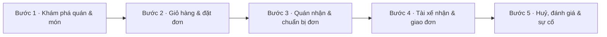
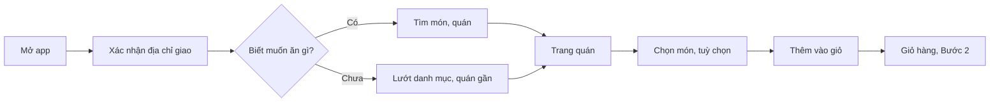
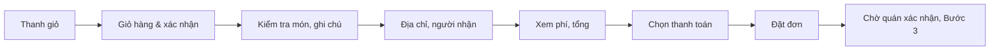
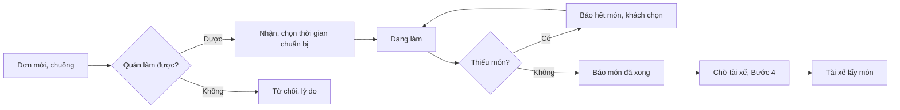
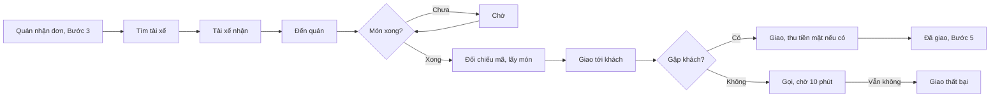
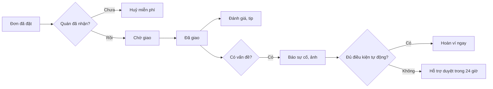

> **Mã:** DE06-PRD · **Trạng thái:** đã chốt · **Người viết:** Design · **SRS:** [SRS.md](SRS.md)

# PRD Đặt ship đồ ăn

> Đề gồm **1 tính năng**, là **1 luồng** gồm 5 bước và các màn hình: Khám phá quán & món → Giỏ hàng & đặt đơn → Quán nhận & chuẩn bị đơn → Tài xế nhận & giao đơn → Huỷ, đánh giá & sự cố. Sơ đồ chung xem [README](../README.md).

## 1. Bối cảnh và vấn đề

### 1.1 Bối cảnh

Nền tảng giao đồ ăn: khách chọn quán và món, đặt đơn; quán nhận và chuẩn bị; hệ thống tìm tài xế đúng lúc món xong; tài xế lấy món, giao tới khách; khách theo dõi trên bản đồ, đánh giá, báo sự cố nếu có. Đây là đề có **ba bên cùng thao tác trên một đơn** và **thời điểm phải khớp nhau** (món xong – tài xế tới).

Giờ trưa và tối là cao điểm: khách đói, muốn đồ ăn tới nhanh và nóng; quán vừa bán tại chỗ vừa nhận đơn online; tài xế muốn chạy được nhiều đơn, ít phải chờ. Một đơn đi qua ba ứng dụng, ba người, trong khoảng 30–45 phút. Bài toán thiết kế chính là **giữ ba bên cùng thấy một trạng thái**, đưa tài xế tới quán **đúng lúc món xong**, và xử lý công bằng khi có sự cố.

### 1.2 Vấn đề

| **Vấn đề** | **Hệ quả** |
| --- | --- |
| Danh sách quán dài, không biết quán nào giao nhanh | Chọn quán xa, chờ 1 tiếng |
| Chọn món xong mới biết quán đã đóng hoặc tạm ngưng | Mất công chọn lại |
| Phí giao chỉ biết ở bước cuối | Thấy đắt, bỏ đơn |
| Món nhiều tuỳ chọn (size, topping, cay) nhưng giao diện rối | Chọn sai, nhận món không như ý |
| Món đã hết vẫn hiện trên menu | Quán phải gọi khách đổi món, đơn chậm |
| Tổng tiền có nhiều loại phí khó hiểu | Khách thấy "phí chồng phí", bỏ đơn |
| Địa chỉ trong toà nhà, hẻm không rõ | Tài xế gọi hỏi nhiều lần, đồ ăn nguội |
| Đặt hộ người khác nhưng số điện thoại là của mình | Tài xế không liên lạc được người nhận |
| Món hết, giá đổi sau khi đã thêm vào giỏ | Đặt xong quán từ chối |
| Bấm đặt nhiều lần vì mạng chậm | Hai đơn trùng |
| Quầy ồn, không nghe chuông đơn mới | Đơn tự huỷ, khách bực, quán mất doanh thu |
| Món hết nhưng quên tắt trên app | Phải từ chối đơn hoặc gọi khách đổi món |
| Tài xế tới khi món chưa xong | Tài xế chờ lâu, bỏ đơn |
| Món xong sớm nhưng tài xế chưa tới | Đồ ăn nguội |
| Giờ cao điểm quá tải nhưng không có cách tạm dừng | Nhận đơn rồi làm trễ, bị đánh giá thấp |
| Tài xế tới quán quá sớm | Chờ lâu, mất thu nhập, bỏ đơn |
| Tài xế tới quá muộn | Đồ ăn nguội, khách đánh giá thấp quán |
| Quán đông, tài xế lấy nhầm đơn | Hai khách nhận sai món |
| Khách không biết tài xế đang ở đâu | Gọi hỏi liên tục, hoặc đi vắng khi tài xế tới |
| Tài xế tới nơi không gặp khách | Đứng chờ, không biết xử lý đồ ăn thế nào |
| Đặt nhầm nhưng không biết còn huỷ được không | Gọi hỗ trợ, hoặc để mặc rồi không nhận |
| Thiếu món phải chat với hỗ trợ, chờ lâu | Khách bực, đánh giá 1 sao cả quán lẫn app |
| Hoàn tiền lâu, không rõ hoàn bao nhiêu | Mất niềm tin |
| Đánh giá chung chung "ngon", "dở" | Quán không biết sửa gì |
| Khách đặt tiền mặt rồi không nhận | Tài xế, quán thiệt |

### 1.3 Mục tiêu

- ≥ 50% phiên mở app có thêm ít nhất 1 món vào giỏ.
- Thời gian từ mở app tới thêm món đầu tiên ≤ 90 giây (trung vị).
- Tỉ lệ đơn bị quán từ chối vì hết món ≤ 3%.
- Tỉ lệ từ mở giỏ tới đặt đơn thành công ≥ 65%.
- Tỉ lệ đơn tài xế phải gọi hỏi địa chỉ ≤ 15%.
- 0 đơn trùng do bấm đặt nhiều lần.
- Tỉ lệ đơn bị huỷ vì quán không phản hồi ≤ 2%.
- Thời gian trung vị từ đơn tới quán đến khi quán nhận ≤ 60 giây.
- Thời gian tài xế chờ tại quán trung vị ≤ 5 phút.
- ≥ 95% đơn có tài xế trong 10 phút kể từ khi bắt đầu tìm.
- Tỉ lệ lấy nhầm đơn ≤ 0,1%.
- Tỉ lệ giao thất bại do không liên lạc được khách ≤ 1%.
- ≥ 70% sự cố thiếu món, sai món được hoàn tiền tự động trong 5 phút.
- ≥ 35% đơn đã giao có đánh giá.
- Tỉ lệ khách đặt lại trong 30 ngày sau khi có sự cố được xử lý ≥ 60%.

## 2. Người dùng

| **Nhóm** | **Nhu cầu với tính năng này** |
| --- | --- |
| Dân văn phòng đặt trưa | Quán gần, giao nhanh, giá ổn; đặt lại món quen |
| Sinh viên | Rẻ, ít phí giao, đang có ưu đãi của quán; Biết rõ từng khoản phí, trả tiền mặt |
| Gia đình đặt tối | Quán nhiều món, đặt cho nhiều người |
| Người chưa biết ăn gì | Gợi ý theo danh mục, món bán chạy |
| Dân văn phòng | Giao tới toà nhà, ghi rõ tầng, sảnh; trả bằng ví |
| Người đặt hộ gia đình | Đổi tên, số điện thoại người nhận |
| Chủ quán nhỏ, tự đứng quầy | Chuông to, nhận một chạm, chữ to |
| Nhân viên quầy quán đông | Thấy đơn theo thứ tự, biết đơn nào trễ |
| Chủ quán | Tạm dừng nhận đơn khi quá tải, tắt món hết nhanh |
| Tài xế giao đồ ăn | Biết thu nhập trước khi nhận, điểm lấy, điểm giao rõ ràng, ít chờ |
| Khách | Thấy tài xế trên bản đồ, giờ tới chính xác, liên lạc được |
| Quán | Biết tài xế nào tới, khi nào tới; Nhận đánh giá cụ thể để cải thiện |
| Khách đặt nhầm | Huỷ nhanh, không mất tiền |
| Khách nhận thiếu, sai món | Báo bằng vài chạm, hoàn tiền ngay |
| Khách hài lòng | Khen quán, tip tài xế dễ dàng |

## 3. Phạm vi

### 3.1 Trong phạm vi (MVP)

**Bước 1 · Khám phá quán & món**

- Chọn địa chỉ giao; danh sách quán theo địa chỉ giao.
- Trang chủ: danh mục món (Cơm, Bún phở, Trà sữa…), quán gần bạn, đặt lại.
- Thẻ quán: ảnh, tên, khoảng cách, thời gian giao dự kiến, phí giao ước tính, trạng thái mở, đánh giá.
- Tìm kiếm quán và món, không dấu; lọc: đang mở, miễn phí giao, khoảng cách; sắp xếp.
- Trang quán: menu theo nhóm, món bán chạy, món hết hàng, giờ mở cửa.
- Tuỳ chọn món: size, topping, mức cay, ghi chú; giá cập nhật theo lựa chọn.

**Bước 2 · Giỏ hàng & đặt đơn**

- Giỏ hàng: sửa số lượng, tuỳ chọn, xoá món; ghi chú cho quán; dụng cụ ăn uống.
- Địa chỉ giao: chọn đã lưu, tìm mới, ghim bản đồ, chi tiết toà nhà, ghi chú cho tài xế; người nhận.
- Bảng giá: tạm tính, phí giao, phí dịch vụ, phí đơn nhỏ, phụ phí cao điểm, giảm phí giao của quán; giải thích từng khoản.
- Thanh toán: tiền mặt, ví liên kết.
- Đặt đơn, chống đặt trùng.

**Bước 3 · Quán nhận & chuẩn bị đơn**

- Nhận đơn mới: chuông lặp, đếm ngược 3 phút, nhận với thời gian chuẩn bị, hoặc từ chối có lý do.
- Danh sách đơn theo trạng thái: Mới, Đang làm, Chờ tài xế, Đã xong.
- Chi tiết đơn: món, tuỳ chọn, ghi chú, dụng cụ; thông tin tài xế khi có.
- Báo hết món sau khi đã nhận; gia hạn thời gian chuẩn bị; báo món đã xong.
- Bật tắt món, tuỳ chọn hết hàng; tạm ngưng nhận đơn.

**Bước 4 · Tài xế nhận & giao đơn**

- App tài xế: bật nhận đơn, yêu cầu đơn mới, nhận hoặc bỏ qua.
- Thời điểm tìm tài xế theo thời gian chuẩn bị của quán.
- Đến quán, đối chiếu và lấy món; chờ khi món chưa xong.
- Giao: dẫn đường, đến nơi, giao tận tay hoặc theo ghi chú có ảnh, thu tiền mặt.
- Không liên lạc được khách: quy trình chờ và giao thất bại.
- Khách theo dõi đơn: trạng thái, tài xế, bản đồ, giờ dự kiến; gọi, nhắn tin qua số trung gian.

**Bước 5 · Huỷ, đánh giá & sự cố**

- Khách huỷ đơn trước khi quán nhận; hướng dẫn khi không huỷ được nữa.
- Hoàn tiền về ví cho các trường hợp huỷ không do lỗi khách.
- Đánh giá quán (sao, nhãn, bình luận, ảnh) và tài xế (sao, nhãn).
- Tip tài xế bằng ví.
- Báo sự cố: thiếu món, sai món, đổ vỡ, chất lượng, không nhận được đơn; hoàn tiền tự động hoặc qua duyệt.
- Lịch sử đơn, chi tiết đơn, đặt lại.
- Khoá tiền mặt với khách nhiều lần không nhận.

### 3.2 Ngoài phạm vi

- Mã giảm giá của nền tảng, chương trình khuyến mãi → phase sau (chỉ có giá giảm do quán đặt sẵn trên món).
- Đặt trước theo giờ.
- Đặt nhóm, nhiều người cùng chọn món.
- Gợi ý cá nhân hoá bằng AI.
- Mã giảm giá nền tảng, điểm thưởng.
- Đặt hẹn giờ.
- Thanh toán thẻ trực tiếp.
- Tách hoá đơn, xuất hoá đơn VAT.
- Sửa menu, giá, ảnh (làm trên web quản lý quán, không thuộc đề).
- Báo cáo doanh thu, đối soát tiền với nền tảng.
- Nhiều chi nhánh, phân quyền nhân viên.
- Kết nối máy POS, in phiếu bếp tự động → phase sau.
- Ghép nhiều đơn cho một tài xế → phase sau.
- Đăng ký, duyệt hồ sơ tài xế; ví và rút tiền của tài xế.
- Tài xế riêng của quán.
- Giao bằng xe ô tô, giao hàng cồng kềnh.
- Màn xử lý sự cố của nhân viên hỗ trợ (chỉ mô tả kết quả khách thấy).
- Quán trả lời đánh giá → phase sau.
- Chat trực tiếp với hỗ trợ trong app (dùng kênh hỗ trợ chung).
- Bồi thường bằng mã giảm giá.

## 4. Nguyên tắc sản phẩm

### 4.1 Ba con số luôn có mặt

Mỗi thẻ quán đều có **thời gian giao dự kiến**, **phí giao ước tính** và **khoảng cách**, tính theo địa chỉ giao đang chọn.

### 4.2 Không cho chọn thứ không đặt được

Quán đóng cửa hoặc tạm ngưng, món hết đều hiện rõ và không thêm vào giỏ được.

### 4.3 Tuỳ chọn món rõ như thực đơn giấy

Nhóm tuỳ chọn bắt buộc đánh dấu rõ, có giá cộng thêm từng lựa chọn, tổng giá cập nhật ngay.

### 4.4 Mọi khoản phí đều có lời giải thích

Chạm vào khoản phí nào cũng có một câu giải thích vì sao có phí đó.

### 4.5 Địa chỉ cho tài xế, không chỉ cho bản đồ

Ngoài ghim bản đồ, luôn có chỗ cho chi tiết "Toà A, tầng 5" và ghi chú cho tài xế.

### 4.6 Kiểm tra trước khi gửi quán

Giá, món hết, quán mở đều được kiểm tra lại khi mở giỏ và khi bấm đặt.

### 4.7 Không bỏ lỡ đơn

Đơn mới kêu lặp lại tới khi có người chạm; màn hình đơn mới chiếm toàn màn hình.

### 4.8 Một chạm cho việc thường gặp

Nhận đơn, báo xong món, tắt món hết đều một chạm, nút lớn.

### 4.9 Quán kiểm soát tải

Quán chọn thời gian chuẩn bị và có thể tạm ngưng; app không ép quán nhận đơn khi quá tải.

### 4.10 Đến đúng lúc món xong

Hệ thống chọn thời điểm tìm tài xế theo thời gian chuẩn bị, không phải ngay khi đặt đơn.

### 4.11 Lấy đúng đơn

Mã đơn 6 ký tự to rõ ở App quán, App tài xế và trên túi đồ ăn (quán ghi tay); tài xế đối chiếu trước khi lấy.

### 4.12 Ba bên cùng một sự thật

Mỗi bước của tài xế cập nhật ngay cho khách và quán.

### 4.13 Riêng tư khi liên lạc

Gọi và nhắn qua số trung gian, không lộ số thật.

### 4.14 Tin khách trước, kiểm tra sau

Sự cố nhỏ có ảnh được hoàn tiền tự động; kiểm tra lạm dụng dựa trên lịch sử, không bắt mọi khách chờ.

### 4.15 Nói rõ còn huỷ được không

Nút huỷ chỉ xuất hiện khi huỷ được; khi không, nói vì sao và có lối tới hỗ trợ.

### 4.16 Đánh giá để cải thiện, không để trút giận

Nhãn cụ thể giúp quán biết sửa gì; đánh giá thấp có gợi ý báo sự cố để được hoàn tiền.

## 5. Quy tắc nghiệp vụ

| **Quy tắc** | **Giá trị** |
| --- | --- |
| Bán kính giao | Tối đa 10 km theo đường đi từ quán tới địa chỉ giao |
| Phí giao ước tính | 15.000 ₫ cho 3 km đầu + 5.000 ₫ mỗi km tiếp theo, làm tròn 1.000 ₫ |
| Thời gian giao dự kiến | Thời gian chuẩn bị trung bình của quán + thời gian đi từ quán tới khách |
| Trạng thái quán | Đang mở, Sắp đóng (≤ 30 phút), Đóng cửa, Tạm ngưng |
| Giỏ hàng | Chỉ chứa món của 1 quán |
| Món hết | Quán tự bật tắt (Bước 3); hết món thì không thêm được |
| Phí giao | Theo khoảng cách (Bước 1) + phụ phí cao điểm hoặc thời tiết xấu 5.000 ₫ khi có |
| Phí dịch vụ | 3.000 ₫ mỗi đơn |
| Phí đơn nhỏ | 5.000 ₫ khi tạm tính < 40.000 ₫ |
| Giới hạn đơn | Tạm tính tối đa 3.000.000 ₫; tối đa 30 món |
| Tiền mặt | Tổng ≤ 1.000.000 ₫ |
| Đơn đang chạy | Tối đa 3 đơn cùng lúc mỗi khách |
| Dụng cụ ăn uống | Mặc định không lấy |
| Thời gian xác nhận | 3 phút; quá thì đơn tự huỷ |
| Bỏ lỡ liên tiếp | 3 đơn → quán tự tạm ngưng nhận đơn |
| Thời gian chuẩn bị | Quán chọn 5–60 phút; mặc định theo cài đặt của quán |
| Gia hạn | 1 lần mỗi đơn, +5 hoặc +10 phút |
| Báo hết món sau khi nhận | Khách có 3 phút để chọn bỏ món hoặc huỷ đơn |
| Tạm ngưng | 30 phút, 1 giờ, hết ngày, hoặc tới khi bật lại |
| Thời điểm tìm | Chuẩn bị ≤ 15 phút → tìm ngay khi quán nhận; dài hơn → tìm khi còn 10 phút |
| Bán kính tìm | 3 km quanh quán, +1 km mỗi phút, tối đa 6 km |
| Thời gian trả lời | 20 giây mỗi tài xế |
| Không tìm được | 25 phút kể từ khi bắt đầu tìm → huỷ đơn, hoàn tiền |
| Thu nhập tài xế | Phí giao (gồm phụ phí) − 10% chiết khấu + thưởng (nếu có) + 100% tip |
| Chờ khách | Gọi ≥ 2 lần, chờ 10 phút tại điểm giao |
| Ảnh xác nhận | Bắt buộc khi không giao tận tay |
| Khách tự huỷ | Chỉ khi quán chưa nhận đơn; miễn phí |
| Hoàn tiền về ví | ≤ 5 phút |
| Đánh giá | Trong 7 ngày sau khi giao |
| Tip | 5.000, 10.000, 20.000 ₫ hoặc số khác ≤ 200.000 ₫; trong 24 giờ sau khi giao |
| Báo sự cố | Trong 2 giờ sau khi giao; 1 yêu cầu mỗi đơn |
| Hoàn tự động | Tổng hoàn ≤ 100.000 ₫ và khách có ≤ 2 sự cố được duyệt trong 30 ngày |
| Khoá tiền mặt | 2 lần không nhận đơn tiền mặt trong 90 ngày → chỉ dùng ví 30 ngày |

- Đơn giá phí giao, bán kính là **cấu hình theo thành phố**.
- Các mức phí là **cấu hình theo thành phố**.

## 6. Luồng trải nghiệm

### 6.1 Toàn bộ luồng

### 6.2 Bước 1 · Khám phá quán & món

| **Bước** | **Giai đoạn** | **Trải nghiệm** | **Đầu ra** |
| --- | --- | --- | --- |
| 1 | Địa chỉ giao | Tự định vị hoặc chọn địa chỉ đã lưu | Địa chỉ giao |
| 2 | Khám phá | Danh mục, quán gần, đặt lại, tìm kiếm | Quán muốn xem |
| 3 | Xem menu | Nhóm món, món bán chạy, giá | Món muốn đặt |
| 4 | Tuỳ chọn | Size, topping, cay, ghi chú | Món trong giỏ |

### 6.3 Bước 2 · Giỏ hàng & đặt đơn

| **Bước** | **Giai đoạn** | **Trải nghiệm** | **Đầu ra** |
| --- | --- | --- | --- |
| 1 | Giỏ | Danh sách món, sửa nhanh, ghi chú cho quán | Món cuối |
| 2 | Địa chỉ | Địa chỉ đã lưu hoặc mới, chi tiết toà nhà, người nhận | Nơi giao rõ ràng |
| 3 | Tiền | Từng khoản phí, tổng | Khách biết trả bao nhiêu |
| 4 | Đặt | Thanh toán, nút "Đặt đơn · {tổng}" | Đơn gửi quán |

### 6.4 Bước 3 · Quán nhận & chuẩn bị đơn

| **Bước** | **Giai đoạn** | **Trải nghiệm** | **Đầu ra** |
| --- | --- | --- | --- |
| 1 | Đơn tới | Toàn màn đơn mới, chuông lặp, đếm ngược | Quán biết có đơn |
| 2 | Quyết định | Nhận với thời gian chuẩn bị hoặc từ chối | Đơn đang làm hoặc huỷ |
| 3 | Làm món | Danh sách đơn đang làm, đơn nào sắp trễ | Món xong |
| 4 | Bàn giao | Báo xong; thấy tài xế nào tới, mã đơn | Tài xế lấy món |

### 6.5 Bước 4 · Tài xế nhận & giao đơn

| **Bước** | **Giai đoạn** | **Khách thấy** | **Tài xế thấy** | **Quán thấy** |
| --- | --- | --- | --- | --- |
| 1 | Tìm tài xế | "Đang tìm tài xế" | Yêu cầu đơn | "Đang tìm tài xế" |
| 2 | Đến quán | Tài xế, biển số, "đang tới quán" | Dẫn đường tới quán | Tài xế, thời gian tới |
| 3 | Lấy món | "Tài xế đã lấy món" | Mã đơn, danh sách món | Đơn sang Đã xong |
| 4 | Giao | Bản đồ, giờ tới | Dẫn đường, địa chỉ chi tiết, ghi chú | – |
| 5 | Kết thúc | "Đã giao", đánh giá | Thu tiền, thu nhập | – |

### 6.6 Bước 5 · Huỷ, đánh giá & sự cố

| **Bước** | **Giai đoạn** | **Trải nghiệm** | **Đầu ra** |
| --- | --- | --- | --- |
| 1 | Huỷ (nếu cần) | Nút huỷ khi còn chờ quán; lý do | Đơn huỷ, hoàn ví |
| 2 | Đánh giá | Sao, nhãn cho quán và tài xế; tip | Đánh giá |
| 3 | Sự cố | Chọn vấn đề, món, ảnh; thấy số tiền hoàn | Hoàn tiền |
| 4 | Đặt lại | Từ lịch sử đơn | Giỏ mới |

## 7. Use Cases, User Stories và Acceptance Criteria

### Bước 1 · Khám phá quán & món

#### UC1. Địa chỉ giao và danh sách quán

##### US1.1 Chọn địa chỉ giao

User Story: Là khách, tôi muốn app biết tôi đang ở đâu để chỉ hiện quán giao được tới tôi.

AC01: Mở app tự định vị; hiện địa chỉ ở đầu trang chủ, chạm để đổi.

AC02: Chọn từ địa chỉ đã lưu (Nhà, Công ty) hoặc tìm địa chỉ mới.

AC03: Đổi địa chỉ → danh sách quán, thời gian, phí giao cập nhật.

AC04: Địa chỉ ngoài vùng phục vụ → báo rõ, không hiện quán.

##### US1.2 Lướt quán

AC01: Trang chủ có danh mục, Quán gần bạn, Đặt lại (đơn đã giao gần đây).

AC02: Mỗi thẻ quán có thời gian dự kiến, phí giao, khoảng cách, trạng thái, điểm đánh giá.

AC03: Quán đóng cửa xếp cuối, ghi giờ mở cửa lại.

#### UC2. Tìm kiếm và lọc

##### US2.1 Tìm món, quán

User Story: Là khách, tôi muốn gõ "bun bo" và thấy các quán có bún bò gần tôi.

AC01: Tìm theo tên quán và tên món, không dấu.

AC02: Kết quả nhóm theo quán, hiện món khớp trong quán.

AC03: Lọc: Đang mở, Miễn phí giao, ≤ 3 km; sắp xếp: Phù hợp, Gần nhất, Giao nhanh nhất, Đánh giá cao.

#### UC3. Xem menu và tuỳ chọn món

##### US3.1 Xem menu quán

AC01: Menu theo nhóm do quán đặt; thanh nhóm dính đầu trang, chạm để nhảy tới nhóm.

AC02: Món hết hiện mờ, ghi "Hết món".

AC03: Quán đóng cửa vẫn xem được menu, không thêm giỏ được.

##### US3.2 Chọn tuỳ chọn món

User Story: Là khách, tôi muốn chọn size, topping, mức cay và thấy giá ngay.

AC01: Nhóm bắt buộc ghi "Bắt buộc · chọn 1"; nhóm tuỳ chọn ghi "Chọn tối đa {n}".

AC02: Mỗi lựa chọn có giá cộng thêm; tổng cập nhật theo số lượng.

AC03: Thiếu nhóm bắt buộc → nút Thêm vào giỏ chỉ rõ nhóm còn thiếu.

AC04: Giỏ đang có món của quán khác → hỏi thay giỏ mới hay giữ giỏ cũ.

### Bước 2 · Giỏ hàng & đặt đơn

#### UC4. Xem và sửa giỏ

##### US4.1 Sửa món trong giỏ

AC01: Mỗi dòng: tên, tuỳ chọn, ghi chú, số lượng, giá; chạm để sửa tuỳ chọn.

AC02: Giảm số lượng về 0 → xoá, có Hoàn tác.

AC03: Món hết, giá đổi kể từ lúc thêm → đánh dấu rõ; món hết không được đặt.

##### US4.2 Ghi chú, dụng cụ

AC01: Ghi chú cho quán ≤ 200 ký tự.

AC02: Công tắc "Lấy dụng cụ ăn uống", mặc định tắt.

#### UC5. Địa chỉ và người nhận

##### US5.1 Giao đúng chỗ

User Story: Là khách ở toà nhà, tôi muốn ghi rõ toà, tầng để tài xế khỏi gọi hỏi.

AC01: Chọn địa chỉ đã lưu hoặc tìm mới; kéo ghim cho chính xác.

AC02: Ô chi tiết (toà, tầng, phòng) và ghi chú cho tài xế.

AC03: Lưu địa chỉ mới với tên (Nhà, Công ty, khác).

##### US5.2 Đặt hộ

AC01: Đổi tên, số điện thoại người nhận cho đơn này; không đổi hồ sơ.

#### UC6. Phí và thanh toán

##### US6.1 Hiểu tổng tiền

User Story: Là khách, tôi muốn biết từng khoản phí là gì để thấy giá hợp lý.

AC01: Liệt kê tạm tính, phí giao, phí dịch vụ, phí đơn nhỏ (nếu có), phụ phí (nếu có), giảm phí giao (nếu có), tổng.

AC02: Chạm biểu tượng ⓘ cạnh mỗi khoản → giải thích.

AC03: Phí đơn nhỏ → gợi ý "Thêm {x} ₫ để bỏ phí đơn nhỏ".

##### US6.2 Chọn thanh toán

AC01: Tiền mặt (ẩn khi tổng > 1.000.000 ₫, ghi lý do) hoặc ví liên kết (hiện số dư).

AC02: Ví không đủ số dư → báo, gợi ý tiền mặt.

#### UC7. Đặt đơn

AC01: Bấm "Đặt đơn" chỉ tạo 1 đơn dù bấm nhiều lần.

AC02: Quán vừa đóng, món vừa hết, giá đổi → báo cụ thể, không tạo đơn.

AC03: Đặt thành công → màn theo dõi đơn ở trạng thái "Chờ quán xác nhận".

### Bước 3 · Quán nhận & chuẩn bị đơn

#### UC8. Nhận hoặc từ chối đơn

##### US8.1 Không bỏ lỡ đơn mới

User Story: Là chủ quán, tôi muốn app kêu to và lặp lại khi có đơn để không bỏ lỡ lúc đang bận.

AC01: Đơn mới → âm thanh lặp mỗi 5 giây, màn đơn mới toàn màn hình, đếm ngược 3 phút.

AC02: Nhiều đơn mới cùng lúc → hiện lần lượt, ghi "1/3".

AC03: App chạy nền hoặc màn hình tắt vẫn có thông báo kèm âm thanh.

##### US8.2 Nhận đơn

AC01: Chọn thời gian chuẩn bị (gợi ý theo số món), bấm "Nhận đơn".

AC02: Nhận xong, khách thấy "Quán đang chuẩn bị" và hệ thống bắt đầu tìm tài xế.

##### US8.3 Từ chối đơn

AC01: Lý do: Hết món (chọn món hết), Quán quá tải, Sắp đóng cửa, Khác.

AC02: Từ chối vì hết món → món đó tự chuyển "Hết món".

AC03: Quá 3 phút không phản hồi → đơn tự huỷ; 3 đơn liên tiếp → quán tự tạm ngưng.

#### UC9. Chuẩn bị đơn

##### US9.1 Theo dõi đơn đang làm

AC01: Đơn đang làm xếp theo thời điểm phải xong, đơn sắp trễ (≤ 2 phút) nổi bật.

AC02: Chi tiết đơn: món, tuỳ chọn, ghi chú, dụng cụ, mã đơn, tên khách viết tắt.

##### US9.2 Báo hết món sau khi đã nhận

User Story: Là quán, tôi muốn báo một món vừa hết để khách chọn bỏ món hoặc huỷ đơn.

AC01: Chọn món hết → khách nhận thông báo, có 3 phút để chọn.

AC02: Khách không trả lời → bỏ món đó, hoàn tiền món nếu đã trả ví.

AC03: Mọi món đều hết → đơn huỷ, không tính lỗi cho khách.

##### US9.3 Gia hạn và báo xong

AC01: Quá thời gian chuẩn bị → nhắc quán; quán gia hạn +5 hoặc +10 phút một lần; khách được báo giờ mới.

AC02: Bấm "Món đã xong" → đơn chuyển chờ tài xế; tài xế nhận thông báo.

AC03: Thấy tên, biển số, thời gian tài xế tới quán khi đã có tài xế.

#### UC10. Trạng thái quán và món

AC01: Tắt món hết, tuỳ chọn hết bằng một chạm; có tìm món.

AC02: Tạm ngưng nhận đơn 30 phút, 1 giờ, hết ngày, hoặc tới khi bật lại; khách thấy "Tạm ngưng".

### Bước 4 · Tài xế nhận & giao đơn

#### UC11. Tìm và nhận đơn

##### US11.1 Quyết định nhanh

User Story: Là tài xế, tôi muốn thấy quán, quãng đường, thu nhập trước khi nhận.

AC01: Thẻ yêu cầu: tên quán, khoảng cách tới quán, quãng đường giao, thu nhập dự kiến, giờ món xong, tiền mặt cần thu (nếu có).

AC02: Đếm ngược 20 giây; nhận bằng một chạm.

AC03: Hết giờ hoặc bỏ qua → gửi tài xế khác.

##### US11.2 Không tìm được tài xế

AC01: Khách thấy "Đang tìm tài xế" với thời gian đã tìm.

AC02: Quá 25 phút → đơn huỷ, hoàn tiền, khách được xin lỗi kèm gợi ý đặt lại.

#### UC12. Lấy món

##### US12.1 Lấy đúng đơn

User Story: Là tài xế, tôi muốn đối chiếu mã đơn để không lấy nhầm.

AC01: Đến quán (trong 100 m) → nút "Đã đến quán"; quán thấy tài xế đã tới.

AC02: Màn lấy món: mã đơn chữ to, danh sách món để tích kiểm.

AC03: Món chưa xong → hiện "Quán đang chuẩn bị, xong lúc {giờ}"; chưa cho bấm "Đã lấy món".

AC04: Chờ quá 10 phút sau giờ hẹn → nút báo hỗ trợ.

#### UC13. Giao đơn

##### US13.1 Theo dõi đơn

User Story: Là khách, tôi muốn thấy tài xế đang ở đâu và mấy giờ tới.

AC01: Từ khi tài xế lấy món: bản đồ vị trí tài xế cập nhật mỗi 5 giây, giờ tới dự kiến.

AC02: Thấy tên, ảnh, biển số, nút gọi, nhắn tin.

##### US13.2 Giao hàng

AC01: Tài xế thấy địa chỉ chi tiết, ghi chú, tên người nhận; gọi qua số trung gian.

AC02: Giao tận tay → bấm "Đã giao"; để theo ghi chú → bắt buộc chụp ảnh.

AC03: Đơn tiền mặt → màn thu tiền ghi rõ số tiền.

##### US13.3 Không gặp khách

AC01: Tài xế gọi ≥ 2 lần qua app; khách nhận thông báo "Tài xế đã tới".

AC02: Sau 10 phút chờ tại điểm giao → được bấm "Giao thất bại" với lý do.

AC03: Khách bị tính tiền đơn; tài xế vẫn nhận thu nhập.

### Bước 5 · Huỷ, đánh giá & sự cố

#### UC14. Huỷ đơn

##### US14.1 Huỷ khi quán chưa nhận

User Story: Là khách đặt nhầm, tôi muốn huỷ ngay khi quán chưa nhận để không mất tiền.

AC01: Đơn chờ quán xác nhận → nút "Huỷ đơn"; chọn lý do; huỷ ngay, hoàn ví.

AC02: Quán vừa nhận đúng lúc khách bấm huỷ → báo không huỷ được nữa.

##### US14.2 Khi không còn huỷ được

AC01: Quán đã nhận → không có nút huỷ; hiện "Quán đã bắt đầu chuẩn bị" và nút "Cần hỗ trợ".

#### UC15. Đánh giá và tip

##### US15.1 Đánh giá quán, tài xế

AC01: Sau khi giao, màn đánh giá hiện tự động một lần; vào lại được từ chi tiết đơn trong 7 ngày.

AC02: Quán: 1–5 sao, nhãn theo số sao, bình luận ≤ 300 ký tự, ≤ 3 ảnh. Tài xế: 1–5 sao, nhãn.

AC03: Quán ≤ 2 sao → bắt buộc chọn ít nhất 1 nhãn; nhãn Thiếu món, Sai món → gợi ý báo sự cố.

##### US15.2 Tip tài xế

AC01: Chọn mức tip; trừ ví; tài xế nhận 100%.

AC02: Ví không đủ → báo; không ảnh hưởng đánh giá.

#### UC16. Báo sự cố

##### US16.1 Thiếu, sai, đổ vỡ, chất lượng

User Story: Là khách nhận thiếu món, tôi muốn báo trong vài chạm và được hoàn tiền ngay.

AC01: Chọn vấn đề, chọn món và số lượng bị ảnh hưởng, chụp ảnh (bắt buộc).

AC02: Hiện số tiền hoàn trước khi gửi.

AC03: Đủ điều kiện → hoàn ví ngay, báo thành công; không đủ → hỗ trợ duyệt trong 24 giờ.

##### US16.2 Không nhận được đơn

AC01: Đơn báo đã giao nhưng khách không nhận → gửi yêu cầu; hỗ trợ đối chiếu ảnh, vị trí giao.

#### UC17. Lịch sử và đặt lại

AC01: Lịch sử 6 tháng; mỗi đơn: quán, ngày, món, tổng, trạng thái.

AC02: "Đặt lại" thêm món còn bán vào giỏ (Bước 2).

## 8. Chỉ số theo dõi

| **Chỉ số** | **Định nghĩa** | **Mục tiêu MVP** |
| --- | --- | --- |
| Tỉ lệ thêm giỏ | Phiên có thêm món / phiên mở app | ≥ 50% |
| Thời gian tới món đầu tiên | Mở app → thêm món đầu tiên | ≤ 90 giây (trung vị) |
| Tỉ lệ tìm có kết quả | Lượt tìm có kết quả / tổng lượt tìm | ≥ 85% |
| Tỉ lệ dùng Đặt lại | Đơn từ Đặt lại / tổng đơn | Theo dõi |
| Từ chối vì hết món | Đơn quán từ chối lý do hết món / tổng đơn | ≤ 3% |
| Tỉ lệ đặt đơn | Đơn thành công / phiên mở giỏ | ≥ 65% |
| Tỉ lệ có chi tiết địa chỉ | Đơn có chi tiết toà, tầng hoặc ghi chú tài xế / tổng đơn | Theo dõi |
| Tỉ lệ tài xế gọi hỏi địa chỉ | Đơn tài xế gọi khách trước khi tới / tổng đơn | ≤ 15% |
| Tỉ lệ chạm giải thích phí | Phiên chạm ⓘ / phiên mở giỏ | Theo dõi |
| Đơn trùng | Đơn trùng do bấm nhiều lần | 0 |
| Tỉ lệ quán không phản hồi | Đơn tự huỷ do quá 3 phút / tổng đơn | ≤ 2% |
| Thời gian nhận đơn | Đơn tới quán → quán nhận (trung vị) | ≤ 60 giây |
| Tỉ lệ từ chối | Đơn quán từ chối / tổng đơn | ≤ 5% |
| Tỉ lệ báo hết món sau nhận | Đơn có báo hết món / đơn đã nhận | ≤ 3% |
| Đúng giờ chuẩn bị | Đơn báo xong trước giờ hẹn (gồm gia hạn) / đơn đã nhận | ≥ 85% |
| Tài xế chờ tại quán | Tài xế tới quán → lấy món (trung vị) | ≤ 5 phút |
| Tỉ lệ có tài xế trong 10 phút | Đơn có tài xế ≤ 10 phút từ khi tìm / đơn cần tài xế | ≥ 95% |
| Tỉ lệ huỷ vì không có tài xế | Đơn huỷ lý do này / tổng đơn | ≤ 1% |
| Tài xế chờ tại quán | Đến quán → lấy món (trung vị) | ≤ 5 phút |
| Món chờ tài xế | Quán báo xong → tài xế lấy (trung vị) | ≤ 5 phút |
| Lấy nhầm | Khiếu nại nhận nhầm đơn / tổng đơn | ≤ 0,1% |
| Giao thất bại | Đơn `GIAO_THAT_BAI` / tổng đơn | ≤ 1% |
| Đúng giờ | Đơn giao trước giờ dự kiến cuối / tổng đơn | ≥ 85% |
| Hoàn tự động | Sự cố hoàn tự động trong 5 phút / sự cố thiếu, sai món | ≥ 70% |
| Tỉ lệ đánh giá | Đơn có đánh giá / đơn đã giao | ≥ 35% |
| Tỉ lệ tip | Đơn có tip / đơn đã giao | Theo dõi |
| Tỉ lệ sự cố | Đơn có sự cố / đơn đã giao | ≤ 3% |
| Quay lại sau sự cố | Khách đặt lại trong 30 ngày sau sự cố được xử lý | ≥ 60% |
| Huỷ bởi khách | Đơn khách huỷ / tổng đơn | Theo dõi |

## 9. Phụ thuộc và rủi ro

| **Mục** | **Mô tả** | **Hướng xử lý** |
| --- | --- | --- |
| Dữ liệu menu do quán nhập | Ảnh xấu, giá sai, quên tắt món hết | Quán bật tắt món nhanh (Bước 3); nhắc khi bị từ chối vì hết món |
| Thời gian dự kiến | Sai lệch giờ cao điểm | Tính từ dữ liệu thực tế 7 ngày, cập nhật mỗi 15 phút |
| Dịch vụ bản đồ | Tính đường đi chậm | Ước tính theo đường chim bay × 1,3 khi chưa có kết quả |
| Ví liên kết | Lỗi, chậm khi trừ tiền | Thời gian chờ 15 giây, báo lỗi rõ, gợi ý tiền mặt |
| Phụ phí thời tiết | Khách phản ứng | Hiện nhãn và giải thích; chỉ áp khi vận hành bật theo khu vực |
| Đơn tiền mặt bị bom | Khách không nhận hàng | Giới hạn tiền mặt; khoá tiền mặt với khách có 2 lần không nhận (Bước 5) |
| Thiết bị quán | Điện thoại cũ, tắt âm, chế độ tiết kiệm pin | Kiểm tra quyền thông báo, âm lượng khi bật nhận đơn; nhắc tắt tối ưu pin |
| Mạng quán yếu | Đơn tới chậm | Push dự phòng; trạng thái mạng trên đầu app |
| Quán lạm dụng thời gian chuẩn bị dài | Khách chờ lâu | Thời gian dự kiến cho khách dùng số thực tế (Bước 1) |
| Thiếu tài xế giờ cao điểm, mưa | Đơn chờ lâu | Phụ phí (Bước 2), thưởng thêm cho tài xế khi tìm lâu |
| Định vị tài xế | Mất GPS trong hẻm, toà nhà | Hiện "Cập nhật {n} giây trước"; không suy đoán vị trí |
| Số trung gian | Lỗi nhà mạng | Nhắn tin trong app luôn khả dụng |
| An toàn thực phẩm | Đồ ăn của đơn giao thất bại | Tài xế không giao lại cho người khác; hướng dẫn xử lý theo chính sách |
| Lạm dụng hoàn tiền | Báo sự cố giả | Ngưỡng tự động theo lịch sử; ảnh bắt buộc; hỗ trợ duyệt khi vượt ngưỡng |
| Đánh giá ác ý | Quán bị đánh giá thấp không công bằng | Chỉ khách đã nhận đơn mới đánh giá; ẩn bình luận vi phạm theo báo cáo |
| Tranh chấp với quán | Quán không đồng ý bị trừ tiền | Quán khiếu nại trên web quản lý (ngoài phạm vi) |

## 10. Câu hỏi mở

> Mọi câu hỏi dưới đây đã được PO chốt ngày 20/11/2026; quyết định ghi sau mỗi câu và đã cập nhật vào SRS.

- Có cho đặt món của nhiều quán trong một đơn? → **Đã chốt:** Không. Giỏ chỉ có 1 quán (SRS BR-09).
- Quán đóng cửa có hiện trong kết quả tìm kiếm? → **Đã chốt:** Có, xếp cuối, ghi giờ mở lại (SRS BR-04).
- Thời gian dự kiến hiện một số hay khoảng? → **Đã chốt:** Khoảng 10 phút, ví dụ "25–35 phút" (SRS BR-03).
- Có hiện quán ngoài bán kính 10 km? → **Đã chốt:** Không (SRS BR-02).
- Trừ tiền ví lúc nào? → **Đã chốt:** Ngay khi đặt đơn; hoàn tự động nếu đơn bị huỷ không do lỗi khách (SRS BR-16).
- Tip cho tài xế đặt ở bước nào? → **Đã chốt:** Sau khi giao, ở màn đánh giá (Bước 5), không ở bước đặt đơn.
- Giỏ hàng giữ bao lâu? → **Đã chốt:** 24 giờ, lưu theo tài khoản (SRS BR-11).
- Có cho đổi phương thức thanh toán sau khi đặt? → **Đã chốt:** Không (SRS BR-16).
- Tìm tài xế lúc quán nhận hay lúc món xong? → **Đã chốt:** Lúc quán nhận nếu thời gian chuẩn bị ≤ 15 phút; dài hơn thì bắt đầu tìm khi còn 10 phút (Bước 4 BR-34).
- Quán có huỷ đơn sau khi đã nhận? → **Đã chốt:** Chỉ qua "Báo hết món" (bỏ hết món) hoặc gọi hỗ trợ; không có nút huỷ tự do (SRS BR-28).
- Ai xác nhận đã bàn giao cho tài xế? → **Đã chốt:** Tài xế bấm "Đã lấy món" (Bước 4); quán chỉ thấy trạng thái (SRS BR-30).
- Món tắt "hết" có tự bật lại? → **Đã chốt:** Quán chọn "Hết hôm nay" (tự bật lúc mở cửa hôm sau) hoặc "Hết tới khi bật lại" (SRS BR-32).
- Tài xế có ứng tiền trả quán với đơn tiền mặt? → **Đã chốt:** Không. Nền tảng thanh toán cho quán; tài xế chỉ thu tiền khách và đối soát với nền tảng (SRS BR-42).
- Tài xế huỷ sau khi nhận thì sao? → **Đã chốt:** Trước khi lấy món: tìm tài xế khác, tối đa 2 lần. Sau khi lấy món: không huỷ trong app, phải báo sự cố qua hỗ trợ (SRS BR-46).
- Có cho khách đổi địa chỉ khi đang giao? → **Đã chốt:** Không ở MVP; khách nhắn tài xế (SRS BR-44).
- Ảnh xác nhận có hiện cho khách? → **Đã chốt:** Có, trong chi tiết đơn (SRS BR-42).
- Đơn tiền mặt có sự cố thì hoàn bằng gì? → **Đã chốt:** Hoàn vào ví của khách (SRS BR-53).
- Đánh giá tài xế có công khai? → **Đã chốt:** Không; chỉ dùng nội bộ. Đánh giá quán công khai với tên viết tắt (SRS BR-50).
- Khách huỷ sau khi quán nhận qua hỗ trợ có mất tiền? → **Đã chốt:** Do hỗ trợ quyết định theo từng trường hợp; app chỉ dẫn tới hỗ trợ (SRS BR-47).
- Ai chịu tiền bồi hoàn? → **Đã chốt:** Thiếu, sai, chất lượng → trừ vào tiền quán; đổ vỡ khi giao → nền tảng chịu (SRS BR-58).
