> **Mã:** DE06-SRS · **Trạng thái:** đã chốt · **Người viết:** Design · **PRD:** [PRD.md](PRD.md)

# UC-DE06 - Đặt ship đồ ăn

> SRS này mô tả **1 tính năng**, là **1 luồng** gồm 4 bước: Khám phá quán & món → Giỏ hàng & đặt đơn → Theo dõi đơn → Huỷ, đánh giá & sự cố. Mã BR, MSG, UC, SCR đánh số liên tục trong toàn tài liệu. Sơ đồ chung xem [README](../README.md).

## 1. Tổng quan

| **Mục** | **Nội dung** |
| --- | --- |
| Mục tiêu | Ứng dụng đặt đồ ăn giao tận nơi, nhìn từ phía khách: chọn quán và món, đặt đơn, theo dõi quán chuẩn bị và tài xế giao tới trên bản đồ, nhận đồ rồi đánh giá, báo sự cố nếu có |
| Actor | Khách · App khách · Máy chủ · Dịch vụ bản đồ · Ví liên kết · Tổng đài số trung gian · Nhân viên hỗ trợ (hệ thống nội bộ) · Quán, tài xế (nhận kết quả qua ứng dụng riêng, ngoài phạm vi) |
| Luồng | Bước 1 Khám phá quán & món → Bước 2 Giỏ hàng & đặt đơn → Bước 3 Theo dõi đơn → Bước 4 Huỷ, đánh giá & sự cố |
| Ngoài phạm vi | Ứng dụng của quán (nhận đơn, chuẩn bị, quản lý món) và của tài xế (nhận đơn, lấy món, giao), web quản lý quán, trang quản trị và màn xử lý của nhân viên hỗ trợ, ví điện tử (dùng ví liên kết có sẵn), mã giảm giá và khuyến mãi của nền tảng, đặt hẹn giờ, giao hàng không phải đồ ăn |
| Nền tảng | App khách iOS / Android |

### Các bước của luồng

| **Bước** | **Mục tiêu** | **Phạm vi** |
| --- | --- | --- |
| Bước 1 · Khám phá quán & món | Khách tìm được quán, món phù hợp với địa chỉ giao; chọn tuỳ chọn món và thêm vào giỏ | Địa chỉ giao, trang chủ, danh mục, thẻ quán, tìm kiếm, lọc, sắp xếp, trang quán, tuỳ chọn món, thêm giỏ |
| Bước 2 · Giỏ hàng & đặt đơn | Khách xác nhận món, địa chỉ, người nhận, phí, thanh toán và đặt đơn | Giỏ hàng, ghi chú, dụng cụ, địa chỉ giao, người nhận, bảng phí, thanh toán, đặt đơn |
| Bước 3 · Theo dõi đơn | Khách biết đơn đang ở đâu, bao giờ tới, xử lý khi món hết, liên lạc tài xế và ra nhận đồ đúng lúc | Màn theo dõi đơn, chờ quán xác nhận, quán từ chối, món hết, gia hạn, tìm tài xế, vị trí tài xế, gọi và nhắn tin, tài xế đã tới, giao thành công, giao thất bại, banner trang chủ |
| Bước 4 · Huỷ, đánh giá & sự cố | Khách huỷ được khi còn kịp, được hoàn tiền nhanh, đánh giá cụ thể, báo sự cố và được bồi hoàn | Huỷ đơn, hoàn ví, đánh giá quán và tài xế, tip, báo sự cố, bồi hoàn tự động hoặc qua duyệt, lịch sử đơn, đặt lại, khoá tiền mặt |

## 2. User Story

| **ID** | **As a** | **I want** | **So that** |
| --- | --- | --- | --- |
| US-01 | Khách | Chỉ thấy quán giao được tới địa chỉ của tôi | Không chọn nhầm quán xa |
| US-02 | Khách | Thấy thời gian, phí giao của từng quán | Chọn nhanh |
| US-03 | Khách | Tìm món, quán không cần gõ dấu | Tìm nhanh |
| US-04 | Khách | Chọn size, topping và thấy giá ngay | Nhận đúng món |
| US-05 | Khách | Đặt lại món quen | Không phải chọn lại |
| US-06 | Khách | Sửa món, ghi chú trong giỏ | Đơn đúng ý |
| US-07 | Khách | Ghi rõ toà, tầng, ghi chú cho tài xế | Tài xế không phải gọi hỏi |
| US-08 | Khách | Đặt hộ người khác | Tài xế liên lạc đúng người nhận |
| US-09 | Khách | Hiểu từng khoản phí | Thấy giá hợp lý |
| US-10 | Khách | Đặt một lần là một đơn | Không bị trùng đơn |
| US-11 | Khách | Thấy đơn đang ở bước nào và giờ tới | Chủ động thời gian |
| US-12 | Khách | Được báo ngay khi quán không nhận đơn | Đặt quán khác kịp |
| US-13 | Khách | Tự chọn bỏ món hay huỷ khi món hết | Không nhận đơn khác ý |
| US-14 | Khách | Thấy tài xế trên bản đồ, gọi nhắn không lộ số | Yên tâm, riêng tư |
| US-15 | Khách | Biết tài xế đã tới | Ra nhận đúng lúc |
| US-16 | Khách | Huỷ đơn khi quán chưa nhận | Không mất tiền khi đặt nhầm |
| US-17 | Khách | Biết hoàn bao nhiêu, khi nào | Yên tâm |
| US-18 | Khách | Đánh giá bằng nhãn cụ thể | Quán biết cần sửa gì |
| US-19 | Khách | Tip tài xế | Cảm ơn tài xế |
| US-20 | Khách | Báo thiếu món có ảnh, được hoàn ngay | Không phải chờ hỗ trợ |
| US-21 | Khách | Đặt lại đơn cũ | Ăn lại món quen nhanh |

## 3. Business Rules

| **Mã** | **Quy tắc** |
| --- | --- |
| BR-01 | **Địa chỉ giao** mặc định = vị trí thiết bị khớp vào địa chỉ gần nhất; hoặc địa chỉ đã lưu dùng gần nhất nếu thiết bị cách đó ≤ 100 m. Ngoài vùng phục vụ → MSG-01, không hiện quán |
| BR-02 | **Quán hiển thị**: khoảng cách theo đường đi từ quán tới địa chỉ giao ≤ 10 km; quán đã được duyệt hoạt động |
| BR-03 | **Thời gian dự kiến** = thời gian chuẩn bị trung bình của quán (7 ngày gần nhất, cùng khung giờ) + thời gian đi từ quán tới khách; hiện dạng khoảng 10 phút làm tròn 5, ví dụ "25–35 phút" |
| BR-04 | **Trạng thái quán**: `DANG_MO` (trong giờ mở cửa, đang bật nhận đơn); `SAP_DONG` (còn ≤ 30 phút tới giờ đóng, hiện "Đóng lúc {giờ}"); `DONG_CUA` (ngoài giờ, hiện "Mở lúc {giờ, ngày}"); `TAM_NGUNG` (quán tắt nhận đơn trên ứng dụng quán). `DONG_CUA`, `TAM_NGUNG` xếp cuối mọi danh sách, không thêm giỏ được |
| BR-05 | **Phí giao ước tính** trên thẻ quán = 15.000 ₫ cho 3 km đầu + 5.000 ₫ mỗi km tiếp theo (làm tròn lên km), làm tròn 1.000 ₫; quán tự tài trợ phí giao thì ghi "Miễn phí giao" (phí cuối cùng tính ở Bước 2 BR-13) |
| BR-06 | **Thẻ quán**: ảnh bìa, tên, điểm đánh giá trung bình (1 số lẻ) + số lượt (ẩn nếu < 10 lượt, ghi "Quán mới"), khoảng cách, thời gian dự kiến, phí giao, nhãn trạng thái |
| BR-07 | **Tìm kiếm** quán và món; không phân biệt dấu, hoa thường; gợi ý sau 2 ký tự, chờ 300 ms. Kết quả nhóm theo quán, mỗi quán hiện tối đa 3 món khớp. Lọc: Đang mở, Miễn phí giao, ≤ 3 km. Sắp xếp: Phù hợp (mặc định), Gần nhất, Giao nhanh nhất, Đánh giá cao |
| BR-08 | **Món**: tên, mô tả ≤ 200 ký tự, ảnh, giá; giá giảm do quán đặt hiện giá gốc gạch ngang. Món `HET_MON` (quán tắt trên ứng dụng quán) hiện mờ, nhãn "Hết món". Nhãn "Bán chạy" cho 5 món nhiều đơn nhất 30 ngày |
| BR-09 | **Giỏ 1 quán**: thêm món của quán khác khi giỏ đang có món → MSG-04 \[Tạo giỏ mới\] \[Giữ giỏ cũ\] |
| BR-10 | **Nhóm tuỳ chọn**: mỗi nhóm có min, max lựa chọn (bắt buộc khi min ≥ 1); mỗi lựa chọn có giá cộng thêm ≥ 0 và có thể hết. Giá món = (giá gốc + tổng giá lựa chọn) × số lượng. Số lượng 1–20. Ghi chú món ≤ 100 ký tự. Cùng món, cùng tuỳ chọn, cùng ghi chú → gộp dòng trong giỏ |
| BR-11 | **Giỏ** lưu trên máy chủ theo tài khoản, 1 quán, hết hạn 24 giờ không hoạt động. Mở **SCR-05** → kiểm tra lại: món hết → nhãn "Hết món", không tính vào tạm tính; giá đổi → nhãn "Giá đã thay đổi" và giá mới; quán đóng, tạm ngưng → banner, nút Đặt disabled |
| BR-12 | **Địa chỉ giao**: ghim bản đồ (bắt buộc) + tên đường, phường (từ ghim) + chi tiết (toà, tầng, phòng) ≤ 100 ký tự + ghi chú cho tài xế ≤ 100 ký tự. Địa chỉ đã lưu tối đa 10, gồm Nhà, Công ty. Đổi địa chỉ khác quán > 10 km → MSG-08 |
| BR-13 | **Phí giao** = phí theo khoảng cách đường đi thực tế (Bước 1 BR-05) + phụ phí 5.000 ₫ khi vận hành bật cao điểm hoặc thời tiết xấu cho khu vực − phần quán tài trợ (nếu có, tối đa bằng phí giao) |
| BR-14 | **Phí dịch vụ** 3.000 ₫/đơn. **Phí đơn nhỏ** 5.000 ₫ khi tạm tính < 40.000 ₫; hiện gợi ý "Thêm {40.000 − tạm tính} ₫ để không mất phí đơn nhỏ" |
| BR-15 | **Tổng** = tạm tính + phí giao + phí dịch vụ + phí đơn nhỏ. Tạm tính tối đa 3.000.000 ₫, tối đa 30 món; vượt → MSG-09 |
| BR-16 | **Thanh toán**: Tiền mặt (tổng ≤ 1.000.000 ₫, khách không bị khoá tiền mặt theo Bước 4 BR-43) hoặc Ví liên kết. Ví → trừ tiền khi tạo đơn; đơn huỷ không do lỗi khách → hoàn toàn bộ trong ≤ 5 phút. Không đổi phương thức sau khi đặt |
| BR-17 | **Người nhận** mặc định tên, số điện thoại tài khoản; đổi được cho riêng đơn này. Số điện thoại di động Việt Nam 10 số |
| BR-18 | **Ghi chú cho quán** ≤ 200 ký tự. **Dụng cụ ăn uống** mặc định tắt |
| BR-19 | **Đặt đơn**: idempotency key cho mỗi lần mở **SCR-05**. Máy chủ kiểm tra: quán `DANG_MO` hoặc `SAP_DONG` và còn ≥ 10 phút tới giờ đóng; món còn; giá khớp; khách có < 3 đơn chưa kết thúc. Đạt → tạo đơn `CHO_QUAN_XAC_NHAN`, mã đơn 6 ký tự chữ số, gửi tới quán |
| BR-20 | **Thời gian dự kiến** trên **SCR-05** tính lại theo địa chỉ cuối (Bước 1 BR-03), hiện dạng "Giao lúc 12:25–12:35" |
| BR-21 | **Giải thích phí** (ⓘ): Phí giao – "Trả cho tài xế, tính theo quãng đường {km} km"; Phụ phí – "Đang cao điểm hoặc thời tiết xấu, giúp có thêm tài xế"; Phí dịch vụ – "Duy trì ứng dụng và hỗ trợ khách hàng"; Phí đơn nhỏ – "Áp dụng cho đơn dưới 40.000 ₫" |
| BR-22 | **Ví liên kết** không đủ số dư hoặc lỗi → MSG-12; không tạo đơn. Ví trừ tiền thành công nhưng tạo đơn lỗi → hoàn ngay, MSG-15 |
| BR-23 | **Màn theo dõi** (**SCR-07**) hiện trạng thái theo mục 4.2; dữ liệu đến qua kết nối thời gian thực, dự phòng gọi lại mỗi 10 giây. Trạng thái do quán và tài xế cập nhật trên ứng dụng riêng (ngoài phạm vi) |
| BR-24 | **Chờ quán xác nhận**: đếm ngược 3 phút tính trên máy chủ. Quán từ chối hoặc hết 3 phút → đơn `DA_HUY`, hoàn ví (Bước 2 BR-16), MSG-18 kèm lý do quán chọn (Hết món, Quán quá tải, Sắp đóng cửa, Khác) |
| BR-25 | **Giờ giao dự kiến** dạng khoảng 10 phút ("12:25–12:35"), tính lại khi quán nhận, gia hạn, có tài xế và mỗi 30 giây khi đang giao. Giờ mới trễ hơn > 5 phút so với lần đã báo → push MSG-20 |
| BR-26 | **Món hết sau khi quán nhận**: MSG-19 dạng popup kèm \[Bỏ món\] \[Huỷ đơn\], 3 phút để chọn; không trả lời → bỏ món. Bỏ món → tạm tính giảm, hoàn phần tiền món nếu trả ví; phí giao, phí dịch vụ giữ nguyên; không tính thêm phí đơn nhỏ. Mọi món đều hết hoặc khách chọn Huỷ → `DA_HUY`, hoàn toàn bộ, không tính lỗi khách |
| BR-27 | **Quán gia hạn** (+5 hoặc +10 phút, tối đa 1 lần mỗi đơn) → giờ giao dự kiến mới, MSG-20 |
| BR-28 | **Tìm tài xế** bắt đầu khi quán nhận đơn hoặc khi còn 10 phút tới giờ món xong; khách thấy "Đang tìm tài xế" và "Đã tìm {n} phút". Quá 25 phút không có tài xế → `DA_HUY`, hoàn ví, MSG-21 |
| BR-29 | **Có tài xế**: card ảnh, tên, biển số, số đơn đã giao; MSG-22. Bản đồ hiện tài xế, quán, điểm giao; vị trí cập nhật mỗi 5 giây; vị trí cũ hơn 15 giây → "Cập nhật {n} giây trước", không đoán vị trí. Tài xế đổi (tài xế cũ huỷ trước khi lấy món) → card cập nhật, toast "Đã đổi tài xế" |
| BR-30 | **Liên lạc**: gọi qua số trung gian, nhắn tin trong app với tin nhắn nhanh ("Tôi đang xuống", "Để ở bảo vệ giúp tôi", "Gọi khi tới nhé"); tin nhắn ≤ 200 ký tự. Hiệu lực từ lúc có tài xế tới 1 giờ sau khi đơn kết thúc. Số thật không hiển thị cho bên nào |
| BR-31 | **Tài xế đã tới** (trong 150 m quanh điểm giao): MSG-24, **SCR-07** đổi sang tiêu đề "Tài xế đã tới", nút gọi nổi bật, đồng hồ "Tài xế đã chờ {mm:ss}". Khách không ra nhận trong 10 phút và tài xế đã gọi ≥ 2 lần → `GIAO_THAT_BAI`, MSG-25; đơn vẫn tính tiền (ví không hoàn; tiền mặt ghi nhận lần không nhận theo Bước 4 BR-43) |
| BR-32 | **Đã giao**: `DA_GIAO`, MSG-26. Giao không tận tay (bảo vệ, lễ tân, treo cửa theo ghi chú) → ảnh xác nhận của tài xế hiện trên **SCR-07** và chi tiết đơn. Đơn tiền mặt → **SCR-07** nhắc "Chuẩn bị {tổng} ₫" từ khi tài xế lấy món |
| BR-33 | **Không đổi địa chỉ, món, thanh toán** sau khi đặt. **SCR-07** có "Cần hỗ trợ" mở kênh hỗ trợ; khách muốn dặn thêm thì nhắn tài xế (BR-30) |
| BR-34 | **Banner đơn đang giao** trên **SCR-01** khi có đơn chưa kết thúc: tiêu đề trạng thái + giờ dự kiến; nhiều đơn → "{n} đơn đang giao", chạm mở danh sách. Chạm push trạng thái → mở **SCR-07** của đơn |
| BR-35 | **Khách huỷ**: chỉ khi đơn `CHO_QUAN_XAC_NHAN` → huỷ ngay, miễn phí. Từ `DANG_CHUAN_BI` trở đi không có nút huỷ; hiện "Quán đã bắt đầu chuẩn bị" và nút "Cần hỗ trợ" mở kênh hỗ trợ; việc huỷ, tính tiền do hỗ trợ quyết định |
| BR-36 | **Lý do huỷ** bắt buộc: Đặt nhầm món · Đổi địa chỉ · Đổi phương thức thanh toán · Chờ quán lâu · Không còn nhu cầu · Khác (≤ 100 ký tự) |
| BR-37 | **Hoàn tiền về ví** ≤ 5 phút cho: khách huỷ hợp lệ, quán từ chối hoặc không phản hồi, hết món toàn bộ, bỏ món (phần tiền món), không có tài xế (Bước 3), sự cố được duyệt. Đơn tiền mặt chưa thu tiền thì không phát sinh hoàn (trừ bồi hoàn sự cố) |
| BR-38 | **Đánh giá**: trong 7 ngày sau `DA_GIAO`, 1 lần mỗi đơn, không sửa. Quán: 1–5 sao; nhãn 4–5 sao (Ngon, Đóng gói cẩn thận, Đúng món, Giá hợp lý), nhãn 1–3 sao (Món nguội, Thiếu món, Sai món, Đóng gói kém, Không hợp vệ sinh, Ít so với giá); bình luận ≤ 300 ký tự; ≤ 3 ảnh ≤ 10 MB. Tài xế: 1–5 sao; nhãn (Thân thiện, Giao nhanh, Cẩn thận / Thái độ chưa tốt, Giao chậm, Làm đổ món). Đánh giá quán công khai với tên viết tắt; đánh giá tài xế nội bộ |
| BR-39 | **Tip**: 5.000, 10.000, 20.000 ₫ hoặc số khác 1.000–200.000 ₫; chỉ bằng ví; trong 24 giờ sau `DA_GIAO`; 1 lần mỗi đơn; tài xế nhận 100%, nhận push "Bạn được tip {x} ₫" |
| BR-40 | **Báo sự cố**: trong 2 giờ sau `DA_GIAO` (hoặc sau `GIAO_THAT_BAI` với loại "Không nhận được đơn"); 1 yêu cầu mỗi đơn. Loại: Thiếu món · Sai món · Món bị đổ vỡ · Chất lượng món (hỏng, có dị vật) · Không nhận được đơn. Với 4 loại đầu: chọn món và số lượng bị ảnh hưởng, ảnh 1–3 tấm bắt buộc. Mô tả ≤ 300 ký tự |
| BR-41 | **Số tiền bồi hoàn** = Σ (giá món + tuỳ chọn) × số lượng bị ảnh hưởng; mọi món bị ảnh hưởng ở loại Thiếu món, Sai món → thêm phí giao nếu cả đơn bị ảnh hưởng. Hoàn vào ví, kể cả đơn tiền mặt. "Không nhận được đơn" được duyệt → hoàn toàn bộ tổng đơn |
| BR-42 | **Tự động duyệt** khi: loại khác "Không nhận được đơn", số tiền ≤ 100.000 ₫, khách có ≤ 2 sự cố được duyệt trong 30 ngày, tài khoản không bị gắn cờ. Còn lại → `CHO_DUYET`, hỗ trợ trả lời ≤ 24 giờ |
| BR-43 | **Khoá tiền mặt**: 2 đơn tiền mặt `GIAO_THAT_BAI` trong 90 ngày → tài khoản chỉ được dùng ví trong 30 ngày (Bước 2 BR-16); hiện MSG-35 khi chọn thanh toán |
| BR-44 | **Lịch sử đơn**: 6 tháng gần nhất, mới nhất trước; tab Đang giao, Đã giao, Đã huỷ. "Đặt lại" thêm món còn bán với cùng tuỳ chọn vào giỏ (thay giỏ hiện tại theo Bước 1 BR-09); món, tuỳ chọn hết bị bỏ, MSG-05 (Bước 1) |
| BR-45 | **Gợi ý báo sự cố từ đánh giá**: chọn nhãn Thiếu món, Sai món khi còn trong 2 giờ → hiện "Bạn có muốn báo sự cố để được hoàn tiền?" → mở **SCR-09** điền sẵn loại |
| BR-46 | **Ai chịu bồi hoàn**: Thiếu món, Sai món, Chất lượng → trừ vào khoản thanh toán cho quán; Món bị đổ vỡ → nền tảng chịu, ghi nhận vào chất lượng tài xế; Không nhận được đơn → hỗ trợ quyết định sau khi đối chiếu ảnh và vị trí giao |

## 4. Trạng thái

### 4.1 Bước 1 · Khám phá quán & món

#### Trạng thái nút Thêm vào giỏ trên SCR-04

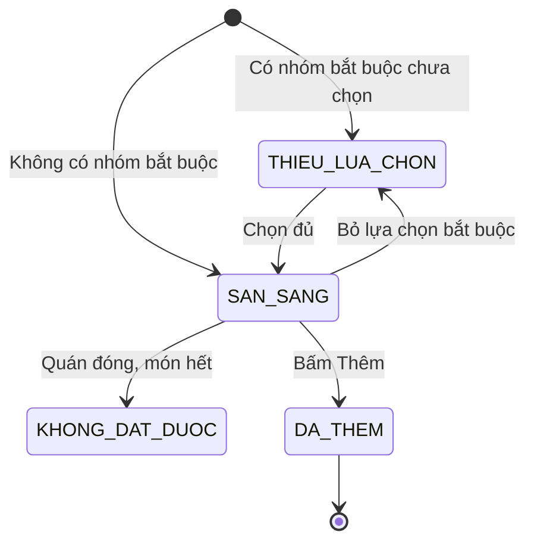

| **Trạng thái** | **Hiển thị** |
| --- | --- |
| `THIEU_LUA_CHON` | Nút ghi "Chọn {tên nhóm}"; chạm thì cuộn tới nhóm, nhóm rung nhẹ |
| `SAN_SANG` | "Thêm vào giỏ · {giá} ₫" |
| `KHONG_DAT_DUOC` | Nút disabled, ghi "Quán đang đóng cửa" hoặc "Hết món" |
| `DA_THEM` | Đóng **SCR-04**, thanh giỏ ở **SCR-03** cập nhật |

### 4.2 Bước 2 · Giỏ hàng & đặt đơn

#### Trạng thái nút Đặt đơn trên SCR-05

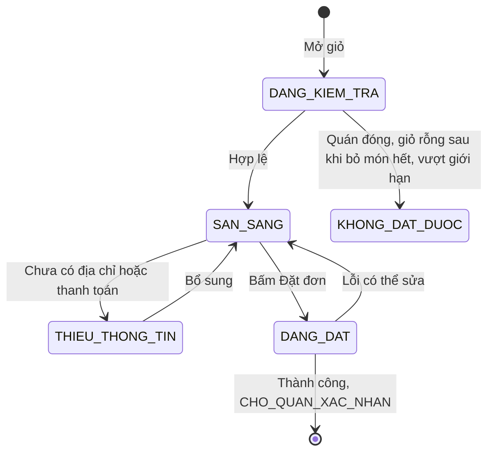

| **Trạng thái** | **Hiển thị nút** |
| --- | --- |
| `DANG_KIEM_TRA` | Skeleton giá, nút disabled |
| `SAN_SANG` | "Đặt đơn · {tổng} ₫" |
| `THIEU_THONG_TIN` | "Chọn địa chỉ giao" hoặc "Chọn thanh toán"; chạm mở phần thiếu |
| `KHONG_DAT_DUOC` | Disabled + lý do |
| `DANG_DAT` | Loading, không bấm lại được |

### 4.3 Bước 3 · Theo dõi đơn

#### Đơn hàng nhìn từ phía khách

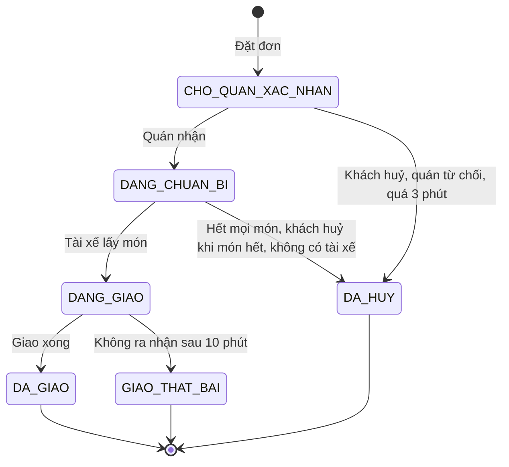

#### Khách thấy gì trên SCR-07

| **Đơn / giai đoạn** | **Tiêu đề** | **Phụ** |
| --- | --- | --- |
| `CHO_QUAN_XAC_NHAN` | Chờ quán xác nhận | Đếm ngược ≤ 3 phút; nút Huỷ đơn (Bước 4) |
| `DANG_CHUAN_BI`, chưa tìm tài xế | Quán đang chuẩn bị | Giờ giao dự kiến |
| `DANG_CHUAN_BI`, đang chờ khách chọn món hết | Món {tên} đã hết | Popup MSG-19 |
| `DANG_CHUAN_BI`, đang tìm tài xế | Đang tìm tài xế | "Đã tìm {n} phút" |
| `DANG_CHUAN_BI`, có tài xế | {Tên tài xế} đang tới quán | Biển số, giờ tới quán |
| `DANG_GIAO` | Đang giao tới bạn | Bản đồ, giờ tới, nhắc tiền mặt |
| `DANG_GIAO`, tài xế trong 150 m | Tài xế đã tới | "Vui lòng ra nhận", nút gọi nổi bật, đồng hồ chờ |
| `DA_GIAO` | Đã giao | Ảnh xác nhận (nếu có), nút Đánh giá mở **SCR-08** (Bước 4) |
| `GIAO_THAT_BAI` | Giao không thành công | Lý do, Cần hỗ trợ, báo sự cố (Bước 4) |
| `DA_HUY` | Đơn đã huỷ | Lý do, số tiền hoàn, \[Đặt lại\] |

### 4.4 Bước 4 · Huỷ, đánh giá & sự cố

#### Vòng đời yêu cầu sự cố

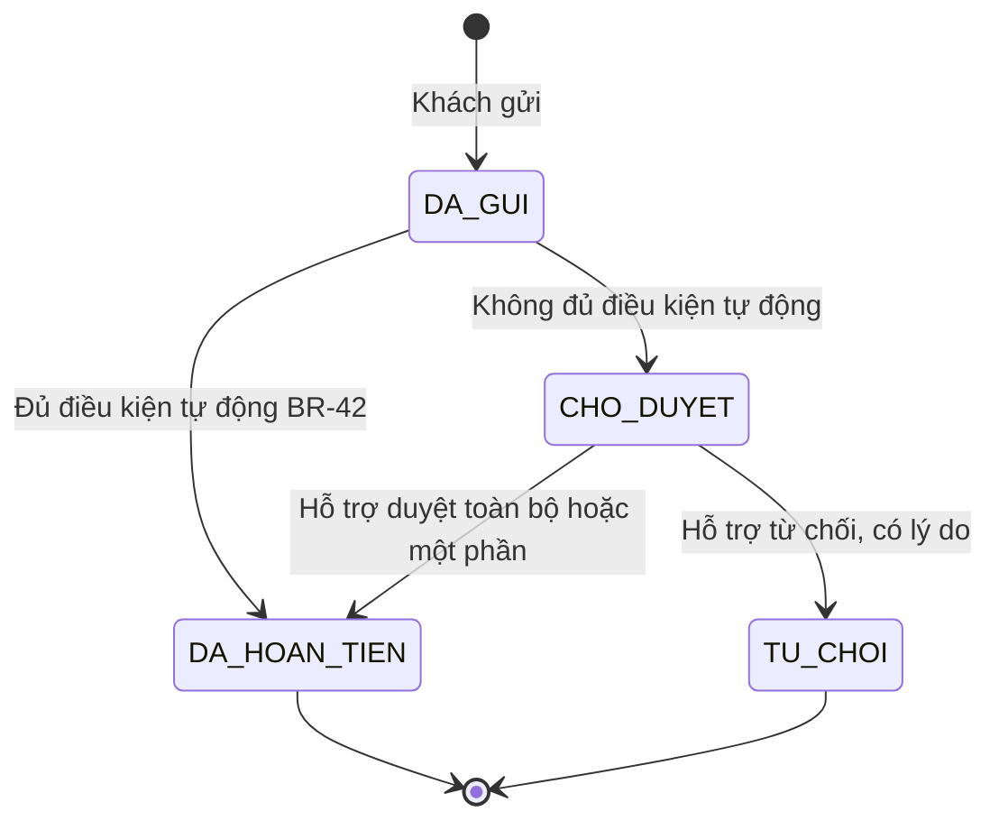

#### Hành động khách theo trạng thái đơn

| **Trạng thái đơn** | **Huỷ** | **Đánh giá** | **Tip** | **Báo sự cố** | **Đặt lại** |
| --- | --- | --- | --- | --- | --- |
| `CHO_QUAN_XAC_NHAN` | Có | – | – | – | – |
| `DANG_CHUAN_BI`, `SAN_SANG`, `DANG_GIAO` | Cần hỗ trợ | – | – | – | – |
| `DA_GIAO` | – | 7 ngày | 24 giờ | 2 giờ | Có |
| `GIAO_THAT_BAI` | – | – | – | 2 giờ, chỉ "Không nhận được đơn" | Có |
| `DA_HUY` | – | – | – | – | Có |

## 5. Use Case

### Bước 1 · Khám phá quán & món

#### UC-01 Chọn địa chỉ và tìm quán

| **Mục** | **Nội dung** |
| --- | --- |
| Tiền điều kiện | Khách đã đăng nhập |
| Hậu điều kiện thành công | Khách mở được **SCR-03** của một quán phục vụ địa chỉ giao |
| Hậu điều kiện thất bại | Ở lại **SCR-01** hoặc **SCR-02** với thông báo |

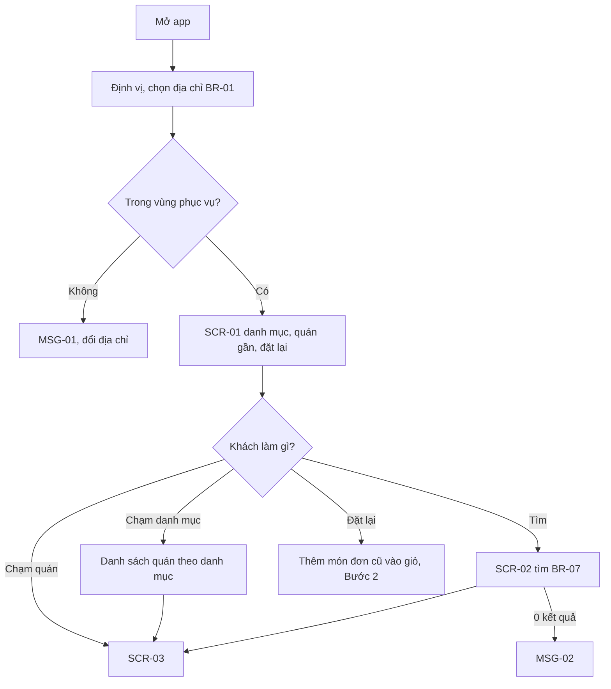

**Luồng chính**

| **Bước** | **Actor** | **Mô tả** |
| --- | --- | --- |
| 1 | Khách | Mở app |
| 2 | App | Định vị, chọn địa chỉ giao theo BR-01; gọi \[StoreFeed\] |
| 3 | App | Hiện **SCR-01**: địa chỉ giao, danh mục, Đặt lại, Quán gần bạn |
| 4 | Khách | Chạm ô tìm, gõ "bun bo" |
| 5 | App | Gọi \[Search\]; hiện **SCR-02** kết quả nhóm theo quán |
| 6 | Khách | Chạm một quán → **SCR-03** |

**Luồng thay thế**

| **Mã** | **Điều kiện** | **Xử lý** |
| --- | --- | --- |
| A1 | Đổi địa chỉ giao | Chạm địa chỉ đầu trang → chọn đã lưu hoặc tìm mới (dùng chung **SCR-06**, Bước 2) → tải lại danh sách |
| A2 | Chạm danh mục | Danh sách quán có món thuộc danh mục; cùng bộ lọc, sắp xếp như tìm kiếm |
| A3 | Đặt lại | Thêm món của đơn cũ vào giỏ (bỏ món hết, báo MSG-05) → **SCR-05** (Bước 2) |
| A4 | Từ chối quyền vị trí | Khách chọn địa chỉ thủ công |

**Luồng lỗi**

| **Mã** | **Điều kiện** | **Xử lý** |
| --- | --- | --- |
| E1 | Ngoài vùng phục vụ | MSG-01 |
| E2 | Không có quán nào trong 10 km | Empty state "Chưa có quán giao tới khu vực này" |
| E3 | Tìm 0 kết quả | MSG-02, gợi ý danh mục |
| E4 | Lỗi mạng | MSG-06 |

#### UC-02 Xem menu và thêm món

| **Mục** | **Nội dung** |
| --- | --- |
| Tiền điều kiện | Quán phục vụ địa chỉ giao |
| Hậu điều kiện thành công | Món với tuỳ chọn đã vào giỏ; thanh giỏ hiện số món, tạm tính |
| Hậu điều kiện thất bại | Giỏ không đổi |

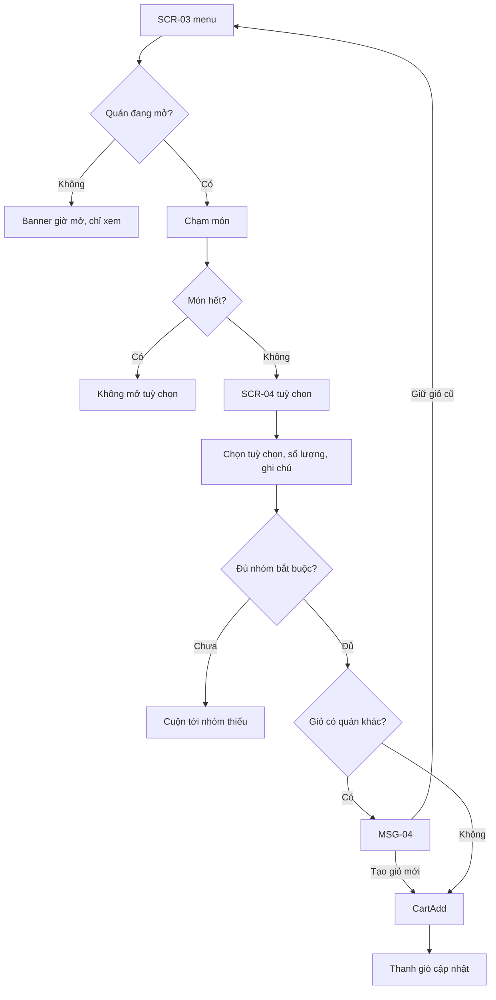

**Luồng chính**

| **Bước** | **Actor** | **Mô tả** |
| --- | --- | --- |
| 1 | App | Gọi \[StoreMenu\]; hiện **SCR-03**: thông tin quán, thanh nhóm món, danh sách món |
| 2 | Khách | Chạm món "Trà sữa trân châu" |
| 3 | App | Mở **SCR-04** với nhóm Size (bắt buộc), Đường, Đá, Topping |
| 4 | Khách | Chọn size L, 2 topping, số lượng 2 |
| 5 | App | Cập nhật "Thêm vào giỏ · 98.000 ₫" |
| 6 | Khách | Bấm Thêm vào giỏ |
| 7 | App | Gọi \[CartAdd\]; đóng **SCR-04**; thanh giỏ "2 món · 98.000 ₫ · Xem giỏ" |

**Luồng thay thế**

| **Mã** | **Điều kiện** | **Xử lý** |
| --- | --- | --- |
| A1 | Món không có nhóm tuỳ chọn | Nút "+" trên dòng món thêm thẳng 1 món |
| A2 | Món đã trong giỏ | Dòng món hiện số lượng; "−" "+" sửa nhanh |
| A3 | Lựa chọn hết | Lựa chọn mờ, ghi "Hết" |
| A4 | Giỏ có quán khác | MSG-04 (BR-09) |

**Luồng lỗi**

| **Mã** | **Điều kiện** | **Xử lý** |
| --- | --- | --- |
| E1 | Quán vừa đóng, tạm ngưng | MSG-03, nút disabled |
| E2 | Món vừa hết khi bấm thêm | MSG-05 |
| E3 | Lỗi mạng | MSG-06 |

### Bước 2 · Giỏ hàng & đặt đơn

#### UC-03 Xác nhận giỏ, địa chỉ và thanh toán

| **Mục** | **Nội dung** |
| --- | --- |
| Tiền điều kiện | Giỏ có ít nhất 1 món còn |
| Hậu điều kiện thành công | Nút Đặt đơn ở `SAN_SANG` |
| Hậu điều kiện thất bại | Ở lại **SCR-05** với lỗi |

**Luồng chính**

| **Bước** | **Actor** | **Mô tả** |
| --- | --- | --- |
| 1 | Khách | Chạm thanh giỏ → **SCR-05** |
| 2 | App | Gọi \[CartValidate\]; hiện món, địa chỉ mặc định, phí (BR-13–15), thời gian dự kiến |
| 3 | Khách | Sửa số lượng một món; nhập ghi chú cho quán |
| 4 | Khách | Chạm địa chỉ → **SCR-06**; chọn "Công ty", nhập chi tiết "Toà B, tầng 12" |
| 5 | App | Gọi \[DeliveryQuote\] tính lại phí giao, thời gian |
| 6 | Khách | Chọn Ví liên kết |
| 7 | App | Nút "Đặt đơn · {tổng} ₫" ở `SAN_SANG` |

**Luồng thay thế**

| **Mã** | **Điều kiện** | **Xử lý** |
| --- | --- | --- |
| A1 | Thêm địa chỉ mới | **SCR-06**: tìm địa chỉ → kéo ghim → chi tiết, ghi chú → tuỳ chọn lưu với tên |
| A2 | Đổi người nhận | Chạm "Người nhận" → nhập tên, số điện thoại (BR-17) |
| A3 | Chạm ⓘ cạnh phí | Bottom sheet giải thích (BR-21) |
| A4 | Có phí đơn nhỏ | Gợi ý "Thêm {x} ₫…" + nút "Thêm món" về **SCR-03** |
| A5 | Sửa tuỳ chọn món | Mở **SCR-04** với lựa chọn hiện tại |

**Luồng lỗi**

| **Mã** | **Điều kiện** | **Xử lý** |
| --- | --- | --- |
| E1 | Món hết, giá đổi | Nhãn trên dòng (BR-11), MSG-07 |
| E2 | Địa chỉ quá xa quán | MSG-08 |
| E3 | Vượt giới hạn đơn | MSG-09 |
| E4 | Tiền mặt không khả dụng | MSG-10 |

#### UC-04 Đặt đơn

| **Mục** | **Nội dung** |
| --- | --- |
| Tiền điều kiện | Nút ở `SAN_SANG` |
| Hậu điều kiện thành công | Đơn `CHO_QUAN_XAC_NHAN`; giỏ trống; mở **SCR-07** (Bước 3) |
| Hậu điều kiện thất bại | Không tạo đơn; ví không bị trừ hoặc đã hoàn |

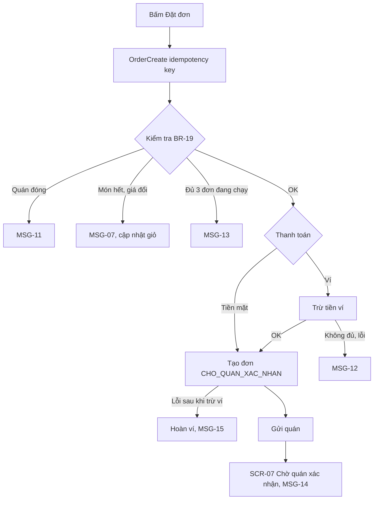

**Luồng chính**

| **Bước** | **Actor** | **Mô tả** |
| --- | --- | --- |
| 1 | Khách | Bấm "Đặt đơn · {tổng} ₫" |
| 2 | App | Gọi \[OrderCreate\] với idempotency key; nút `DANG_DAT` |
| 3 | Máy chủ | Kiểm tra BR-19; trừ ví (nếu ví); tạo đơn; gửi tới quán |
| 4 | App | Mở **SCR-07** trạng thái "Chờ quán xác nhận"; MSG-14 |

**Luồng thay thế**

| **Mã** | **Điều kiện** | **Xử lý** |
| --- | --- | --- |
| A1 | Mạng chậm, gửi lại | Gửi lại cùng key; máy chủ trả đơn đã tạo |
| A2 | Giá đổi lúc đặt | MSG-07 kèm tổng mới; khách bấm đặt lại |

**Luồng lỗi**

| **Mã** | **Điều kiện** | **Xử lý** |
| --- | --- | --- |
| E1 | Quán vừa đóng | MSG-11 |
| E2 | Ví lỗi, không đủ tiền | MSG-12 |
| E3 | Đủ 3 đơn chưa kết thúc | MSG-13 |
| E4 | Tạo đơn lỗi sau khi trừ ví | Hoàn ví, MSG-15 |
| E5 | Mất mạng hoàn toàn | MSG-16; khi có mạng gọi lại cùng key |

### Bước 3 · Theo dõi đơn

#### UC-05 Theo dõi đơn tới khi có tài xế

| **Mục** | **Nội dung** |
| --- | --- |
| Tiền điều kiện | Đơn vừa tạo ở `CHO_QUAN_XAC_NHAN` (Bước 2) |
| Hậu điều kiện thành công | Đơn `DANG_CHUAN_BI` có tài xế; khách thấy tài xế trên bản đồ |
| Hậu điều kiện thất bại | Đơn `DA_HUY`, khách được hoàn tiền và gợi ý đặt lại |

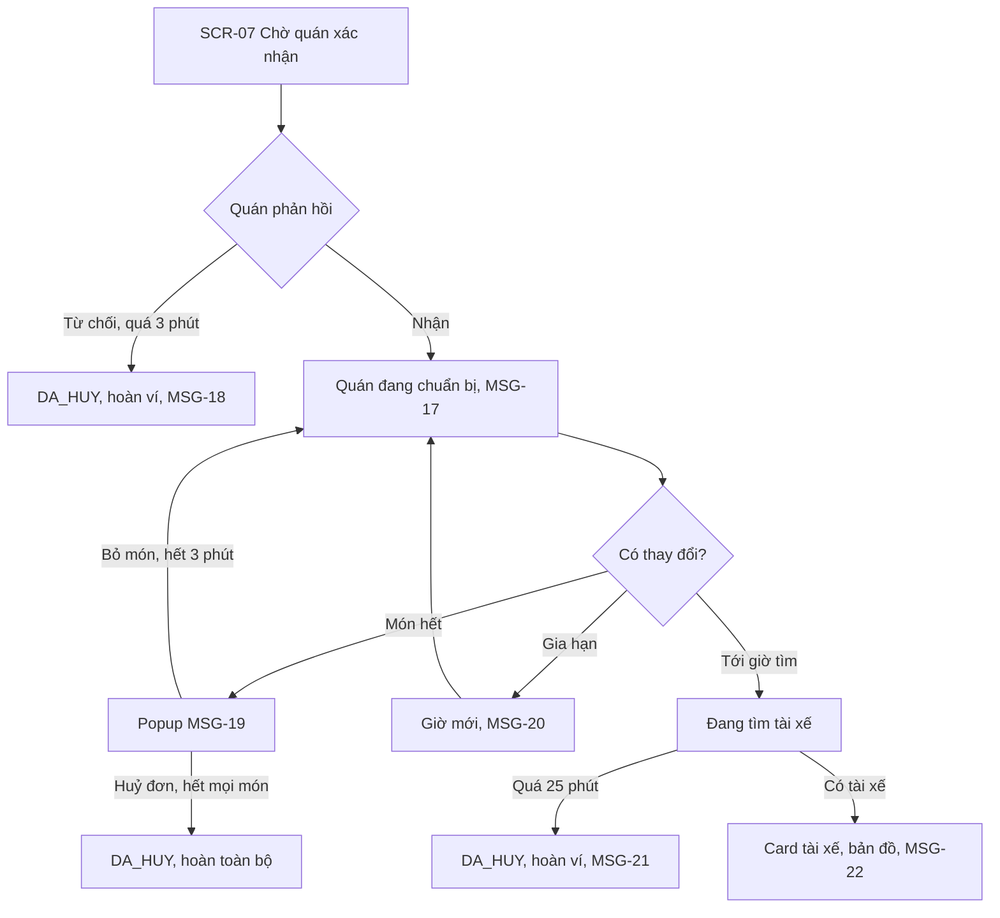

**Luồng chính**

| **Bước** | **Actor** | **Mô tả** |
| --- | --- | --- |
| 1 | App | Sau khi đặt, mở **SCR-07**: "Chờ quán xác nhận", đếm ngược 3 phút (BR-24) |
| 2 | Máy chủ | Quán nhận → đơn `DANG_CHUAN_BI`; gửi MSG-17 kèm giờ giao dự kiến (BR-25) |
| 3 | App | Tiêu đề "Quán đang chuẩn bị", stepper bước 2 |
| 4 | Máy chủ | Tới giờ tìm tài xế (BR-28) → App hiện "Đang tìm tài xế" |
| 5 | Máy chủ | Có tài xế → gửi MSG-22 |
| 6 | App | Hiện card tài xế và bản đồ (BR-29) |

**Luồng thay thế**

| **Mã** | **Điều kiện** | **Xử lý** |
| --- | --- | --- |
| A1 | Quán báo hết món | Popup MSG-19 (BR-26); khách chọn \[Bỏ món\] → \[OrderItemDecision\], tổng mới cập nhật trong chi tiết đơn |
| A2 | Quán gia hạn | Giờ dự kiến mới, MSG-20 (BR-27) |
| A3 | Khách muốn huỷ khi còn chờ quán | Nút Huỷ đơn → Bước 4 UC-07 |
| A4 | Khách thoát app | Push MSG-17, MSG-19 … MSG-22; chạm → **SCR-07** (BR-34) |

**Luồng lỗi**

| **Mã** | **Điều kiện** | **Xử lý** |
| --- | --- | --- |
| E1 | Quán từ chối hoặc quá 3 phút | `DA_HUY`, MSG-18, \[Xem quán khác\] |
| E2 | Khách chọn Huỷ khi món hết, hoặc mọi món hết | `DA_HUY`, hoàn toàn bộ |
| E3 | Quá 25 phút không có tài xế | `DA_HUY`, MSG-21, \[Đặt lại\] |
| E4 | Mất mạng | Banner "Đang kết nối lại…", giữ trạng thái cuối, thời điểm cập nhật |

#### UC-06 Theo dõi giao hàng và nhận đồ

| **Mục** | **Nội dung** |
| --- | --- |
| Tiền điều kiện | Đơn có tài xế |
| Hậu điều kiện thành công | Đơn `DA_GIAO`; khách được mời đánh giá |
| Hậu điều kiện thất bại | Đơn `GIAO_THAT_BAI`, vẫn tính tiền |

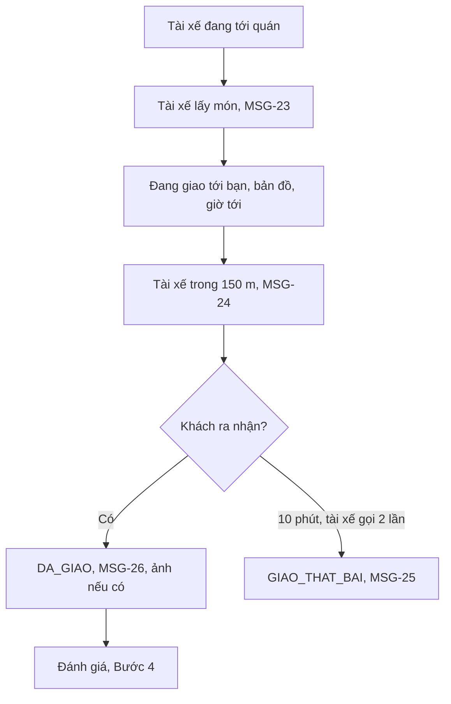

**Luồng chính**

| **Bước** | **Actor** | **Mô tả** |
| --- | --- | --- |
| 1 | Máy chủ | Tài xế lấy món → đơn `DANG_GIAO`; gửi MSG-23 |
| 2 | App | Tiêu đề "Đang giao tới bạn"; bản đồ, giờ tới tính lại mỗi 30 giây (BR-25, BR-29) |
| 3 | Khách | Chạm "Nhắn tin" → chọn "Gọi khi tới nhé" (BR-30) |
| 4 | Máy chủ | Tài xế trong 150 m → gửi MSG-24 |
| 5 | App | Tiêu đề "Tài xế đã tới", nút gọi nổi bật, đồng hồ chờ (BR-31) |
| 6 | Khách | Ra nhận đồ; tài xế xác nhận đã giao trên app tài xế |
| 7 | App | Đơn `DA_GIAO`, MSG-26; nút "Đánh giá" mở **SCR-08** (Bước 4) |

**Luồng thay thế**

| **Mã** | **Điều kiện** | **Xử lý** |
| --- | --- | --- |
| A1 | Giao để ở bảo vệ, lễ tân theo ghi chú | Ảnh xác nhận hiện trên **SCR-07** (BR-32) |
| A2 | Gọi tài xế | \[MaskedCall\] → gọi qua số trung gian |
| A3 | Đơn tiền mặt | Nhắc "Chuẩn bị {tổng} ₫" (BR-32) |
| A4 | Khách cần đổi địa chỉ | Không có chức năng; nhắn tài xế hoặc "Cần hỗ trợ" (BR-33) |

**Luồng lỗi**

| **Mã** | **Điều kiện** | **Xử lý** |
| --- | --- | --- |
| E1 | Không ra nhận 10 phút, tài xế đã gọi ≥ 2 lần | `GIAO_THAT_BAI`, MSG-25 (BR-31) |
| E2 | Vị trí tài xế không cập nhật > 15 giây | "Cập nhật {n} giây trước" (BR-29) |
| E3 | Số trung gian lỗi | Toast "Chưa gọi được, hãy nhắn tin cho tài xế"; tin nhắn vẫn dùng được |

### Bước 4 · Huỷ, đánh giá & sự cố

#### UC-07 Huỷ đơn

| **Mục** | **Nội dung** |
| --- | --- |
| Tiền điều kiện | Đơn `CHO_QUAN_XAC_NHAN` |
| Hậu điều kiện thành công | Đơn `DA_HUY`; quán thấy đơn bị huỷ; hoàn ví nếu đã trả |
| Hậu điều kiện thất bại | Đơn giữ trạng thái; khách được dẫn tới hỗ trợ |

**Luồng chính**

| **Bước** | **Actor** | **Mô tả** |
| --- | --- | --- |
| 1 | Khách | Ở **SCR-07** bấm "Huỷ đơn" |
| 2 | App | Bottom sheet lý do (BR-36), số tiền sẽ hoàn (nếu trả ví) |
| 3 | Khách | Chọn lý do, bấm "Xác nhận huỷ" |
| 4 | App | Gọi \[OrderCancel\] |
| 5 | Máy chủ | Kiểm tra trạng thái; huỷ; hoàn ví; báo quán qua ứng dụng quán (ngoài phạm vi) |
| 6 | App | MSG-27; **SCR-07** hiện "Đã huỷ" và nút "Đặt lại" |

**Luồng lỗi**

| **Mã** | **Điều kiện** | **Xử lý** |
| --- | --- | --- |
| E1 | Quán vừa nhận đơn | MSG-28, nút "Cần hỗ trợ" |
| E2 | Lỗi mạng | MSG-36 |

#### UC-08 Đánh giá và tip

| **Mục** | **Nội dung** |
| --- | --- |
| Tiền điều kiện | Đơn `DA_GIAO` trong 7 ngày |
| Hậu điều kiện thành công | Đánh giá được lưu; tip (nếu có) chuyển tới tài xế |
| Hậu điều kiện thất bại | Không lưu; khách đánh giá lại sau được |

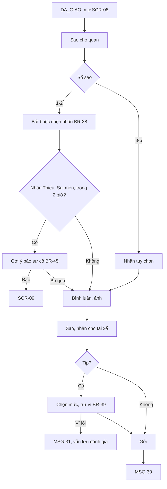

**Luồng chính**

| **Bước** | **Actor** | **Mô tả** |
| --- | --- | --- |
| 1 | App | Đơn `DA_GIAO` → mở **SCR-08** một lần (khách đóng được) |
| 2 | Khách | Chọn 5 sao cho quán, nhãn "Ngon", "Đóng gói cẩn thận" |
| 3 | Khách | Chọn 5 sao cho tài xế, tip 10.000 ₫ |
| 4 | Khách | Bấm "Gửi" |
| 5 | App | Gọi \[ReviewSubmit\] và \[TipSend\] |
| 6 | Máy chủ | Lưu đánh giá; trừ ví, chuyển tip; push tài xế |
| 7 | App | MSG-30 |

**Luồng thay thế**

| **Mã** | **Điều kiện** | **Xử lý** |
| --- | --- | --- |
| A1 | Đánh giá sau | Đóng **SCR-08**; chi tiết đơn có nút "Đánh giá" trong 7 ngày |
| A2 | Chỉ tip, không đánh giá | Cho phép, trong 24 giờ |
| A3 | Đánh giá thấp có nhãn sự cố | BR-45 |

**Luồng lỗi**

| **Mã** | **Điều kiện** | **Xử lý** |
| --- | --- | --- |
| E1 | Ví không đủ khi tip | MSG-31; đánh giá vẫn được lưu |
| E2 | Quá 7 ngày | MSG-32 |
| E3 | Thiếu nhãn khi ≤ 2 sao | Lỗi inline "Chọn ít nhất 1 lý do" |

#### UC-09 Báo sự cố

| **Mục** | **Nội dung** |
| --- | --- |
| Tiền điều kiện | Trong 2 giờ sau `DA_GIAO` (hoặc `GIAO_THAT_BAI` với loại Không nhận được đơn); đơn chưa có yêu cầu sự cố |
| Hậu điều kiện thành công | Yêu cầu `DA_HOAN_TIEN` hoặc `CHO_DUYET` |
| Hậu điều kiện thất bại | Không tạo yêu cầu |

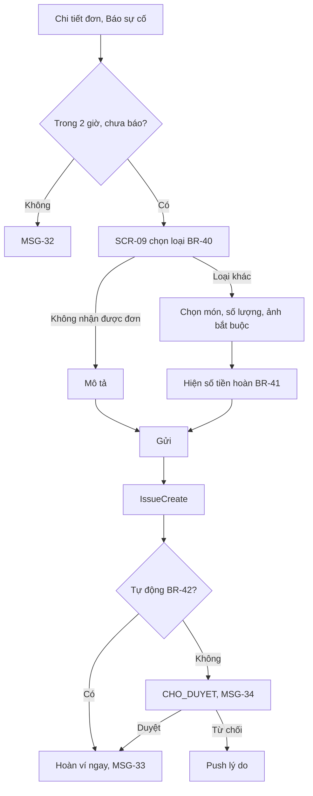

**Luồng chính**

| **Bước** | **Actor** | **Mô tả** |
| --- | --- | --- |
| 1 | Khách | Mở chi tiết đơn → "Báo sự cố" |
| 2 | App | Mở **SCR-09**, danh sách loại |
| 3 | Khách | Chọn "Thiếu món"; chọn "Trà sữa trân châu × 1"; chụp ảnh túi đồ ăn |
| 4 | App | Hiện "Bạn sẽ được hoàn 49.000 ₫ vào ví" |
| 5 | Khách | Bấm "Gửi" |
| 6 | App | Gọi \[IssueCreate\] |
| 7 | Máy chủ | Đủ điều kiện tự động → hoàn ví; trừ tiền quán (BR-46); báo quán |
| 8 | App | MSG-33 |

**Luồng thay thế**

| **Mã** | **Điều kiện** | **Xử lý** |
| --- | --- | --- |
| A1 | Không đủ điều kiện tự động | `CHO_DUYET`, MSG-34; kết quả qua push |
| A2 | Không nhận được đơn | Không cần chọn món, ảnh; luôn `CHO_DUYET` |
| A3 | Mở từ gợi ý ở đánh giá | Điền sẵn loại (BR-45) |

**Luồng lỗi**

| **Mã** | **Điều kiện** | **Xử lý** |
| --- | --- | --- |
| E1 | Quá 2 giờ, đã có yêu cầu | MSG-32 |
| E2 | Thiếu ảnh | Lỗi inline "Vui lòng chụp ít nhất 1 ảnh" |
| E3 | Lỗi mạng khi tải ảnh | MSG-36; giữ dữ liệu, cho gửi lại |

## 6. Điểm vào

| **Điểm vào** | **Dẫn tới** | **Ghi chú** |
| --- | --- | --- |
| Mở app | **SCR-01** | Đơn đang giao → banner theo dõi đơn ở đầu (Bước 3) |
| Chạm thông báo quán yêu thích mở cửa | **SCR-03** | Phase sau |
| "Đặt lại" ở lịch sử đơn (Bước 4) | A3 UC-01 | |
| Link chia sẻ quán | **SCR-03** | Ngoài bán kính → MSG-01 |
| Thanh giỏ ở **SCR-01**, **SCR-03** | **SCR-05** | |
| "Đặt lại" (Bước 1 A3, Bước 4) | **SCR-05** | Món hết đã bị bỏ |
| Địa chỉ ở **SCR-01** | **SCR-06** | Dùng chung chọn địa chỉ |
| Đặt đơn thành công (Bước 2) | **SCR-07** | |
| Banner đơn đang giao ở **SCR-01** | **SCR-07** | BR-34 |
| Push trạng thái đơn | **SCR-07** | |
| Đơn ở tab Đang giao của lịch sử (Bước 4) | **SCR-07** | |
| Đơn vừa giao (MSG-26, Bước 3) | **SCR-08** | Một lần |
| Tài khoản → Đơn hàng | **SCR-10** | |
| Chi tiết đơn ở **SCR-10** | Đánh giá, Báo sự cố, Đặt lại theo mục 4.2 | |
| Nút "Huỷ đơn" ở **SCR-07** | UC-07 | |

## 7. Mô tả màn hình

<!-- Bước 1 · Khám phá quán & món -->
### SCR-01 Trang chủ

| **#** | **Thành phần** | **Loại** | **Hành vi** |
| --- | --- | --- | --- |
| 1 | Địa chỉ giao | Header | "Giao đến: {tên địa chỉ}"; chạm để đổi (A1) |
| 2 | Ô tìm kiếm | Search bar | Mở **SCR-02** |
| 3 | Danh mục | Lưới icon | 8–10 danh mục, cuộn ngang |
| 4 | Đặt lại | Dải thẻ | 5 đơn đã giao gần nhất: ảnh quán, món chính, "Đặt lại" |
| 5 | Quán gần bạn | List thẻ quán | Thẻ theo BR-06; tải thêm khi cuộn |
| 6 | Banner đơn đang giao | Banner | Khi có đơn chưa kết thúc (Bước 3 BR-34) |
| 7 | Thanh giỏ | Sticky bar | Khi giỏ có món: quán, số món, tạm tính |

### SCR-02 Tìm kiếm

| **#** | **Thành phần** | **Loại** | **Hành vi** |
| --- | --- | --- | --- |
| 1 | Ô tìm | Search input | Gợi ý BR-07 |
| 2 | Tìm gần đây | Chips | 5 từ khoá |
| 3 | Bộ lọc | Chips | Đang mở, Miễn phí giao, ≤ 3 km |
| 4 | Sắp xếp | Dropdown | BR-07 |
| 5 | Kết quả | List | Thẻ quán + tối đa 3 món khớp (ảnh nhỏ, tên, giá) |

### SCR-03 Trang quán

| **#** | **Thành phần** | **Loại** | **Hành vi** |
| --- | --- | --- | --- |
| 1 | Ảnh bìa, tên quán | Header | Thu gọn khi cuộn |
| 2 | Thông tin | Text | Đánh giá, khoảng cách, thời gian dự kiến, phí giao, giờ mở cửa |
| 3 | Banner trạng thái | Banner | `SAP_DONG`, `DONG_CUA`, `TAM_NGUNG` (BR-04) |
| 4 | Tìm trong quán | Icon | Lọc món theo tên |
| 5 | Thanh nhóm món | Tabs dính | Chạm nhảy tới nhóm; tự đổi khi cuộn |
| 6 | Dòng món | List item | Ảnh, tên, mô tả 2 dòng, giá, nhãn Bán chạy, Hết món; nút "+" |
| 7 | Thanh giỏ | Sticky bar | "{n} món · {tạm tính} ₫ · Xem giỏ" → **SCR-05** |

### SCR-04 Tuỳ chọn món

| **#** | **Thành phần** | **Loại** | **Bắt buộc** | **Validate / hành vi** |
| --- | --- | --- | --- | --- |
| 1 | Ảnh, tên, mô tả, giá | Header | – | |
| 2 | Nhóm chọn 1 | Radio group | Theo min | "Bắt buộc · chọn 1"; giá cộng thêm |
| 3 | Nhóm chọn nhiều | Checkbox group | Theo min | "Chọn tối đa {max}"; vượt max thì lựa chọn khác disabled |
| 4 | Ghi chú cho quán | Text | Không | ≤ 100 ký tự; placeholder "Ví dụ: không hành" |
| 5 | Số lượng | Stepper | Có | 1–20 |
| 6 | Nút thêm | Button | – | Mục 4.1 |

<!-- Bước 2 · Giỏ hàng & đặt đơn -->
### SCR-05 Giỏ hàng & xác nhận đơn

| **#** | **Thành phần** | **Loại** | **Bắt buộc** | **Validate / hành vi** |
| --- | --- | --- | --- | --- |
| 1 | Giao đến | Card | Có | Tên địa chỉ, chi tiết, ghi chú tài xế; chạm → **SCR-06** |
| 2 | Người nhận | Dòng chọn | Có | Tên · số điện thoại (BR-17) |
| 3 | Thời gian dự kiến | Text | – | BR-20 |
| 4 | Tên quán | Header | – | Chạm về **SCR-03** |
| 5 | Dòng món | List | – | Tên, tuỳ chọn, ghi chú, stepper, giá; nhãn Hết món, Giá đã thay đổi |
| 6 | "Thêm món" | Link | – | Về **SCR-03** |
| 7 | Ghi chú cho quán | Text | Không | ≤ 200 ký tự |
| 8 | Dụng cụ ăn uống | Switch | – | Mặc định tắt |
| 9 | Bảng phí | List | – | Tạm tính, phí giao, phụ phí, phí dịch vụ, phí đơn nhỏ, quán giảm phí giao; mỗi khoản có ⓘ |
| 10 | Gợi ý bỏ phí đơn nhỏ | Info | – | A4 |
| 11 | Thanh toán | Dòng chọn | Có | Tiền mặt / Ví liên kết (số dư) |
| 12 | Tổng | Text lớn | – | BR-15 |
| 13 | Nút Đặt đơn | Button dính đáy | – | Mục 4.1 |

### SCR-06 Địa chỉ giao

| **#** | **Thành phần** | **Loại** | **Bắt buộc** | **Validate / hành vi** |
| --- | --- | --- | --- | --- |
| 1 | Ô tìm địa chỉ | Search | – | Gợi ý sau 2 ký tự, không dấu |
| 2 | Địa chỉ đã lưu | List | – | Tối đa 10; sửa, xoá |
| 3 | Bản đồ + ghim | Map | Có | Kéo bản đồ để chỉnh ghim; tên đường cập nhật khi thả |
| 4 | Chi tiết | Text | Không | Toà, tầng, phòng ≤ 100 ký tự |
| 5 | Ghi chú cho tài xế | Text | Không | ≤ 100 ký tự; placeholder "Ví dụ: gửi bảo vệ sảnh B" |
| 6 | Lưu địa chỉ | Checkbox + Chips tên | Không | Nhà, Công ty, Khác (tên ≤ 30 ký tự) |
| 7 | "Xác nhận địa chỉ" | Button | – | Kiểm tra bán kính (BR-12) |

<!-- Bước 3 · Theo dõi đơn -->
### SCR-07 Theo dõi đơn

| **#** | **Thành phần** | **Loại** | **Bắt buộc** | **Validate / hành vi** |
| --- | --- | --- | --- | --- |
| 1 | Trạng thái | Header | – | Theo mục 4.2 |
| 2 | Tiến trình | Stepper | – | Đã đặt → Quán chuẩn bị → Đang giao → Đã giao |
| 3 | Giờ giao dự kiến | Text lớn | – | "12:25–12:35" (BR-25); đếm ngược 3 phút khi chờ quán |
| 4 | Bản đồ | Map | – | Từ khi có tài xế: tài xế, quán, điểm giao; "Cập nhật {n} giây trước" khi > 15 giây (BR-29) |
| 5 | Tài xế | Card | – | Ảnh, tên, biển số, nút Gọi, Nhắn tin (BR-30) |
| 6 | Nhắn tin | Bottom sheet | – | Tin nhắn nhanh + ô nhập ≤ 200 ký tự |
| 7 | Nhắc tiền mặt | Info | – | Đơn tiền mặt (BR-32) |
| 8 | Ảnh giao | Image | – | Khi có ảnh xác nhận (BR-32) |
| 9 | Chi tiết đơn | Accordion | – | Mã đơn, món, tổng, thanh toán, địa chỉ, ghi chú |
| 10 | Huỷ đơn | Link | – | Chỉ `CHO_QUAN_XAC_NHAN` (Bước 4) |
| 11 | Cần hỗ trợ | Link | – | Mở kênh hỗ trợ (BR-33) |
| 12 | Đánh giá | Button | – | Khi `DA_GIAO` → **SCR-08** (Bước 4) |

<!-- Bước 4 · Huỷ, đánh giá & sự cố -->
### SCR-08 Đánh giá & tip

| **#** | **Thành phần** | **Loại** | **Bắt buộc** | **Validate / hành vi** |
| --- | --- | --- | --- | --- |
| 1 | Quán | Header | – | Ảnh, tên, món đã đặt |
| 2 | Sao quán | Rating 1–5 | Có | |
| 3 | Nhãn quán | Chips nhiều chọn | Khi ≤ 2 sao | Bộ nhãn theo số sao (BR-38) |
| 4 | Bình luận | Textarea | Không | ≤ 300 ký tự |
| 5 | Ảnh | Upload | Không | ≤ 3 ảnh |
| 6 | Gợi ý báo sự cố | Info + Button | – | BR-45 |
| 7 | Sao, nhãn tài xế | Rating + Chips | Không | |
| 8 | Tip | Chips + Amount | Không | BR-39; hiện số dư ví |
| 9 | "Gửi" | Button | – | Disabled khi chưa chọn sao quán |

### SCR-09 Báo sự cố

| **#** | **Thành phần** | **Loại** | **Bắt buộc** | **Validate / hành vi** |
| --- | --- | --- | --- | --- |
| 1 | Loại sự cố | Radio | Có | BR-40 |
| 2 | Món bị ảnh hưởng | Checklist + Stepper | Có (trừ Không nhận được đơn) | Số lượng ≤ số đã đặt |
| 3 | Ảnh | Camera / Upload | Có (trừ Không nhận được đơn) | 1–3 ảnh |
| 4 | Mô tả | Textarea | Không | ≤ 300 ký tự |
| 5 | Số tiền hoàn | Card | – | BR-41; "Hoàn vào ví" |
| 6 | "Gửi" | Button | – | |
| 7 | Kết quả | Overlay | – | MSG-33 hoặc MSG-34 |

### SCR-10 Lịch sử đơn & chi tiết

| **#** | **Thành phần** | **Loại** | **Hành vi** |
| --- | --- | --- | --- |
| 1 | Tab | Tabs | Đang giao, Đã giao, Đã huỷ |
| 2 | Thẻ đơn | Card | Quán, ngày giờ, món chính "+{n} món", tổng, trạng thái |
| 3 | Chi tiết | Màn chi tiết | Món, phí, thanh toán, tài xế, ảnh giao, mốc thời gian, đánh giá đã gửi, yêu cầu sự cố (trạng thái 4.1, số tiền) |
| 4 | Hành động | Buttons | Theo mục 4.2 |

## 8. API

### 8.1 Bước 1 · Khám phá quán & món

| **API** | **Request chính** | **Response chính** | **Timeout / retry** |
| --- | --- | --- | --- |
| \[ReverseGeocode\] | lat, lng | Địa chỉ, in_service_area | 3s / 1 lần |
| \[StoreFeed\] | delivery_location, category, filters, sort, cursor | Thẻ quán (BR-06), đơn đặt lại | 5s / 1 lần |
| \[Search\] | keyword, delivery_location, filters, sort | Quán + món khớp | 3s / 1 lần |
| \[StoreMenu\] | store_id, delivery_location | Thông tin quán, trạng thái, nhóm món, món, nhóm tuỳ chọn | 5s / 1 lần |
| \[CartAdd\] | store_id, item_id, options, quantity, note, replace_cart | Giỏ mới | 5s / 1 lần |

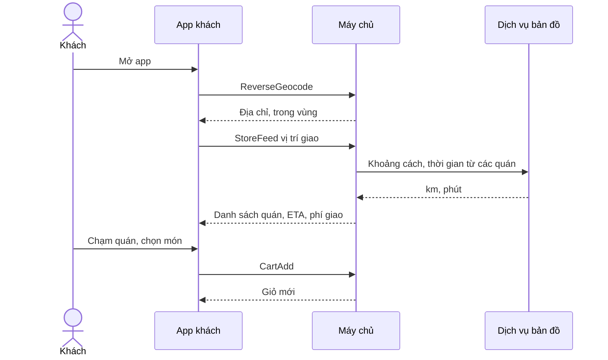

**Map lỗi → thông báo**

| **Nhóm lỗi** | **Message** |
| --- | --- |
| Ngoài vùng phục vụ | MSG-01 |
| Tìm 0 kết quả | MSG-02 |
| Quán đóng, tạm ngưng | MSG-03 |
| Giỏ có quán khác | MSG-04 |
| Món hết | MSG-05 |
| Mất mạng, lỗi máy chủ | MSG-06 |

### 8.2 Bước 2 · Giỏ hàng & đặt đơn

| **API** | **Request chính** | **Response chính** | **Timeout / retry** |
| --- | --- | --- | --- |
| \[CartValidate\] | cart_id, delivery_address | Dòng hợp lệ, cờ hết món, đổi giá, trạng thái quán | 5s / 1 lần |
| \[DeliveryQuote\] | store_id, delivery_address, subtotal | Phí giao, phụ phí, phần quán tài trợ, phí dịch vụ, phí đơn nhỏ, eta, distance_km | 5s / 1 lần |
| \[AddressSave\] | name, lat, lng, detail, driver_note | address_id | 5s / 1 lần |
| \[WalletBalance\] | – | Số dư, trạng thái liên kết | 3s / 1 lần |
| \[OrderCreate\] | cart_id, address, receiver, store_note, cutlery, payment_method, quote_id, idempotency_key | order_id, order_code, status, eta | 15s / gửi lại cùng key |

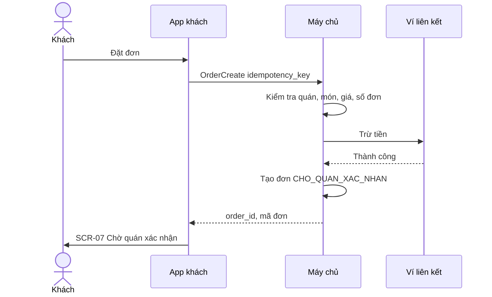

**Map lỗi → thông báo**

| **Nhóm lỗi** | **Message** |
| --- | --- |
| Món hết, giá đổi | MSG-07 |
| Địa chỉ ngoài bán kính quán | MSG-08 |
| Vượt giới hạn đơn | MSG-09 |
| Tiền mặt không khả dụng | MSG-10 |
| Quán đóng | MSG-11 |
| Ví lỗi, không đủ số dư | MSG-12 |
| Quá số đơn đang chạy | MSG-13 |
| Đặt thành công | MSG-14 |
| Hoàn ví do lỗi tạo đơn | MSG-15 |
| Mất mạng | MSG-16 |

### 8.3 Bước 3 · Theo dõi đơn

| **API** | **Request chính** | **Response chính** | **Timeout / retry** |
| --- | --- | --- | --- |
| \[OrderTrack\] | order_id | Trạng thái, giai đoạn, eta, tài xế, vị trí, ảnh giao | Kết nối lâu dài; dự phòng gọi mỗi 10 giây |
| \[OrderItemDecision\] | order_id, item_ids, decision (bo_mon / huy) | Đơn cập nhật, số tiền hoàn | 5s / 2 lần |
| \[MaskedCall\] | order_id | Số trung gian | 5s / 1 lần |
| \[ChatSend\] | order_id, text | message_id | 5s / 3 lần |
| \[ActiveOrders\] | – | Danh sách đơn chưa kết thúc cho banner | 3s / 1 lần |

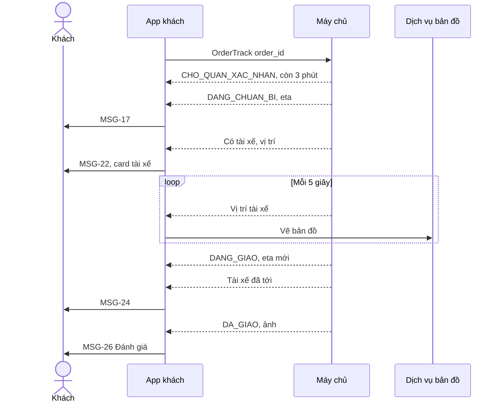

**Map lỗi → thông báo**

| **Nhóm lỗi** | **Message** |
| --- | --- |
| Quán nhận đơn | MSG-17 |
| Quán từ chối, không phản hồi | MSG-18 |
| Quán báo hết món | MSG-19 |
| Giờ giao trễ hơn, quán gia hạn | MSG-20 |
| Không có tài xế | MSG-21 |
| Có tài xế | MSG-22 |
| Tài xế lấy món | MSG-23 |
| Tài xế đã tới | MSG-24 |
| Giao thất bại | MSG-25 |
| Đã giao | MSG-26 |

### 8.4 Bước 4 · Huỷ, đánh giá & sự cố

| **API** | **Request chính** | **Response chính** | **Timeout / retry** |
| --- | --- | --- | --- |
| \[OrderCancel\] | order_id, reason, note | status, refund_amount | 5s / 1 lần |
| \[ReviewSubmit\] | order_id, store_rating, store_tags, comment, photos, driver_rating, driver_tags | review_id | 10s / 1 lần |
| \[TipSend\] | order_id, amount, idempotency_key | status | 10s / gửi lại cùng key |
| \[IssueCreate\] | order_id, type, items, photos, description, idempotency_key | issue_id, status, refund_amount | 15s / gửi lại cùng key |
| \[OrderHistory\] | tab, cursor | Danh sách đơn | 5s / 1 lần |
| \[OrderDetail\] | order_id | Chi tiết, allowed_actions (mục 4.2) | 5s / 1 lần |
| \[Reorder\] | order_id | Giỏ mới, món bị bỏ | 5s / 1 lần |

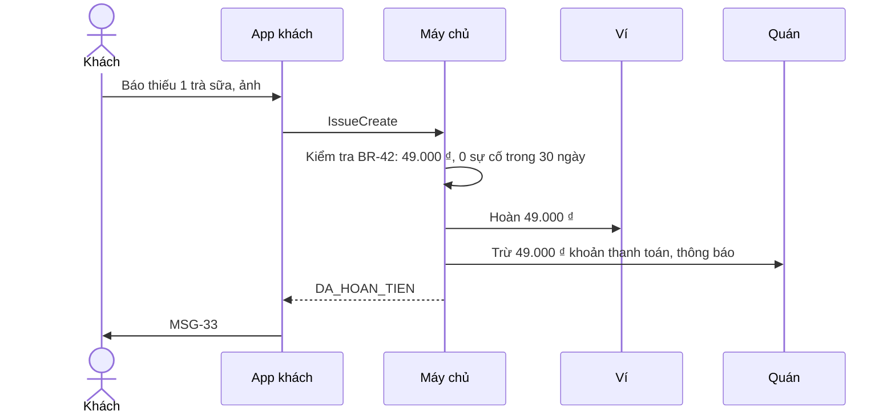

**Map lỗi → thông báo**

| **Nhóm lỗi** | **Message** |
| --- | --- |
| Huỷ thành công | MSG-27 |
| Không còn huỷ được | MSG-28 |
| Hoàn tiền cho đơn bị huỷ không do khách | MSG-29 |
| Gửi đánh giá thành công | MSG-30 |
| Tip lỗi | MSG-31 |
| Quá hạn đánh giá, báo sự cố | MSG-32 |
| Hoàn tiền sự cố ngay | MSG-33 |
| Sự cố chờ duyệt | MSG-34 |
| Bị khoá tiền mặt | MSG-35 |
| Mất mạng | MSG-36 |

## 9. Danh sách thông báo

| **ID** | **Nơi hiện** | **Nội dung (VI)** |
| --- | --- | --- |
| MSG-01 | Empty state | Rất tiếc, chúng tôi chưa giao tới địa chỉ này. \[Đổi địa chỉ\] |
| MSG-02 | Empty state | Không tìm thấy “{từ khoá}” gần bạn. Thử từ khoá khác hoặc xem danh mục |
| MSG-03 | Banner | Quán đang đóng cửa, mở lại lúc {giờ}. Bạn vẫn có thể xem menu |
| MSG-04 | Popup | Giỏ hàng đang có món của {quán cũ}. Tạo giỏ mới với món của {quán mới}? \[Tạo giỏ mới\] \[Giữ giỏ cũ\] |
| MSG-05 | Toast | {Tên món} đã hết. {Nếu Đặt lại: Các món còn lại đã được thêm vào giỏ} |
| MSG-06 | Toast | Kết nối không ổn định, vui lòng thử lại |
| MSG-07 | Banner **SCR-05** | Một số món đã hết hoặc đổi giá. Vui lòng kiểm tra lại giỏ. Tổng mới: {tổng} ₫ |
| MSG-08 | Inline | Quán không giao tới địa chỉ này (quá 10 km). Chọn địa chỉ khác hoặc quán khác |
| MSG-09 | Inline | Mỗi đơn tối đa 30 món và 3.000.000 ₫ |
| MSG-10 | Inline thanh toán | Thanh toán tiền mặt áp dụng cho đơn đến 1.000.000 ₫ {hoặc: Tài khoản tạm thời không dùng được tiền mặt} |
| MSG-11 | Popup | {Quán} vừa đóng cửa hoặc tạm ngưng nhận đơn. Giỏ hàng vẫn được giữ |
| MSG-12 | Popup | Ví không đủ số dư hoặc đang lỗi. \[Nạp tiền vào ví\] \[Dùng tiền mặt\] |
| MSG-13 | Popup | Bạn đang có 3 đơn chưa giao xong. Vui lòng đặt thêm sau khi có đơn hoàn tất |
| MSG-14 | Toast | Đã gửi đơn tới {quán}. Đang chờ quán xác nhận |
| MSG-15 | Popup | Chưa tạo được đơn. Số tiền {tổng} ₫ đã được hoàn về ví |
| MSG-16 | Toast | Kết nối không ổn định, vui lòng thử lại |
| MSG-17 | Push | {Quán} đã nhận đơn và đang chuẩn bị. Dự kiến giao lúc {giờ} |
| MSG-18 | Popup / push | {Quán} không thể nhận đơn {lý do}. {Nếu trả ví: Đã hoàn {số tiền} ₫ về ví}. \[Xem quán khác\] |
| MSG-19 | Popup | {Quán} báo hết {món}. Bạn muốn bỏ món này hay huỷ đơn? Sau 3 phút, món sẽ tự được bỏ. \[Bỏ món\] \[Huỷ đơn\] |
| MSG-20 | Push | Đơn của bạn cần thêm thời gian. Dự kiến giao lúc {giờ mới} |
| MSG-21 | Popup / push | Rất tiếc, hiện chưa có tài xế nhận đơn của bạn nên đơn đã được huỷ. {Đã hoàn {tổng} ₫ về ví}. \[Đặt lại\] |
| MSG-22 | Push | {Tên tài xế} ({biển số}) sẽ lấy món tại {quán} lúc khoảng {giờ} |
| MSG-23 | Push | Tài xế đã lấy món và đang giao tới bạn. Dự kiến tới lúc {giờ} |
| MSG-24 | Push | Tài xế đã tới. Vui lòng ra nhận đồ ăn |
| MSG-25 | Push | Tài xế không liên lạc được với bạn nên đơn không giao được. Đơn vẫn được tính tiền. Liên hệ hỗ trợ nếu có nhầm lẫn |
| MSG-26 | Push | Đơn của bạn đã được giao. Chúc ngon miệng! \[Đánh giá\] |
| MSG-27 | Toast | Đã huỷ đơn. {Nếu trả ví: {số tiền} ₫ đã được hoàn về ví} |
| MSG-28 | Popup | Quán đã bắt đầu chuẩn bị nên không thể huỷ trong ứng dụng. \[Cần hỗ trợ\] \[Đóng\] |
| MSG-29 | Push | Đơn {mã} đã huỷ ({lý do}). Đã hoàn {số tiền} ₫ về ví của bạn |
| MSG-30 | Toast | Cảm ơn bạn đã đánh giá! |
| MSG-31 | Toast | Chưa gửi được tip: ví không đủ số dư hoặc đang lỗi. Đánh giá của bạn đã được lưu |
| MSG-32 | Popup | Đã quá thời gian {đánh giá: 7 ngày / báo sự cố: 2 giờ} hoặc đơn đã có yêu cầu. Liên hệ hỗ trợ nếu cần |
| MSG-33 | Overlay | Đã hoàn {số tiền} ₫ vào ví. Xin lỗi vì trải nghiệm chưa tốt! |
| MSG-34 | Overlay | Đã gửi yêu cầu. Bộ phận hỗ trợ sẽ phản hồi trong 24 giờ |
| MSG-35 | Inline thanh toán | Tài khoản tạm thời chỉ dùng được ví đến {ngày} do có đơn tiền mặt không nhận |
| MSG-36 | Toast | Kết nối không ổn định, vui lòng thử lại |

## 10. Yêu cầu phi chức năng

| **Mục** | **Yêu cầu** |
| --- | --- |
| Hiệu năng | **SCR-01** hiện quán đầu tiên ≤ 2 giây trên 4G; \[Search\] ≤ 500 ms (p95); mở **SCR-04** ≤ 300 ms (dữ liệu có sẵn từ \[StoreMenu\]); \[CartValidate\] ≤ 1 giây (p95); \[OrderCreate\] ≤ 3 giây (p95); đơn tới quán ≤ 3 giây sau khi tạo; Trạng thái mới hiện trên **SCR-07** ≤ 3 giây sau khi quán, tài xế cập nhật; push ≤ 5 giây; Hoàn ví tự động ≤ 5 phút (mục tiêu ≤ 1 phút); \[IssueCreate\] có ảnh ≤ 10 giây trên 4G |
| Độ tươi dữ liệu | Trạng thái quán và món hết cập nhật trên app ≤ 30 giây sau khi quán đổi trên ứng dụng quán |
| Riêng tư | Vị trí chỉ lấy khi app đang dùng |
| Log / audit | Từ khoá tìm kiếm, số kết quả; Báo giá phí (quote_id), thay đổi giỏ, kết quả trừ và hoàn ví; Mọi lần đổi trạng thái, lựa chọn khi món hết, cuộc gọi qua số trung gian (thời điểm, thời lượng); Mọi lệnh hoàn tiền: lý do, số tiền, tự động hay ai duyệt; mọi thay đổi trạng thái sự cố |
| Tracking | Mở app, đổi địa chỉ, chạm danh mục, tìm kiếm, lọc, mở quán (vị trí trong danh sách), mở món, thêm giỏ, thay giỏ, đặt lại; Mở giỏ, sửa món, đổi địa chỉ, thêm chi tiết, đổi người nhận, chạm ⓘ, thanh toán, đặt đơn (kết quả, lý do lỗi), bỏ giỏ; Mở **SCR-07**, nguồn mở (banner, push), chạm gọi, nhắn, tin nhắn nhanh, chọn khi món hết, Cần hỗ trợ; Huỷ (lý do, kết quả), mở đánh giá, gửi đánh giá (số sao, nhãn), tip (mức), báo sự cố (loại, tự động hay duyệt, số tiền), đặt lại |
| Accessibility | Thẻ quán đọc được đầy đủ (tên, thời gian, phí); nhóm tuỳ chọn đọc rõ bắt buộc, số tối đa; giá cộng thêm đọc rõ; Bảng phí đọc được từng dòng; nút Đặt đơn đọc rõ tổng tiền; ghim bản đồ có cách chọn địa chỉ thay thế bằng tìm kiếm; Tiêu đề trạng thái được đọc khi thay đổi; giờ dự kiến đọc dạng "từ 12 giờ 25 tới 12 giờ 35"; bản đồ có mô tả thay thế "Tài xế cách bạn {n} km"; Sao đánh giá chọn được bằng giọng đọc ("3 trên 5 sao"); nhãn là nút có tên; camera có lựa chọn tải ảnh từ thư viện |
| Tính đúng | Idempotency bắt buộc; mỗi đơn lưu giá từng món, từng khoản phí tại thời điểm đặt; Idempotency cho tip, sự cố; số tiền hoàn tính trên giá đã lưu lúc đặt |
| Bảo mật, riêng tư | Số điện thoại người nhận chỉ tài xế và quán của đơn thấy, qua số trung gian (Bước 3); Số thật không hiển thị cho bên nào (BR-30); vị trí tài xế chỉ hiện khi đơn đang có tài xế; Ảnh sự cố chỉ hỗ trợ và quán của đơn xem; đánh giá công khai dùng tên viết tắt |
| Pin, dữ liệu | Màn ở nền thì ngừng cập nhật bản đồ, chỉ nhận push |
| Chống lạm dụng | Đếm sự cố theo tài khoản, thiết bị, địa chỉ giao; vượt ngưỡng gắn cờ (BR-42) |
