> **Mã:** DE06-SRS · **Trạng thái:** đã chốt · **Người viết:** Design · **PRD:** [PRD.md](PRD.md)

# UC-DE06 - Đặt ship đồ ăn

> SRS này mô tả **1 tính năng**, là **1 luồng** gồm 5 bước: Khám phá quán & món → Giỏ hàng & đặt đơn → Quán nhận & chuẩn bị đơn → Tài xế nhận & giao đơn → Huỷ, đánh giá & sự cố. Mã BR, MSG, UC, SCR đánh số liên tục trong toàn tài liệu. Sơ đồ chung xem [README](../README.md).

## 1. Tổng quan

| **Mục** | **Nội dung** |
| --- | --- |
| Mục tiêu | Nền tảng giao đồ ăn: khách chọn quán và món, đặt đơn; quán nhận và chuẩn bị; hệ thống tìm tài xế đúng lúc món xong; tài xế lấy món, giao tới khách; khách theo dõi trên bản đồ, đánh giá, báo sự cố nếu có |
| Actor | Khách · App khách · Máy chủ · Dịch vụ bản đồ · Ví liên kết · Quán (chủ quán, nhân viên quầy) · App quán · Khách (nhận thông báo) · Tài xế · Quán · App tài xế · Máy chủ điều phối · Dịch vụ cuộc gọi trung gian · Nhân viên hỗ trợ (hệ thống nội bộ) · Quán, tài xế (nhận kết quả) |
| Luồng | Bước 1 Khám phá quán & món → Bước 2 Giỏ hàng & đặt đơn → Bước 3 Quán nhận & chuẩn bị đơn → Bước 4 Tài xế nhận & giao đơn → Bước 5 Huỷ, đánh giá & sự cố |
| Ngoài phạm vi | Web quản lý quán (menu, giá, báo cáo, đối soát), trang quản trị và màn xử lý của nhân viên hỗ trợ, đăng ký và duyệt quán, tài xế, ví điện tử (dùng ví liên kết có sẵn), mã giảm giá và khuyến mãi của nền tảng, đặt hẹn giờ, ghép nhiều đơn cho một tài xế, giao hàng không phải đồ ăn |
| Nền tảng | App khách iOS / Android · App quán (điện thoại hoặc tablet) · App tài xế iOS / Android |

### Các bước của luồng

| **Bước** | **Mục tiêu** | **Phạm vi** |
| --- | --- | --- |
| Bước 1 · Khám phá quán & món | Khách tìm được quán, món phù hợp với địa chỉ giao; chọn tuỳ chọn món và thêm vào giỏ | Địa chỉ giao, trang chủ, danh mục, thẻ quán, tìm kiếm, lọc, sắp xếp, trang quán, tuỳ chọn món, thêm giỏ |
| Bước 2 · Giỏ hàng & đặt đơn | Khách xác nhận món, địa chỉ, người nhận, phí, thanh toán và đặt đơn | Giỏ hàng, ghi chú, dụng cụ, địa chỉ giao, người nhận, bảng phí, thanh toán, đặt đơn |
| Bước 3 · Quán nhận & chuẩn bị đơn | Quán nhận đơn nhanh, chuẩn bị đúng hẹn, báo xong để tài xế lấy; quản lý món hết và tạm ngưng | Đơn mới, nhận, từ chối, tự huỷ khi quá hạn, danh sách đơn, chi tiết, báo hết món sau nhận, gia hạn, báo xong, bật tắt món, tạm ngưng |
| Bước 4 · Tài xế nhận & giao đơn | Ghép tài xế đúng lúc; tài xế lấy đúng đơn, giao đúng người; khách và quán thấy cùng một trạng thái | Bật nhận đơn, thời điểm tìm, gửi yêu cầu, nhận, bỏ qua, không tìm được, đến quán, lấy món, giao, ảnh xác nhận, thu tiền mặt, không gặp khách, theo dõi đơn, liên lạc |
| Bước 5 · Huỷ, đánh giá & sự cố | Khách huỷ được khi còn kịp, được hoàn tiền nhanh, đánh giá cụ thể, báo sự cố và được bồi hoàn | Huỷ đơn, hoàn ví, đánh giá quán và tài xế, tip, báo sự cố, bồi hoàn tự động hoặc qua duyệt, lịch sử đơn, đặt lại, khoá tiền mặt |

## 2. User Story

| **ID** | **As a** | **I want** | **So that** |
| --- | --- | --- | --- |
| US-01 | Khách | Chỉ thấy quán giao được tới địa chỉ của tôi | Không chọn nhầm quán xa |
| US-02 | Khách | Thấy thời gian, phí giao của từng quán | Chọn nhanh |
| US-03 | Khách | Tìm món, quán không cần gõ dấu | Tìm nhanh |
| US-04 | Khách | Chọn size, topping và thấy giá ngay | Nhận đúng món |
| US-05 | Khách | Đặt lại món quen | Không phải chọn lại |
| US-06 | Khách | Sửa món, ghi chú trong giỏ | Đơn đúng ý |
| US-07 | Khách | Ghi rõ toà, tầng, ghi chú cho tài xế | Tài xế không phải gọi hỏi |
| US-08 | Khách | Đặt hộ người khác | Tài xế liên lạc đúng người nhận |
| US-09 | Khách | Hiểu từng khoản phí | Thấy giá hợp lý |
| US-10 | Khách | Đặt một lần là một đơn | Không bị trùng đơn |
| US-11 | Quán | Nghe chuông lặp khi có đơn | Không bỏ lỡ đơn |
| US-12 | Quán | Nhận đơn và hẹn giờ xong trong một chạm | Làm nhanh giờ cao điểm |
| US-13 | Quán | Báo món vừa hết sau khi đã nhận | Không phải gọi khách |
| US-14 | Quán | Biết đơn nào sắp trễ | Làm đúng thứ tự |
| US-15 | Quán | Tắt món hết, tạm ngưng khi quá tải | Không nhận đơn làm không kịp |
| US-16 | Tài xế | Thấy thu nhập, quãng đường trước khi nhận | Quyết định nhanh |
| US-17 | Tài xế | Đối chiếu mã đơn khi lấy món | Không lấy nhầm |
| US-18 | Khách | Thấy tài xế trên bản đồ, giờ tới | Ra nhận đúng lúc |
| US-19 | Tài xế | Có quy trình rõ khi không gặp khách | Không mất thời gian, vẫn có thu nhập |
| US-20 | Khách, tài xế | Liên lạc không lộ số thật | Giữ riêng tư |
| US-21 | Khách | Huỷ đơn khi quán chưa nhận | Không mất tiền khi đặt nhầm |
| US-22 | Khách | Biết hoàn bao nhiêu, khi nào | Yên tâm |
| US-23 | Khách | Đánh giá bằng nhãn cụ thể | Quán biết cần sửa gì |
| US-24 | Khách | Tip tài xế | Cảm ơn tài xế |
| US-25 | Khách | Báo thiếu món có ảnh, được hoàn ngay | Không phải chờ hỗ trợ |
| US-26 | Khách | Đặt lại đơn cũ | Ăn lại món quen nhanh |

## 3. Business Rules

| **Mã** | **Quy tắc** |
| --- | --- |
| BR-01 | **Địa chỉ giao** mặc định = vị trí thiết bị khớp vào địa chỉ gần nhất; hoặc địa chỉ đã lưu dùng gần nhất nếu thiết bị cách đó ≤ 100 m. Ngoài vùng phục vụ → MSG-01, không hiện quán |
| BR-02 | **Quán hiển thị**: khoảng cách theo đường đi từ quán tới địa chỉ giao ≤ 10 km; quán đã được duyệt hoạt động |
| BR-03 | **Thời gian dự kiến** = thời gian chuẩn bị trung bình của quán (7 ngày gần nhất, cùng khung giờ) + thời gian đi từ quán tới khách; hiện dạng khoảng 10 phút làm tròn 5, ví dụ "25–35 phút" |
| BR-04 | **Trạng thái quán**: `DANG_MO` (trong giờ mở cửa, đang bật nhận đơn); `SAP_DONG` (còn ≤ 30 phút tới giờ đóng, hiện "Đóng lúc {giờ}"); `DONG_CUA` (ngoài giờ, hiện "Mở lúc {giờ, ngày}"); `TAM_NGUNG` (quán tắt nhận đơn, Bước 3). `DONG_CUA`, `TAM_NGUNG` xếp cuối mọi danh sách, không thêm giỏ được |
| BR-05 | **Phí giao ước tính** trên thẻ quán = 15.000 ₫ cho 3 km đầu + 5.000 ₫ mỗi km tiếp theo (làm tròn lên km), làm tròn 1.000 ₫; quán tự tài trợ phí giao thì ghi "Miễn phí giao" (phí cuối cùng tính ở Bước 2 BR-13) |
| BR-06 | **Thẻ quán**: ảnh bìa, tên, điểm đánh giá trung bình (1 số lẻ) + số lượt (ẩn nếu < 10 lượt, ghi "Quán mới"), khoảng cách, thời gian dự kiến, phí giao, nhãn trạng thái |
| BR-07 | **Tìm kiếm** quán và món; không phân biệt dấu, hoa thường; gợi ý sau 2 ký tự, chờ 300 ms. Kết quả nhóm theo quán, mỗi quán hiện tối đa 3 món khớp. Lọc: Đang mở, Miễn phí giao, ≤ 3 km. Sắp xếp: Phù hợp (mặc định), Gần nhất, Giao nhanh nhất, Đánh giá cao |
| BR-08 | **Món**: tên, mô tả ≤ 200 ký tự, ảnh, giá; giá giảm do quán đặt hiện giá gốc gạch ngang. Món `HET_MON` (Bước 3) hiện mờ, nhãn "Hết món". Nhãn "Bán chạy" cho 5 món nhiều đơn nhất 30 ngày |
| BR-09 | **Giỏ 1 quán**: thêm món của quán khác khi giỏ đang có món → MSG-04 \[Tạo giỏ mới\] \[Giữ giỏ cũ\] |
| BR-10 | **Nhóm tuỳ chọn**: mỗi nhóm có min, max lựa chọn (bắt buộc khi min ≥ 1); mỗi lựa chọn có giá cộng thêm ≥ 0 và có thể hết. Giá món = (giá gốc + tổng giá lựa chọn) × số lượng. Số lượng 1–20. Ghi chú món ≤ 100 ký tự. Cùng món, cùng tuỳ chọn, cùng ghi chú → gộp dòng trong giỏ |
| BR-11 | **Giỏ** lưu trên máy chủ theo tài khoản, 1 quán, hết hạn 24 giờ không hoạt động. Mở **SCR-K05** → kiểm tra lại: món hết → nhãn "Hết món", không tính vào tạm tính; giá đổi → nhãn "Giá đã thay đổi" và giá mới; quán đóng, tạm ngưng → banner, nút Đặt disabled |
| BR-12 | **Địa chỉ giao**: ghim bản đồ (bắt buộc) + tên đường, phường (từ ghim) + chi tiết (toà, tầng, phòng) ≤ 100 ký tự + ghi chú cho tài xế ≤ 100 ký tự. Địa chỉ đã lưu tối đa 10, gồm Nhà, Công ty. Đổi địa chỉ khác quán > 10 km → MSG-08 |
| BR-13 | **Phí giao** = phí theo khoảng cách đường đi thực tế (Bước 1 BR-05) + phụ phí 5.000 ₫ khi vận hành bật cao điểm hoặc thời tiết xấu cho khu vực − phần quán tài trợ (nếu có, tối đa bằng phí giao) |
| BR-14 | **Phí dịch vụ** 3.000 ₫/đơn. **Phí đơn nhỏ** 5.000 ₫ khi tạm tính < 40.000 ₫; hiện gợi ý "Thêm {40.000 − tạm tính} ₫ để không mất phí đơn nhỏ" |
| BR-15 | **Tổng** = tạm tính + phí giao + phí dịch vụ + phí đơn nhỏ. Tạm tính tối đa 3.000.000 ₫, tối đa 30 món; vượt → MSG-09 |
| BR-16 | **Thanh toán**: Tiền mặt (tổng ≤ 1.000.000 ₫, khách không bị khoá tiền mặt theo Bước 5 BR-55) hoặc Ví liên kết. Ví → trừ tiền khi tạo đơn; đơn huỷ không do lỗi khách → hoàn toàn bộ trong ≤ 5 phút. Không đổi phương thức sau khi đặt |
| BR-17 | **Người nhận** mặc định tên, số điện thoại tài khoản; đổi được cho riêng đơn này. Số điện thoại di động Việt Nam 10 số |
| BR-18 | **Ghi chú cho quán** ≤ 200 ký tự. **Dụng cụ ăn uống** mặc định tắt |
| BR-19 | **Đặt đơn**: idempotency key cho mỗi lần mở **SCR-K05**. Máy chủ kiểm tra: quán `DANG_MO` hoặc `SAP_DONG` và còn ≥ 10 phút tới giờ đóng; món còn; giá khớp; khách có < 3 đơn chưa kết thúc. Đạt → tạo đơn `CHO_QUAN_XAC_NHAN`, mã đơn 6 ký tự chữ số, gửi tới quán (Bước 3) |
| BR-20 | **Thời gian dự kiến** trên **SCR-K05** tính lại theo địa chỉ cuối (Bước 1 BR-03), hiện dạng "Giao lúc 12:25–12:35" |
| BR-21 | **Giải thích phí** (ⓘ): Phí giao – "Trả cho tài xế, tính theo quãng đường {km} km"; Phụ phí – "Đang cao điểm hoặc thời tiết xấu, giúp có thêm tài xế"; Phí dịch vụ – "Duy trì ứng dụng và hỗ trợ khách hàng"; Phí đơn nhỏ – "Áp dụng cho đơn dưới 40.000 ₫" |
| BR-22 | **Ví liên kết** không đủ số dư hoặc lỗi → MSG-12; không tạo đơn. Ví trừ tiền thành công nhưng tạo đơn lỗi → hoàn ngay, MSG-15 |
| BR-23 | **Đơn mới** tới mọi thiết bị đang đăng nhập của quán; **SCR-Q02** dạng toàn màn, âm thanh lặp mỗi 5 giây tới khi có người chạm vào màn; đếm ngược 3 phút tính trên máy chủ. App nền → thông báo có âm thanh riêng |
| BR-24 | **Nhận đơn**: chọn thời gian chuẩn bị 5–60 phút; gợi ý = thời gian mặc định của quán + 2 phút cho mỗi món vượt 5 món, làm tròn 5. Nhận → đơn `DANG_CHUAN_BI`, hạn xong = thời điểm nhận + thời gian chuẩn bị; khách nhận MSG-17. Thiết bị khác của quán đóng màn đơn mới |
| BR-25 | **Từ chối**: lý do bắt buộc: Hết món (chọn 1+ món hoặc tuỳ chọn hết → tự chuyển `HET_MON`), Quán quá tải, Sắp đóng cửa, Khác (≤ 100 ký tự). Đơn `DA_HUY`, hoàn ví cho khách (Bước 2 BR-16), khách nhận MSG-18 |
| BR-26 | **Quá hạn xác nhận** 3 phút → đơn `DA_HUY` lý do "Quán không phản hồi", hoàn ví. Bộ đếm bỏ lỡ của quán +1; nhận 1 đơn thì về 0. Đạt 3 → quán `TAM_NGUNG` (tới khi bật lại), push MSG-19 cho chủ quán |
| BR-27 | **Thứ tự đơn đang làm**: theo hạn xong tăng dần. Còn ≤ 2 phút tới hạn → nhãn "Sắp trễ"; quá hạn → nhãn "Trễ {n} phút", màu cảnh báo |
| BR-28 | **Báo hết món sau khi nhận**: chọn món hoặc tuỳ chọn hết → khách nhận MSG-20 với \[Bỏ món\] \[Huỷ đơn\], 3 phút để chọn; không trả lời → bỏ món. Bỏ món → tạm tính giảm, hoàn phần tiền món nếu trả ví, đơn tiếp tục; phí giao, phí dịch vụ giữ nguyên; tạm tính mới < 40.000 ₫ không tính thêm phí đơn nhỏ. Mọi món đều hết hoặc khách chọn Huỷ → `DA_HUY`, hoàn toàn bộ, không tính lỗi khách. Quán không có nút huỷ tự do |
| BR-29 | **Gia hạn**: khi còn ≤ 2 phút hoặc đã trễ, quán gia hạn +5 hoặc +10 phút, 1 lần mỗi đơn; khách nhận MSG-21 với giờ giao mới; tài xế đã nhận đơn thấy giờ món xong mới |
| BR-30 | **Món đã xong**: quán bấm → `SAN_SANG`; tài xế đã gán nhận push (Bước 4). Bàn giao do tài xế xác nhận "Đã lấy món" (Bước 4); **SCR-Q01** chuyển đơn sang tab Đã xong khi đơn `DANG_GIAO` |
| BR-31 | **Tạm ngưng nhận đơn**: 30 phút, 1 giờ, tới hết ngày, tới khi bật lại. Trong lúc tạm ngưng, khách thấy quán `TAM_NGUNG` (Bước 1 BR-04); đơn đang làm không bị ảnh hưởng. Bật lại → `DANG_MO` nếu trong giờ mở cửa |
| BR-32 | **Món hết**: bật tắt theo món hoặc theo lựa chọn trong nhóm tuỳ chọn; chọn "Hết hôm nay" (tự còn lúc mở cửa ngày hôm sau) hoặc "Hết tới khi bật lại". Cập nhật lên app khách ≤ 30 giây |
| BR-33 | **Hiển thị khách** trên App quán: tên viết tắt ("Anh N."), mã đơn 6 ký tự; không hiện số điện thoại, địa chỉ khách |
| BR-34 | **Thời điểm tìm tài xế**: thời gian chuẩn bị ≤ 15 phút → tìm ngay khi quán nhận; > 15 phút → bắt đầu khi còn 10 phút tới hạn xong (gồm gia hạn). Khi bắt đầu tìm, khách thấy "Đang tìm tài xế" |
| BR-35 | **Tài xế đủ điều kiện**: `DANG_RANH`, vị trí cập nhật trong 30 giây, trong bán kính quanh quán (3 km, +1 km mỗi phút, tối đa 6 km), chưa bỏ qua đơn này. Gửi lần lượt cho tài xế có thời gian tới quán ngắn nhất; mỗi lần 1 tài xế, 20 giây trả lời |
| BR-36 | **Thẻ yêu cầu**: tên quán, khoảng cách tới quán, quãng đường quán → khách, thu nhập dự kiến (BR-45), giờ món xong, tiền mặt cần thu (nếu có), số món. Không hiện địa chỉ chính xác của khách trước khi nhận (chỉ phường) |
| BR-37 | **Nhận đơn**: máy chủ kiểm tra đơn còn chưa có tài xế → gán; tài xế `DANG_CHAY`; khách và quán thấy tài xế (tên, ảnh, biển số, thời gian tới quán) |
| BR-38 | **Không tìm được tài xế**: sau 10 phút tìm → thêm thưởng 5.000 ₫ vào thu nhập dự kiến (vận hành bật); sau 25 phút → đơn `DA_HUY` lý do "Không có tài xế", hoàn ví cho khách; nếu quán đã báo xong món, nền tảng vẫn trả tiền món cho quán |
| BR-39 | **Trạng thái tài xế trong đơn**: `DANG_DEN_QUAN` → `DA_DEN_QUAN` (vào bán kính 100 m quanh quán và bấm "Đã đến quán") → `DA_LAY_MON` → `DANG_DEN_KHACH` → `DA_DEN_NOI_GIAO` (trong 150 m quanh điểm giao và bấm "Đã đến") → kết thúc. Đơn chuyển `DANG_GIAO` khi tài xế `DA_LAY_MON` |
| BR-40 | **Lấy món**: chỉ khi đơn `SAN_SANG`; màn lấy món hiện mã đơn 6 ký tự (chữ ≥ 32 pt), tên khách viết tắt, danh sách món để tích; bấm "Đã lấy món" sau khi tích đủ. Đơn chưa `SAN_SANG` → hiện giờ món xong. Chờ > 10 phút sau hạn xong → nút "Báo quán trễ" gửi hỗ trợ, tài xế được cộng phí chờ 5.000 ₫ |
| BR-41 | **Liên lạc**: gọi qua số trung gian, nhắn tin trong app (có tin nhắn nhanh: "Tôi đã tới", "Tôi đang xuống", "Để ở bảo vệ giúp tôi"); hiệu lực từ lúc nhận đơn tới 1 giờ sau khi kết thúc. Số thật không hiển thị cho bên nào |
| BR-42 | **Giao**: giao tận tay → bấm "Đã giao". Không giao tận tay (theo ghi chú: bảo vệ, lễ tân, treo cửa) → bắt buộc 1 ảnh, ảnh hiện cho khách trong chi tiết đơn. Đơn tiền mặt → màn thu tiền "Thu {tổng} ₫", tài xế bấm "Đã thu đủ"; tài xế đối soát tiền mặt với nền tảng (ngoài phạm vi). Kết thúc → đơn `DA_GIAO`, tài xế `DANG_RANH` |
| BR-43 | **Không gặp khách**: sau `DA_DEN_NOI_GIAO`, khách nhận push MSG-29; tài xế gọi ≥ 2 lần qua app (đếm trên máy chủ) và chờ 10 phút → nút "Giao thất bại" bật, chọn lý do (Không liên lạc được, Khách từ chối nhận, Sai địa chỉ). Đơn `GIAO_THAT_BAI`: khách bị tính tiền đầy đủ (ví không hoàn; tiền mặt ghi nhận lần không nhận, Bước 5 BR-55); tài xế nhận đủ thu nhập + phí chờ 5.000 ₫; đồ ăn xử lý theo chính sách, không giao cho người khác |
| BR-44 | **Theo dõi đơn** (**SCR-K07**): trạng thái theo mục 4.3; vị trí tài xế cập nhật mỗi 5 giây từ lúc nhận đơn; bản đồ hiện tài xế, quán, điểm giao; giờ tới dự kiến tính lại mỗi 30 giây. Không đổi địa chỉ giao sau khi đặt |
| BR-45 | **Thu nhập tài xế** = phí giao (gồm phụ phí) × 90% + thưởng (BR-38) + phí chờ (BR-40, BR-43) + 100% tip (Bước 5). Thẻ yêu cầu hiện phần không gồm tip |
| BR-46 | **Tài xế huỷ sau khi nhận**: chỉ trước `DA_LAY_MON`, chọn lý do; đơn quay về tìm tài xế (đồng hồ BR-38 không đặt lại), loại tài xế vừa huỷ; tối đa 2 lần, lần 3 → hỗ trợ xử lý. Sau `DA_LAY_MON` không có nút huỷ; sự cố (tai nạn, hỏng xe) báo qua nút "Báo sự cố" tới hỗ trợ |
| BR-47 | **Khách huỷ**: chỉ khi đơn `CHO_QUAN_XAC_NHAN` → huỷ ngay, miễn phí. Từ `DANG_CHUAN_BI` trở đi không có nút huỷ; hiện "Quán đã bắt đầu chuẩn bị" và nút "Cần hỗ trợ" mở kênh hỗ trợ; việc huỷ, tính tiền do hỗ trợ quyết định |
| BR-48 | **Lý do huỷ** bắt buộc: Đặt nhầm món · Đổi địa chỉ · Đổi phương thức thanh toán · Chờ quán lâu · Không còn nhu cầu · Khác (≤ 100 ký tự) |
| BR-49 | **Hoàn tiền về ví** ≤ 5 phút cho: khách huỷ hợp lệ, quán từ chối hoặc không phản hồi (Bước 3), hết món toàn bộ, bỏ món (phần tiền món), không có tài xế (Bước 4), sự cố được duyệt. Đơn tiền mặt chưa thu tiền thì không phát sinh hoàn (trừ bồi hoàn sự cố) |
| BR-50 | **Đánh giá**: trong 7 ngày sau `DA_GIAO`, 1 lần mỗi đơn, không sửa. Quán: 1–5 sao; nhãn 4–5 sao (Ngon, Đóng gói cẩn thận, Đúng món, Giá hợp lý), nhãn 1–3 sao (Món nguội, Thiếu món, Sai món, Đóng gói kém, Không hợp vệ sinh, Ít so với giá); bình luận ≤ 300 ký tự; ≤ 3 ảnh ≤ 10 MB. Tài xế: 1–5 sao; nhãn (Thân thiện, Giao nhanh, Cẩn thận / Thái độ chưa tốt, Giao chậm, Làm đổ món). Đánh giá quán công khai với tên viết tắt; đánh giá tài xế nội bộ |
| BR-51 | **Tip**: 5.000, 10.000, 20.000 ₫ hoặc số khác 1.000–200.000 ₫; chỉ bằng ví; trong 24 giờ sau `DA_GIAO`; 1 lần mỗi đơn; tài xế nhận 100% (Bước 4 BR-45), nhận push "Bạn được tip {x} ₫" |
| BR-52 | **Báo sự cố**: trong 2 giờ sau `DA_GIAO` (hoặc sau `GIAO_THAT_BAI` với loại "Không nhận được đơn"); 1 yêu cầu mỗi đơn. Loại: Thiếu món · Sai món · Món bị đổ vỡ · Chất lượng món (hỏng, có dị vật) · Không nhận được đơn. Với 4 loại đầu: chọn món và số lượng bị ảnh hưởng, ảnh 1–3 tấm bắt buộc. Mô tả ≤ 300 ký tự |
| BR-53 | **Số tiền bồi hoàn** = Σ (giá món + tuỳ chọn) × số lượng bị ảnh hưởng; mọi món bị ảnh hưởng ở loại Thiếu món, Sai món → thêm phí giao nếu cả đơn bị ảnh hưởng. Hoàn vào ví, kể cả đơn tiền mặt. "Không nhận được đơn" được duyệt → hoàn toàn bộ tổng đơn |
| BR-54 | **Tự động duyệt** khi: loại khác "Không nhận được đơn", số tiền ≤ 100.000 ₫, khách có ≤ 2 sự cố được duyệt trong 30 ngày, tài khoản không bị gắn cờ. Còn lại → `CHO_DUYET`, hỗ trợ trả lời ≤ 24 giờ |
| BR-55 | **Khoá tiền mặt**: 2 đơn tiền mặt `GIAO_THAT_BAI` trong 90 ngày → tài khoản chỉ được dùng ví trong 30 ngày (Bước 2 BR-16); hiện MSG-43 khi chọn thanh toán |
| BR-56 | **Lịch sử đơn**: 6 tháng gần nhất, mới nhất trước; tab Đang giao, Đã giao, Đã huỷ. "Đặt lại" thêm món còn bán với cùng tuỳ chọn vào giỏ (thay giỏ hiện tại theo Bước 1 BR-09); món, tuỳ chọn hết bị bỏ, MSG-05 (Bước 1) |
| BR-57 | **Gợi ý báo sự cố từ đánh giá**: chọn nhãn Thiếu món, Sai món khi còn trong 2 giờ → hiện "Bạn có muốn báo sự cố để được hoàn tiền?" → mở **SCR-K09** điền sẵn loại |
| BR-58 | **Ai chịu bồi hoàn**: Thiếu món, Sai món, Chất lượng → trừ vào khoản thanh toán cho quán; Món bị đổ vỡ → nền tảng chịu, ghi nhận vào chất lượng tài xế; Không nhận được đơn → hỗ trợ quyết định sau khi đối chiếu ảnh và vị trí giao |

## 4. Trạng thái

### 4.1 Bước 1 · Khám phá quán & món

#### Trạng thái nút Thêm vào giỏ trên SCR-K04

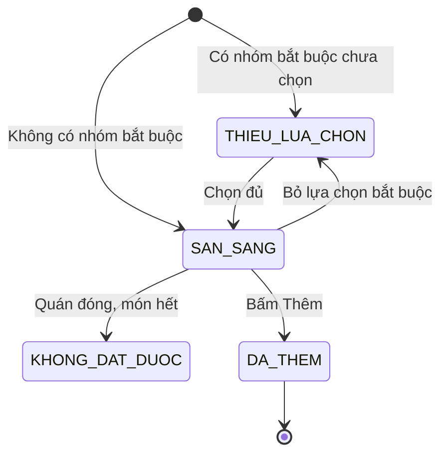

| **Trạng thái** | **Hiển thị** |
| --- | --- |
| `THIEU_LUA_CHON` | Nút ghi "Chọn {tên nhóm}"; chạm thì cuộn tới nhóm, nhóm rung nhẹ |
| `SAN_SANG` | "Thêm vào giỏ · {giá} ₫" |
| `KHONG_DAT_DUOC` | Nút disabled, ghi "Quán đang đóng cửa" hoặc "Hết món" |
| `DA_THEM` | Đóng **SCR-K04**, thanh giỏ ở **SCR-K03** cập nhật |

### 4.2 Bước 2 · Giỏ hàng & đặt đơn

#### Trạng thái nút Đặt đơn trên SCR-K05

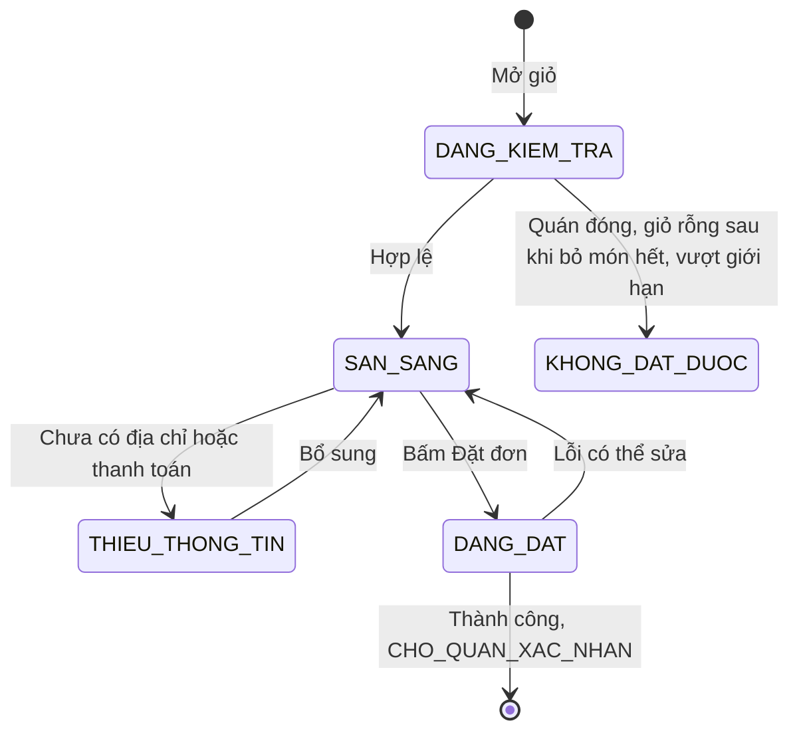

| **Trạng thái** | **Hiển thị nút** |
| --- | --- |
| `DANG_KIEM_TRA` | Skeleton giá, nút disabled |
| `SAN_SANG` | "Đặt đơn · {tổng} ₫" |
| `THIEU_THONG_TIN` | "Chọn địa chỉ giao" hoặc "Chọn thanh toán"; chạm mở phần thiếu |
| `KHONG_DAT_DUOC` | Disabled + lý do |
| `DANG_DAT` | Loading, không bấm lại được |

### 4.3 Bước 3 · Quán nhận & chuẩn bị đơn

#### Trạng thái đơn phía quán

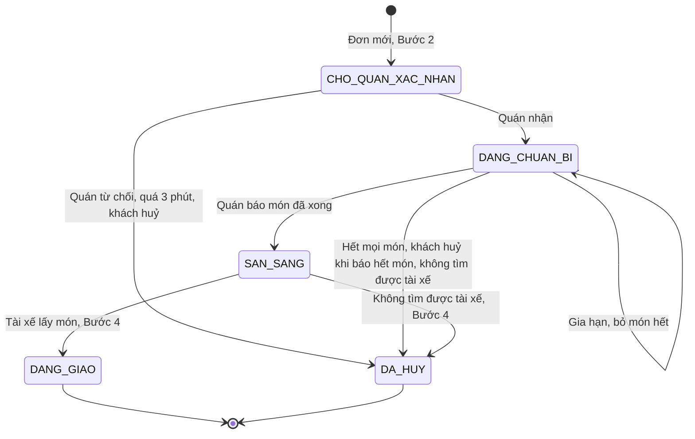

#### Trạng thái quán

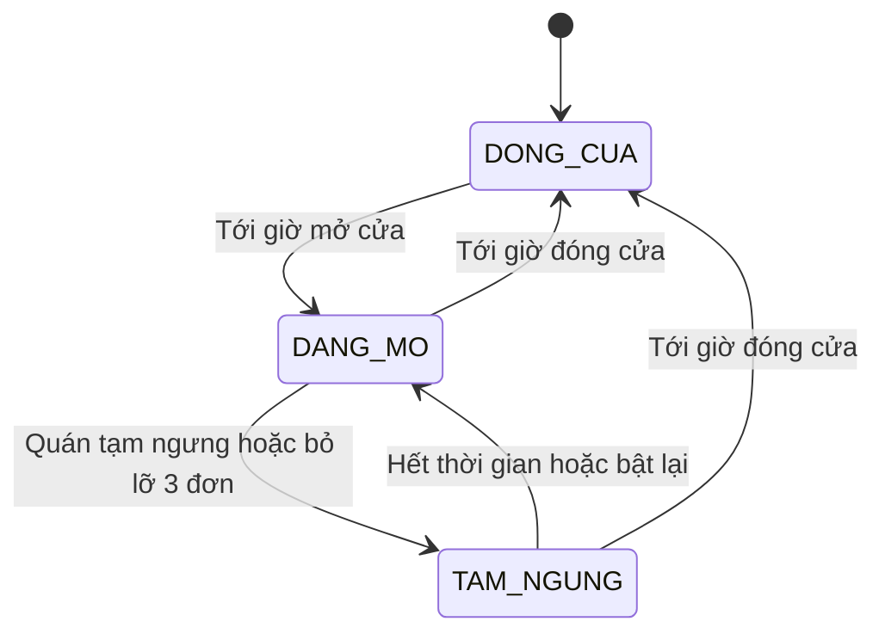

#### Tab trên SCR-Q01

| **Tab** | **Trạng thái đơn** | **Hiển thị** |
| --- | --- | --- |
| Mới | `CHO_QUAN_XAC_NHAN` | Đếm ngược, số món, tổng |
| Đang làm | `DANG_CHUAN_BI` | Hạn xong, nhãn Sắp trễ / Trễ, tài xế (nếu có) |
| Chờ tài xế | `SAN_SANG` | Tài xế, thời gian tới quán, "Đã tới" khi tài xế bấm đến quán |
| Đã xong | `DANG_GIAO`, `DA_GIAO`, `DA_HUY` trong ngày | Giờ, kết quả, lý do huỷ |

### 4.4 Bước 4 · Tài xế nhận & giao đơn

#### Trạng thái tài xế (toàn cục)

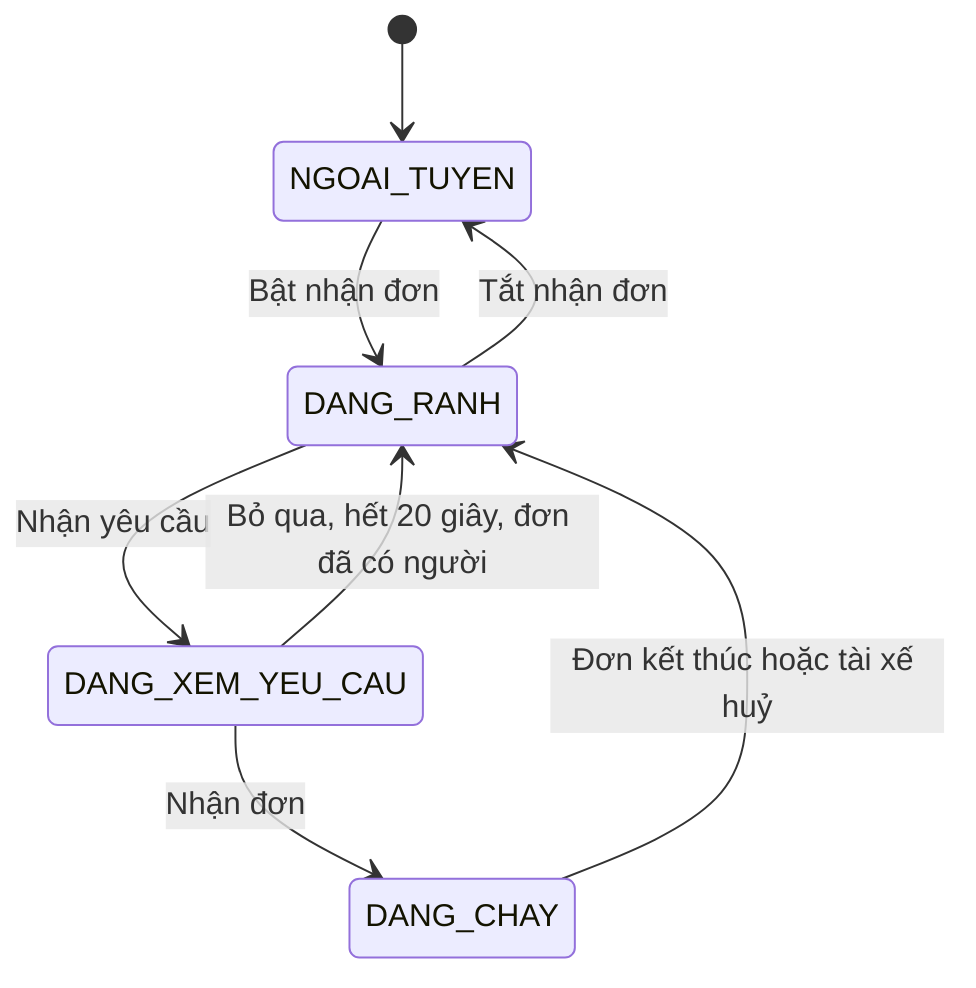

#### Tiến trình tài xế trong một đơn

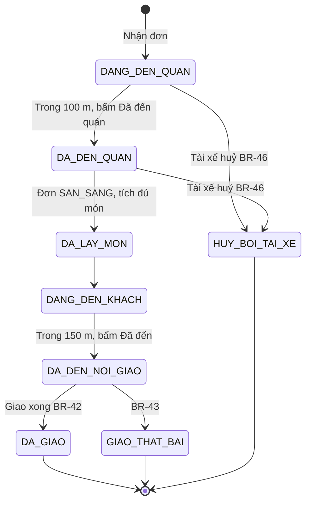

#### Khách thấy gì trên SCR-K07

| **Đơn / tài xế** | **Tiêu đề** | **Phụ** |
| --- | --- | --- |
| `CHO_QUAN_XAC_NHAN` | Chờ quán xác nhận | Đếm ngược ≤ 3 phút; nút Huỷ đơn (Bước 5) |
| `DANG_CHUAN_BI`, chưa tìm | Quán đang chuẩn bị | Giờ giao dự kiến |
| `DANG_CHUAN_BI` hoặc `SAN_SANG`, đang tìm | Đang tìm tài xế | "Đã tìm {n} phút" |
| `DANG_DEN_QUAN` | {Tên tài xế} đang tới quán | Biển số, giờ tới quán |
| `DA_DEN_QUAN` | Tài xế đang chờ lấy món | |
| `DANG_DEN_KHACH` | Đang giao tới bạn | Bản đồ, giờ tới |
| `DA_DEN_NOI_GIAO` | Tài xế đã tới | "Vui lòng ra nhận", nút gọi nổi bật |
| `DA_GIAO` | Đã giao | Ảnh xác nhận (nếu có), mở **SCR-K08** (Bước 5) |
| `GIAO_THAT_BAI` | Giao không thành công | Lý do, liên hệ hỗ trợ |

### 4.5 Bước 5 · Huỷ, đánh giá & sự cố

#### Vòng đời yêu cầu sự cố


#### Hành động khách theo trạng thái đơn

| **Trạng thái đơn** | **Huỷ** | **Đánh giá** | **Tip** | **Báo sự cố** | **Đặt lại** |
| --- | --- | --- | --- | --- | --- |
| `CHO_QUAN_XAC_NHAN` | Có | – | – | – | – |
| `DANG_CHUAN_BI`, `SAN_SANG`, `DANG_GIAO` | Cần hỗ trợ | – | – | – | – |
| `DA_GIAO` | – | 7 ngày | 24 giờ | 2 giờ | Có |
| `GIAO_THAT_BAI` | – | – | – | 2 giờ, chỉ "Không nhận được đơn" | Có |
| `DA_HUY` | – | – | – | – | Có |

## 5. Use Case

### Bước 1 · Khám phá quán & món

#### UC-01 Chọn địa chỉ và tìm quán

| **Mục** | **Nội dung** |
| --- | --- |
| Tiền điều kiện | Khách đã đăng nhập |
| Hậu điều kiện thành công | Khách mở được **SCR-K03** của một quán phục vụ địa chỉ giao |
| Hậu điều kiện thất bại | Ở lại **SCR-K01** hoặc **SCR-K02** với thông báo |

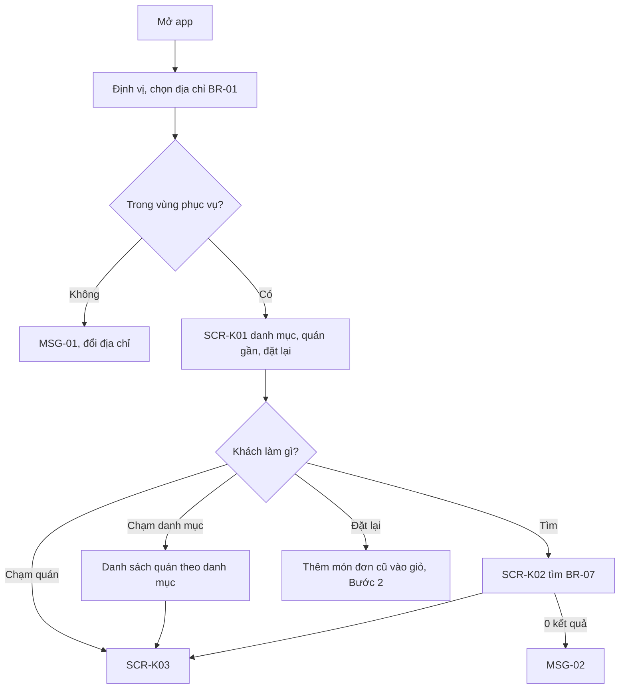

**Luồng chính**

| **Bước** | **Actor** | **Mô tả** |
| --- | --- | --- |
| 1 | Khách | Mở app |
| 2 | App | Định vị, chọn địa chỉ giao theo BR-01; gọi \[StoreFeed\] |
| 3 | App | Hiện **SCR-K01**: địa chỉ giao, danh mục, Đặt lại, Quán gần bạn |
| 4 | Khách | Chạm ô tìm, gõ "bun bo" |
| 5 | App | Gọi \[Search\]; hiện **SCR-K02** kết quả nhóm theo quán |
| 6 | Khách | Chạm một quán → **SCR-K03** |

**Luồng thay thế**

| **Mã** | **Điều kiện** | **Xử lý** |
| --- | --- | --- |
| A1 | Đổi địa chỉ giao | Chạm địa chỉ đầu trang → chọn đã lưu hoặc tìm mới (dùng chung **SCR-K06**, Bước 2) → tải lại danh sách |
| A2 | Chạm danh mục | Danh sách quán có món thuộc danh mục; cùng bộ lọc, sắp xếp như tìm kiếm |
| A3 | Đặt lại | Thêm món của đơn cũ vào giỏ (bỏ món hết, báo MSG-05) → **SCR-K05** (Bước 2) |
| A4 | Từ chối quyền vị trí | Khách chọn địa chỉ thủ công |

**Luồng lỗi**

| **Mã** | **Điều kiện** | **Xử lý** |
| --- | --- | --- |
| E1 | Ngoài vùng phục vụ | MSG-01 |
| E2 | Không có quán nào trong 10 km | Empty state "Chưa có quán giao tới khu vực này" |
| E3 | Tìm 0 kết quả | MSG-02, gợi ý danh mục |
| E4 | Lỗi mạng | MSG-06 |

#### UC-02 Xem menu và thêm món

| **Mục** | **Nội dung** |
| --- | --- |
| Tiền điều kiện | Quán phục vụ địa chỉ giao |
| Hậu điều kiện thành công | Món với tuỳ chọn đã vào giỏ; thanh giỏ hiện số món, tạm tính |
| Hậu điều kiện thất bại | Giỏ không đổi |

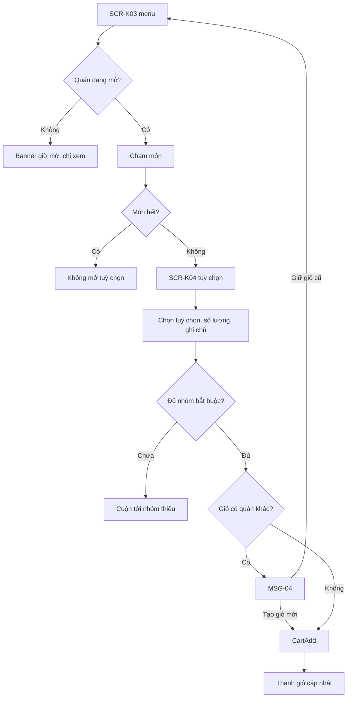

**Luồng chính**

| **Bước** | **Actor** | **Mô tả** |
| --- | --- | --- |
| 1 | App | Gọi \[StoreMenu\]; hiện **SCR-K03**: thông tin quán, thanh nhóm món, danh sách món |
| 2 | Khách | Chạm món "Trà sữa trân châu" |
| 3 | App | Mở **SCR-K04** với nhóm Size (bắt buộc), Đường, Đá, Topping |
| 4 | Khách | Chọn size L, 2 topping, số lượng 2 |
| 5 | App | Cập nhật "Thêm vào giỏ · 98.000 ₫" |
| 6 | Khách | Bấm Thêm vào giỏ |
| 7 | App | Gọi \[CartAdd\]; đóng **SCR-K04**; thanh giỏ "2 món · 98.000 ₫ · Xem giỏ" |

**Luồng thay thế**

| **Mã** | **Điều kiện** | **Xử lý** |
| --- | --- | --- |
| A1 | Món không có nhóm tuỳ chọn | Nút "+" trên dòng món thêm thẳng 1 món |
| A2 | Món đã trong giỏ | Dòng món hiện số lượng; "−" "+" sửa nhanh |
| A3 | Lựa chọn hết | Lựa chọn mờ, ghi "Hết" |
| A4 | Giỏ có quán khác | MSG-04 (BR-09) |

**Luồng lỗi**

| **Mã** | **Điều kiện** | **Xử lý** |
| --- | --- | --- |
| E1 | Quán vừa đóng, tạm ngưng | MSG-03, nút disabled |
| E2 | Món vừa hết khi bấm thêm | MSG-05 |
| E3 | Lỗi mạng | MSG-06 |

### Bước 2 · Giỏ hàng & đặt đơn

#### UC-03 Xác nhận giỏ, địa chỉ và thanh toán

| **Mục** | **Nội dung** |
| --- | --- |
| Tiền điều kiện | Giỏ có ít nhất 1 món còn |
| Hậu điều kiện thành công | Nút Đặt đơn ở `SAN_SANG` |
| Hậu điều kiện thất bại | Ở lại **SCR-K05** với lỗi |

**Luồng chính**

| **Bước** | **Actor** | **Mô tả** |
| --- | --- | --- |
| 1 | Khách | Chạm thanh giỏ → **SCR-K05** |
| 2 | App | Gọi \[CartValidate\]; hiện món, địa chỉ mặc định, phí (BR-13–15), thời gian dự kiến |
| 3 | Khách | Sửa số lượng một món; nhập ghi chú cho quán |
| 4 | Khách | Chạm địa chỉ → **SCR-K06**; chọn "Công ty", nhập chi tiết "Toà B, tầng 12" |
| 5 | App | Gọi \[DeliveryQuote\] tính lại phí giao, thời gian |
| 6 | Khách | Chọn Ví liên kết |
| 7 | App | Nút "Đặt đơn · {tổng} ₫" ở `SAN_SANG` |

**Luồng thay thế**

| **Mã** | **Điều kiện** | **Xử lý** |
| --- | --- | --- |
| A1 | Thêm địa chỉ mới | **SCR-K06**: tìm địa chỉ → kéo ghim → chi tiết, ghi chú → tuỳ chọn lưu với tên |
| A2 | Đổi người nhận | Chạm "Người nhận" → nhập tên, số điện thoại (BR-17) |
| A3 | Chạm ⓘ cạnh phí | Bottom sheet giải thích (BR-21) |
| A4 | Có phí đơn nhỏ | Gợi ý "Thêm {x} ₫…" + nút "Thêm món" về **SCR-K03** |
| A5 | Sửa tuỳ chọn món | Mở **SCR-K04** với lựa chọn hiện tại |

**Luồng lỗi**

| **Mã** | **Điều kiện** | **Xử lý** |
| --- | --- | --- |
| E1 | Món hết, giá đổi | Nhãn trên dòng (BR-11), MSG-07 |
| E2 | Địa chỉ quá xa quán | MSG-08 |
| E3 | Vượt giới hạn đơn | MSG-09 |
| E4 | Tiền mặt không khả dụng | MSG-10 |

#### UC-04 Đặt đơn

| **Mục** | **Nội dung** |
| --- | --- |
| Tiền điều kiện | Nút ở `SAN_SANG` |
| Hậu điều kiện thành công | Đơn `CHO_QUAN_XAC_NHAN`; giỏ trống; mở **SCR-K07** (Bước 4) |
| Hậu điều kiện thất bại | Không tạo đơn; ví không bị trừ hoặc đã hoàn |

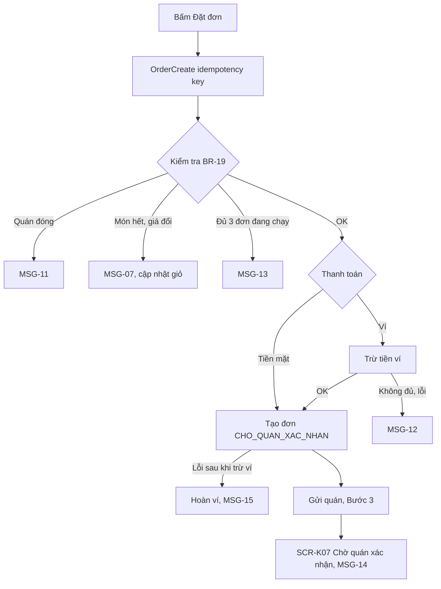

**Luồng chính**

| **Bước** | **Actor** | **Mô tả** |
| --- | --- | --- |
| 1 | Khách | Bấm "Đặt đơn · {tổng} ₫" |
| 2 | App | Gọi \[OrderCreate\] với idempotency key; nút `DANG_DAT` |
| 3 | Máy chủ | Kiểm tra BR-19; trừ ví (nếu ví); tạo đơn; gửi tới App quán |
| 4 | App | Mở **SCR-K07** trạng thái "Chờ quán xác nhận"; MSG-14 |

**Luồng thay thế**

| **Mã** | **Điều kiện** | **Xử lý** |
| --- | --- | --- |
| A1 | Mạng chậm, gửi lại | Gửi lại cùng key; máy chủ trả đơn đã tạo |
| A2 | Giá đổi lúc đặt | MSG-07 kèm tổng mới; khách bấm đặt lại |

**Luồng lỗi**

| **Mã** | **Điều kiện** | **Xử lý** |
| --- | --- | --- |
| E1 | Quán vừa đóng | MSG-11 |
| E2 | Ví lỗi, không đủ tiền | MSG-12 |
| E3 | Đủ 3 đơn chưa kết thúc | MSG-13 |
| E4 | Tạo đơn lỗi sau khi trừ ví | Hoàn ví, MSG-15 |
| E5 | Mất mạng hoàn toàn | MSG-16; khi có mạng gọi lại cùng key |

### Bước 3 · Quán nhận & chuẩn bị đơn

#### UC-05 Nhận hoặc từ chối đơn mới

| **Mục** | **Nội dung** |
| --- | --- |
| Tiền điều kiện | Quán `DANG_MO`; App quán đã đăng nhập |
| Hậu điều kiện thành công | Đơn `DANG_CHUAN_BI` với hạn xong; khách được báo; bắt đầu tìm tài xế theo Bước 4 |
| Hậu điều kiện thất bại | Đơn `DA_HUY` với lý do |

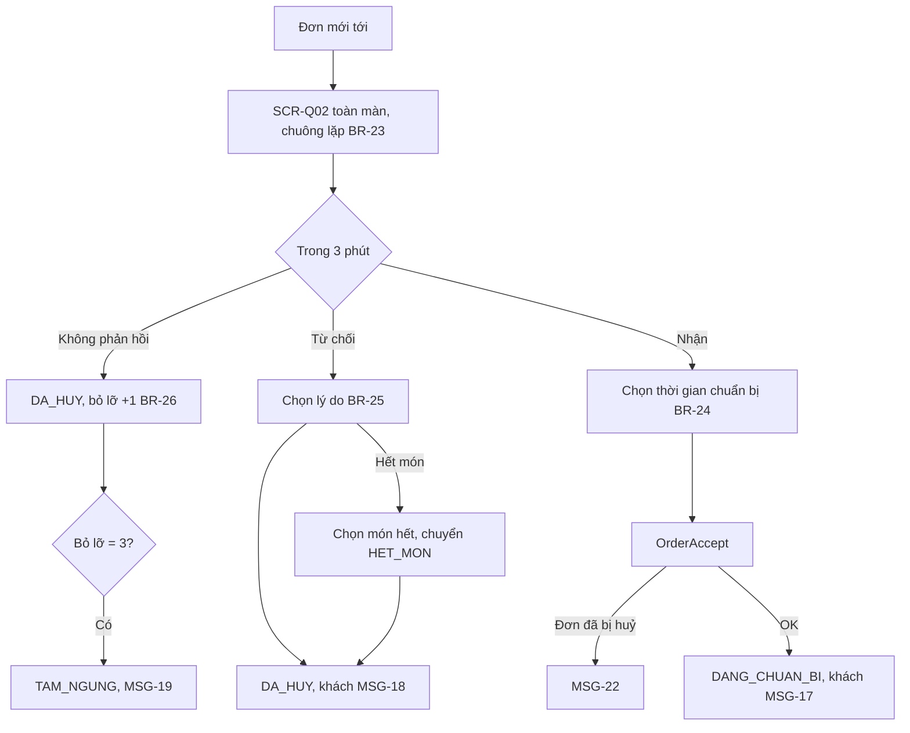

**Luồng chính**

| **Bước** | **Actor** | **Mô tả** |
| --- | --- | --- |
| 1 | Máy chủ | Gửi đơn mới tới mọi thiết bị của quán |
| 2 | App quán | Mở **SCR-Q02** toàn màn, chuông lặp, đếm ngược |
| 3 | Quán | Xem món, chọn thời gian chuẩn bị (gợi ý sẵn) |
| 4 | Quán | Bấm "Nhận đơn" |
| 5 | App quán | Gọi \[OrderAccept\]; đơn sang tab Đang làm |
| 6 | Máy chủ | Đơn `DANG_CHUAN_BI`; gửi MSG-17 cho khách; lên lịch tìm tài xế (Bước 4 BR-34) |

**Luồng thay thế**

| **Mã** | **Điều kiện** | **Xử lý** |
| --- | --- | --- |
| A1 | Nhiều đơn mới | Hiện lần lượt, "1/{n}"; đơn còn ít thời gian nhất trước |
| A2 | Từ chối | Chọn lý do → \[OrderReject\] (BR-25) |
| A3 | Thiết bị khác của quán đã nhận | Màn đơn mới đóng, toast "Đơn đã được nhận trên thiết bị khác" |

**Luồng lỗi**

| **Mã** | **Điều kiện** | **Xử lý** |
| --- | --- | --- |
| E1 | Quá 3 phút | BR-26 |
| E2 | Khách huỷ trước khi quán bấm nhận | MSG-22 |
| E3 | Mất mạng khi bấm nhận | Thử lại tự động 3 lần trong thời gian còn lại; vẫn lỗi → MSG-24 |

#### UC-06 Chuẩn bị và báo món đã xong

| **Mục** | **Nội dung** |
| --- | --- |
| Tiền điều kiện | Đơn `DANG_CHUAN_BI` |
| Hậu điều kiện thành công | Đơn `SAN_SANG`; tài xế được báo |
| Hậu điều kiện thất bại | Đơn `DA_HUY` (hết món) hoặc vẫn `DANG_CHUAN_BI` |

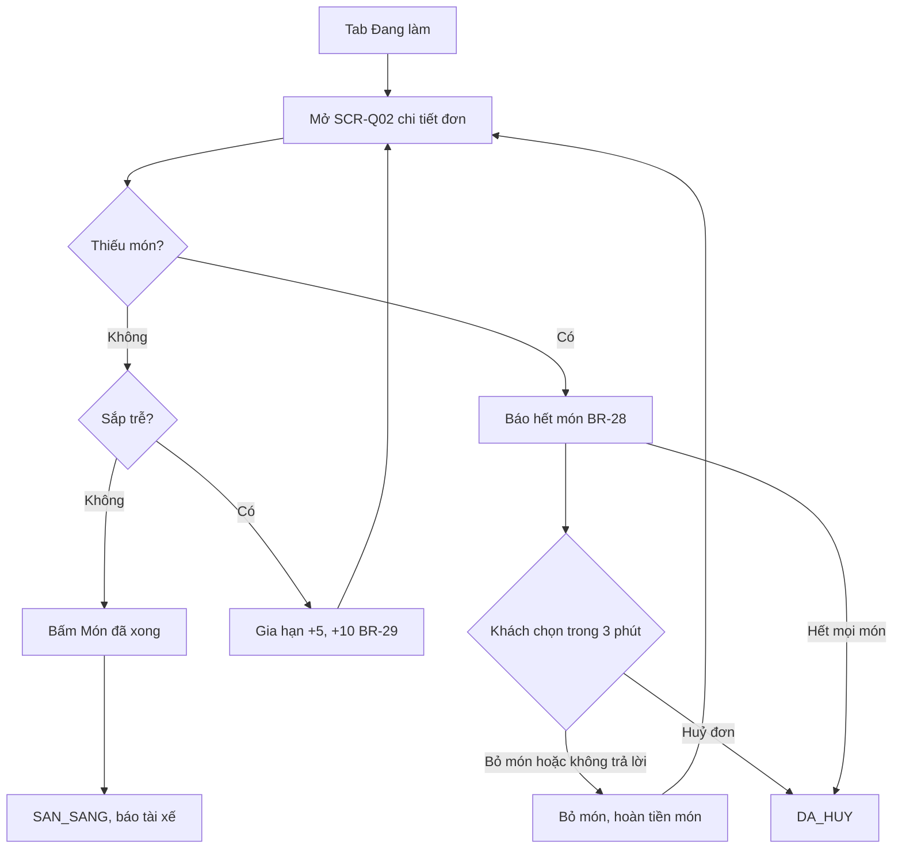

**Luồng chính**

| **Bước** | **Actor** | **Mô tả** |
| --- | --- | --- |
| 1 | Quán | Ở tab Đang làm, chạm đơn → chi tiết |
| 2 | Quán | Làm món theo tuỳ chọn, ghi chú |
| 3 | Quán | Bấm "Món đã xong" |
| 4 | App quán | Gọi \[OrderReady\]; đơn sang tab Chờ tài xế |
| 5 | Máy chủ | Đơn `SAN_SANG`; push tài xế đã gán (Bước 4) |

**Luồng thay thế**

| **Mã** | **Điều kiện** | **Xử lý** |
| --- | --- | --- |
| A1 | Báo hết món | BR-28 → \[OrderItemUnavailable\]; chờ khách ≤ 3 phút; đơn hiện "Đang chờ khách chọn" |
| A2 | Gia hạn | BR-29 → \[OrderExtend\] |
| A3 | Tài xế đã tới quán trước khi xong | Thẻ tài xế hiện "Đã tới quán"; đơn nổi bật |

**Luồng lỗi**

| **Mã** | **Điều kiện** | **Xử lý** |
| --- | --- | --- |
| E1 | Đã gia hạn 1 lần | Nút gia hạn ẩn; MSG-23 nếu trễ > 10 phút |
| E2 | Đơn bị huỷ (khách, hỗ trợ) | MSG-22; đơn sang Đã xong |
| E3 | Mất mạng | MSG-24; thao tác lưu chờ, gửi khi có mạng |

#### UC-07 Quản lý món hết và trạng thái quán

**Luồng chính**

| **Bước** | **Actor** | **Mô tả** |
| --- | --- | --- |
| 1 | Quán | Mở **SCR-Q03** |
| 2 | Quán | Tìm "trân châu đen", tắt → chọn "Hết hôm nay" |
| 3 | App quán | Gọi \[ItemAvailability\]; app khách cập nhật ≤ 30 giây (BR-32) |
| 4 | Quán | Giờ cao điểm, bấm "Tạm ngưng nhận đơn" → 30 phút |
| 5 | App quán | Gọi \[StoreStatus\]; đầu app hiện "Tạm ngưng tới {giờ}" và nút "Mở lại" |

### Bước 4 · Tài xế nhận & giao đơn

#### UC-08 Tìm tài xế và nhận đơn

| **Mục** | **Nội dung** |
| --- | --- |
| Tiền điều kiện | Đơn `DANG_CHUAN_BI`, đã tới thời điểm tìm (BR-34) |
| Hậu điều kiện thành công | Đơn có tài xế `DANG_DEN_QUAN` |
| Hậu điều kiện thất bại | Đơn `DA_HUY` lý do không có tài xế |

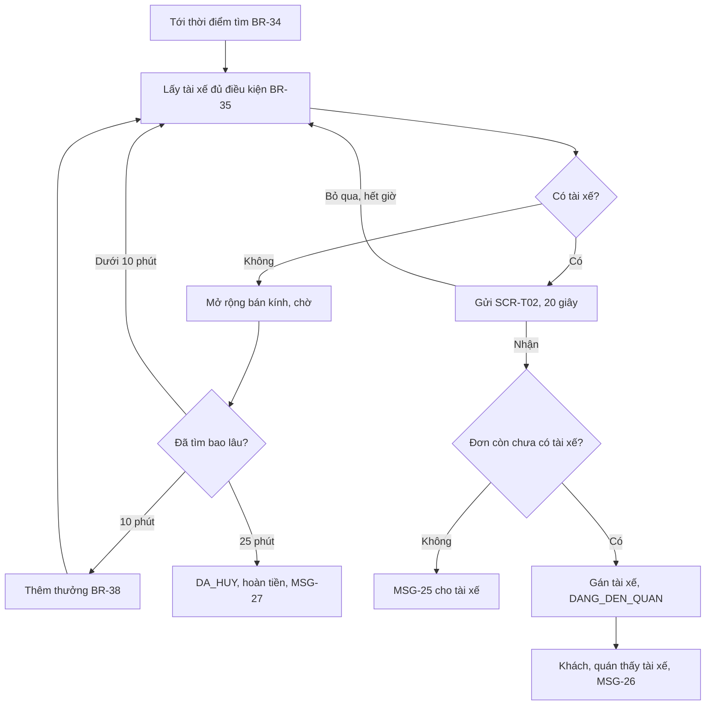

**Luồng chính**

| **Bước** | **Actor** | **Mô tả** |
| --- | --- | --- |
| 1 | Máy chủ | Tới thời điểm tìm; chọn tài xế phù hợp nhất (BR-35); gửi yêu cầu |
| 2 | App tài xế | Hiện **SCR-T02**: thẻ yêu cầu (BR-36), đếm ngược 20 giây, âm thanh |
| 3 | Tài xế | Bấm "Nhận đơn" |
| 4 | Máy chủ | Gán (BR-37) |
| 5 | App tài xế | Mở **SCR-T03**: dẫn đường tới quán |
| 6 | App khách, App quán | Hiện tài xế; khách nhận MSG-26 |

**Luồng thay thế**

| **Mã** | **Điều kiện** | **Xử lý** |
| --- | --- | --- |
| A1 | Tài xế bỏ qua, hết 20 giây | Gửi tài xế kế tiếp |
| A2 | Tài xế huỷ trước khi lấy món | BR-46, quay lại bước 1 |

**Luồng lỗi**

| **Mã** | **Điều kiện** | **Xử lý** |
| --- | --- | --- |
| E1 | Đơn đã có tài xế khác hoặc đã huỷ khi bấm nhận | MSG-25 |
| E2 | Không tìm được sau 25 phút | MSG-27 (BR-38) |

#### UC-09 Lấy món tại quán

| **Mục** | **Nội dung** |
| --- | --- |
| Tiền điều kiện | Tài xế `DANG_DEN_QUAN` |
| Hậu điều kiện thành công | Tài xế `DA_LAY_MON`; đơn `DANG_GIAO` |
| Hậu điều kiện thất bại | Tài xế vẫn chờ, hoặc báo hỗ trợ |

**Luồng chính**

| **Bước** | **Actor** | **Mô tả** |
| --- | --- | --- |
| 1 | Tài xế | Tới quán, bấm "Đã đến quán" (trong 100 m) |
| 2 | App quán | Thẻ tài xế hiện "Đã tới quán" |
| 3 | App tài xế | Mở **SCR-T03** chế độ lấy món: mã đơn chữ to, món |
| 4 | Tài xế | Nói mã đơn với quán, nhận túi, tích từng món |
| 5 | Tài xế | Bấm "Đã lấy món" |
| 6 | Máy chủ | Tài xế `DA_LAY_MON`, đơn `DANG_GIAO`; khách nhận MSG-28 |
| 7 | App tài xế | Mở **SCR-T04** dẫn đường tới khách |

**Luồng thay thế**

| **Mã** | **Điều kiện** | **Xử lý** |
| --- | --- | --- |
| A1 | Đơn chưa `SAN_SANG` | Nút "Đã lấy món" disabled, hiện "Quán đang chuẩn bị, xong lúc {giờ}"; khi quán báo xong → push tài xế |
| A2 | Chờ > 10 phút sau hạn | "Báo quán trễ" (BR-40) |
| A3 | Bấm "Đã đến quán" khi ngoài 100 m | MSG-30 |

**Luồng lỗi**

| **Mã** | **Điều kiện** | **Xử lý** |
| --- | --- | --- |
| E1 | Đơn bị huỷ khi tài xế đang ở quán | MSG-31; tài xế về `DANG_RANH`, nhận phí chờ nếu đã ở quán > 5 phút |
| E2 | Mất mạng | Thao tác lưu chờ, gửi khi có mạng; mã đơn vẫn hiện để đối chiếu |

#### UC-10 Giao đơn và theo dõi

| **Mục** | **Nội dung** |
| --- | --- |
| Tiền điều kiện | Tài xế `DA_LAY_MON` |
| Hậu điều kiện thành công | Đơn `DA_GIAO`; khách được mời đánh giá (Bước 5) |
| Hậu điều kiện thất bại | Đơn `GIAO_THAT_BAI` |

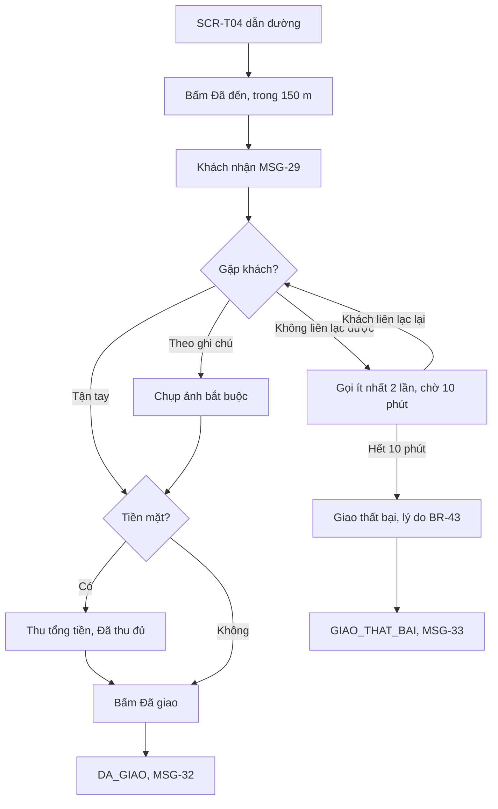

**Luồng chính**

| **Bước** | **Actor** | **Mô tả** |
| --- | --- | --- |
| 1 | App khách | **SCR-K07**: bản đồ tài xế, giờ tới (BR-44) |
| 2 | Tài xế | Tới nơi, bấm "Đã đến" |
| 3 | Máy chủ | Push MSG-29 cho khách |
| 4 | Tài xế | Gọi khách qua app; khách ra nhận |
| 5 | Tài xế | Bấm "Đã giao" |
| 6 | Máy chủ | Đơn `DA_GIAO`; khách MSG-32, mở **SCR-K08** (Bước 5) |

**Luồng thay thế**

| **Mã** | **Điều kiện** | **Xử lý** |
| --- | --- | --- |
| A1 | Giao theo ghi chú | Chụp ảnh (BR-42) |
| A2 | Tiền mặt | Màn thu tiền trước khi bấm Đã giao |
| A3 | Khách nhắn tin, gọi tài xế | Qua số trung gian, chat (BR-41) |

**Luồng lỗi**

| **Mã** | **Điều kiện** | **Xử lý** |
| --- | --- | --- |
| E1 | Không gặp khách | BR-43 |
| E2 | Bấm "Đã đến" khi ngoài 150 m | MSG-30 |
| E3 | Sự cố trên đường | "Báo sự cố" → hỗ trợ; khách thấy "Đơn đang được hỗ trợ xử lý" |
| E4 | Mất mạng khi bấm Đã giao | Lưu chờ; khách thấy cập nhật khi tài xế có mạng; MSG-34 cho tài xế |

### Bước 5 · Huỷ, đánh giá & sự cố

#### UC-11 Huỷ đơn

| **Mục** | **Nội dung** |
| --- | --- |
| Tiền điều kiện | Đơn `CHO_QUAN_XAC_NHAN` |
| Hậu điều kiện thành công | Đơn `DA_HUY`; quán thấy đơn bị huỷ; hoàn ví nếu đã trả |
| Hậu điều kiện thất bại | Đơn giữ trạng thái; khách được dẫn tới hỗ trợ |

**Luồng chính**

| **Bước** | **Actor** | **Mô tả** |
| --- | --- | --- |
| 1 | Khách | Ở **SCR-K07** bấm "Huỷ đơn" |
| 2 | App | Bottom sheet lý do (BR-48), số tiền sẽ hoàn (nếu trả ví) |
| 3 | Khách | Chọn lý do, bấm "Xác nhận huỷ" |
| 4 | App | Gọi \[OrderCancel\] |
| 5 | Máy chủ | Kiểm tra trạng thái; huỷ; hoàn ví; báo quán (Bước 3 MSG-22) |
| 6 | App | MSG-35; **SCR-K07** hiện "Đã huỷ" và nút "Đặt lại" |

**Luồng lỗi**

| **Mã** | **Điều kiện** | **Xử lý** |
| --- | --- | --- |
| E1 | Quán vừa nhận đơn | MSG-36, nút "Cần hỗ trợ" |
| E2 | Lỗi mạng | MSG-44 |

#### UC-12 Đánh giá và tip

| **Mục** | **Nội dung** |
| --- | --- |
| Tiền điều kiện | Đơn `DA_GIAO` trong 7 ngày |
| Hậu điều kiện thành công | Đánh giá được lưu; tip (nếu có) chuyển tới tài xế |
| Hậu điều kiện thất bại | Không lưu; khách đánh giá lại sau được |

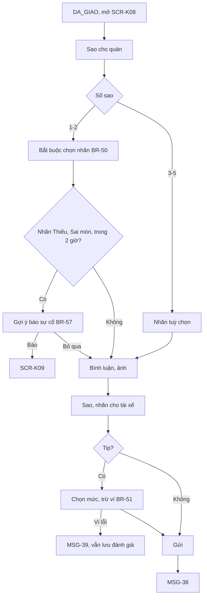

**Luồng chính**

| **Bước** | **Actor** | **Mô tả** |
| --- | --- | --- |
| 1 | App | Đơn `DA_GIAO` → mở **SCR-K08** một lần (khách đóng được) |
| 2 | Khách | Chọn 5 sao cho quán, nhãn "Ngon", "Đóng gói cẩn thận" |
| 3 | Khách | Chọn 5 sao cho tài xế, tip 10.000 ₫ |
| 4 | Khách | Bấm "Gửi" |
| 5 | App | Gọi \[ReviewSubmit\] và \[TipSend\] |
| 6 | Máy chủ | Lưu đánh giá; trừ ví, chuyển tip; push tài xế |
| 7 | App | MSG-38 |

**Luồng thay thế**

| **Mã** | **Điều kiện** | **Xử lý** |
| --- | --- | --- |
| A1 | Đánh giá sau | Đóng **SCR-K08**; chi tiết đơn có nút "Đánh giá" trong 7 ngày |
| A2 | Chỉ tip, không đánh giá | Cho phép, trong 24 giờ |
| A3 | Đánh giá thấp có nhãn sự cố | BR-57 |

**Luồng lỗi**

| **Mã** | **Điều kiện** | **Xử lý** |
| --- | --- | --- |
| E1 | Ví không đủ khi tip | MSG-39; đánh giá vẫn được lưu |
| E2 | Quá 7 ngày | MSG-40 |
| E3 | Thiếu nhãn khi ≤ 2 sao | Lỗi inline "Chọn ít nhất 1 lý do" |

#### UC-13 Báo sự cố

| **Mục** | **Nội dung** |
| --- | --- |
| Tiền điều kiện | Trong 2 giờ sau `DA_GIAO` (hoặc `GIAO_THAT_BAI` với loại Không nhận được đơn); đơn chưa có yêu cầu sự cố |
| Hậu điều kiện thành công | Yêu cầu `DA_HOAN_TIEN` hoặc `CHO_DUYET` |
| Hậu điều kiện thất bại | Không tạo yêu cầu |

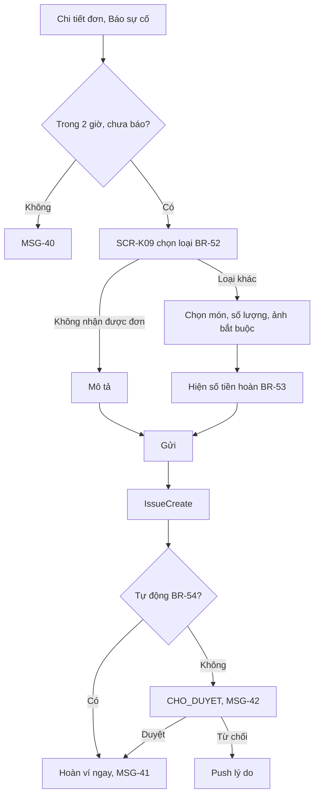

**Luồng chính**

| **Bước** | **Actor** | **Mô tả** |
| --- | --- | --- |
| 1 | Khách | Mở chi tiết đơn → "Báo sự cố" |
| 2 | App | Mở **SCR-K09**, danh sách loại |
| 3 | Khách | Chọn "Thiếu món"; chọn "Trà sữa trân châu × 1"; chụp ảnh túi đồ ăn |
| 4 | App | Hiện "Bạn sẽ được hoàn 49.000 ₫ vào ví" |
| 5 | Khách | Bấm "Gửi" |
| 6 | App | Gọi \[IssueCreate\] |
| 7 | Máy chủ | Đủ điều kiện tự động → hoàn ví; trừ tiền quán (BR-58); báo quán |
| 8 | App | MSG-41 |

**Luồng thay thế**

| **Mã** | **Điều kiện** | **Xử lý** |
| --- | --- | --- |
| A1 | Không đủ điều kiện tự động | `CHO_DUYET`, MSG-42; kết quả qua push |
| A2 | Không nhận được đơn | Không cần chọn món, ảnh; luôn `CHO_DUYET` |
| A3 | Mở từ gợi ý ở đánh giá | Điền sẵn loại (BR-57) |

**Luồng lỗi**

| **Mã** | **Điều kiện** | **Xử lý** |
| --- | --- | --- |
| E1 | Quá 2 giờ, đã có yêu cầu | MSG-40 |
| E2 | Thiếu ảnh | Lỗi inline "Vui lòng chụp ít nhất 1 ảnh" |
| E3 | Lỗi mạng khi tải ảnh | MSG-44; giữ dữ liệu, cho gửi lại |

## 6. Điểm vào

| **Điểm vào** | **Dẫn tới** | **Ghi chú** |
| --- | --- | --- |
| Mở app | **SCR-K01** | Đơn đang giao → banner theo dõi đơn ở đầu (Bước 4) |
| Chạm thông báo quán yêu thích mở cửa | **SCR-K03** | Phase sau |
| "Đặt lại" ở lịch sử đơn (Bước 5) | A3 UC-01 | |
| Link chia sẻ quán | **SCR-K03** | Ngoài bán kính → MSG-01 |
| Thanh giỏ ở **SCR-K01**, **SCR-K03** | **SCR-K05** | |
| "Đặt lại" (Bước 1 A3, Bước 5) | **SCR-K05** | Món hết đã bị bỏ |
| Địa chỉ ở **SCR-K01** | **SCR-K06** | Dùng chung chọn địa chỉ |
| Đơn mới (đang mở app hoặc chạm thông báo) | **SCR-Q02** toàn màn | BR-23 |
| Mở app | **SCR-Q01** tab có đơn cần xử lý gần nhất | |
| Push "Quán đã tạm ngưng" | **SCR-Q03** | BR-26 |
| Push "Khách đã chọn bỏ món" | **SCR-Q02** của đơn | BR-28 |
| Đặt đơn thành công (Bước 2) | **SCR-K07** | |
| Banner đơn đang giao ở **SCR-K01** | **SCR-K07** | |
| Push trạng thái đơn | **SCR-K07** | |
| Tài xế mở app | **SCR-T01** hoặc đơn đang chạy | |
| Yêu cầu đơn mới | **SCR-T02** | |
| Đơn vừa giao (MSG-32, Bước 4) | **SCR-K08** | Một lần |
| Tài khoản → Đơn hàng | **SCR-K10** | |
| Chi tiết đơn ở **SCR-K10** | Đánh giá, Báo sự cố, Đặt lại theo mục 4.2 | |
| Nút "Huỷ đơn" ở **SCR-K07** | UC-11 | |

## 7. Mô tả màn hình

<!-- Bước 1 · Khám phá quán & món -->
### SCR-K01 Trang chủ

| **#** | **Thành phần** | **Loại** | **Hành vi** |
| --- | --- | --- | --- |
| 1 | Địa chỉ giao | Header | "Giao đến: {tên địa chỉ}"; chạm để đổi (A1) |
| 2 | Ô tìm kiếm | Search bar | Mở **SCR-K02** |
| 3 | Danh mục | Lưới icon | 8–10 danh mục, cuộn ngang |
| 4 | Đặt lại | Dải thẻ | 5 đơn đã giao gần nhất: ảnh quán, món chính, "Đặt lại" |
| 5 | Quán gần bạn | List thẻ quán | Thẻ theo BR-06; tải thêm khi cuộn |
| 6 | Banner đơn đang giao | Banner | Khi có đơn chưa kết thúc (Bước 4) |
| 7 | Thanh giỏ | Sticky bar | Khi giỏ có món: quán, số món, tạm tính |

### SCR-K02 Tìm kiếm

| **#** | **Thành phần** | **Loại** | **Hành vi** |
| --- | --- | --- | --- |
| 1 | Ô tìm | Search input | Gợi ý BR-07 |
| 2 | Tìm gần đây | Chips | 5 từ khoá |
| 3 | Bộ lọc | Chips | Đang mở, Miễn phí giao, ≤ 3 km |
| 4 | Sắp xếp | Dropdown | BR-07 |
| 5 | Kết quả | List | Thẻ quán + tối đa 3 món khớp (ảnh nhỏ, tên, giá) |

### SCR-K03 Trang quán

| **#** | **Thành phần** | **Loại** | **Hành vi** |
| --- | --- | --- | --- |
| 1 | Ảnh bìa, tên quán | Header | Thu gọn khi cuộn |
| 2 | Thông tin | Text | Đánh giá, khoảng cách, thời gian dự kiến, phí giao, giờ mở cửa |
| 3 | Banner trạng thái | Banner | `SAP_DONG`, `DONG_CUA`, `TAM_NGUNG` (BR-04) |
| 4 | Tìm trong quán | Icon | Lọc món theo tên |
| 5 | Thanh nhóm món | Tabs dính | Chạm nhảy tới nhóm; tự đổi khi cuộn |
| 6 | Dòng món | List item | Ảnh, tên, mô tả 2 dòng, giá, nhãn Bán chạy, Hết món; nút "+" |
| 7 | Thanh giỏ | Sticky bar | "{n} món · {tạm tính} ₫ · Xem giỏ" → **SCR-K05** |

### SCR-K04 Tuỳ chọn món

| **#** | **Thành phần** | **Loại** | **Bắt buộc** | **Validate / hành vi** |
| --- | --- | --- | --- | --- |
| 1 | Ảnh, tên, mô tả, giá | Header | – | |
| 2 | Nhóm chọn 1 | Radio group | Theo min | "Bắt buộc · chọn 1"; giá cộng thêm |
| 3 | Nhóm chọn nhiều | Checkbox group | Theo min | "Chọn tối đa {max}"; vượt max thì lựa chọn khác disabled |
| 4 | Ghi chú cho quán | Text | Không | ≤ 100 ký tự; placeholder "Ví dụ: không hành" |
| 5 | Số lượng | Stepper | Có | 1–20 |
| 6 | Nút thêm | Button | – | Mục 4.1 |

<!-- Bước 2 · Giỏ hàng & đặt đơn -->
### SCR-K05 Giỏ hàng & xác nhận đơn

| **#** | **Thành phần** | **Loại** | **Bắt buộc** | **Validate / hành vi** |
| --- | --- | --- | --- | --- |
| 1 | Giao đến | Card | Có | Tên địa chỉ, chi tiết, ghi chú tài xế; chạm → **SCR-K06** |
| 2 | Người nhận | Dòng chọn | Có | Tên · số điện thoại (BR-17) |
| 3 | Thời gian dự kiến | Text | – | BR-20 |
| 4 | Tên quán | Header | – | Chạm về **SCR-K03** |
| 5 | Dòng món | List | – | Tên, tuỳ chọn, ghi chú, stepper, giá; nhãn Hết món, Giá đã thay đổi |
| 6 | "Thêm món" | Link | – | Về **SCR-K03** |
| 7 | Ghi chú cho quán | Text | Không | ≤ 200 ký tự |
| 8 | Dụng cụ ăn uống | Switch | – | Mặc định tắt |
| 9 | Bảng phí | List | – | Tạm tính, phí giao, phụ phí, phí dịch vụ, phí đơn nhỏ, quán giảm phí giao; mỗi khoản có ⓘ |
| 10 | Gợi ý bỏ phí đơn nhỏ | Info | – | A4 |
| 11 | Thanh toán | Dòng chọn | Có | Tiền mặt / Ví liên kết (số dư) |
| 12 | Tổng | Text lớn | – | BR-15 |
| 13 | Nút Đặt đơn | Button dính đáy | – | Mục 4.1 |

### SCR-K06 Địa chỉ giao

| **#** | **Thành phần** | **Loại** | **Bắt buộc** | **Validate / hành vi** |
| --- | --- | --- | --- | --- |
| 1 | Ô tìm địa chỉ | Search | – | Gợi ý sau 2 ký tự, không dấu |
| 2 | Địa chỉ đã lưu | List | – | Tối đa 10; sửa, xoá |
| 3 | Bản đồ + ghim | Map | Có | Kéo bản đồ để chỉnh ghim; tên đường cập nhật khi thả |
| 4 | Chi tiết | Text | Không | Toà, tầng, phòng ≤ 100 ký tự |
| 5 | Ghi chú cho tài xế | Text | Không | ≤ 100 ký tự; placeholder "Ví dụ: gửi bảo vệ sảnh B" |
| 6 | Lưu địa chỉ | Checkbox + Chips tên | Không | Nhà, Công ty, Khác (tên ≤ 30 ký tự) |
| 7 | "Xác nhận địa chỉ" | Button | – | Kiểm tra bán kính (BR-12) |

<!-- Bước 3 · Quán nhận & chuẩn bị đơn -->
### SCR-Q01 Danh sách đơn

| **#** | **Thành phần** | **Loại** | **Hành vi** |
| --- | --- | --- | --- |
| 1 | Trạng thái quán | Header | "Đang mở" / "Tạm ngưng tới {giờ}" + công tắc; trạng thái mạng |
| 2 | Tab | Tabs có số đếm | Mục 4.3 |
| 3 | Thẻ đơn | Card lớn | Mã đơn (chữ to), tên khách viết tắt, số món, hạn xong, nhãn Sắp trễ / Trễ, tài xế |
| 4 | Nút nhanh trên thẻ | Button | "Món đã xong" ở tab Đang làm |

### SCR-Q02 Chi tiết đơn / Đơn mới

| **#** | **Thành phần** | **Loại** | **Hành vi** |
| --- | --- | --- | --- |
| 1 | Mã đơn, khách | Header | BR-33 |
| 2 | Đếm ngược | Timer | Chỉ đơn mới; còn < 30 giây đổi màu |
| 3 | Danh sách món | List | Số lượng (chữ to), tên, tuỳ chọn, ghi chú món in đậm |
| 4 | Ghi chú cho quán, dụng cụ | Text | Nổi bật nếu có |
| 5 | Tổng tiền món | Text | Tạm tính quán nhận (chưa trừ chiết khấu) |
| 6 | Thời gian chuẩn bị | Chips | 5, 10, 15, 20, 30, 45, 60 phút; chọn sẵn gợi ý (BR-24) |
| 7 | "Nhận đơn", "Từ chối" | Button lớn | Chỉ đơn mới |
| 8 | Báo hết món, Gia hạn, Món đã xong | Button | Đơn đang làm (BR-28, BR-29, BR-30) |
| 9 | Tài xế | Card | Tên, biển số, ảnh, thời gian tới quán, nút gọi (số trung gian) |

### SCR-Q03 Món & trạng thái quán

| **#** | **Thành phần** | **Loại** | **Hành vi** |
| --- | --- | --- | --- |
| 1 | Tạm ngưng nhận đơn | Button + bottom sheet | BR-31 |
| 2 | Giờ mở cửa hôm nay | Text | Chỉ xem (sửa trên web quản lý) |
| 3 | Tìm món | Search | Không dấu |
| 4 | Danh sách món theo nhóm | List + Switch | Bật = còn; tắt mở lựa chọn "Hết hôm nay" / "Hết tới khi bật lại" |
| 5 | Tuỳ chọn | List + Switch | Theo nhóm tuỳ chọn |
| 6 | Món đang hết | Filter chip | Lọc nhanh món đang tắt |

<!-- Bước 4 · Tài xế nhận & giao đơn -->
### SCR-T01 Trang chủ tài xế

| **#** | **Thành phần** | **Loại** | **Hành vi** |
| --- | --- | --- | --- |
| 1 | Bật nhận đơn | Switch lớn | `NGOAI_TUYEN` ↔ `DANG_RANH` |
| 2 | Bản đồ | Map | Vị trí, khu vực nhiều đơn (tô màu) |
| 3 | Thu nhập hôm nay | Card | Số đơn, tổng thu nhập, tip |
| 4 | Đơn đang chạy | Banner | Khi có; chạm mở **SCR-T03** hoặc **SCR-T04** |

### SCR-T02 Yêu cầu đơn mới

| **#** | **Thành phần** | **Loại** | **Hành vi** |
| --- | --- | --- | --- |
| 1 | Thu nhập dự kiến | Text lớn | BR-45 (không gồm tip) |
| 2 | Quán | Text | Tên, khoảng cách tới quán, giờ món xong |
| 3 | Giao tới | Text | Phường, quãng đường quán → khách |
| 4 | Tiền mặt cần thu | Tag | Khi đơn tiền mặt |
| 5 | Đếm ngược | Progress vòng | 20 giây |
| 6 | "Nhận đơn" | Button lớn | |
| 7 | "Bỏ qua" | Button phụ | |

### SCR-T03 Đến quán & lấy món

| **#** | **Thành phần** | **Loại** | **Hành vi** |
| --- | --- | --- | --- |
| 1 | Dẫn đường | Map | Mở app bản đồ ngoài nếu muốn |
| 2 | Quán | Card | Tên, địa chỉ, gọi quán |
| 3 | "Đã đến quán" | Button | BR-39 |
| 4 | Mã đơn | Text cực lớn | 6 ký tự |
| 5 | Món | Checklist | Tích từng món |
| 6 | Trạng thái món | Info | "Quán đang chuẩn bị, xong lúc {giờ}" khi chưa `SAN_SANG` |
| 7 | "Đã lấy món" | Button | Bật khi `SAN_SANG` và tích đủ |
| 8 | Báo quán trễ, Huỷ đơn, Báo sự cố | Menu | BR-40, BR-46 |

### SCR-T04 Giao cho khách

| **#** | **Thành phần** | **Loại** | **Hành vi** |
| --- | --- | --- | --- |
| 1 | Dẫn đường | Map | Tới điểm giao |
| 2 | Người nhận | Card | Tên, địa chỉ, chi tiết toà nhà, ghi chú tài xế (in đậm) |
| 3 | Gọi, Nhắn tin | Button | Số trung gian, tin nhắn nhanh (BR-41) |
| 4 | "Đã đến" | Button | BR-39 |
| 5 | Đồng hồ chờ | Timer | Sau "Đã đến": 10 phút, số lần gọi |
| 6 | Chụp ảnh giao | Camera | BR-42 |
| 7 | Thu tiền mặt | Card | "Thu {tổng} ₫", "Đã thu đủ" |
| 8 | "Đã giao" | Button lớn | |
| 9 | "Giao thất bại" | Button phụ | Bật theo BR-43 |

### SCR-K07 Theo dõi đơn (khách)

| **#** | **Thành phần** | **Loại** | **Hành vi** |
| --- | --- | --- | --- |
| 1 | Trạng thái | Header | Mục 4.3 |
| 2 | Tiến trình | Stepper | Đã đặt → Quán chuẩn bị → Đang giao → Đã giao |
| 3 | Giờ giao dự kiến | Text lớn | "12:25–12:35" (BR-44) |
| 4 | Bản đồ | Map | Tài xế, quán, điểm giao; "Cập nhật {n} giây trước" khi > 15 giây |
| 5 | Tài xế | Card | Ảnh, tên, biển số, gọi, nhắn tin |
| 6 | Chi tiết đơn | Accordion | Món, tổng, thanh toán, địa chỉ |
| 7 | Huỷ đơn | Link | Chỉ `CHO_QUAN_XAC_NHAN` (Bước 5) |
| 8 | Trợ giúp | Link | Mở hỗ trợ |

<!-- Bước 5 · Huỷ, đánh giá & sự cố -->
### SCR-K08 Đánh giá & tip

| **#** | **Thành phần** | **Loại** | **Bắt buộc** | **Validate / hành vi** |
| --- | --- | --- | --- | --- |
| 1 | Quán | Header | – | Ảnh, tên, món đã đặt |
| 2 | Sao quán | Rating 1–5 | Có | |
| 3 | Nhãn quán | Chips nhiều chọn | Khi ≤ 2 sao | Bộ nhãn theo số sao (BR-50) |
| 4 | Bình luận | Textarea | Không | ≤ 300 ký tự |
| 5 | Ảnh | Upload | Không | ≤ 3 ảnh |
| 6 | Gợi ý báo sự cố | Info + Button | – | BR-57 |
| 7 | Sao, nhãn tài xế | Rating + Chips | Không | |
| 8 | Tip | Chips + Amount | Không | BR-51; hiện số dư ví |
| 9 | "Gửi" | Button | – | Disabled khi chưa chọn sao quán |

### SCR-K09 Báo sự cố

| **#** | **Thành phần** | **Loại** | **Bắt buộc** | **Validate / hành vi** |
| --- | --- | --- | --- | --- |
| 1 | Loại sự cố | Radio | Có | BR-52 |
| 2 | Món bị ảnh hưởng | Checklist + Stepper | Có (trừ Không nhận được đơn) | Số lượng ≤ số đã đặt |
| 3 | Ảnh | Camera / Upload | Có (trừ Không nhận được đơn) | 1–3 ảnh |
| 4 | Mô tả | Textarea | Không | ≤ 300 ký tự |
| 5 | Số tiền hoàn | Card | – | BR-53; "Hoàn vào ví" |
| 6 | "Gửi" | Button | – | |
| 7 | Kết quả | Overlay | – | MSG-41 hoặc MSG-42 |

### SCR-K10 Lịch sử đơn & chi tiết

| **#** | **Thành phần** | **Loại** | **Hành vi** |
| --- | --- | --- | --- |
| 1 | Tab | Tabs | Đang giao, Đã giao, Đã huỷ |
| 2 | Thẻ đơn | Card | Quán, ngày giờ, món chính "+{n} món", tổng, trạng thái |
| 3 | Chi tiết | Màn chi tiết | Món, phí, thanh toán, tài xế, ảnh giao, mốc thời gian, đánh giá đã gửi, yêu cầu sự cố (trạng thái 4.1, số tiền) |
| 4 | Hành động | Buttons | Theo mục 4.2 |

## 8. API

### 8.1 Bước 1 · Khám phá quán & món

| **API** | **Request chính** | **Response chính** | **Timeout / retry** |
| --- | --- | --- | --- |
| \[ReverseGeocode\] | lat, lng | Địa chỉ, in_service_area | 3s / 1 lần |
| \[StoreFeed\] | delivery_location, category, filters, sort, cursor | Thẻ quán (BR-06), đơn đặt lại | 5s / 1 lần |
| \[Search\] | keyword, delivery_location, filters, sort | Quán + món khớp | 3s / 1 lần |
| \[StoreMenu\] | store_id, delivery_location | Thông tin quán, trạng thái, nhóm món, món, nhóm tuỳ chọn | 5s / 1 lần |
| \[CartAdd\] | store_id, item_id, options, quantity, note, replace_cart | Giỏ mới | 5s / 1 lần |

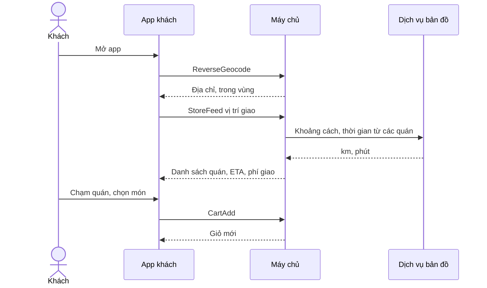

**Map lỗi → thông báo**

| **Nhóm lỗi** | **Message** |
| --- | --- |
| Ngoài vùng phục vụ | MSG-01 |
| Tìm 0 kết quả | MSG-02 |
| Quán đóng, tạm ngưng | MSG-03 |
| Giỏ có quán khác | MSG-04 |
| Món hết | MSG-05 |
| Mất mạng, lỗi máy chủ | MSG-06 |

### 8.2 Bước 2 · Giỏ hàng & đặt đơn

| **API** | **Request chính** | **Response chính** | **Timeout / retry** |
| --- | --- | --- | --- |
| \[CartValidate\] | cart_id, delivery_address | Dòng hợp lệ, cờ hết món, đổi giá, trạng thái quán | 5s / 1 lần |
| \[DeliveryQuote\] | store_id, delivery_address, subtotal | Phí giao, phụ phí, phần quán tài trợ, phí dịch vụ, phí đơn nhỏ, eta, distance_km | 5s / 1 lần |
| \[AddressSave\] | name, lat, lng, detail, driver_note | address_id | 5s / 1 lần |
| \[WalletBalance\] | – | Số dư, trạng thái liên kết | 3s / 1 lần |
| \[OrderCreate\] | cart_id, address, receiver, store_note, cutlery, payment_method, quote_id, idempotency_key | order_id, order_code, status, eta | 15s / gửi lại cùng key |

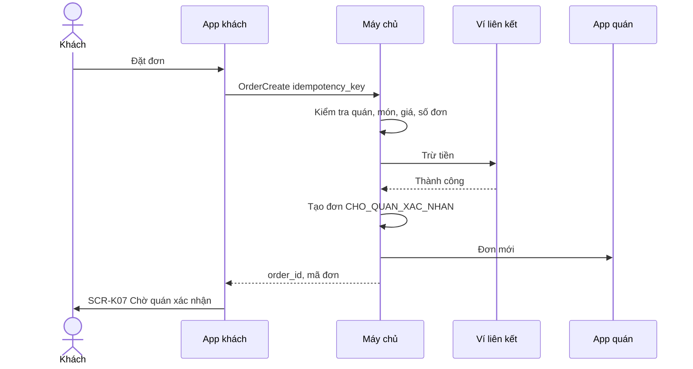

**Map lỗi → thông báo**

| **Nhóm lỗi** | **Message** |
| --- | --- |
| Món hết, giá đổi | MSG-07 |
| Địa chỉ ngoài bán kính quán | MSG-08 |
| Vượt giới hạn đơn | MSG-09 |
| Tiền mặt không khả dụng | MSG-10 |
| Quán đóng | MSG-11 |
| Ví lỗi, không đủ số dư | MSG-12 |
| Quá số đơn đang chạy | MSG-13 |
| Đặt thành công | MSG-14 |
| Hoàn ví do lỗi tạo đơn | MSG-15 |
| Mất mạng | MSG-16 |

### 8.3 Bước 3 · Quán nhận & chuẩn bị đơn

| **API** | **Request chính** | **Response chính** | **Timeout / retry** |
| --- | --- | --- | --- |
| \[MerchantOrderStream\] | store_id | Luồng sự kiện đơn mới, đổi trạng thái | Kết nối lâu dài; push dự phòng |
| \[OrderAccept\] | order_id, prep_minutes | status, ready_due_at | 5s / 3 lần trong hạn xác nhận |
| \[OrderReject\] | order_id, reason, unavailable_items | status | 5s / 1 lần |
| \[OrderItemUnavailable\] | order_id, items | Chờ khách, deadline | 5s / 1 lần |
| \[OrderExtend\] | order_id, minutes (5, 10) | ready_due_at mới | 5s / 1 lần |
| \[OrderReady\] | order_id | status `SAN_SANG` | 5s / 3 lần |
| \[ItemAvailability\] | item_id hoặc option_id, available, until | OK | 5s / 1 lần |
| \[StoreStatus\] | paused_until hoặc resume | Trạng thái quán | 5s / 1 lần |

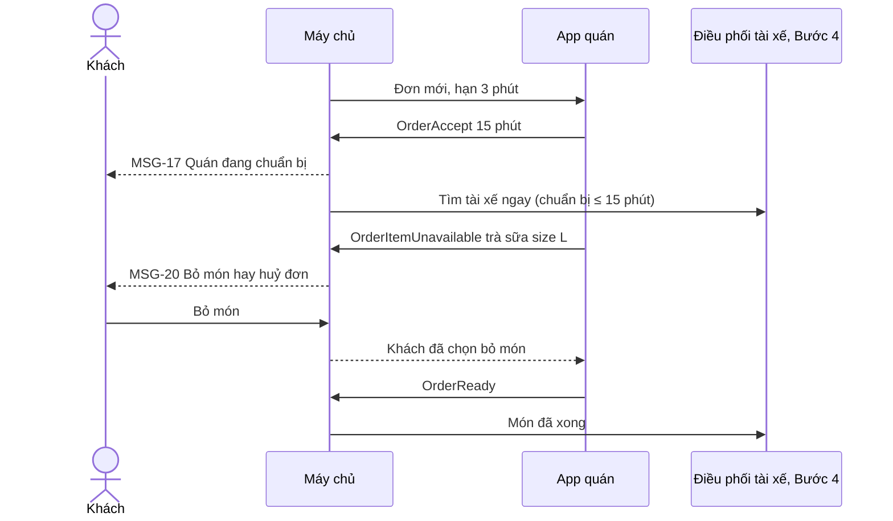

**Map lỗi → thông báo**

| **Nhóm lỗi** | **Message** |
| --- | --- |
| Quán nhận đơn (gửi khách) | MSG-17 |
| Quán từ chối, tự huỷ (gửi khách) | MSG-18 |
| Quán bị tạm ngưng do bỏ lỡ | MSG-19 |
| Báo hết món (gửi khách) | MSG-20 |
| Gia hạn (gửi khách) | MSG-21 |
| Đơn đã bị huỷ | MSG-22 |
| Trễ nhiều | MSG-23 |
| Mất mạng | MSG-24 |

### 8.4 Bước 4 · Tài xế nhận & giao đơn

| **API** | **Request chính** | **Response chính** | **Timeout / retry** |
| --- | --- | --- | --- |
| \[DriverStatus\] | online | Trạng thái tài xế | 5s / 1 lần |
| \[DriverLocation\] | lat, lng, accuracy | – | Gửi mỗi 5 giây khi online |
| \[OfferStream\] | driver_id | Yêu cầu đơn, expires_at | Kết nối lâu dài; push dự phòng |
| \[OfferAccept\], \[OfferDecline\] | offer_id | Kết quả gán | 5s / 1 lần |
| \[TripArriveStore\] | order_id, lat, lng | OK hoặc ngoài bán kính | 5s / 2 lần |
| \[TripPickedUp\] | order_id, checked_items | Đơn `DANG_GIAO` | 5s / 3 lần |
| \[TripArriveCustomer\] | order_id, lat, lng | OK | 5s / 2 lần |
| \[TripDelivered\] | order_id, photo, cash_collected | Đơn `DA_GIAO` | 15s / 3 lần |
| \[TripFailed\] | order_id, reason | Đơn `GIAO_THAT_BAI` hoặc chưa đủ điều kiện | 5s / 1 lần |
| \[MaskedCall\], \[ChatSend\] | order_id, to | Số trung gian, tin nhắn | 5s / 1 lần |
| \[OrderTrack\] | order_id | Trạng thái, vị trí tài xế, eta | Kết nối lâu dài; dự phòng gọi mỗi 10 giây |

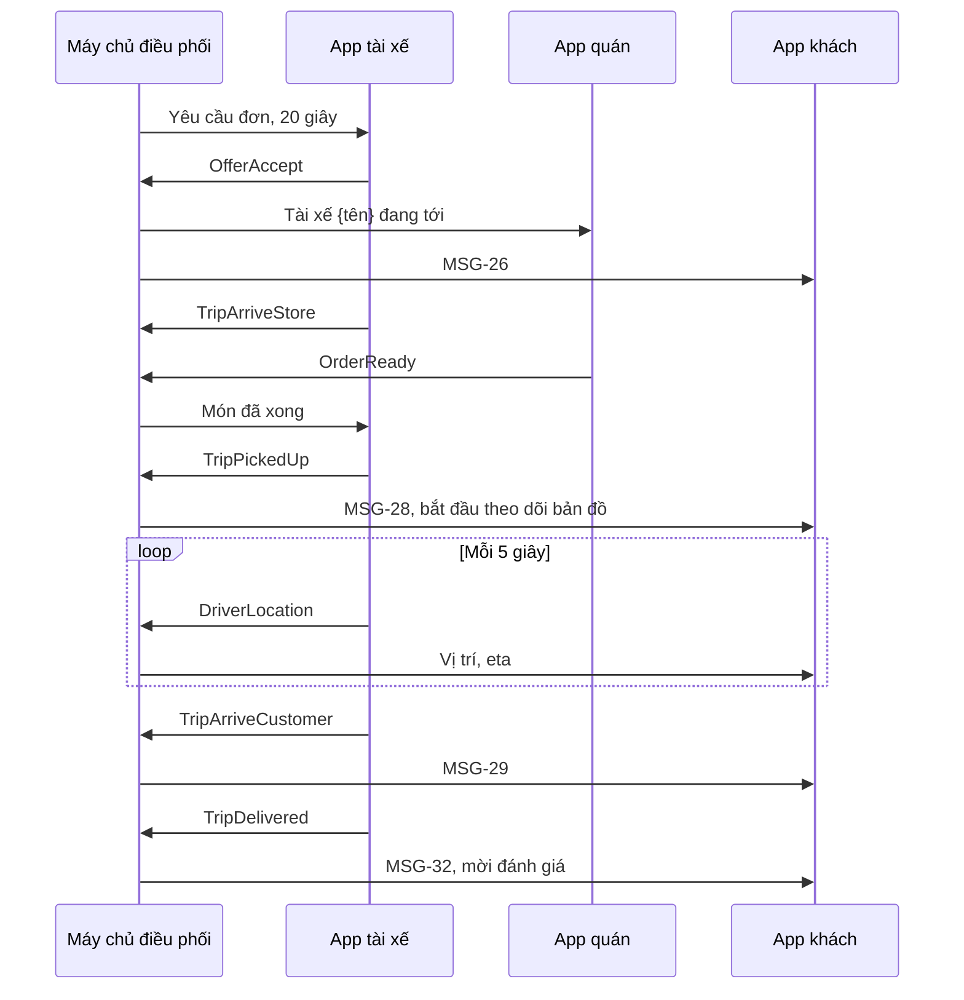

**Map lỗi → thông báo**

| **Nhóm lỗi** | **Message** |
| --- | --- |
| Đơn đã có người nhận | MSG-25 |
| Đã có tài xế (gửi khách) | MSG-26 |
| Không tìm được tài xế | MSG-27 |
| Tài xế đã lấy món | MSG-28 |
| Tài xế đã tới | MSG-29 |
| Ngoài bán kính khi bấm đến | MSG-30 |
| Đơn bị huỷ khi tài xế đang làm | MSG-31 |
| Đã giao | MSG-32 |
| Giao thất bại | MSG-33 |
| Mất mạng | MSG-34 |

### 8.5 Bước 5 · Huỷ, đánh giá & sự cố

| **API** | **Request chính** | **Response chính** | **Timeout / retry** |
| --- | --- | --- | --- |
| \[OrderCancel\] | order_id, reason, note | status, refund_amount | 5s / 1 lần |
| \[ReviewSubmit\] | order_id, store_rating, store_tags, comment, photos, driver_rating, driver_tags | review_id | 10s / 1 lần |
| \[TipSend\] | order_id, amount, idempotency_key | status | 10s / gửi lại cùng key |
| \[IssueCreate\] | order_id, type, items, photos, description, idempotency_key | issue_id, status, refund_amount | 15s / gửi lại cùng key |
| \[OrderHistory\] | tab, cursor | Danh sách đơn | 5s / 1 lần |
| \[OrderDetail\] | order_id | Chi tiết, allowed_actions (mục 4.2) | 5s / 1 lần |
| \[Reorder\] | order_id | Giỏ mới, món bị bỏ | 5s / 1 lần |

```mermaid
sequenceDiagram
  actor K as Khách
  participant App as App khách
  participant API as Máy chủ
  participant V as Ví
  participant Q as Quán
  K->>App: Báo thiếu 1 trà sữa, ảnh
  App->>API: IssueCreate
  API->>API: Kiểm tra BR-54: 49.000 ₫, 0 sự cố trong 30 ngày
  API->>V: Hoàn 49.000 ₫
  API->>Q: Trừ 49.000 ₫ khoản thanh toán, thông báo
  API-->>App: DA_HOAN_TIEN
  App->>K: MSG-41
```

**Map lỗi → thông báo**

| **Nhóm lỗi** | **Message** |
| --- | --- |
| Huỷ thành công | MSG-35 |
| Không còn huỷ được | MSG-36 |
| Hoàn tiền cho đơn bị huỷ không do khách | MSG-37 |
| Gửi đánh giá thành công | MSG-38 |
| Tip lỗi | MSG-39 |
| Quá hạn đánh giá, báo sự cố | MSG-40 |
| Hoàn tiền sự cố ngay | MSG-41 |
| Sự cố chờ duyệt | MSG-42 |
| Bị khoá tiền mặt | MSG-43 |
| Mất mạng | MSG-44 |

## 9. Danh sách thông báo

| **ID** | **Nơi hiện** | **Nội dung (VI)** |
| --- | --- | --- |
| MSG-01 | Empty state | Rất tiếc, chúng tôi chưa giao tới địa chỉ này. \[Đổi địa chỉ\] |
| MSG-02 | Empty state | Không tìm thấy “{từ khoá}” gần bạn. Thử từ khoá khác hoặc xem danh mục |
| MSG-03 | Banner | Quán đang đóng cửa, mở lại lúc {giờ}. Bạn vẫn có thể xem menu |
| MSG-04 | Popup | Giỏ hàng đang có món của {quán cũ}. Tạo giỏ mới với món của {quán mới}? \[Tạo giỏ mới\] \[Giữ giỏ cũ\] |
| MSG-05 | Toast | {Tên món} đã hết. {Nếu Đặt lại: Các món còn lại đã được thêm vào giỏ} |
| MSG-06 | Toast | Kết nối không ổn định, vui lòng thử lại |
| MSG-07 | Banner **SCR-K05** | Một số món đã hết hoặc đổi giá. Vui lòng kiểm tra lại giỏ. Tổng mới: {tổng} ₫ |
| MSG-08 | Inline | Quán không giao tới địa chỉ này (quá 10 km). Chọn địa chỉ khác hoặc quán khác |
| MSG-09 | Inline | Mỗi đơn tối đa 30 món và 3.000.000 ₫ |
| MSG-10 | Inline thanh toán | Thanh toán tiền mặt áp dụng cho đơn đến 1.000.000 ₫ {hoặc: Tài khoản tạm thời không dùng được tiền mặt} |
| MSG-11 | Popup | {Quán} vừa đóng cửa hoặc tạm ngưng nhận đơn. Giỏ hàng vẫn được giữ |
| MSG-12 | Popup | Ví không đủ số dư hoặc đang lỗi. \[Nạp tiền vào ví\] \[Dùng tiền mặt\] |
| MSG-13 | Popup | Bạn đang có 3 đơn chưa giao xong. Vui lòng đặt thêm sau khi có đơn hoàn tất |
| MSG-14 | Toast | Đã gửi đơn tới {quán}. Đang chờ quán xác nhận |
| MSG-15 | Popup | Chưa tạo được đơn. Số tiền {tổng} ₫ đã được hoàn về ví |
| MSG-16 | Toast | Kết nối không ổn định, vui lòng thử lại |
| MSG-17 | Push khách | {Quán} đã nhận đơn và đang chuẩn bị. Dự kiến giao lúc {giờ} |
| MSG-18 | Push khách | {Quán} không thể nhận đơn {lý do}. {Nếu trả ví: Đã hoàn {số tiền} ₫ về ví}. \[Xem quán khác\] |
| MSG-19 | Push quán | Quán đã tự tạm ngưng nhận đơn vì bỏ lỡ 3 đơn liên tiếp. Kiểm tra âm lượng, kết nối rồi bật lại. \[Mở lại\] |
| MSG-20 | Popup khách | {Quán} báo hết {món}. Bạn muốn bỏ món này hay huỷ đơn? Sau 3 phút, món sẽ tự được bỏ. \[Bỏ món\] \[Huỷ đơn\] |
| MSG-21 | Push khách | Quán cần thêm {n} phút để chuẩn bị. Dự kiến giao lúc {giờ mới} |
| MSG-22 | Toast quán | Đơn {mã} đã bị huỷ {lý do} |
| MSG-23 | Banner quán | Đơn {mã} đã trễ {n} phút. Khách và tài xế đang chờ |
| MSG-24 | Banner quán | Mất kết nối. Đơn mới có thể tới chậm, hãy kiểm tra mạng |
| MSG-25 | Toast tài xế | Đơn này không còn. Chúng tôi sẽ gửi đơn khác cho bạn |
| MSG-26 | Push khách | {Tên tài xế} ({biển số}) sẽ lấy món tại {quán} lúc khoảng {giờ} |
| MSG-27 | Popup khách | Rất tiếc, hiện chưa có tài xế nhận đơn của bạn nên đơn đã được huỷ. {Đã hoàn {tổng} ₫ về ví}. \[Đặt lại\] |
| MSG-28 | Push khách | Tài xế đã lấy món và đang giao tới bạn. Dự kiến tới lúc {giờ} |
| MSG-29 | Push khách | Tài xế đã tới. Vui lòng ra nhận đồ ăn |
| MSG-30 | Toast tài xế | Bạn chưa ở gần {quán / điểm giao}. Vui lòng bấm khi đã tới nơi |
| MSG-31 | Popup tài xế | Đơn {mã} đã bị huỷ. {Bạn nhận phí chờ {x} ₫} |
| MSG-32 | Push khách | Đơn của bạn đã được giao. Chúc ngon miệng! \[Đánh giá\] |
| MSG-33 | Push khách | Tài xế không liên lạc được với bạn nên đơn không giao được. Đơn vẫn được tính tiền. Liên hệ hỗ trợ nếu có nhầm lẫn |
| MSG-34 | Banner tài xế | Mất kết nối. Thao tác sẽ được gửi khi có mạng |
| MSG-35 | Toast | Đã huỷ đơn. {Nếu trả ví: {số tiền} ₫ đã được hoàn về ví} |
| MSG-36 | Popup | Quán đã bắt đầu chuẩn bị nên không thể huỷ trong ứng dụng. \[Cần hỗ trợ\] \[Đóng\] |
| MSG-37 | Push | Đơn {mã} đã huỷ ({lý do}). Đã hoàn {số tiền} ₫ về ví của bạn |
| MSG-38 | Toast | Cảm ơn bạn đã đánh giá! |
| MSG-39 | Toast | Chưa gửi được tip: ví không đủ số dư hoặc đang lỗi. Đánh giá của bạn đã được lưu |
| MSG-40 | Popup | Đã quá thời gian {đánh giá: 7 ngày / báo sự cố: 2 giờ} hoặc đơn đã có yêu cầu. Liên hệ hỗ trợ nếu cần |
| MSG-41 | Overlay | Đã hoàn {số tiền} ₫ vào ví. Xin lỗi vì trải nghiệm chưa tốt! |
| MSG-42 | Overlay | Đã gửi yêu cầu. Bộ phận hỗ trợ sẽ phản hồi trong 24 giờ |
| MSG-43 | Inline thanh toán | Tài khoản tạm thời chỉ dùng được ví đến {ngày} do có đơn tiền mặt không nhận |
| MSG-44 | Toast | Kết nối không ổn định, vui lòng thử lại |

## 10. Yêu cầu phi chức năng

| **Mục** | **Yêu cầu** |
| --- | --- |
| Hiệu năng | **SCR-K01** hiện quán đầu tiên ≤ 2 giây trên 4G; \[Search\] ≤ 500 ms (p95); mở **SCR-K04** ≤ 300 ms (dữ liệu có sẵn từ \[StoreMenu\]); \[CartValidate\] ≤ 1 giây (p95); \[OrderCreate\] ≤ 3 giây (p95); đơn tới App quán ≤ 3 giây sau khi tạo; Đơn mới tới App quán ≤ 3 giây (p95); thao tác nhận, xong ≤ 1 giây phản hồi; Yêu cầu đơn tới tài xế ≤ 2 giây; vị trí tài xế tới App khách ≤ 5 giây; trạng thái đồng bộ ba app ≤ 3 giây; Hoàn ví tự động ≤ 5 phút (mục tiêu ≤ 1 phút); \[IssueCreate\] có ảnh ≤ 10 giây trên 4G |
| Độ tươi dữ liệu | Trạng thái quán và món hết cập nhật trên app ≤ 30 giây sau khi quán đổi (Bước 3) |
| Riêng tư | Vị trí chỉ lấy khi app đang dùng; App quán không thấy số điện thoại, địa chỉ khách (BR-33); Địa chỉ chính xác của khách chỉ hiện sau khi nhận đơn; số điện thoại qua trung gian (BR-41); ảnh giao xoá sau 30 ngày |
| Log / audit | Từ khoá tìm kiếm, số kết quả; Báo giá phí (quote_id), thay đổi giỏ, kết quả trừ và hoàn ví; Thời điểm đơn tới, nhận, từ chối (lý do), báo hết món, gia hạn, báo xong; bật tắt món, tạm ngưng (ai, khi nào); Mỗi đơn: danh sách tài xế đã gửi, phản hồi, thời điểm; mọi mốc trạng thái và vị trí lúc bấm; số lần gọi; Mọi lệnh hoàn tiền: lý do, số tiền, tự động hay ai duyệt; mọi thay đổi trạng thái sự cố |
| Tracking | Mở app, đổi địa chỉ, chạm danh mục, tìm kiếm, lọc, mở quán (vị trí trong danh sách), mở món, thêm giỏ, thay giỏ, đặt lại; Mở giỏ, sửa món, đổi địa chỉ, thêm chi tiết, đổi người nhận, chạm ⓘ, thanh toán, đặt đơn (kết quả, lý do lỗi), bỏ giỏ; Thời gian nhận đơn, lựa chọn thời gian chuẩn bị so với gợi ý, tỉ lệ gia hạn, tỉ lệ báo xong đúng hạn; Tỉ lệ nhận, thời gian phản hồi, thời gian chờ tại quán, thời gian giao, giao thất bại (lý do), sử dụng chat, gọi; Huỷ (lý do, kết quả), mở đánh giá, gửi đánh giá (số sao, nhãn), tip (mức), báo sự cố (loại, tự động hay duyệt, số tiền), đặt lại |
| Accessibility | Thẻ quán đọc được đầy đủ (tên, thời gian, phí); nhóm tuỳ chọn đọc rõ bắt buộc, số tối đa; giá cộng thêm đọc rõ; Bảng phí đọc được từng dòng; nút Đặt đơn đọc rõ tổng tiền; ghim bản đồ có cách chọn địa chỉ thay thế bằng tìm kiếm; Chữ to (mã đơn, số lượng ≥ 20 pt); nút chính ≥ 56 pt chiều cao; âm thanh đơn mới khác âm thông báo thường; có rung; App tài xế: nút ≥ 56 pt, dùng được bằng một tay, hạn chế thao tác khi đang chạy xe (chỉ nút Nhận, Đã đến); App khách: trạng thái đọc được bằng giọng đọc khi đổi; Sao đánh giá chọn được bằng giọng đọc ("3 trên 5 sao"); nhãn là nút có tên; camera có lựa chọn tải ảnh từ thư viện |
| Tính đúng | Idempotency bắt buộc; mỗi đơn lưu giá từng món, từng khoản phí tại thời điểm đặt; Idempotency cho tip, sự cố; số tiền hoàn tính trên giá đã lưu lúc đặt |
| Bảo mật, riêng tư | Số điện thoại người nhận chỉ tài xế và quán của đơn thấy, qua số trung gian (Bước 4); Ảnh sự cố chỉ hỗ trợ và quán của đơn xem; đánh giá công khai dùng tên viết tắt |
| Độ tin cậy | Đếm ngược tính trên máy chủ; nhiều thiết bị không nhận trùng một đơn (máy chủ khoá theo đơn); Gán tài xế một lần (khoá theo đơn); thao tác của tài xế khi mất mạng được lưu chờ và gửi đúng thứ tự |
| Thiết bị | Kiểm tra quyền thông báo, âm lượng, tối ưu pin khi đăng nhập; cảnh báo nếu tắt |
| Pin | App tài xế gửi vị trí mỗi 5 giây khi có đơn, mỗi 30 giây khi rảnh |
| Chống lạm dụng | Đếm sự cố theo tài khoản, thiết bị, địa chỉ giao; vượt ngưỡng gắn cờ (BR-54) |
