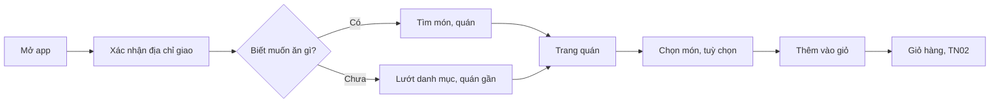

> **Mã:** DE06-TN01-PRD · **Trạng thái:** đã chốt · **Người viết:** Design · **SRS:** [SRS.md](SRS.md)

# PRD Khám phá quán và món (App đặt ship đồ ăn)

## 1. Bối cảnh và vấn đề

### 1.1 Bối cảnh

Khám phá quán và món là bước đầu tiên của vòng đời đơn (xem [README](../../README.md)). Khách thường mở app khi đói, lúc 11 giờ trưa hoặc 7 giờ tối, chưa biết ăn gì. Họ cần ra quyết định trong vài phút, dựa trên ba thứ: món có hợp khẩu vị, bao lâu thì tới, tổng hết bao nhiêu tiền.

### 1.2 Vấn đề

| **Vấn đề** | **Hệ quả** |
| --- | --- |
| Danh sách quán dài, không biết quán nào giao nhanh | Chọn quán xa, chờ 1 tiếng |
| Chọn món xong mới biết quán đã đóng hoặc tạm ngưng | Mất công chọn lại |
| Phí giao chỉ biết ở bước cuối | Thấy đắt, bỏ đơn |
| Món nhiều tuỳ chọn (size, topping, cay) nhưng giao diện rối | Chọn sai, nhận món không như ý |
| Món đã hết vẫn hiện trên menu | Quán phải gọi khách đổi món, đơn chậm |

### 1.3 Mục tiêu

- ≥ 50% phiên mở app có thêm ít nhất 1 món vào giỏ.
- Thời gian từ mở app tới thêm món đầu tiên ≤ 90 giây (trung vị).
- Tỉ lệ đơn bị quán từ chối vì hết món ≤ 3%.

## 2. Người dùng

| **Nhóm** | **Nhu cầu với tính năng này** |
| --- | --- |
| Dân văn phòng đặt trưa | Quán gần, giao nhanh, giá ổn; đặt lại món quen |
| Sinh viên | Rẻ, ít phí giao, đang có ưu đãi của quán |
| Gia đình đặt tối | Quán nhiều món, đặt cho nhiều người |
| Người chưa biết ăn gì | Gợi ý theo danh mục, món bán chạy |

## 3. Phạm vi

### 3.1 Trong phạm vi (MVP)

- Chọn địa chỉ giao; danh sách quán theo địa chỉ giao.
- Trang chủ: danh mục món (Cơm, Bún phở, Trà sữa…), quán gần bạn, đặt lại.
- Thẻ quán: ảnh, tên, khoảng cách, thời gian giao dự kiến, phí giao ước tính, trạng thái mở, đánh giá.
- Tìm kiếm quán và món, không dấu; lọc: đang mở, miễn phí giao, khoảng cách; sắp xếp.
- Trang quán: menu theo nhóm, món bán chạy, món hết hàng, giờ mở cửa.
- Tuỳ chọn món: size, topping, mức cay, ghi chú; giá cập nhật theo lựa chọn.

### 3.2 Ngoài phạm vi

- Mã giảm giá của nền tảng, chương trình khuyến mãi → phase sau (chỉ có giá giảm do quán đặt sẵn trên món).
- Đặt trước theo giờ.
- Đặt nhóm, nhiều người cùng chọn món.
- Gợi ý cá nhân hoá bằng AI.

## 4. Nguyên tắc sản phẩm

### 4.1 Ba con số luôn có mặt

Mỗi thẻ quán đều có **thời gian giao dự kiến**, **phí giao ước tính** và **khoảng cách**, tính theo địa chỉ giao đang chọn.

### 4.2 Không cho chọn thứ không đặt được

Quán đóng cửa hoặc tạm ngưng, món hết đều hiện rõ và không thêm vào giỏ được.

### 4.3 Tuỳ chọn món rõ như thực đơn giấy

Nhóm tuỳ chọn bắt buộc đánh dấu rõ, có giá cộng thêm từng lựa chọn, tổng giá cập nhật ngay.

## 5. Quy tắc nghiệp vụ

| **Quy tắc** | **Giá trị** |
| --- | --- |
| Bán kính giao | Tối đa 10 km theo đường đi từ quán tới địa chỉ giao |
| Phí giao ước tính | 15.000 ₫ cho 3 km đầu + 5.000 ₫ mỗi km tiếp theo, làm tròn 1.000 ₫ |
| Thời gian giao dự kiến | Thời gian chuẩn bị trung bình của quán + thời gian đi từ quán tới khách |
| Trạng thái quán | Đang mở, Sắp đóng (≤ 30 phút), Đóng cửa, Tạm ngưng |
| Giỏ hàng | Chỉ chứa món của 1 quán |
| Món hết | Quán tự bật tắt (TN03); hết món thì không thêm được |

- Đơn giá phí giao, bán kính là **cấu hình theo thành phố**.

## 6. Luồng trải nghiệm

| **Bước** | **Giai đoạn** | **Trải nghiệm** | **Đầu ra** |
| --- | --- | --- | --- |
| 1 | Địa chỉ giao | Tự định vị hoặc chọn địa chỉ đã lưu | Địa chỉ giao |
| 2 | Khám phá | Danh mục, quán gần, đặt lại, tìm kiếm | Quán muốn xem |
| 3 | Xem menu | Nhóm món, món bán chạy, giá | Món muốn đặt |
| 4 | Tuỳ chọn | Size, topping, cay, ghi chú | Món trong giỏ |

## 7. Use Cases, User Stories và Acceptance Criteria

### UC1. Địa chỉ giao và danh sách quán

#### US1.1 Chọn địa chỉ giao

User Story: Là khách, tôi muốn app biết tôi đang ở đâu để chỉ hiện quán giao được tới tôi.

AC01: Mở app tự định vị; hiện địa chỉ ở đầu trang chủ, chạm để đổi.

AC02: Chọn từ địa chỉ đã lưu (Nhà, Công ty) hoặc tìm địa chỉ mới.

AC03: Đổi địa chỉ → danh sách quán, thời gian, phí giao cập nhật.

AC04: Địa chỉ ngoài vùng phục vụ → báo rõ, không hiện quán.

#### US1.2 Lướt quán

AC01: Trang chủ có danh mục, Quán gần bạn, Đặt lại (đơn đã giao gần đây).

AC02: Mỗi thẻ quán có thời gian dự kiến, phí giao, khoảng cách, trạng thái, điểm đánh giá.

AC03: Quán đóng cửa xếp cuối, ghi giờ mở cửa lại.

### UC2. Tìm kiếm và lọc

#### US2.1 Tìm món, quán

User Story: Là khách, tôi muốn gõ "bun bo" và thấy các quán có bún bò gần tôi.

AC01: Tìm theo tên quán và tên món, không dấu.

AC02: Kết quả nhóm theo quán, hiện món khớp trong quán.

AC03: Lọc: Đang mở, Miễn phí giao, ≤ 3 km; sắp xếp: Phù hợp, Gần nhất, Giao nhanh nhất, Đánh giá cao.

### UC3. Xem menu và tuỳ chọn món

#### US3.1 Xem menu quán

AC01: Menu theo nhóm do quán đặt; thanh nhóm dính đầu trang, chạm để nhảy tới nhóm.

AC02: Món hết hiện mờ, ghi "Hết món".

AC03: Quán đóng cửa vẫn xem được menu, không thêm giỏ được.

#### US3.2 Chọn tuỳ chọn món

User Story: Là khách, tôi muốn chọn size, topping, mức cay và thấy giá ngay.

AC01: Nhóm bắt buộc ghi "Bắt buộc · chọn 1"; nhóm tuỳ chọn ghi "Chọn tối đa {n}".

AC02: Mỗi lựa chọn có giá cộng thêm; tổng cập nhật theo số lượng.

AC03: Thiếu nhóm bắt buộc → nút Thêm vào giỏ chỉ rõ nhóm còn thiếu.

AC04: Giỏ đang có món của quán khác → hỏi thay giỏ mới hay giữ giỏ cũ.

## 8. Chỉ số theo dõi

| **Chỉ số** | **Định nghĩa** | **Mục tiêu MVP** |
| --- | --- | --- |
| Tỉ lệ thêm giỏ | Phiên có thêm món / phiên mở app | ≥ 50% |
| Thời gian tới món đầu tiên | Mở app → thêm món đầu tiên | ≤ 90 giây (trung vị) |
| Tỉ lệ tìm có kết quả | Lượt tìm có kết quả / tổng lượt tìm | ≥ 85% |
| Tỉ lệ dùng Đặt lại | Đơn từ Đặt lại / tổng đơn | Theo dõi |
| Từ chối vì hết món | Đơn quán từ chối lý do hết món / tổng đơn | ≤ 3% |

## 9. Phụ thuộc và rủi ro

| **Mục** | **Mô tả** | **Hướng xử lý** |
| --- | --- | --- |
| Dữ liệu menu do quán nhập | Ảnh xấu, giá sai, quên tắt món hết | Quán bật tắt món nhanh (TN03); nhắc khi bị từ chối vì hết món |
| Thời gian dự kiến | Sai lệch giờ cao điểm | Tính từ dữ liệu thực tế 7 ngày, cập nhật mỗi 15 phút |
| Dịch vụ bản đồ | Tính đường đi chậm | Ước tính theo đường chim bay × 1,3 khi chưa có kết quả |

## 10. Câu hỏi mở

> Mọi câu hỏi dưới đây đã được PO chốt ngày 20/11/2026; quyết định ghi sau mỗi câu và đã cập nhật vào SRS.

- Có cho đặt món của nhiều quán trong một đơn? → **Đã chốt:** Không. Giỏ chỉ có 1 quán (SRS BR-09).
- Quán đóng cửa có hiện trong kết quả tìm kiếm? → **Đã chốt:** Có, xếp cuối, ghi giờ mở lại (SRS BR-04).
- Thời gian dự kiến hiện một số hay khoảng? → **Đã chốt:** Khoảng 10 phút, ví dụ "25–35 phút" (SRS BR-03).
- Có hiện quán ngoài bán kính 10 km? → **Đã chốt:** Không (SRS BR-02).
