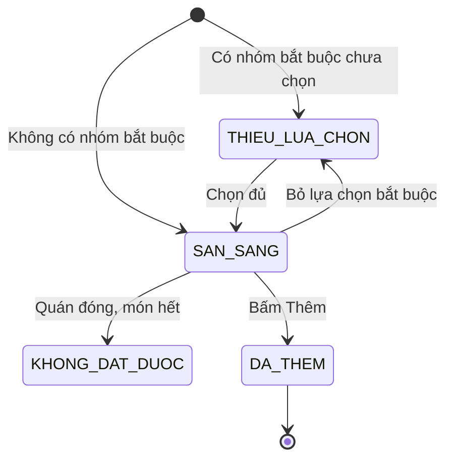
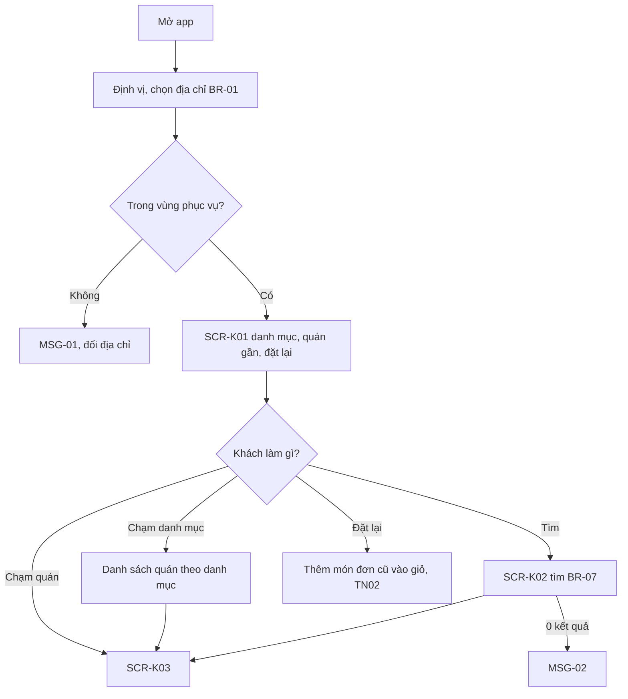
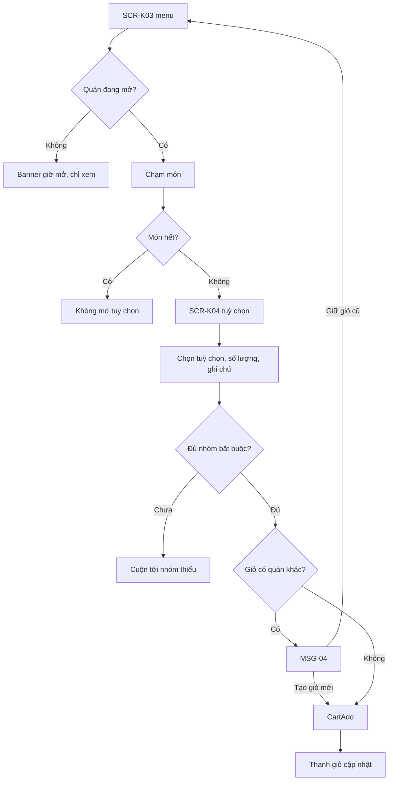
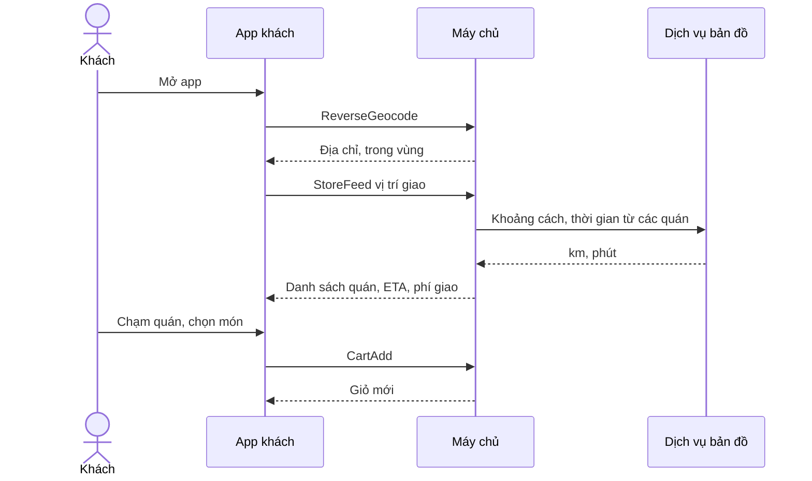

> **Mã:** DE06-TN01-SRS · **Trạng thái:** đã chốt · **Người viết:** Design · **PRD:** [PRD.md](PRD.md)

# UC-DE06-01 - Khám phá quán và món

> SRS này mô tả từ lúc khách mở app đến khi món được thêm vào giỏ; giỏ hàng và đặt đơn xem [SRS TN02](../TN02-gio-hang-dat-don/SRS.md).

## 1. Tổng quan

| **Mục** | **Nội dung** |
| --- | --- |
| Mục tiêu | Khách tìm được quán, món phù hợp với địa chỉ giao; chọn tuỳ chọn món và thêm vào giỏ |
| Actor | Khách · App khách · Máy chủ · Dịch vụ bản đồ |
| Phạm vi | Địa chỉ giao, trang chủ, danh mục, thẻ quán, tìm kiếm, lọc, sắp xếp, trang quán, tuỳ chọn món, thêm giỏ |
| Ngoài phạm vi | Mã giảm giá nền tảng, đặt trước, đặt nhóm, gợi ý AI |
| Nền tảng | App khách iOS / Android |

## 2. User Story

| **ID** | **As a** | **I want** | **So that** |
| --- | --- | --- | --- |
| US-01 | Khách | Chỉ thấy quán giao được tới địa chỉ của tôi | Không chọn nhầm quán xa |
| US-02 | Khách | Thấy thời gian, phí giao của từng quán | Chọn nhanh |
| US-03 | Khách | Tìm món, quán không cần gõ dấu | Tìm nhanh |
| US-04 | Khách | Chọn size, topping và thấy giá ngay | Nhận đúng món |
| US-05 | Khách | Đặt lại món quen | Không phải chọn lại |

## 3. Business Rules

| **Mã** | **Quy tắc** |
| --- | --- |
| BR-01 | **Địa chỉ giao** mặc định = vị trí thiết bị khớp vào địa chỉ gần nhất; hoặc địa chỉ đã lưu dùng gần nhất nếu thiết bị cách đó ≤ 100 m. Ngoài vùng phục vụ → MSG-01, không hiện quán |
| BR-02 | **Quán hiển thị**: khoảng cách theo đường đi từ quán tới địa chỉ giao ≤ 10 km; quán đã được duyệt hoạt động |
| BR-03 | **Thời gian dự kiến** = thời gian chuẩn bị trung bình của quán (7 ngày gần nhất, cùng khung giờ) + thời gian đi từ quán tới khách; hiện dạng khoảng 10 phút làm tròn 5, ví dụ "25–35 phút" |
| BR-04 | **Trạng thái quán**: `DANG_MO` (trong giờ mở cửa, đang bật nhận đơn); `SAP_DONG` (còn ≤ 30 phút tới giờ đóng, hiện "Đóng lúc {giờ}"); `DONG_CUA` (ngoài giờ, hiện "Mở lúc {giờ, ngày}"); `TAM_NGUNG` (quán tắt nhận đơn, TN03). `DONG_CUA`, `TAM_NGUNG` xếp cuối mọi danh sách, không thêm giỏ được |
| BR-05 | **Phí giao ước tính** trên thẻ quán = 15.000 ₫ cho 3 km đầu + 5.000 ₫ mỗi km tiếp theo (làm tròn lên km), làm tròn 1.000 ₫; quán tự tài trợ phí giao thì ghi "Miễn phí giao" (phí cuối cùng tính ở TN02 BR-13) |
| BR-06 | **Thẻ quán**: ảnh bìa, tên, điểm đánh giá trung bình (1 số lẻ) + số lượt (ẩn nếu < 10 lượt, ghi "Quán mới"), khoảng cách, thời gian dự kiến, phí giao, nhãn trạng thái |
| BR-07 | **Tìm kiếm** quán và món; không phân biệt dấu, hoa thường; gợi ý sau 2 ký tự, chờ 300 ms. Kết quả nhóm theo quán, mỗi quán hiện tối đa 3 món khớp. Lọc: Đang mở, Miễn phí giao, ≤ 3 km. Sắp xếp: Phù hợp (mặc định), Gần nhất, Giao nhanh nhất, Đánh giá cao |
| BR-08 | **Món**: tên, mô tả ≤ 200 ký tự, ảnh, giá; giá giảm do quán đặt hiện giá gốc gạch ngang. Món `HET_MON` (TN03) hiện mờ, nhãn "Hết món". Nhãn "Bán chạy" cho 5 món nhiều đơn nhất 30 ngày |
| BR-09 | **Giỏ 1 quán**: thêm món của quán khác khi giỏ đang có món → MSG-04 \[Tạo giỏ mới\] \[Giữ giỏ cũ\] |
| BR-10 | **Nhóm tuỳ chọn**: mỗi nhóm có min, max lựa chọn (bắt buộc khi min ≥ 1); mỗi lựa chọn có giá cộng thêm ≥ 0 và có thể hết. Giá món = (giá gốc + tổng giá lựa chọn) × số lượng. Số lượng 1–20. Ghi chú món ≤ 100 ký tự. Cùng món, cùng tuỳ chọn, cùng ghi chú → gộp dòng trong giỏ |

## 4. Trạng thái

### 4.1 Trạng thái nút Thêm vào giỏ trên SCR-K04

| **Trạng thái** | **Hiển thị** |
| --- | --- |
| `THIEU_LUA_CHON` | Nút ghi "Chọn {tên nhóm}"; chạm thì cuộn tới nhóm, nhóm rung nhẹ |
| `SAN_SANG` | "Thêm vào giỏ · {giá} ₫" |
| `KHONG_DAT_DUOC` | Nút disabled, ghi "Quán đang đóng cửa" hoặc "Hết món" |
| `DA_THEM` | Đóng **SCR-K04**, thanh giỏ ở **SCR-K03** cập nhật |

## 5. Use Case

### UC-01 Chọn địa chỉ và tìm quán

| **Mục** | **Nội dung** |
| --- | --- |
| Tiền điều kiện | Khách đã đăng nhập |
| Hậu điều kiện thành công | Khách mở được **SCR-K03** của một quán phục vụ địa chỉ giao |
| Hậu điều kiện thất bại | Ở lại **SCR-K01** hoặc **SCR-K02** với thông báo |

**Luồng chính**

| **Bước** | **Actor** | **Mô tả** |
| --- | --- | --- |
| 1 | Khách | Mở app |
| 2 | App | Định vị, chọn địa chỉ giao theo BR-01; gọi \[StoreFeed\] |
| 3 | App | Hiện **SCR-K01**: địa chỉ giao, danh mục, Đặt lại, Quán gần bạn |
| 4 | Khách | Chạm ô tìm, gõ "bun bo" |
| 5 | App | Gọi \[Search\]; hiện **SCR-K02** kết quả nhóm theo quán |
| 6 | Khách | Chạm một quán → **SCR-K03** |

**Luồng thay thế**

| **Mã** | **Điều kiện** | **Xử lý** |
| --- | --- | --- |
| A1 | Đổi địa chỉ giao | Chạm địa chỉ đầu trang → chọn đã lưu hoặc tìm mới (dùng chung **SCR-K06**, TN02) → tải lại danh sách |
| A2 | Chạm danh mục | Danh sách quán có món thuộc danh mục; cùng bộ lọc, sắp xếp như tìm kiếm |
| A3 | Đặt lại | Thêm món của đơn cũ vào giỏ (bỏ món hết, báo MSG-05) → **SCR-K05** (TN02) |
| A4 | Từ chối quyền vị trí | Khách chọn địa chỉ thủ công |

**Luồng lỗi**

| **Mã** | **Điều kiện** | **Xử lý** |
| --- | --- | --- |
| E1 | Ngoài vùng phục vụ | MSG-01 |
| E2 | Không có quán nào trong 10 km | Empty state "Chưa có quán giao tới khu vực này" |
| E3 | Tìm 0 kết quả | MSG-02, gợi ý danh mục |
| E4 | Lỗi mạng | MSG-06 |

### UC-02 Xem menu và thêm món

| **Mục** | **Nội dung** |
| --- | --- |
| Tiền điều kiện | Quán phục vụ địa chỉ giao |
| Hậu điều kiện thành công | Món với tuỳ chọn đã vào giỏ; thanh giỏ hiện số món, tạm tính |
| Hậu điều kiện thất bại | Giỏ không đổi |

**Luồng chính**

| **Bước** | **Actor** | **Mô tả** |
| --- | --- | --- |
| 1 | App | Gọi \[StoreMenu\]; hiện **SCR-K03**: thông tin quán, thanh nhóm món, danh sách món |
| 2 | Khách | Chạm món "Trà sữa trân châu" |
| 3 | App | Mở **SCR-K04** với nhóm Size (bắt buộc), Đường, Đá, Topping |
| 4 | Khách | Chọn size L, 2 topping, số lượng 2 |
| 5 | App | Cập nhật "Thêm vào giỏ · 98.000 ₫" |
| 6 | Khách | Bấm Thêm vào giỏ |
| 7 | App | Gọi \[CartAdd\]; đóng **SCR-K04**; thanh giỏ "2 món · 98.000 ₫ · Xem giỏ" |

**Luồng thay thế**

| **Mã** | **Điều kiện** | **Xử lý** |
| --- | --- | --- |
| A1 | Món không có nhóm tuỳ chọn | Nút "+" trên dòng món thêm thẳng 1 món |
| A2 | Món đã trong giỏ | Dòng món hiện số lượng; "−" "+" sửa nhanh |
| A3 | Lựa chọn hết | Lựa chọn mờ, ghi "Hết" |
| A4 | Giỏ có quán khác | MSG-04 (BR-09) |

**Luồng lỗi**

| **Mã** | **Điều kiện** | **Xử lý** |
| --- | --- | --- |
| E1 | Quán vừa đóng, tạm ngưng | MSG-03, nút disabled |
| E2 | Món vừa hết khi bấm thêm | MSG-05 |
| E3 | Lỗi mạng | MSG-06 |

## 6. Điểm vào

| **Điểm vào** | **Dẫn tới** | **Ghi chú** |
| --- | --- | --- |
| Mở app | **SCR-K01** | Đơn đang giao → banner theo dõi đơn ở đầu (TN04) |
| Chạm thông báo quán yêu thích mở cửa | **SCR-K03** | Phase sau |
| "Đặt lại" ở lịch sử đơn (TN05) | A3 UC-01 | |
| Link chia sẻ quán | **SCR-K03** | Ngoài bán kính → MSG-01 |

## 7. Mô tả màn hình

### SCR-K01 Trang chủ

| **#** | **Thành phần** | **Loại** | **Hành vi** |
| --- | --- | --- | --- |
| 1 | Địa chỉ giao | Header | "Giao đến: {tên địa chỉ}"; chạm để đổi (A1) |
| 2 | Ô tìm kiếm | Search bar | Mở **SCR-K02** |
| 3 | Danh mục | Lưới icon | 8–10 danh mục, cuộn ngang |
| 4 | Đặt lại | Dải thẻ | 5 đơn đã giao gần nhất: ảnh quán, món chính, "Đặt lại" |
| 5 | Quán gần bạn | List thẻ quán | Thẻ theo BR-06; tải thêm khi cuộn |
| 6 | Banner đơn đang giao | Banner | Khi có đơn chưa kết thúc (TN04) |
| 7 | Thanh giỏ | Sticky bar | Khi giỏ có món: quán, số món, tạm tính |

### SCR-K02 Tìm kiếm

| **#** | **Thành phần** | **Loại** | **Hành vi** |
| --- | --- | --- | --- |
| 1 | Ô tìm | Search input | Gợi ý BR-07 |
| 2 | Tìm gần đây | Chips | 5 từ khoá |
| 3 | Bộ lọc | Chips | Đang mở, Miễn phí giao, ≤ 3 km |
| 4 | Sắp xếp | Dropdown | BR-07 |
| 5 | Kết quả | List | Thẻ quán + tối đa 3 món khớp (ảnh nhỏ, tên, giá) |

### SCR-K03 Trang quán

| **#** | **Thành phần** | **Loại** | **Hành vi** |
| --- | --- | --- | --- |
| 1 | Ảnh bìa, tên quán | Header | Thu gọn khi cuộn |
| 2 | Thông tin | Text | Đánh giá, khoảng cách, thời gian dự kiến, phí giao, giờ mở cửa |
| 3 | Banner trạng thái | Banner | `SAP_DONG`, `DONG_CUA`, `TAM_NGUNG` (BR-04) |
| 4 | Tìm trong quán | Icon | Lọc món theo tên |
| 5 | Thanh nhóm món | Tabs dính | Chạm nhảy tới nhóm; tự đổi khi cuộn |
| 6 | Dòng món | List item | Ảnh, tên, mô tả 2 dòng, giá, nhãn Bán chạy, Hết món; nút "+" |
| 7 | Thanh giỏ | Sticky bar | "{n} món · {tạm tính} ₫ · Xem giỏ" → **SCR-K05** |

### SCR-K04 Tuỳ chọn món

| **#** | **Thành phần** | **Loại** | **Bắt buộc** | **Validate / hành vi** |
| --- | --- | --- | --- | --- |
| 1 | Ảnh, tên, mô tả, giá | Header | – | |
| 2 | Nhóm chọn 1 | Radio group | Theo min | "Bắt buộc · chọn 1"; giá cộng thêm |
| 3 | Nhóm chọn nhiều | Checkbox group | Theo min | "Chọn tối đa {max}"; vượt max thì lựa chọn khác disabled |
| 4 | Ghi chú cho quán | Text | Không | ≤ 100 ký tự; placeholder "Ví dụ: không hành" |
| 5 | Số lượng | Stepper | Có | 1–20 |
| 6 | Nút thêm | Button | – | Mục 4.1 |

## 8. API

| **API** | **Request chính** | **Response chính** | **Timeout / retry** |
| --- | --- | --- | --- |
| \[ReverseGeocode\] | lat, lng | Địa chỉ, in_service_area | 3s / 1 lần |
| \[StoreFeed\] | delivery_location, category, filters, sort, cursor | Thẻ quán (BR-06), đơn đặt lại | 5s / 1 lần |
| \[Search\] | keyword, delivery_location, filters, sort | Quán + món khớp | 3s / 1 lần |
| \[StoreMenu\] | store_id, delivery_location | Thông tin quán, trạng thái, nhóm món, món, nhóm tuỳ chọn | 5s / 1 lần |
| \[CartAdd\] | store_id, item_id, options, quantity, note, replace_cart | Giỏ mới | 5s / 1 lần |

**Map lỗi → thông báo**

| **Nhóm lỗi** | **Message** |
| --- | --- |
| Ngoài vùng phục vụ | MSG-01 |
| Tìm 0 kết quả | MSG-02 |
| Quán đóng, tạm ngưng | MSG-03 |
| Giỏ có quán khác | MSG-04 |
| Món hết | MSG-05 |
| Mất mạng, lỗi máy chủ | MSG-06 |

## 9. Danh sách thông báo

| **ID** | **Nơi hiện** | **Nội dung (VI)** |
| --- | --- | --- |
| MSG-01 | Empty state | Rất tiếc, chúng tôi chưa giao tới địa chỉ này. \[Đổi địa chỉ\] |
| MSG-02 | Empty state | Không tìm thấy “{từ khoá}” gần bạn. Thử từ khoá khác hoặc xem danh mục |
| MSG-03 | Banner | Quán đang đóng cửa, mở lại lúc {giờ}. Bạn vẫn có thể xem menu |
| MSG-04 | Popup | Giỏ hàng đang có món của {quán cũ}. Tạo giỏ mới với món của {quán mới}? \[Tạo giỏ mới\] \[Giữ giỏ cũ\] |
| MSG-05 | Toast | {Tên món} đã hết. {Nếu Đặt lại: Các món còn lại đã được thêm vào giỏ} |
| MSG-06 | Toast | Kết nối không ổn định, vui lòng thử lại |

## 10. Yêu cầu phi chức năng

| **Mục** | **Yêu cầu** |
| --- | --- |
| Hiệu năng | **SCR-K01** hiện quán đầu tiên ≤ 2 giây trên 4G; \[Search\] ≤ 500 ms (p95); mở **SCR-K04** ≤ 300 ms (dữ liệu có sẵn từ \[StoreMenu\]) |
| Độ tươi dữ liệu | Trạng thái quán và món hết cập nhật trên app ≤ 30 giây sau khi quán đổi (TN03) |
| Riêng tư | Vị trí chỉ lấy khi app đang dùng |
| Log / audit | Từ khoá tìm kiếm, số kết quả |
| Tracking | Mở app, đổi địa chỉ, chạm danh mục, tìm kiếm, lọc, mở quán (vị trí trong danh sách), mở món, thêm giỏ, thay giỏ, đặt lại |
| Accessibility | Thẻ quán đọc được đầy đủ (tên, thời gian, phí); nhóm tuỳ chọn đọc rõ bắt buộc, số tối đa; giá cộng thêm đọc rõ |
