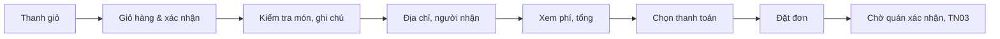

> **Mã:** DE06-TN02-PRD · **Trạng thái:** đã chốt · **Người viết:** Design · **SRS:** [SRS.md](SRS.md)

# PRD Giỏ hàng và đặt đơn (App đặt ship đồ ăn)

## 1. Bối cảnh và vấn đề

### 1.1 Bối cảnh

Sau khi chọn món (TN01), khách xem lại giỏ, xác nhận địa chỉ giao, chọn cách trả tiền và đặt đơn (xem [README](../../README.md)). Đơn được gửi tới quán ngay; mọi sai sót ở bước này (sai địa chỉ, sai số điện thoại, quên ghi chú) đều khiến tài xế và quán mất thời gian.

### 1.2 Vấn đề

| **Vấn đề** | **Hệ quả** |
| --- | --- |
| Tổng tiền có nhiều loại phí khó hiểu | Khách thấy "phí chồng phí", bỏ đơn |
| Địa chỉ trong toà nhà, hẻm không rõ | Tài xế gọi hỏi nhiều lần, đồ ăn nguội |
| Đặt hộ người khác nhưng số điện thoại là của mình | Tài xế không liên lạc được người nhận |
| Món hết, giá đổi sau khi đã thêm vào giỏ | Đặt xong quán từ chối |
| Bấm đặt nhiều lần vì mạng chậm | Hai đơn trùng |

### 1.3 Mục tiêu

- Tỉ lệ từ mở giỏ tới đặt đơn thành công ≥ 65%.
- Tỉ lệ đơn tài xế phải gọi hỏi địa chỉ ≤ 15%.
- 0 đơn trùng do bấm đặt nhiều lần.

## 2. Người dùng

| **Nhóm** | **Nhu cầu với tính năng này** |
| --- | --- |
| Dân văn phòng | Giao tới toà nhà, ghi rõ tầng, sảnh; trả bằng ví |
| Sinh viên | Biết rõ từng khoản phí, trả tiền mặt |
| Người đặt hộ gia đình | Đổi tên, số điện thoại người nhận |

## 3. Phạm vi

### 3.1 Trong phạm vi (MVP)

- Giỏ hàng: sửa số lượng, tuỳ chọn, xoá món; ghi chú cho quán; dụng cụ ăn uống.
- Địa chỉ giao: chọn đã lưu, tìm mới, ghim bản đồ, chi tiết toà nhà, ghi chú cho tài xế; người nhận.
- Bảng giá: tạm tính, phí giao, phí dịch vụ, phí đơn nhỏ, phụ phí cao điểm, giảm phí giao của quán; giải thích từng khoản.
- Thanh toán: tiền mặt, ví liên kết.
- Đặt đơn, chống đặt trùng.

### 3.2 Ngoài phạm vi

- Mã giảm giá nền tảng, điểm thưởng.
- Đặt hẹn giờ.
- Thanh toán thẻ trực tiếp.
- Tách hoá đơn, xuất hoá đơn VAT.

## 4. Nguyên tắc sản phẩm

### 4.1 Mọi khoản phí đều có lời giải thích

Chạm vào khoản phí nào cũng có một câu giải thích vì sao có phí đó.

### 4.2 Địa chỉ cho tài xế, không chỉ cho bản đồ

Ngoài ghim bản đồ, luôn có chỗ cho chi tiết "Toà A, tầng 5" và ghi chú cho tài xế.

### 4.3 Kiểm tra trước khi gửi quán

Giá, món hết, quán mở đều được kiểm tra lại khi mở giỏ và khi bấm đặt.

## 5. Quy tắc nghiệp vụ

| **Quy tắc** | **Giá trị** |
| --- | --- |
| Phí giao | Theo khoảng cách (TN01) + phụ phí cao điểm hoặc thời tiết xấu 5.000 ₫ khi có |
| Phí dịch vụ | 3.000 ₫ mỗi đơn |
| Phí đơn nhỏ | 5.000 ₫ khi tạm tính < 40.000 ₫ |
| Giới hạn đơn | Tạm tính tối đa 3.000.000 ₫; tối đa 30 món |
| Tiền mặt | Tổng ≤ 1.000.000 ₫ |
| Đơn đang chạy | Tối đa 3 đơn cùng lúc mỗi khách |
| Dụng cụ ăn uống | Mặc định không lấy |

- Các mức phí là **cấu hình theo thành phố**.

## 6. Luồng trải nghiệm

| **Bước** | **Giai đoạn** | **Trải nghiệm** | **Đầu ra** |
| --- | --- | --- | --- |
| 1 | Giỏ | Danh sách món, sửa nhanh, ghi chú cho quán | Món cuối |
| 2 | Địa chỉ | Địa chỉ đã lưu hoặc mới, chi tiết toà nhà, người nhận | Nơi giao rõ ràng |
| 3 | Tiền | Từng khoản phí, tổng | Khách biết trả bao nhiêu |
| 4 | Đặt | Thanh toán, nút "Đặt đơn · {tổng}" | Đơn gửi quán |

## 7. Use Cases, User Stories và Acceptance Criteria

### UC1. Xem và sửa giỏ

#### US1.1 Sửa món trong giỏ

AC01: Mỗi dòng: tên, tuỳ chọn, ghi chú, số lượng, giá; chạm để sửa tuỳ chọn.

AC02: Giảm số lượng về 0 → xoá, có Hoàn tác.

AC03: Món hết, giá đổi kể từ lúc thêm → đánh dấu rõ; món hết không được đặt.

#### US1.2 Ghi chú, dụng cụ

AC01: Ghi chú cho quán ≤ 200 ký tự.

AC02: Công tắc "Lấy dụng cụ ăn uống", mặc định tắt.

### UC2. Địa chỉ và người nhận

#### US2.1 Giao đúng chỗ

User Story: Là khách ở toà nhà, tôi muốn ghi rõ toà, tầng để tài xế khỏi gọi hỏi.

AC01: Chọn địa chỉ đã lưu hoặc tìm mới; kéo ghim cho chính xác.

AC02: Ô chi tiết (toà, tầng, phòng) và ghi chú cho tài xế.

AC03: Lưu địa chỉ mới với tên (Nhà, Công ty, khác).

#### US2.2 Đặt hộ

AC01: Đổi tên, số điện thoại người nhận cho đơn này; không đổi hồ sơ.

### UC3. Phí và thanh toán

#### US3.1 Hiểu tổng tiền

User Story: Là khách, tôi muốn biết từng khoản phí là gì để thấy giá hợp lý.

AC01: Liệt kê tạm tính, phí giao, phí dịch vụ, phí đơn nhỏ (nếu có), phụ phí (nếu có), giảm phí giao (nếu có), tổng.

AC02: Chạm biểu tượng ⓘ cạnh mỗi khoản → giải thích.

AC03: Phí đơn nhỏ → gợi ý "Thêm {x} ₫ để bỏ phí đơn nhỏ".

#### US3.2 Chọn thanh toán

AC01: Tiền mặt (ẩn khi tổng > 1.000.000 ₫, ghi lý do) hoặc ví liên kết (hiện số dư).

AC02: Ví không đủ số dư → báo, gợi ý tiền mặt.

### UC4. Đặt đơn

AC01: Bấm "Đặt đơn" chỉ tạo 1 đơn dù bấm nhiều lần.

AC02: Quán vừa đóng, món vừa hết, giá đổi → báo cụ thể, không tạo đơn.

AC03: Đặt thành công → màn theo dõi đơn ở trạng thái "Chờ quán xác nhận".

## 8. Chỉ số theo dõi

| **Chỉ số** | **Định nghĩa** | **Mục tiêu MVP** |
| --- | --- | --- |
| Tỉ lệ đặt đơn | Đơn thành công / phiên mở giỏ | ≥ 65% |
| Tỉ lệ có chi tiết địa chỉ | Đơn có chi tiết toà, tầng hoặc ghi chú tài xế / tổng đơn | Theo dõi |
| Tỉ lệ tài xế gọi hỏi địa chỉ | Đơn tài xế gọi khách trước khi tới / tổng đơn | ≤ 15% |
| Tỉ lệ chạm giải thích phí | Phiên chạm ⓘ / phiên mở giỏ | Theo dõi |
| Đơn trùng | Đơn trùng do bấm nhiều lần | 0 |

## 9. Phụ thuộc và rủi ro

| **Mục** | **Mô tả** | **Hướng xử lý** |
| --- | --- | --- |
| Ví liên kết | Lỗi, chậm khi trừ tiền | Thời gian chờ 15 giây, báo lỗi rõ, gợi ý tiền mặt |
| Phụ phí thời tiết | Khách phản ứng | Hiện nhãn và giải thích; chỉ áp khi vận hành bật theo khu vực |
| Đơn tiền mặt bị bom | Khách không nhận hàng | Giới hạn tiền mặt; khoá tiền mặt với khách có 2 lần không nhận (TN05) |

## 10. Câu hỏi mở

> Mọi câu hỏi dưới đây đã được PO chốt ngày 20/11/2026; quyết định ghi sau mỗi câu và đã cập nhật vào SRS.

- Trừ tiền ví lúc nào? → **Đã chốt:** Ngay khi đặt đơn; hoàn tự động nếu đơn bị huỷ không do lỗi khách (SRS BR-16).
- Tip cho tài xế đặt ở bước nào? → **Đã chốt:** Sau khi giao, ở màn đánh giá (TN05), không ở bước đặt đơn.
- Giỏ hàng giữ bao lâu? → **Đã chốt:** 24 giờ, lưu theo tài khoản (SRS BR-11).
- Có cho đổi phương thức thanh toán sau khi đặt? → **Đã chốt:** Không (SRS BR-16).
