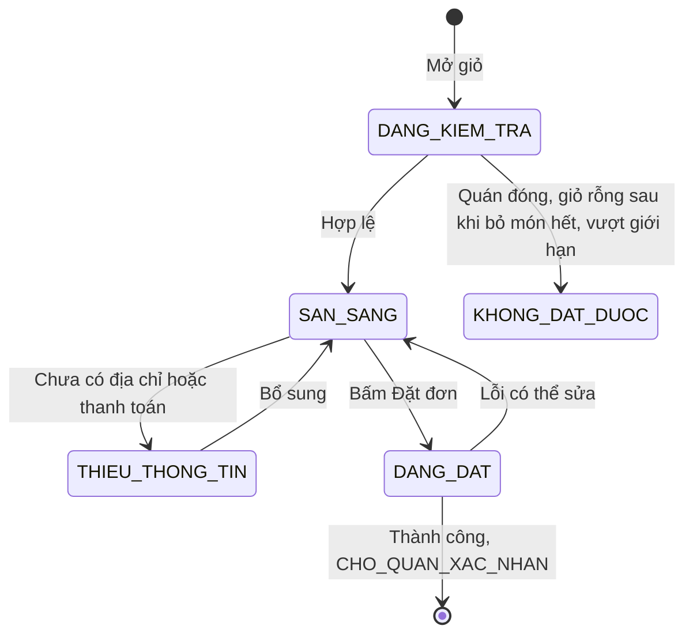
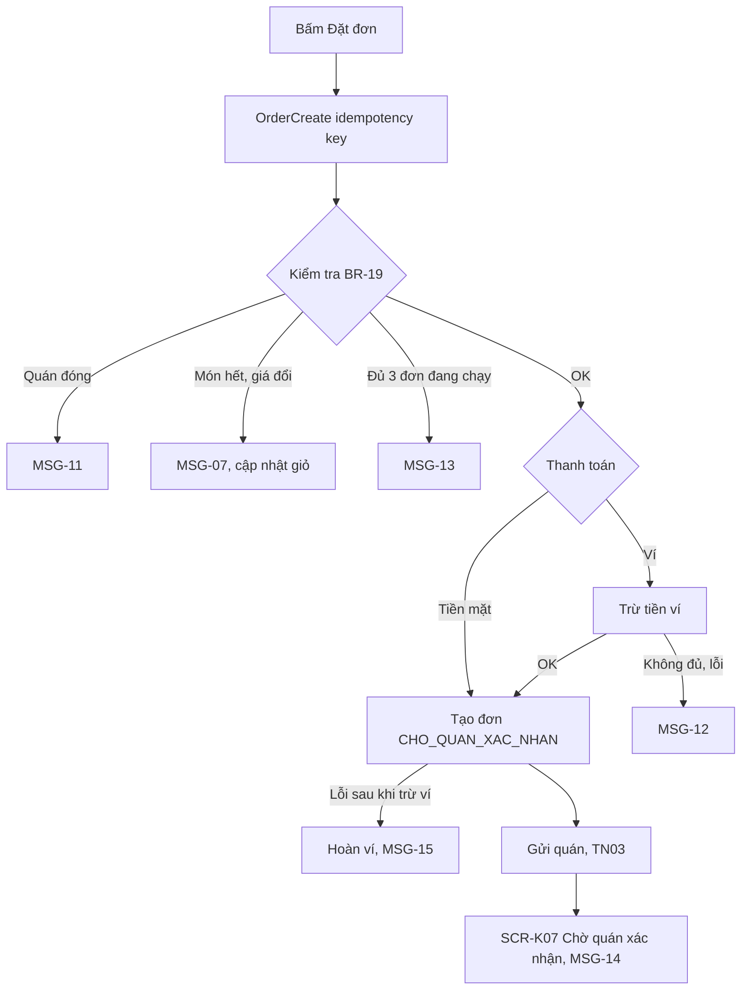
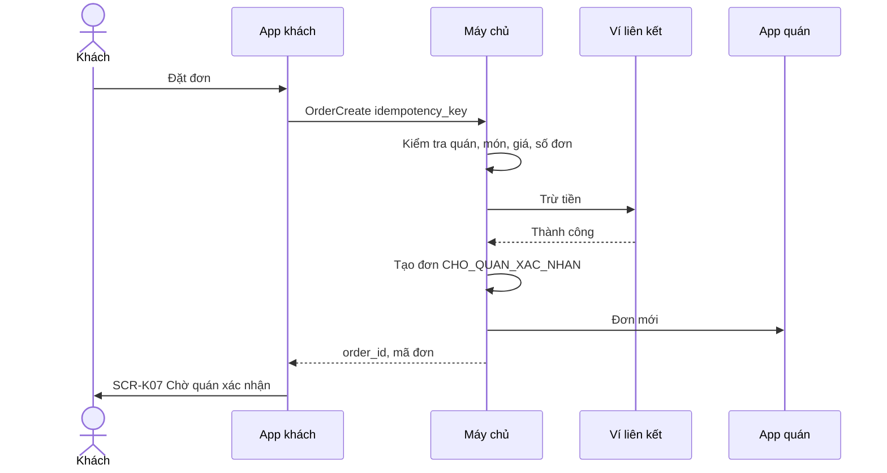

> **Mã:** DE06-TN02-SRS · **Trạng thái:** đã chốt · **Người viết:** Design · **PRD:** [PRD.md](PRD.md)

# UC-DE06-02 - Giỏ hàng và đặt đơn

> SRS này mô tả từ giỏ hàng tới khi đơn được tạo ở `CHO_QUAN_XAC_NHAN`; quán xử lý đơn xem [SRS TN03](../TN03-quan-nhan-chuan-bi-don/SRS.md).

## 1. Tổng quan

| **Mục** | **Nội dung** |
| --- | --- |
| Mục tiêu | Khách xác nhận món, địa chỉ, người nhận, phí, thanh toán và đặt đơn |
| Actor | Khách · App khách · Máy chủ · Ví liên kết · Dịch vụ bản đồ |
| Phạm vi | Giỏ hàng, ghi chú, dụng cụ, địa chỉ giao, người nhận, bảng phí, thanh toán, đặt đơn |
| Ngoài phạm vi | Mã giảm giá nền tảng, hẹn giờ, thẻ, hoá đơn VAT, tip (TN05) |
| Nền tảng | App khách iOS / Android |

## 2. User Story

| **ID** | **As a** | **I want** | **So that** |
| --- | --- | --- | --- |
| US-06 | Khách | Sửa món, ghi chú trong giỏ | Đơn đúng ý |
| US-07 | Khách | Ghi rõ toà, tầng, ghi chú cho tài xế | Tài xế không phải gọi hỏi |
| US-08 | Khách | Đặt hộ người khác | Tài xế liên lạc đúng người nhận |
| US-09 | Khách | Hiểu từng khoản phí | Thấy giá hợp lý |
| US-10 | Khách | Đặt một lần là một đơn | Không bị trùng đơn |

## 3. Business Rules

| **Mã** | **Quy tắc** |
| --- | --- |
| BR-11 | **Giỏ** lưu trên máy chủ theo tài khoản, 1 quán, hết hạn 24 giờ không hoạt động. Mở **SCR-K05** → kiểm tra lại: món hết → nhãn "Hết món", không tính vào tạm tính; giá đổi → nhãn "Giá đã thay đổi" và giá mới; quán đóng, tạm ngưng → banner, nút Đặt disabled |
| BR-12 | **Địa chỉ giao**: ghim bản đồ (bắt buộc) + tên đường, phường (từ ghim) + chi tiết (toà, tầng, phòng) ≤ 100 ký tự + ghi chú cho tài xế ≤ 100 ký tự. Địa chỉ đã lưu tối đa 10, gồm Nhà, Công ty. Đổi địa chỉ khác quán > 10 km → MSG-08 |
| BR-13 | **Phí giao** = phí theo khoảng cách đường đi thực tế (TN01 BR-05) + phụ phí 5.000 ₫ khi vận hành bật cao điểm hoặc thời tiết xấu cho khu vực − phần quán tài trợ (nếu có, tối đa bằng phí giao) |
| BR-14 | **Phí dịch vụ** 3.000 ₫/đơn. **Phí đơn nhỏ** 5.000 ₫ khi tạm tính < 40.000 ₫; hiện gợi ý "Thêm {40.000 − tạm tính} ₫ để không mất phí đơn nhỏ" |
| BR-15 | **Tổng** = tạm tính + phí giao + phí dịch vụ + phí đơn nhỏ. Tạm tính tối đa 3.000.000 ₫, tối đa 30 món; vượt → MSG-09 |
| BR-16 | **Thanh toán**: Tiền mặt (tổng ≤ 1.000.000 ₫, khách không bị khoá tiền mặt theo TN05 BR-55) hoặc Ví liên kết. Ví → trừ tiền khi tạo đơn; đơn huỷ không do lỗi khách → hoàn toàn bộ trong ≤ 5 phút. Không đổi phương thức sau khi đặt |
| BR-17 | **Người nhận** mặc định tên, số điện thoại tài khoản; đổi được cho riêng đơn này. Số điện thoại di động Việt Nam 10 số |
| BR-18 | **Ghi chú cho quán** ≤ 200 ký tự. **Dụng cụ ăn uống** mặc định tắt |
| BR-19 | **Đặt đơn**: idempotency key cho mỗi lần mở **SCR-K05**. Máy chủ kiểm tra: quán `DANG_MO` hoặc `SAP_DONG` và còn ≥ 10 phút tới giờ đóng; món còn; giá khớp; khách có < 3 đơn chưa kết thúc. Đạt → tạo đơn `CHO_QUAN_XAC_NHAN`, mã đơn 6 ký tự chữ số, gửi tới quán (TN03) |
| BR-20 | **Thời gian dự kiến** trên **SCR-K05** tính lại theo địa chỉ cuối (TN01 BR-03), hiện dạng "Giao lúc 12:25–12:35" |
| BR-21 | **Giải thích phí** (ⓘ): Phí giao – "Trả cho tài xế, tính theo quãng đường {km} km"; Phụ phí – "Đang cao điểm hoặc thời tiết xấu, giúp có thêm tài xế"; Phí dịch vụ – "Duy trì ứng dụng và hỗ trợ khách hàng"; Phí đơn nhỏ – "Áp dụng cho đơn dưới 40.000 ₫" |
| BR-22 | **Ví liên kết** không đủ số dư hoặc lỗi → MSG-12; không tạo đơn. Ví trừ tiền thành công nhưng tạo đơn lỗi → hoàn ngay, MSG-15 |

## 4. Trạng thái

### 4.1 Trạng thái nút Đặt đơn trên SCR-K05

| **Trạng thái** | **Hiển thị nút** |
| --- | --- |
| `DANG_KIEM_TRA` | Skeleton giá, nút disabled |
| `SAN_SANG` | "Đặt đơn · {tổng} ₫" |
| `THIEU_THONG_TIN` | "Chọn địa chỉ giao" hoặc "Chọn thanh toán"; chạm mở phần thiếu |
| `KHONG_DAT_DUOC` | Disabled + lý do |
| `DANG_DAT` | Loading, không bấm lại được |

## 5. Use Case

### UC-03 Xác nhận giỏ, địa chỉ và thanh toán

| **Mục** | **Nội dung** |
| --- | --- |
| Tiền điều kiện | Giỏ có ít nhất 1 món còn |
| Hậu điều kiện thành công | Nút Đặt đơn ở `SAN_SANG` |
| Hậu điều kiện thất bại | Ở lại **SCR-K05** với lỗi |

**Luồng chính**

| **Bước** | **Actor** | **Mô tả** |
| --- | --- | --- |
| 1 | Khách | Chạm thanh giỏ → **SCR-K05** |
| 2 | App | Gọi \[CartValidate\]; hiện món, địa chỉ mặc định, phí (BR-13–15), thời gian dự kiến |
| 3 | Khách | Sửa số lượng một món; nhập ghi chú cho quán |
| 4 | Khách | Chạm địa chỉ → **SCR-K06**; chọn "Công ty", nhập chi tiết "Toà B, tầng 12" |
| 5 | App | Gọi \[DeliveryQuote\] tính lại phí giao, thời gian |
| 6 | Khách | Chọn Ví liên kết |
| 7 | App | Nút "Đặt đơn · {tổng} ₫" ở `SAN_SANG` |

**Luồng thay thế**

| **Mã** | **Điều kiện** | **Xử lý** |
| --- | --- | --- |
| A1 | Thêm địa chỉ mới | **SCR-K06**: tìm địa chỉ → kéo ghim → chi tiết, ghi chú → tuỳ chọn lưu với tên |
| A2 | Đổi người nhận | Chạm "Người nhận" → nhập tên, số điện thoại (BR-17) |
| A3 | Chạm ⓘ cạnh phí | Bottom sheet giải thích (BR-21) |
| A4 | Có phí đơn nhỏ | Gợi ý "Thêm {x} ₫…" + nút "Thêm món" về **SCR-K03** |
| A5 | Sửa tuỳ chọn món | Mở **SCR-K04** với lựa chọn hiện tại |

**Luồng lỗi**

| **Mã** | **Điều kiện** | **Xử lý** |
| --- | --- | --- |
| E1 | Món hết, giá đổi | Nhãn trên dòng (BR-11), MSG-07 |
| E2 | Địa chỉ quá xa quán | MSG-08 |
| E3 | Vượt giới hạn đơn | MSG-09 |
| E4 | Tiền mặt không khả dụng | MSG-10 |

### UC-04 Đặt đơn

| **Mục** | **Nội dung** |
| --- | --- |
| Tiền điều kiện | Nút ở `SAN_SANG` |
| Hậu điều kiện thành công | Đơn `CHO_QUAN_XAC_NHAN`; giỏ trống; mở **SCR-K07** (TN04) |
| Hậu điều kiện thất bại | Không tạo đơn; ví không bị trừ hoặc đã hoàn |

**Luồng chính**

| **Bước** | **Actor** | **Mô tả** |
| --- | --- | --- |
| 1 | Khách | Bấm "Đặt đơn · {tổng} ₫" |
| 2 | App | Gọi \[OrderCreate\] với idempotency key; nút `DANG_DAT` |
| 3 | Máy chủ | Kiểm tra BR-19; trừ ví (nếu ví); tạo đơn; gửi tới App quán |
| 4 | App | Mở **SCR-K07** trạng thái "Chờ quán xác nhận"; MSG-14 |

**Luồng thay thế**

| **Mã** | **Điều kiện** | **Xử lý** |
| --- | --- | --- |
| A1 | Mạng chậm, gửi lại | Gửi lại cùng key; máy chủ trả đơn đã tạo |
| A2 | Giá đổi lúc đặt | MSG-07 kèm tổng mới; khách bấm đặt lại |

**Luồng lỗi**

| **Mã** | **Điều kiện** | **Xử lý** |
| --- | --- | --- |
| E1 | Quán vừa đóng | MSG-11 |
| E2 | Ví lỗi, không đủ tiền | MSG-12 |
| E3 | Đủ 3 đơn chưa kết thúc | MSG-13 |
| E4 | Tạo đơn lỗi sau khi trừ ví | Hoàn ví, MSG-15 |
| E5 | Mất mạng hoàn toàn | MSG-16; khi có mạng gọi lại cùng key |

## 6. Điểm vào

| **Điểm vào** | **Dẫn tới** | **Ghi chú** |
| --- | --- | --- |
| Thanh giỏ ở **SCR-K01**, **SCR-K03** | **SCR-K05** | |
| "Đặt lại" (TN01 A3, TN05) | **SCR-K05** | Món hết đã bị bỏ |
| Địa chỉ ở **SCR-K01** | **SCR-K06** | Dùng chung chọn địa chỉ |

## 7. Mô tả màn hình

### SCR-K05 Giỏ hàng & xác nhận đơn

| **#** | **Thành phần** | **Loại** | **Bắt buộc** | **Validate / hành vi** |
| --- | --- | --- | --- | --- |
| 1 | Giao đến | Card | Có | Tên địa chỉ, chi tiết, ghi chú tài xế; chạm → **SCR-K06** |
| 2 | Người nhận | Dòng chọn | Có | Tên · số điện thoại (BR-17) |
| 3 | Thời gian dự kiến | Text | – | BR-20 |
| 4 | Tên quán | Header | – | Chạm về **SCR-K03** |
| 5 | Dòng món | List | – | Tên, tuỳ chọn, ghi chú, stepper, giá; nhãn Hết món, Giá đã thay đổi |
| 6 | "Thêm món" | Link | – | Về **SCR-K03** |
| 7 | Ghi chú cho quán | Text | Không | ≤ 200 ký tự |
| 8 | Dụng cụ ăn uống | Switch | – | Mặc định tắt |
| 9 | Bảng phí | List | – | Tạm tính, phí giao, phụ phí, phí dịch vụ, phí đơn nhỏ, quán giảm phí giao; mỗi khoản có ⓘ |
| 10 | Gợi ý bỏ phí đơn nhỏ | Info | – | A4 |
| 11 | Thanh toán | Dòng chọn | Có | Tiền mặt / Ví liên kết (số dư) |
| 12 | Tổng | Text lớn | – | BR-15 |
| 13 | Nút Đặt đơn | Button dính đáy | – | Mục 4.1 |

### SCR-K06 Địa chỉ giao

| **#** | **Thành phần** | **Loại** | **Bắt buộc** | **Validate / hành vi** |
| --- | --- | --- | --- | --- |
| 1 | Ô tìm địa chỉ | Search | – | Gợi ý sau 2 ký tự, không dấu |
| 2 | Địa chỉ đã lưu | List | – | Tối đa 10; sửa, xoá |
| 3 | Bản đồ + ghim | Map | Có | Kéo bản đồ để chỉnh ghim; tên đường cập nhật khi thả |
| 4 | Chi tiết | Text | Không | Toà, tầng, phòng ≤ 100 ký tự |
| 5 | Ghi chú cho tài xế | Text | Không | ≤ 100 ký tự; placeholder "Ví dụ: gửi bảo vệ sảnh B" |
| 6 | Lưu địa chỉ | Checkbox + Chips tên | Không | Nhà, Công ty, Khác (tên ≤ 30 ký tự) |
| 7 | "Xác nhận địa chỉ" | Button | – | Kiểm tra bán kính (BR-12) |

## 8. API

| **API** | **Request chính** | **Response chính** | **Timeout / retry** |
| --- | --- | --- | --- |
| \[CartValidate\] | cart_id, delivery_address | Dòng hợp lệ, cờ hết món, đổi giá, trạng thái quán | 5s / 1 lần |
| \[DeliveryQuote\] | store_id, delivery_address, subtotal | Phí giao, phụ phí, phần quán tài trợ, phí dịch vụ, phí đơn nhỏ, eta, distance_km | 5s / 1 lần |
| \[AddressSave\] | name, lat, lng, detail, driver_note | address_id | 5s / 1 lần |
| \[WalletBalance\] | – | Số dư, trạng thái liên kết | 3s / 1 lần |
| \[OrderCreate\] | cart_id, address, receiver, store_note, cutlery, payment_method, quote_id, idempotency_key | order_id, order_code, status, eta | 15s / gửi lại cùng key |

**Map lỗi → thông báo**

| **Nhóm lỗi** | **Message** |
| --- | --- |
| Món hết, giá đổi | MSG-07 |
| Địa chỉ ngoài bán kính quán | MSG-08 |
| Vượt giới hạn đơn | MSG-09 |
| Tiền mặt không khả dụng | MSG-10 |
| Quán đóng | MSG-11 |
| Ví lỗi, không đủ số dư | MSG-12 |
| Quá số đơn đang chạy | MSG-13 |
| Đặt thành công | MSG-14 |
| Hoàn ví do lỗi tạo đơn | MSG-15 |
| Mất mạng | MSG-16 |

## 9. Danh sách thông báo

| **ID** | **Nơi hiện** | **Nội dung (VI)** |
| --- | --- | --- |
| MSG-07 | Banner **SCR-K05** | Một số món đã hết hoặc đổi giá. Vui lòng kiểm tra lại giỏ. Tổng mới: {tổng} ₫ |
| MSG-08 | Inline | Quán không giao tới địa chỉ này (quá 10 km). Chọn địa chỉ khác hoặc quán khác |
| MSG-09 | Inline | Mỗi đơn tối đa 30 món và 3.000.000 ₫ |
| MSG-10 | Inline thanh toán | Thanh toán tiền mặt áp dụng cho đơn đến 1.000.000 ₫ {hoặc: Tài khoản tạm thời không dùng được tiền mặt} |
| MSG-11 | Popup | {Quán} vừa đóng cửa hoặc tạm ngưng nhận đơn. Giỏ hàng vẫn được giữ |
| MSG-12 | Popup | Ví không đủ số dư hoặc đang lỗi. \[Nạp tiền vào ví\] \[Dùng tiền mặt\] |
| MSG-13 | Popup | Bạn đang có 3 đơn chưa giao xong. Vui lòng đặt thêm sau khi có đơn hoàn tất |
| MSG-14 | Toast | Đã gửi đơn tới {quán}. Đang chờ quán xác nhận |
| MSG-15 | Popup | Chưa tạo được đơn. Số tiền {tổng} ₫ đã được hoàn về ví |
| MSG-16 | Toast | Kết nối không ổn định, vui lòng thử lại |

## 10. Yêu cầu phi chức năng

| **Mục** | **Yêu cầu** |
| --- | --- |
| Hiệu năng | \[CartValidate\] ≤ 1 giây (p95); \[OrderCreate\] ≤ 3 giây (p95); đơn tới App quán ≤ 3 giây sau khi tạo |
| Tính đúng | Idempotency bắt buộc; mỗi đơn lưu giá từng món, từng khoản phí tại thời điểm đặt |
| Bảo mật, riêng tư | Số điện thoại người nhận chỉ tài xế và quán của đơn thấy, qua số trung gian (TN04) |
| Log / audit | Báo giá phí (quote_id), thay đổi giỏ, kết quả trừ và hoàn ví |
| Tracking | Mở giỏ, sửa món, đổi địa chỉ, thêm chi tiết, đổi người nhận, chạm ⓘ, thanh toán, đặt đơn (kết quả, lý do lỗi), bỏ giỏ |
| Accessibility | Bảng phí đọc được từng dòng; nút Đặt đơn đọc rõ tổng tiền; ghim bản đồ có cách chọn địa chỉ thay thế bằng tìm kiếm |
