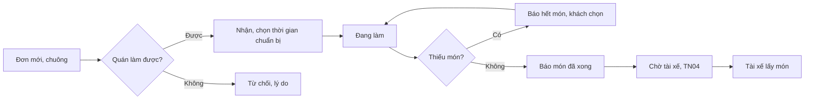

> **Mã:** DE06-TN03-PRD · **Trạng thái:** đã chốt · **Người viết:** Design · **SRS:** [SRS.md](SRS.md)

# PRD Quán nhận và chuẩn bị đơn (App đặt ship đồ ăn)

## 1. Bối cảnh và vấn đề

### 1.1 Bối cảnh

Khi khách đặt (TN02), đơn tới **App quán** (xem [README](../../README.md)). Người dùng App quán thường là chủ quán hoặc nhân viên quầy của quán ăn nhỏ: vừa bán tại chỗ vừa nhận đơn online, tay ướt hoặc dính dầu mỡ, quầy ồn. Họ cần biết ngay có đơn mới, nhận đơn trong một chạm, báo khi món đã xong để tài xế tới lấy.

### 1.2 Vấn đề

| **Vấn đề** | **Hệ quả** |
| --- | --- |
| Quầy ồn, không nghe chuông đơn mới | Đơn tự huỷ, khách bực, quán mất doanh thu |
| Món hết nhưng quên tắt trên app | Phải từ chối đơn hoặc gọi khách đổi món |
| Tài xế tới khi món chưa xong | Tài xế chờ lâu, bỏ đơn |
| Món xong sớm nhưng tài xế chưa tới | Đồ ăn nguội |
| Giờ cao điểm quá tải nhưng không có cách tạm dừng | Nhận đơn rồi làm trễ, bị đánh giá thấp |

### 1.3 Mục tiêu

- Tỉ lệ đơn bị huỷ vì quán không phản hồi ≤ 2%.
- Thời gian trung vị từ đơn tới quán đến khi quán nhận ≤ 60 giây.
- Thời gian tài xế chờ tại quán trung vị ≤ 5 phút.

## 2. Người dùng

| **Nhóm** | **Nhu cầu với tính năng này** |
| --- | --- |
| Chủ quán nhỏ, tự đứng quầy | Chuông to, nhận một chạm, chữ to |
| Nhân viên quầy quán đông | Thấy đơn theo thứ tự, biết đơn nào trễ |
| Chủ quán | Tạm dừng nhận đơn khi quá tải, tắt món hết nhanh |

## 3. Phạm vi

### 3.1 Trong phạm vi (MVP)

- Nhận đơn mới: chuông lặp, đếm ngược 3 phút, nhận với thời gian chuẩn bị, hoặc từ chối có lý do.
- Danh sách đơn theo trạng thái: Mới, Đang làm, Chờ tài xế, Đã xong.
- Chi tiết đơn: món, tuỳ chọn, ghi chú, dụng cụ; thông tin tài xế khi có.
- Báo hết món sau khi đã nhận; gia hạn thời gian chuẩn bị; báo món đã xong.
- Bật tắt món, tuỳ chọn hết hàng; tạm ngưng nhận đơn.

### 3.2 Ngoài phạm vi

- Sửa menu, giá, ảnh (làm trên web quản lý quán, không thuộc đề).
- Báo cáo doanh thu, đối soát tiền với nền tảng.
- Nhiều chi nhánh, phân quyền nhân viên.
- Kết nối máy POS, in phiếu bếp tự động → phase sau.

## 4. Nguyên tắc sản phẩm

### 4.1 Không bỏ lỡ đơn

Đơn mới kêu lặp lại tới khi có người chạm; màn hình đơn mới chiếm toàn màn hình.

### 4.2 Một chạm cho việc thường gặp

Nhận đơn, báo xong món, tắt món hết đều một chạm, nút lớn.

### 4.3 Quán kiểm soát tải

Quán chọn thời gian chuẩn bị và có thể tạm ngưng; app không ép quán nhận đơn khi quá tải.

## 5. Quy tắc nghiệp vụ

| **Quy tắc** | **Giá trị** |
| --- | --- |
| Thời gian xác nhận | 3 phút; quá thì đơn tự huỷ |
| Bỏ lỡ liên tiếp | 3 đơn → quán tự tạm ngưng nhận đơn |
| Thời gian chuẩn bị | Quán chọn 5–60 phút; mặc định theo cài đặt của quán |
| Gia hạn | 1 lần mỗi đơn, +5 hoặc +10 phút |
| Báo hết món sau khi nhận | Khách có 3 phút để chọn bỏ món hoặc huỷ đơn |
| Tạm ngưng | 30 phút, 1 giờ, hết ngày, hoặc tới khi bật lại |

## 6. Luồng trải nghiệm

| **Bước** | **Giai đoạn** | **Trải nghiệm** | **Đầu ra** |
| --- | --- | --- | --- |
| 1 | Đơn tới | Toàn màn đơn mới, chuông lặp, đếm ngược | Quán biết có đơn |
| 2 | Quyết định | Nhận với thời gian chuẩn bị hoặc từ chối | Đơn đang làm hoặc huỷ |
| 3 | Làm món | Danh sách đơn đang làm, đơn nào sắp trễ | Món xong |
| 4 | Bàn giao | Báo xong; thấy tài xế nào tới, mã đơn | Tài xế lấy món |

## 7. Use Cases, User Stories và Acceptance Criteria

### UC1. Nhận hoặc từ chối đơn

#### US1.1 Không bỏ lỡ đơn mới

User Story: Là chủ quán, tôi muốn app kêu to và lặp lại khi có đơn để không bỏ lỡ lúc đang bận.

AC01: Đơn mới → âm thanh lặp mỗi 5 giây, màn đơn mới toàn màn hình, đếm ngược 3 phút.

AC02: Nhiều đơn mới cùng lúc → hiện lần lượt, ghi "1/3".

AC03: App chạy nền hoặc màn hình tắt vẫn có thông báo kèm âm thanh.

#### US1.2 Nhận đơn

AC01: Chọn thời gian chuẩn bị (gợi ý theo số món), bấm "Nhận đơn".

AC02: Nhận xong, khách thấy "Quán đang chuẩn bị" và hệ thống bắt đầu tìm tài xế.

#### US1.3 Từ chối đơn

AC01: Lý do: Hết món (chọn món hết), Quán quá tải, Sắp đóng cửa, Khác.

AC02: Từ chối vì hết món → món đó tự chuyển "Hết món".

AC03: Quá 3 phút không phản hồi → đơn tự huỷ; 3 đơn liên tiếp → quán tự tạm ngưng.

### UC2. Chuẩn bị đơn

#### US2.1 Theo dõi đơn đang làm

AC01: Đơn đang làm xếp theo thời điểm phải xong, đơn sắp trễ (≤ 2 phút) nổi bật.

AC02: Chi tiết đơn: món, tuỳ chọn, ghi chú, dụng cụ, mã đơn, tên khách viết tắt.

#### US2.2 Báo hết món sau khi đã nhận

User Story: Là quán, tôi muốn báo một món vừa hết để khách chọn bỏ món hoặc huỷ đơn.

AC01: Chọn món hết → khách nhận thông báo, có 3 phút để chọn.

AC02: Khách không trả lời → bỏ món đó, hoàn tiền món nếu đã trả ví.

AC03: Mọi món đều hết → đơn huỷ, không tính lỗi cho khách.

#### US2.3 Gia hạn và báo xong

AC01: Quá thời gian chuẩn bị → nhắc quán; quán gia hạn +5 hoặc +10 phút một lần; khách được báo giờ mới.

AC02: Bấm "Món đã xong" → đơn chuyển chờ tài xế; tài xế nhận thông báo.

AC03: Thấy tên, biển số, thời gian tài xế tới quán khi đã có tài xế.

### UC3. Trạng thái quán và món

AC01: Tắt món hết, tuỳ chọn hết bằng một chạm; có tìm món.

AC02: Tạm ngưng nhận đơn 30 phút, 1 giờ, hết ngày, hoặc tới khi bật lại; khách thấy "Tạm ngưng".

## 8. Chỉ số theo dõi

| **Chỉ số** | **Định nghĩa** | **Mục tiêu MVP** |
| --- | --- | --- |
| Tỉ lệ quán không phản hồi | Đơn tự huỷ do quá 3 phút / tổng đơn | ≤ 2% |
| Thời gian nhận đơn | Đơn tới quán → quán nhận (trung vị) | ≤ 60 giây |
| Tỉ lệ từ chối | Đơn quán từ chối / tổng đơn | ≤ 5% |
| Tỉ lệ báo hết món sau nhận | Đơn có báo hết món / đơn đã nhận | ≤ 3% |
| Đúng giờ chuẩn bị | Đơn báo xong trước giờ hẹn (gồm gia hạn) / đơn đã nhận | ≥ 85% |
| Tài xế chờ tại quán | Tài xế tới quán → lấy món (trung vị) | ≤ 5 phút |

## 9. Phụ thuộc và rủi ro

| **Mục** | **Mô tả** | **Hướng xử lý** |
| --- | --- | --- |
| Thiết bị quán | Điện thoại cũ, tắt âm, chế độ tiết kiệm pin | Kiểm tra quyền thông báo, âm lượng khi bật nhận đơn; nhắc tắt tối ưu pin |
| Mạng quán yếu | Đơn tới chậm | Push dự phòng; trạng thái mạng trên đầu app |
| Quán lạm dụng thời gian chuẩn bị dài | Khách chờ lâu | Thời gian dự kiến cho khách dùng số thực tế (TN01) |

## 10. Câu hỏi mở

> Mọi câu hỏi dưới đây đã được PO chốt ngày 20/11/2026; quyết định ghi sau mỗi câu và đã cập nhật vào SRS.

- Tìm tài xế lúc quán nhận hay lúc món xong? → **Đã chốt:** Lúc quán nhận nếu thời gian chuẩn bị ≤ 15 phút; dài hơn thì bắt đầu tìm khi còn 10 phút (SRS TN04 BR-34).
- Quán có huỷ đơn sau khi đã nhận? → **Đã chốt:** Chỉ qua "Báo hết món" (bỏ hết món) hoặc gọi hỗ trợ; không có nút huỷ tự do (SRS BR-28).
- Ai xác nhận đã bàn giao cho tài xế? → **Đã chốt:** Tài xế bấm "Đã lấy món" (TN04); quán chỉ thấy trạng thái (SRS BR-30).
- Món tắt "hết" có tự bật lại? → **Đã chốt:** Quán chọn "Hết hôm nay" (tự bật lúc mở cửa hôm sau) hoặc "Hết tới khi bật lại" (SRS BR-32).
