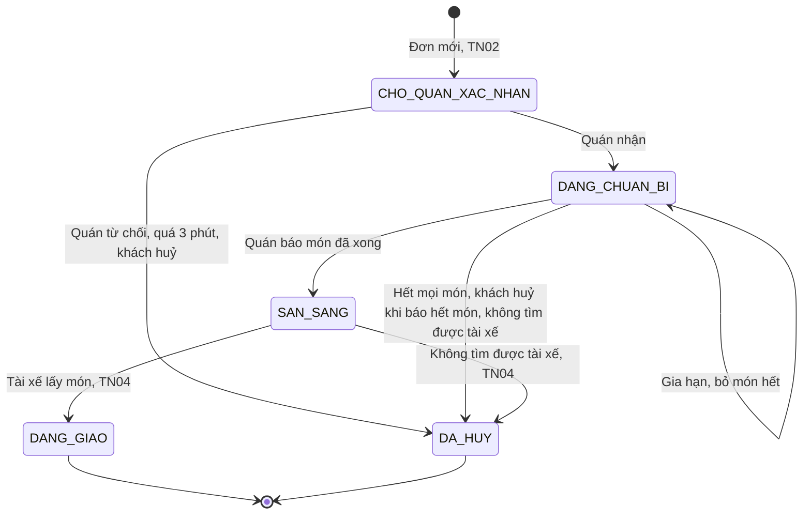
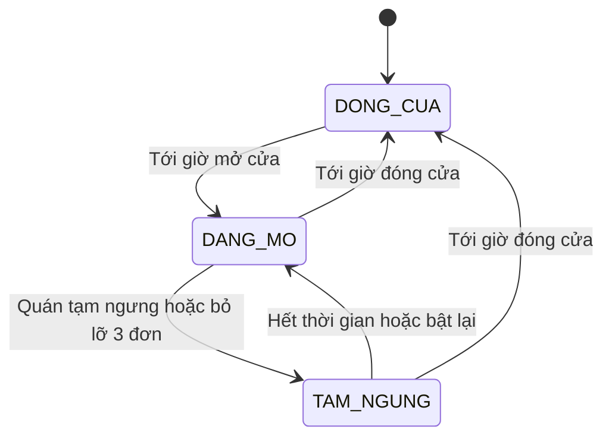
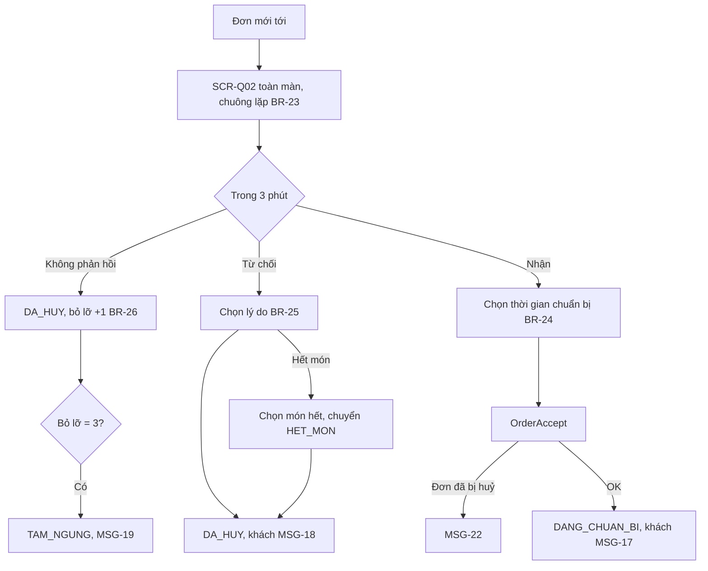
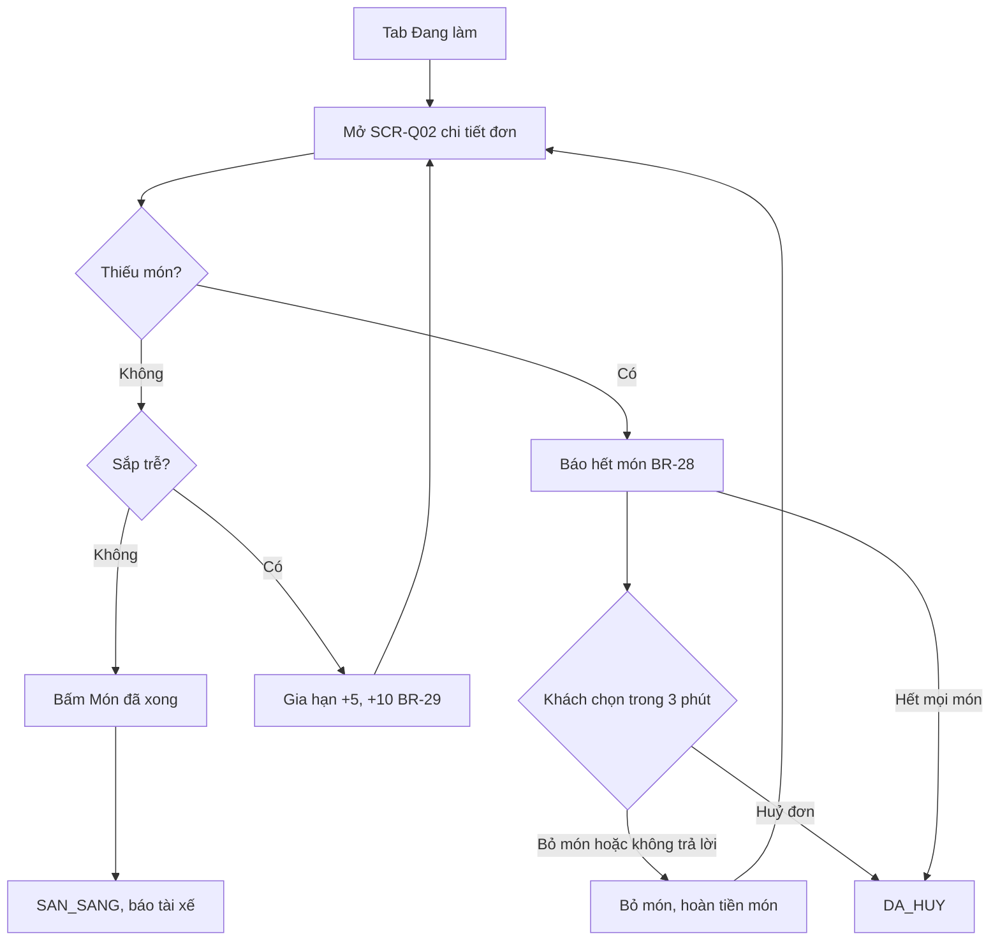
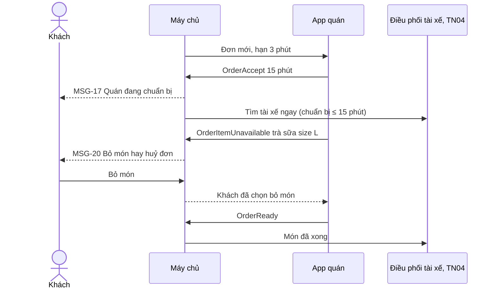

> **Mã:** DE06-TN03-SRS · **Trạng thái:** đã chốt · **Người viết:** Design · **PRD:** [PRD.md](PRD.md)

# UC-DE06-03 - Quán nhận và chuẩn bị đơn

> SRS này mô tả đơn từ `CHO_QUAN_XAC_NHAN` tới `SAN_SANG` (chờ tài xế lấy) hoặc `DA_HUY`; tìm tài xế và giao đơn xem [SRS TN04](../TN04-tai-xe-giao-don/SRS.md).

## 1. Tổng quan

| **Mục** | **Nội dung** |
| --- | --- |
| Mục tiêu | Quán nhận đơn nhanh, chuẩn bị đúng hẹn, báo xong để tài xế lấy; quản lý món hết và tạm ngưng |
| Actor | Quán (chủ quán, nhân viên quầy) · App quán · Máy chủ · Khách (nhận thông báo) |
| Phạm vi | Đơn mới, nhận, từ chối, tự huỷ khi quá hạn, danh sách đơn, chi tiết, báo hết món sau nhận, gia hạn, báo xong, bật tắt món, tạm ngưng |
| Ngoài phạm vi | Sửa menu, báo cáo doanh thu, nhiều chi nhánh, POS, in tự động |
| Nền tảng | App quán iOS / Android (điện thoại hoặc tablet) |

## 2. User Story

| **ID** | **As a** | **I want** | **So that** |
| --- | --- | --- | --- |
| US-11 | Quán | Nghe chuông lặp khi có đơn | Không bỏ lỡ đơn |
| US-12 | Quán | Nhận đơn và hẹn giờ xong trong một chạm | Làm nhanh giờ cao điểm |
| US-13 | Quán | Báo món vừa hết sau khi đã nhận | Không phải gọi khách |
| US-14 | Quán | Biết đơn nào sắp trễ | Làm đúng thứ tự |
| US-15 | Quán | Tắt món hết, tạm ngưng khi quá tải | Không nhận đơn làm không kịp |

## 3. Business Rules

| **Mã** | **Quy tắc** |
| --- | --- |
| BR-23 | **Đơn mới** tới mọi thiết bị đang đăng nhập của quán; **SCR-Q02** dạng toàn màn, âm thanh lặp mỗi 5 giây tới khi có người chạm vào màn; đếm ngược 3 phút tính trên máy chủ. App nền → thông báo có âm thanh riêng |
| BR-24 | **Nhận đơn**: chọn thời gian chuẩn bị 5–60 phút; gợi ý = thời gian mặc định của quán + 2 phút cho mỗi món vượt 5 món, làm tròn 5. Nhận → đơn `DANG_CHUAN_BI`, hạn xong = thời điểm nhận + thời gian chuẩn bị; khách nhận MSG-17. Thiết bị khác của quán đóng màn đơn mới |
| BR-25 | **Từ chối**: lý do bắt buộc: Hết món (chọn 1+ món hoặc tuỳ chọn hết → tự chuyển `HET_MON`), Quán quá tải, Sắp đóng cửa, Khác (≤ 100 ký tự). Đơn `DA_HUY`, hoàn ví cho khách (TN02 BR-16), khách nhận MSG-18 |
| BR-26 | **Quá hạn xác nhận** 3 phút → đơn `DA_HUY` lý do "Quán không phản hồi", hoàn ví. Bộ đếm bỏ lỡ của quán +1; nhận 1 đơn thì về 0. Đạt 3 → quán `TAM_NGUNG` (tới khi bật lại), push MSG-19 cho chủ quán |
| BR-27 | **Thứ tự đơn đang làm**: theo hạn xong tăng dần. Còn ≤ 2 phút tới hạn → nhãn "Sắp trễ"; quá hạn → nhãn "Trễ {n} phút", màu cảnh báo |
| BR-28 | **Báo hết món sau khi nhận**: chọn món hoặc tuỳ chọn hết → khách nhận MSG-20 với \[Bỏ món\] \[Huỷ đơn\], 3 phút để chọn; không trả lời → bỏ món. Bỏ món → tạm tính giảm, hoàn phần tiền món nếu trả ví, đơn tiếp tục; phí giao, phí dịch vụ giữ nguyên; tạm tính mới < 40.000 ₫ không tính thêm phí đơn nhỏ. Mọi món đều hết hoặc khách chọn Huỷ → `DA_HUY`, hoàn toàn bộ, không tính lỗi khách. Quán không có nút huỷ tự do |
| BR-29 | **Gia hạn**: khi còn ≤ 2 phút hoặc đã trễ, quán gia hạn +5 hoặc +10 phút, 1 lần mỗi đơn; khách nhận MSG-21 với giờ giao mới; tài xế đã nhận đơn thấy giờ món xong mới |
| BR-30 | **Món đã xong**: quán bấm → `SAN_SANG`; tài xế đã gán nhận push (TN04). Bàn giao do tài xế xác nhận "Đã lấy món" (TN04); **SCR-Q01** chuyển đơn sang tab Đã xong khi đơn `DANG_GIAO` |
| BR-31 | **Tạm ngưng nhận đơn**: 30 phút, 1 giờ, tới hết ngày, tới khi bật lại. Trong lúc tạm ngưng, khách thấy quán `TAM_NGUNG` (TN01 BR-04); đơn đang làm không bị ảnh hưởng. Bật lại → `DANG_MO` nếu trong giờ mở cửa |
| BR-32 | **Món hết**: bật tắt theo món hoặc theo lựa chọn trong nhóm tuỳ chọn; chọn "Hết hôm nay" (tự còn lúc mở cửa ngày hôm sau) hoặc "Hết tới khi bật lại". Cập nhật lên app khách ≤ 30 giây |
| BR-33 | **Hiển thị khách** trên App quán: tên viết tắt ("Anh N."), mã đơn 6 ký tự; không hiện số điện thoại, địa chỉ khách |

## 4. Trạng thái

### 4.1 Trạng thái đơn phía quán

### 4.2 Trạng thái quán

### 4.3 Tab trên SCR-Q01

| **Tab** | **Trạng thái đơn** | **Hiển thị** |
| --- | --- | --- |
| Mới | `CHO_QUAN_XAC_NHAN` | Đếm ngược, số món, tổng |
| Đang làm | `DANG_CHUAN_BI` | Hạn xong, nhãn Sắp trễ / Trễ, tài xế (nếu có) |
| Chờ tài xế | `SAN_SANG` | Tài xế, thời gian tới quán, "Đã tới" khi tài xế bấm đến quán |
| Đã xong | `DANG_GIAO`, `DA_GIAO`, `DA_HUY` trong ngày | Giờ, kết quả, lý do huỷ |

## 5. Use Case

### UC-05 Nhận hoặc từ chối đơn mới

| **Mục** | **Nội dung** |
| --- | --- |
| Tiền điều kiện | Quán `DANG_MO`; App quán đã đăng nhập |
| Hậu điều kiện thành công | Đơn `DANG_CHUAN_BI` với hạn xong; khách được báo; bắt đầu tìm tài xế theo TN04 |
| Hậu điều kiện thất bại | Đơn `DA_HUY` với lý do |

**Luồng chính**

| **Bước** | **Actor** | **Mô tả** |
| --- | --- | --- |
| 1 | Máy chủ | Gửi đơn mới tới mọi thiết bị của quán |
| 2 | App quán | Mở **SCR-Q02** toàn màn, chuông lặp, đếm ngược |
| 3 | Quán | Xem món, chọn thời gian chuẩn bị (gợi ý sẵn) |
| 4 | Quán | Bấm "Nhận đơn" |
| 5 | App quán | Gọi \[OrderAccept\]; đơn sang tab Đang làm |
| 6 | Máy chủ | Đơn `DANG_CHUAN_BI`; gửi MSG-17 cho khách; lên lịch tìm tài xế (TN04 BR-34) |

**Luồng thay thế**

| **Mã** | **Điều kiện** | **Xử lý** |
| --- | --- | --- |
| A1 | Nhiều đơn mới | Hiện lần lượt, "1/{n}"; đơn còn ít thời gian nhất trước |
| A2 | Từ chối | Chọn lý do → \[OrderReject\] (BR-25) |
| A3 | Thiết bị khác của quán đã nhận | Màn đơn mới đóng, toast "Đơn đã được nhận trên thiết bị khác" |

**Luồng lỗi**

| **Mã** | **Điều kiện** | **Xử lý** |
| --- | --- | --- |
| E1 | Quá 3 phút | BR-26 |
| E2 | Khách huỷ trước khi quán bấm nhận | MSG-22 |
| E3 | Mất mạng khi bấm nhận | Thử lại tự động 3 lần trong thời gian còn lại; vẫn lỗi → MSG-24 |

### UC-06 Chuẩn bị và báo món đã xong

| **Mục** | **Nội dung** |
| --- | --- |
| Tiền điều kiện | Đơn `DANG_CHUAN_BI` |
| Hậu điều kiện thành công | Đơn `SAN_SANG`; tài xế được báo |
| Hậu điều kiện thất bại | Đơn `DA_HUY` (hết món) hoặc vẫn `DANG_CHUAN_BI` |

**Luồng chính**

| **Bước** | **Actor** | **Mô tả** |
| --- | --- | --- |
| 1 | Quán | Ở tab Đang làm, chạm đơn → chi tiết |
| 2 | Quán | Làm món theo tuỳ chọn, ghi chú |
| 3 | Quán | Bấm "Món đã xong" |
| 4 | App quán | Gọi \[OrderReady\]; đơn sang tab Chờ tài xế |
| 5 | Máy chủ | Đơn `SAN_SANG`; push tài xế đã gán (TN04) |

**Luồng thay thế**

| **Mã** | **Điều kiện** | **Xử lý** |
| --- | --- | --- |
| A1 | Báo hết món | BR-28 → \[OrderItemUnavailable\]; chờ khách ≤ 3 phút; đơn hiện "Đang chờ khách chọn" |
| A2 | Gia hạn | BR-29 → \[OrderExtend\] |
| A3 | Tài xế đã tới quán trước khi xong | Thẻ tài xế hiện "Đã tới quán"; đơn nổi bật |

**Luồng lỗi**

| **Mã** | **Điều kiện** | **Xử lý** |
| --- | --- | --- |
| E1 | Đã gia hạn 1 lần | Nút gia hạn ẩn; MSG-23 nếu trễ > 10 phút |
| E2 | Đơn bị huỷ (khách, hỗ trợ) | MSG-22; đơn sang Đã xong |
| E3 | Mất mạng | MSG-24; thao tác lưu chờ, gửi khi có mạng |

### UC-07 Quản lý món hết và trạng thái quán

**Luồng chính**

| **Bước** | **Actor** | **Mô tả** |
| --- | --- | --- |
| 1 | Quán | Mở **SCR-Q03** |
| 2 | Quán | Tìm "trân châu đen", tắt → chọn "Hết hôm nay" |
| 3 | App quán | Gọi \[ItemAvailability\]; app khách cập nhật ≤ 30 giây (BR-32) |
| 4 | Quán | Giờ cao điểm, bấm "Tạm ngưng nhận đơn" → 30 phút |
| 5 | App quán | Gọi \[StoreStatus\]; đầu app hiện "Tạm ngưng tới {giờ}" và nút "Mở lại" |

## 6. Điểm vào

| **Điểm vào** | **Dẫn tới** | **Ghi chú** |
| --- | --- | --- |
| Đơn mới (đang mở app hoặc chạm thông báo) | **SCR-Q02** toàn màn | BR-23 |
| Mở app | **SCR-Q01** tab có đơn cần xử lý gần nhất | |
| Push "Quán đã tạm ngưng" | **SCR-Q03** | BR-26 |
| Push "Khách đã chọn bỏ món" | **SCR-Q02** của đơn | BR-28 |

## 7. Mô tả màn hình

### SCR-Q01 Danh sách đơn

| **#** | **Thành phần** | **Loại** | **Hành vi** |
| --- | --- | --- | --- |
| 1 | Trạng thái quán | Header | "Đang mở" / "Tạm ngưng tới {giờ}" + công tắc; trạng thái mạng |
| 2 | Tab | Tabs có số đếm | Mục 4.3 |
| 3 | Thẻ đơn | Card lớn | Mã đơn (chữ to), tên khách viết tắt, số món, hạn xong, nhãn Sắp trễ / Trễ, tài xế |
| 4 | Nút nhanh trên thẻ | Button | "Món đã xong" ở tab Đang làm |

### SCR-Q02 Chi tiết đơn / Đơn mới

| **#** | **Thành phần** | **Loại** | **Hành vi** |
| --- | --- | --- | --- |
| 1 | Mã đơn, khách | Header | BR-33 |
| 2 | Đếm ngược | Timer | Chỉ đơn mới; còn < 30 giây đổi màu |
| 3 | Danh sách món | List | Số lượng (chữ to), tên, tuỳ chọn, ghi chú món in đậm |
| 4 | Ghi chú cho quán, dụng cụ | Text | Nổi bật nếu có |
| 5 | Tổng tiền món | Text | Tạm tính quán nhận (chưa trừ chiết khấu) |
| 6 | Thời gian chuẩn bị | Chips | 5, 10, 15, 20, 30, 45, 60 phút; chọn sẵn gợi ý (BR-24) |
| 7 | "Nhận đơn", "Từ chối" | Button lớn | Chỉ đơn mới |
| 8 | Báo hết món, Gia hạn, Món đã xong | Button | Đơn đang làm (BR-28, BR-29, BR-30) |
| 9 | Tài xế | Card | Tên, biển số, ảnh, thời gian tới quán, nút gọi (số trung gian) |

### SCR-Q03 Món & trạng thái quán

| **#** | **Thành phần** | **Loại** | **Hành vi** |
| --- | --- | --- | --- |
| 1 | Tạm ngưng nhận đơn | Button + bottom sheet | BR-31 |
| 2 | Giờ mở cửa hôm nay | Text | Chỉ xem (sửa trên web quản lý) |
| 3 | Tìm món | Search | Không dấu |
| 4 | Danh sách món theo nhóm | List + Switch | Bật = còn; tắt mở lựa chọn "Hết hôm nay" / "Hết tới khi bật lại" |
| 5 | Tuỳ chọn | List + Switch | Theo nhóm tuỳ chọn |
| 6 | Món đang hết | Filter chip | Lọc nhanh món đang tắt |

## 8. API

| **API** | **Request chính** | **Response chính** | **Timeout / retry** |
| --- | --- | --- | --- |
| \[MerchantOrderStream\] | store_id | Luồng sự kiện đơn mới, đổi trạng thái | Kết nối lâu dài; push dự phòng |
| \[OrderAccept\] | order_id, prep_minutes | status, ready_due_at | 5s / 3 lần trong hạn xác nhận |
| \[OrderReject\] | order_id, reason, unavailable_items | status | 5s / 1 lần |
| \[OrderItemUnavailable\] | order_id, items | Chờ khách, deadline | 5s / 1 lần |
| \[OrderExtend\] | order_id, minutes (5, 10) | ready_due_at mới | 5s / 1 lần |
| \[OrderReady\] | order_id | status `SAN_SANG` | 5s / 3 lần |
| \[ItemAvailability\] | item_id hoặc option_id, available, until | OK | 5s / 1 lần |
| \[StoreStatus\] | paused_until hoặc resume | Trạng thái quán | 5s / 1 lần |

**Map lỗi → thông báo**

| **Nhóm lỗi** | **Message** |
| --- | --- |
| Quán nhận đơn (gửi khách) | MSG-17 |
| Quán từ chối, tự huỷ (gửi khách) | MSG-18 |
| Quán bị tạm ngưng do bỏ lỡ | MSG-19 |
| Báo hết món (gửi khách) | MSG-20 |
| Gia hạn (gửi khách) | MSG-21 |
| Đơn đã bị huỷ | MSG-22 |
| Trễ nhiều | MSG-23 |
| Mất mạng | MSG-24 |

## 9. Danh sách thông báo

| **ID** | **Nơi hiện** | **Nội dung (VI)** |
| --- | --- | --- |
| MSG-17 | Push khách | {Quán} đã nhận đơn và đang chuẩn bị. Dự kiến giao lúc {giờ} |
| MSG-18 | Push khách | {Quán} không thể nhận đơn {lý do}. {Nếu trả ví: Đã hoàn {số tiền} ₫ về ví}. \[Xem quán khác\] |
| MSG-19 | Push quán | Quán đã tự tạm ngưng nhận đơn vì bỏ lỡ 3 đơn liên tiếp. Kiểm tra âm lượng, kết nối rồi bật lại. \[Mở lại\] |
| MSG-20 | Popup khách | {Quán} báo hết {món}. Bạn muốn bỏ món này hay huỷ đơn? Sau 3 phút, món sẽ tự được bỏ. \[Bỏ món\] \[Huỷ đơn\] |
| MSG-21 | Push khách | Quán cần thêm {n} phút để chuẩn bị. Dự kiến giao lúc {giờ mới} |
| MSG-22 | Toast quán | Đơn {mã} đã bị huỷ {lý do} |
| MSG-23 | Banner quán | Đơn {mã} đã trễ {n} phút. Khách và tài xế đang chờ |
| MSG-24 | Banner quán | Mất kết nối. Đơn mới có thể tới chậm, hãy kiểm tra mạng |

## 10. Yêu cầu phi chức năng

| **Mục** | **Yêu cầu** |
| --- | --- |
| Hiệu năng | Đơn mới tới App quán ≤ 3 giây (p95); thao tác nhận, xong ≤ 1 giây phản hồi |
| Độ tin cậy | Đếm ngược tính trên máy chủ; nhiều thiết bị không nhận trùng một đơn (máy chủ khoá theo đơn) |
| Thiết bị | Kiểm tra quyền thông báo, âm lượng, tối ưu pin khi đăng nhập; cảnh báo nếu tắt |
| Riêng tư | App quán không thấy số điện thoại, địa chỉ khách (BR-33) |
| Log / audit | Thời điểm đơn tới, nhận, từ chối (lý do), báo hết món, gia hạn, báo xong; bật tắt món, tạm ngưng (ai, khi nào) |
| Tracking | Thời gian nhận đơn, lựa chọn thời gian chuẩn bị so với gợi ý, tỉ lệ gia hạn, tỉ lệ báo xong đúng hạn |
| Accessibility | Chữ to (mã đơn, số lượng ≥ 20 pt); nút chính ≥ 56 pt chiều cao; âm thanh đơn mới khác âm thông báo thường; có rung |
