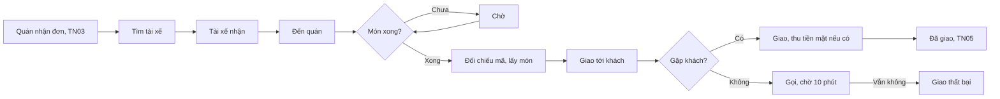

> **Mã:** DE06-TN04-PRD · **Trạng thái:** đã chốt · **Người viết:** Design · **SRS:** [SRS.md](SRS.md)

# PRD Tài xế nhận và giao đơn (App đặt ship đồ ăn)

## 1. Bối cảnh và vấn đề

### 1.1 Bối cảnh

Khi quán nhận đơn (TN03), hệ thống tìm tài xế để lấy món tại quán và giao cho khách (xem [README](../../README.md)). Đây là chỗ **ba bên gặp nhau**: quán cần tài xế tới đúng lúc món xong, khách cần biết đồ ăn đang ở đâu, tài xế cần thông tin rõ để lấy đúng đơn và tìm đúng người nhận.

### 1.2 Vấn đề

| **Vấn đề** | **Hệ quả** |
| --- | --- |
| Tài xế tới quán quá sớm | Chờ lâu, mất thu nhập, bỏ đơn |
| Tài xế tới quá muộn | Đồ ăn nguội, khách đánh giá thấp quán |
| Quán đông, tài xế lấy nhầm đơn | Hai khách nhận sai món |
| Khách không biết tài xế đang ở đâu | Gọi hỏi liên tục, hoặc đi vắng khi tài xế tới |
| Tài xế tới nơi không gặp khách | Đứng chờ, không biết xử lý đồ ăn thế nào |

### 1.3 Mục tiêu

- ≥ 95% đơn có tài xế trong 10 phút kể từ khi bắt đầu tìm.
- Tỉ lệ lấy nhầm đơn ≤ 0,1%.
- Tỉ lệ giao thất bại do không liên lạc được khách ≤ 1%.

## 2. Người dùng

| **Nhóm** | **Nhu cầu với tính năng này** |
| --- | --- |
| Tài xế giao đồ ăn | Biết thu nhập trước khi nhận, điểm lấy, điểm giao rõ ràng, ít chờ |
| Khách | Thấy tài xế trên bản đồ, giờ tới chính xác, liên lạc được |
| Quán | Biết tài xế nào tới, khi nào tới |

## 3. Phạm vi

### 3.1 Trong phạm vi (MVP)

- App tài xế: bật nhận đơn, yêu cầu đơn mới, nhận hoặc bỏ qua.
- Thời điểm tìm tài xế theo thời gian chuẩn bị của quán.
- Đến quán, đối chiếu và lấy món; chờ khi món chưa xong.
- Giao: dẫn đường, đến nơi, giao tận tay hoặc theo ghi chú có ảnh, thu tiền mặt.
- Không liên lạc được khách: quy trình chờ và giao thất bại.
- Khách theo dõi đơn: trạng thái, tài xế, bản đồ, giờ dự kiến; gọi, nhắn tin qua số trung gian.

### 3.2 Ngoài phạm vi

- Ghép nhiều đơn cho một tài xế → phase sau.
- Đăng ký, duyệt hồ sơ tài xế; ví và rút tiền của tài xế.
- Tài xế riêng của quán.
- Giao bằng xe ô tô, giao hàng cồng kềnh.

## 4. Nguyên tắc sản phẩm

### 4.1 Đến đúng lúc món xong

Hệ thống chọn thời điểm tìm tài xế theo thời gian chuẩn bị, không phải ngay khi đặt đơn.

### 4.2 Lấy đúng đơn

Mã đơn 6 ký tự to rõ ở App quán, App tài xế và trên túi đồ ăn (quán ghi tay); tài xế đối chiếu trước khi lấy.

### 4.3 Ba bên cùng một sự thật

Mỗi bước của tài xế cập nhật ngay cho khách và quán.

### 4.4 Riêng tư khi liên lạc

Gọi và nhắn qua số trung gian, không lộ số thật.

## 5. Quy tắc nghiệp vụ

| **Quy tắc** | **Giá trị** |
| --- | --- |
| Thời điểm tìm | Chuẩn bị ≤ 15 phút → tìm ngay khi quán nhận; dài hơn → tìm khi còn 10 phút |
| Bán kính tìm | 3 km quanh quán, +1 km mỗi phút, tối đa 6 km |
| Thời gian trả lời | 20 giây mỗi tài xế |
| Không tìm được | 25 phút kể từ khi bắt đầu tìm → huỷ đơn, hoàn tiền |
| Thu nhập tài xế | Phí giao (gồm phụ phí) − 10% chiết khấu + thưởng (nếu có) + 100% tip |
| Chờ khách | Gọi ≥ 2 lần, chờ 10 phút tại điểm giao |
| Ảnh xác nhận | Bắt buộc khi không giao tận tay |

## 6. Luồng trải nghiệm

| **Bước** | **Giai đoạn** | **Khách thấy** | **Tài xế thấy** | **Quán thấy** |
| --- | --- | --- | --- | --- |
| 1 | Tìm tài xế | "Đang tìm tài xế" | Yêu cầu đơn | "Đang tìm tài xế" |
| 2 | Đến quán | Tài xế, biển số, "đang tới quán" | Dẫn đường tới quán | Tài xế, thời gian tới |
| 3 | Lấy món | "Tài xế đã lấy món" | Mã đơn, danh sách món | Đơn sang Đã xong |
| 4 | Giao | Bản đồ, giờ tới | Dẫn đường, địa chỉ chi tiết, ghi chú | – |
| 5 | Kết thúc | "Đã giao", đánh giá | Thu tiền, thu nhập | – |

## 7. Use Cases, User Stories và Acceptance Criteria

### UC1. Tìm và nhận đơn

#### US1.1 Quyết định nhanh

User Story: Là tài xế, tôi muốn thấy quán, quãng đường, thu nhập trước khi nhận.

AC01: Thẻ yêu cầu: tên quán, khoảng cách tới quán, quãng đường giao, thu nhập dự kiến, giờ món xong, tiền mặt cần thu (nếu có).

AC02: Đếm ngược 20 giây; nhận bằng một chạm.

AC03: Hết giờ hoặc bỏ qua → gửi tài xế khác.

#### US1.2 Không tìm được tài xế

AC01: Khách thấy "Đang tìm tài xế" với thời gian đã tìm.

AC02: Quá 25 phút → đơn huỷ, hoàn tiền, khách được xin lỗi kèm gợi ý đặt lại.

### UC2. Lấy món

#### US2.1 Lấy đúng đơn

User Story: Là tài xế, tôi muốn đối chiếu mã đơn để không lấy nhầm.

AC01: Đến quán (trong 100 m) → nút "Đã đến quán"; quán thấy tài xế đã tới.

AC02: Màn lấy món: mã đơn chữ to, danh sách món để tích kiểm.

AC03: Món chưa xong → hiện "Quán đang chuẩn bị, xong lúc {giờ}"; chưa cho bấm "Đã lấy món".

AC04: Chờ quá 10 phút sau giờ hẹn → nút báo hỗ trợ.

### UC3. Giao đơn

#### US3.1 Theo dõi đơn

User Story: Là khách, tôi muốn thấy tài xế đang ở đâu và mấy giờ tới.

AC01: Từ khi tài xế lấy món: bản đồ vị trí tài xế cập nhật mỗi 5 giây, giờ tới dự kiến.

AC02: Thấy tên, ảnh, biển số, nút gọi, nhắn tin.

#### US3.2 Giao hàng

AC01: Tài xế thấy địa chỉ chi tiết, ghi chú, tên người nhận; gọi qua số trung gian.

AC02: Giao tận tay → bấm "Đã giao"; để theo ghi chú → bắt buộc chụp ảnh.

AC03: Đơn tiền mặt → màn thu tiền ghi rõ số tiền.

#### US3.3 Không gặp khách

AC01: Tài xế gọi ≥ 2 lần qua app; khách nhận thông báo "Tài xế đã tới".

AC02: Sau 10 phút chờ tại điểm giao → được bấm "Giao thất bại" với lý do.

AC03: Khách bị tính tiền đơn; tài xế vẫn nhận thu nhập.

## 8. Chỉ số theo dõi

| **Chỉ số** | **Định nghĩa** | **Mục tiêu MVP** |
| --- | --- | --- |
| Tỉ lệ có tài xế trong 10 phút | Đơn có tài xế ≤ 10 phút từ khi tìm / đơn cần tài xế | ≥ 95% |
| Tỉ lệ huỷ vì không có tài xế | Đơn huỷ lý do này / tổng đơn | ≤ 1% |
| Tài xế chờ tại quán | Đến quán → lấy món (trung vị) | ≤ 5 phút |
| Món chờ tài xế | Quán báo xong → tài xế lấy (trung vị) | ≤ 5 phút |
| Lấy nhầm | Khiếu nại nhận nhầm đơn / tổng đơn | ≤ 0,1% |
| Giao thất bại | Đơn `GIAO_THAT_BAI` / tổng đơn | ≤ 1% |
| Đúng giờ | Đơn giao trước giờ dự kiến cuối / tổng đơn | ≥ 85% |

## 9. Phụ thuộc và rủi ro

| **Mục** | **Mô tả** | **Hướng xử lý** |
| --- | --- | --- |
| Thiếu tài xế giờ cao điểm, mưa | Đơn chờ lâu | Phụ phí (TN02), thưởng thêm cho tài xế khi tìm lâu |
| Định vị tài xế | Mất GPS trong hẻm, toà nhà | Hiện "Cập nhật {n} giây trước"; không suy đoán vị trí |
| Số trung gian | Lỗi nhà mạng | Nhắn tin trong app luôn khả dụng |
| An toàn thực phẩm | Đồ ăn của đơn giao thất bại | Tài xế không giao lại cho người khác; hướng dẫn xử lý theo chính sách |

## 10. Câu hỏi mở

> Mọi câu hỏi dưới đây đã được PO chốt ngày 20/11/2026; quyết định ghi sau mỗi câu và đã cập nhật vào SRS.

- Tài xế có ứng tiền trả quán với đơn tiền mặt? → **Đã chốt:** Không. Nền tảng thanh toán cho quán; tài xế chỉ thu tiền khách và đối soát với nền tảng (SRS BR-42).
- Tài xế huỷ sau khi nhận thì sao? → **Đã chốt:** Trước khi lấy món: tìm tài xế khác, tối đa 2 lần. Sau khi lấy món: không huỷ trong app, phải báo sự cố qua hỗ trợ (SRS BR-46).
- Có cho khách đổi địa chỉ khi đang giao? → **Đã chốt:** Không ở MVP; khách nhắn tài xế (SRS BR-44).
- Ảnh xác nhận có hiện cho khách? → **Đã chốt:** Có, trong chi tiết đơn (SRS BR-42).
