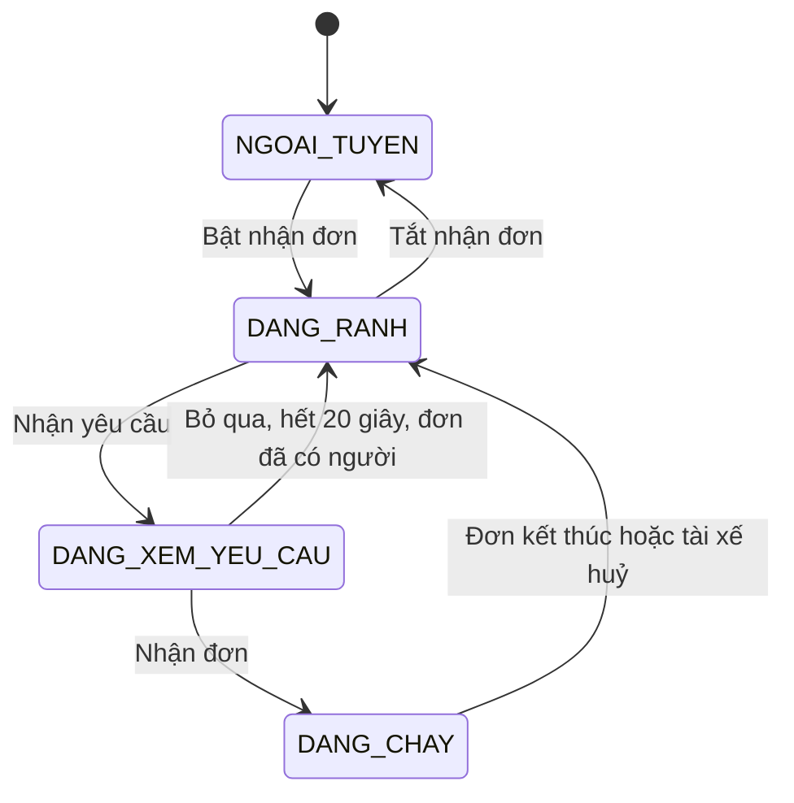
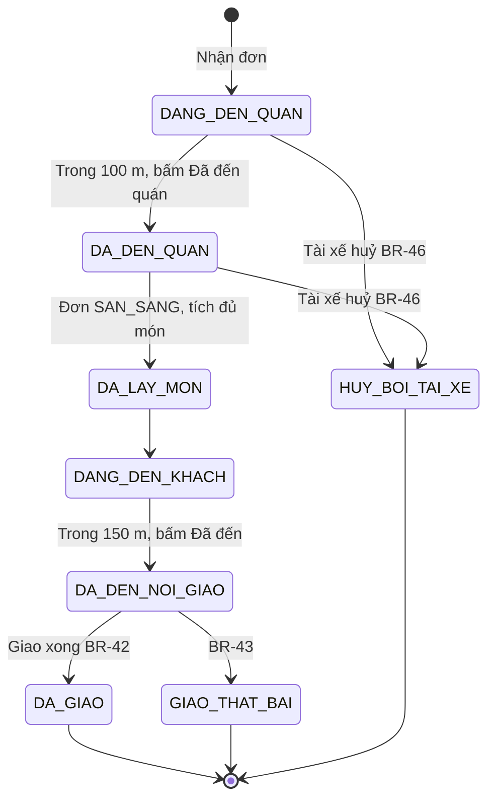
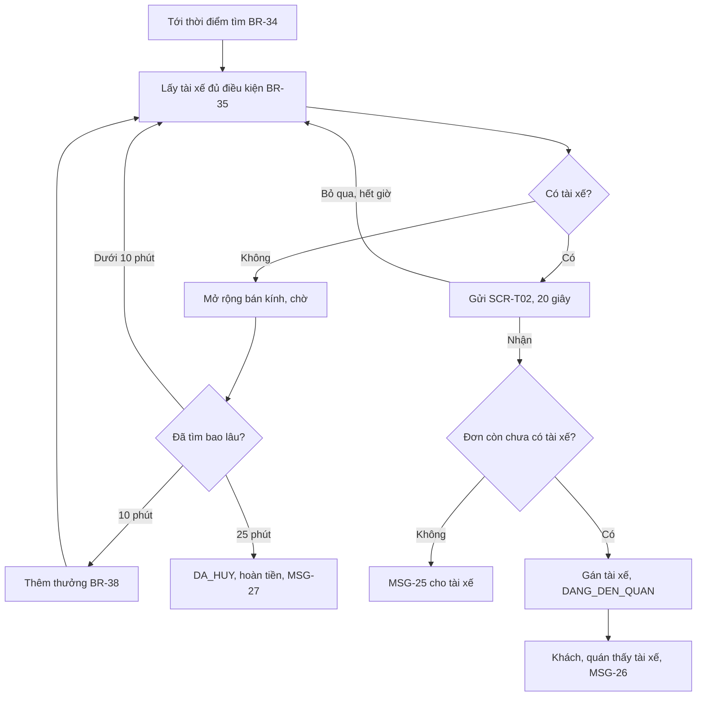
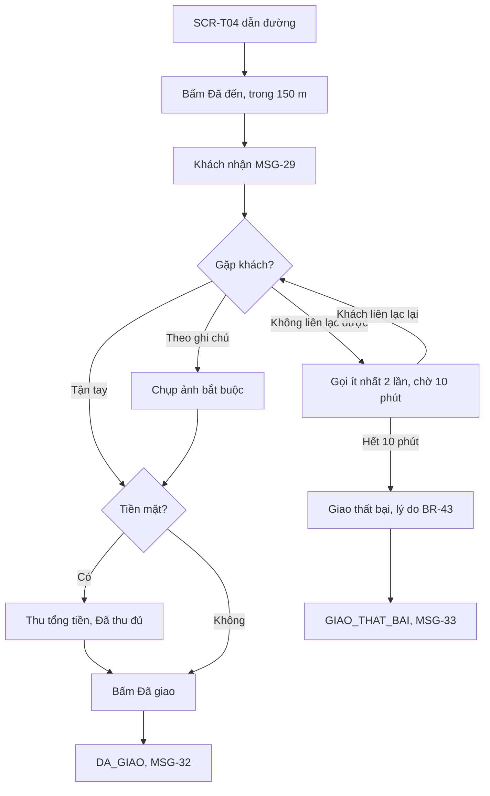
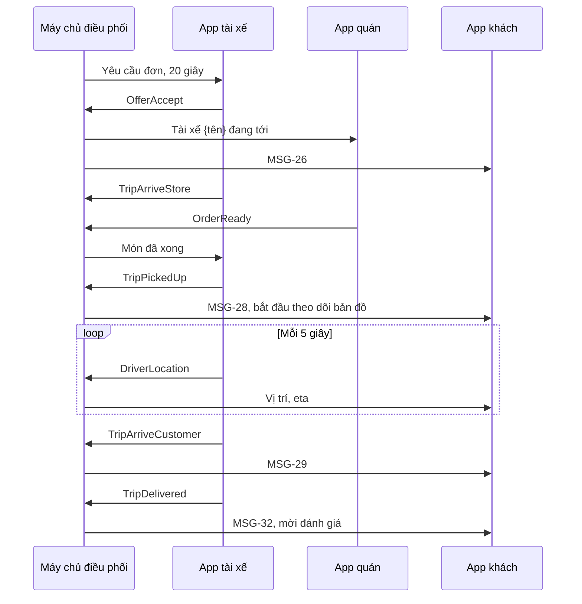

> **Mã:** DE06-TN04-SRS · **Trạng thái:** đã chốt · **Người viết:** Design · **PRD:** [PRD.md](PRD.md)

# UC-DE06-04 - Tài xế nhận và giao đơn

> SRS này mô tả việc tìm tài xế, lấy món và giao, từ khi đơn `DANG_CHUAN_BI` ([SRS TN03](../TN03-quan-nhan-chuan-bi-don/SRS.md)) tới `DA_GIAO` hoặc `GIAO_THAT_BAI`; huỷ, hoàn tiền, đánh giá xem [SRS TN05](../TN05-huy-danh-gia-su-co/SRS.md).

## 1. Tổng quan

| **Mục** | **Nội dung** |
| --- | --- |
| Mục tiêu | Ghép tài xế đúng lúc; tài xế lấy đúng đơn, giao đúng người; khách và quán thấy cùng một trạng thái |
| Actor | Tài xế · Khách · Quán · App tài xế · App khách · App quán · Máy chủ điều phối · Dịch vụ cuộc gọi trung gian |
| Phạm vi | Bật nhận đơn, thời điểm tìm, gửi yêu cầu, nhận, bỏ qua, không tìm được, đến quán, lấy món, giao, ảnh xác nhận, thu tiền mặt, không gặp khách, theo dõi đơn, liên lạc |
| Ngoài phạm vi | Ghép nhiều đơn, hồ sơ tài xế, ví tài xế, tài xế riêng của quán |
| Nền tảng | App tài xế iOS / Android; App khách; App quán |

## 2. User Story

| **ID** | **As a** | **I want** | **So that** |
| --- | --- | --- | --- |
| US-16 | Tài xế | Thấy thu nhập, quãng đường trước khi nhận | Quyết định nhanh |
| US-17 | Tài xế | Đối chiếu mã đơn khi lấy món | Không lấy nhầm |
| US-18 | Khách | Thấy tài xế trên bản đồ, giờ tới | Ra nhận đúng lúc |
| US-19 | Tài xế | Có quy trình rõ khi không gặp khách | Không mất thời gian, vẫn có thu nhập |
| US-20 | Khách, tài xế | Liên lạc không lộ số thật | Giữ riêng tư |

## 3. Business Rules

| **Mã** | **Quy tắc** |
| --- | --- |
| BR-34 | **Thời điểm tìm tài xế**: thời gian chuẩn bị ≤ 15 phút → tìm ngay khi quán nhận; > 15 phút → bắt đầu khi còn 10 phút tới hạn xong (gồm gia hạn). Khi bắt đầu tìm, khách thấy "Đang tìm tài xế" |
| BR-35 | **Tài xế đủ điều kiện**: `DANG_RANH`, vị trí cập nhật trong 30 giây, trong bán kính quanh quán (3 km, +1 km mỗi phút, tối đa 6 km), chưa bỏ qua đơn này. Gửi lần lượt cho tài xế có thời gian tới quán ngắn nhất; mỗi lần 1 tài xế, 20 giây trả lời |
| BR-36 | **Thẻ yêu cầu**: tên quán, khoảng cách tới quán, quãng đường quán → khách, thu nhập dự kiến (BR-45), giờ món xong, tiền mặt cần thu (nếu có), số món. Không hiện địa chỉ chính xác của khách trước khi nhận (chỉ phường) |
| BR-37 | **Nhận đơn**: máy chủ kiểm tra đơn còn chưa có tài xế → gán; tài xế `DANG_CHAY`; khách và quán thấy tài xế (tên, ảnh, biển số, thời gian tới quán) |
| BR-38 | **Không tìm được tài xế**: sau 10 phút tìm → thêm thưởng 5.000 ₫ vào thu nhập dự kiến (vận hành bật); sau 25 phút → đơn `DA_HUY` lý do "Không có tài xế", hoàn ví cho khách; nếu quán đã báo xong món, nền tảng vẫn trả tiền món cho quán |
| BR-39 | **Trạng thái tài xế trong đơn**: `DANG_DEN_QUAN` → `DA_DEN_QUAN` (vào bán kính 100 m quanh quán và bấm "Đã đến quán") → `DA_LAY_MON` → `DANG_DEN_KHACH` → `DA_DEN_NOI_GIAO` (trong 150 m quanh điểm giao và bấm "Đã đến") → kết thúc. Đơn chuyển `DANG_GIAO` khi tài xế `DA_LAY_MON` |
| BR-40 | **Lấy món**: chỉ khi đơn `SAN_SANG`; màn lấy món hiện mã đơn 6 ký tự (chữ ≥ 32 pt), tên khách viết tắt, danh sách món để tích; bấm "Đã lấy món" sau khi tích đủ. Đơn chưa `SAN_SANG` → hiện giờ món xong. Chờ > 10 phút sau hạn xong → nút "Báo quán trễ" gửi hỗ trợ, tài xế được cộng phí chờ 5.000 ₫ |
| BR-41 | **Liên lạc**: gọi qua số trung gian, nhắn tin trong app (có tin nhắn nhanh: "Tôi đã tới", "Tôi đang xuống", "Để ở bảo vệ giúp tôi"); hiệu lực từ lúc nhận đơn tới 1 giờ sau khi kết thúc. Số thật không hiển thị cho bên nào |
| BR-42 | **Giao**: giao tận tay → bấm "Đã giao". Không giao tận tay (theo ghi chú: bảo vệ, lễ tân, treo cửa) → bắt buộc 1 ảnh, ảnh hiện cho khách trong chi tiết đơn. Đơn tiền mặt → màn thu tiền "Thu {tổng} ₫", tài xế bấm "Đã thu đủ"; tài xế đối soát tiền mặt với nền tảng (ngoài phạm vi). Kết thúc → đơn `DA_GIAO`, tài xế `DANG_RANH` |
| BR-43 | **Không gặp khách**: sau `DA_DEN_NOI_GIAO`, khách nhận push MSG-29; tài xế gọi ≥ 2 lần qua app (đếm trên máy chủ) và chờ 10 phút → nút "Giao thất bại" bật, chọn lý do (Không liên lạc được, Khách từ chối nhận, Sai địa chỉ). Đơn `GIAO_THAT_BAI`: khách bị tính tiền đầy đủ (ví không hoàn; tiền mặt ghi nhận lần không nhận, TN05 BR-55); tài xế nhận đủ thu nhập + phí chờ 5.000 ₫; đồ ăn xử lý theo chính sách, không giao cho người khác |
| BR-44 | **Theo dõi đơn** (**SCR-K07**): trạng thái theo mục 4.3; vị trí tài xế cập nhật mỗi 5 giây từ lúc nhận đơn; bản đồ hiện tài xế, quán, điểm giao; giờ tới dự kiến tính lại mỗi 30 giây. Không đổi địa chỉ giao sau khi đặt |
| BR-45 | **Thu nhập tài xế** = phí giao (gồm phụ phí) × 90% + thưởng (BR-38) + phí chờ (BR-40, BR-43) + 100% tip (TN05). Thẻ yêu cầu hiện phần không gồm tip |
| BR-46 | **Tài xế huỷ sau khi nhận**: chỉ trước `DA_LAY_MON`, chọn lý do; đơn quay về tìm tài xế (đồng hồ BR-38 không đặt lại), loại tài xế vừa huỷ; tối đa 2 lần, lần 3 → hỗ trợ xử lý. Sau `DA_LAY_MON` không có nút huỷ; sự cố (tai nạn, hỏng xe) báo qua nút "Báo sự cố" tới hỗ trợ |

## 4. Trạng thái

### 4.1 Trạng thái tài xế (toàn cục)

### 4.2 Tiến trình tài xế trong một đơn

### 4.3 Khách thấy gì trên SCR-K07

| **Đơn / tài xế** | **Tiêu đề** | **Phụ** |
| --- | --- | --- |
| `CHO_QUAN_XAC_NHAN` | Chờ quán xác nhận | Đếm ngược ≤ 3 phút; nút Huỷ đơn (TN05) |
| `DANG_CHUAN_BI`, chưa tìm | Quán đang chuẩn bị | Giờ giao dự kiến |
| `DANG_CHUAN_BI` hoặc `SAN_SANG`, đang tìm | Đang tìm tài xế | "Đã tìm {n} phút" |
| `DANG_DEN_QUAN` | {Tên tài xế} đang tới quán | Biển số, giờ tới quán |
| `DA_DEN_QUAN` | Tài xế đang chờ lấy món | |
| `DANG_DEN_KHACH` | Đang giao tới bạn | Bản đồ, giờ tới |
| `DA_DEN_NOI_GIAO` | Tài xế đã tới | "Vui lòng ra nhận", nút gọi nổi bật |
| `DA_GIAO` | Đã giao | Ảnh xác nhận (nếu có), mở **SCR-K08** (TN05) |
| `GIAO_THAT_BAI` | Giao không thành công | Lý do, liên hệ hỗ trợ |

## 5. Use Case

### UC-08 Tìm tài xế và nhận đơn

| **Mục** | **Nội dung** |
| --- | --- |
| Tiền điều kiện | Đơn `DANG_CHUAN_BI`, đã tới thời điểm tìm (BR-34) |
| Hậu điều kiện thành công | Đơn có tài xế `DANG_DEN_QUAN` |
| Hậu điều kiện thất bại | Đơn `DA_HUY` lý do không có tài xế |

**Luồng chính**

| **Bước** | **Actor** | **Mô tả** |
| --- | --- | --- |
| 1 | Máy chủ | Tới thời điểm tìm; chọn tài xế phù hợp nhất (BR-35); gửi yêu cầu |
| 2 | App tài xế | Hiện **SCR-T02**: thẻ yêu cầu (BR-36), đếm ngược 20 giây, âm thanh |
| 3 | Tài xế | Bấm "Nhận đơn" |
| 4 | Máy chủ | Gán (BR-37) |
| 5 | App tài xế | Mở **SCR-T03**: dẫn đường tới quán |
| 6 | App khách, App quán | Hiện tài xế; khách nhận MSG-26 |

**Luồng thay thế**

| **Mã** | **Điều kiện** | **Xử lý** |
| --- | --- | --- |
| A1 | Tài xế bỏ qua, hết 20 giây | Gửi tài xế kế tiếp |
| A2 | Tài xế huỷ trước khi lấy món | BR-46, quay lại bước 1 |

**Luồng lỗi**

| **Mã** | **Điều kiện** | **Xử lý** |
| --- | --- | --- |
| E1 | Đơn đã có tài xế khác hoặc đã huỷ khi bấm nhận | MSG-25 |
| E2 | Không tìm được sau 25 phút | MSG-27 (BR-38) |

### UC-09 Lấy món tại quán

| **Mục** | **Nội dung** |
| --- | --- |
| Tiền điều kiện | Tài xế `DANG_DEN_QUAN` |
| Hậu điều kiện thành công | Tài xế `DA_LAY_MON`; đơn `DANG_GIAO` |
| Hậu điều kiện thất bại | Tài xế vẫn chờ, hoặc báo hỗ trợ |

**Luồng chính**

| **Bước** | **Actor** | **Mô tả** |
| --- | --- | --- |
| 1 | Tài xế | Tới quán, bấm "Đã đến quán" (trong 100 m) |
| 2 | App quán | Thẻ tài xế hiện "Đã tới quán" |
| 3 | App tài xế | Mở **SCR-T03** chế độ lấy món: mã đơn chữ to, món |
| 4 | Tài xế | Nói mã đơn với quán, nhận túi, tích từng món |
| 5 | Tài xế | Bấm "Đã lấy món" |
| 6 | Máy chủ | Tài xế `DA_LAY_MON`, đơn `DANG_GIAO`; khách nhận MSG-28 |
| 7 | App tài xế | Mở **SCR-T04** dẫn đường tới khách |

**Luồng thay thế**

| **Mã** | **Điều kiện** | **Xử lý** |
| --- | --- | --- |
| A1 | Đơn chưa `SAN_SANG` | Nút "Đã lấy món" disabled, hiện "Quán đang chuẩn bị, xong lúc {giờ}"; khi quán báo xong → push tài xế |
| A2 | Chờ > 10 phút sau hạn | "Báo quán trễ" (BR-40) |
| A3 | Bấm "Đã đến quán" khi ngoài 100 m | MSG-30 |

**Luồng lỗi**

| **Mã** | **Điều kiện** | **Xử lý** |
| --- | --- | --- |
| E1 | Đơn bị huỷ khi tài xế đang ở quán | MSG-31; tài xế về `DANG_RANH`, nhận phí chờ nếu đã ở quán > 5 phút |
| E2 | Mất mạng | Thao tác lưu chờ, gửi khi có mạng; mã đơn vẫn hiện để đối chiếu |

### UC-10 Giao đơn và theo dõi

| **Mục** | **Nội dung** |
| --- | --- |
| Tiền điều kiện | Tài xế `DA_LAY_MON` |
| Hậu điều kiện thành công | Đơn `DA_GIAO`; khách được mời đánh giá (TN05) |
| Hậu điều kiện thất bại | Đơn `GIAO_THAT_BAI` |

**Luồng chính**

| **Bước** | **Actor** | **Mô tả** |
| --- | --- | --- |
| 1 | App khách | **SCR-K07**: bản đồ tài xế, giờ tới (BR-44) |
| 2 | Tài xế | Tới nơi, bấm "Đã đến" |
| 3 | Máy chủ | Push MSG-29 cho khách |
| 4 | Tài xế | Gọi khách qua app; khách ra nhận |
| 5 | Tài xế | Bấm "Đã giao" |
| 6 | Máy chủ | Đơn `DA_GIAO`; khách MSG-32, mở **SCR-K08** (TN05) |

**Luồng thay thế**

| **Mã** | **Điều kiện** | **Xử lý** |
| --- | --- | --- |
| A1 | Giao theo ghi chú | Chụp ảnh (BR-42) |
| A2 | Tiền mặt | Màn thu tiền trước khi bấm Đã giao |
| A3 | Khách nhắn tin, gọi tài xế | Qua số trung gian, chat (BR-41) |

**Luồng lỗi**

| **Mã** | **Điều kiện** | **Xử lý** |
| --- | --- | --- |
| E1 | Không gặp khách | BR-43 |
| E2 | Bấm "Đã đến" khi ngoài 150 m | MSG-30 |
| E3 | Sự cố trên đường | "Báo sự cố" → hỗ trợ; khách thấy "Đơn đang được hỗ trợ xử lý" |
| E4 | Mất mạng khi bấm Đã giao | Lưu chờ; khách thấy cập nhật khi tài xế có mạng; MSG-34 cho tài xế |

## 6. Điểm vào

| **Điểm vào** | **Dẫn tới** | **Ghi chú** |
| --- | --- | --- |
| Đặt đơn thành công (TN02) | **SCR-K07** | |
| Banner đơn đang giao ở **SCR-K01** | **SCR-K07** | |
| Push trạng thái đơn | **SCR-K07** | |
| Tài xế mở app | **SCR-T01** hoặc đơn đang chạy | |
| Yêu cầu đơn mới | **SCR-T02** | |

## 7. Mô tả màn hình

### SCR-T01 Trang chủ tài xế

| **#** | **Thành phần** | **Loại** | **Hành vi** |
| --- | --- | --- | --- |
| 1 | Bật nhận đơn | Switch lớn | `NGOAI_TUYEN` ↔ `DANG_RANH` |
| 2 | Bản đồ | Map | Vị trí, khu vực nhiều đơn (tô màu) |
| 3 | Thu nhập hôm nay | Card | Số đơn, tổng thu nhập, tip |
| 4 | Đơn đang chạy | Banner | Khi có; chạm mở **SCR-T03** hoặc **SCR-T04** |

### SCR-T02 Yêu cầu đơn mới

| **#** | **Thành phần** | **Loại** | **Hành vi** |
| --- | --- | --- | --- |
| 1 | Thu nhập dự kiến | Text lớn | BR-45 (không gồm tip) |
| 2 | Quán | Text | Tên, khoảng cách tới quán, giờ món xong |
| 3 | Giao tới | Text | Phường, quãng đường quán → khách |
| 4 | Tiền mặt cần thu | Tag | Khi đơn tiền mặt |
| 5 | Đếm ngược | Progress vòng | 20 giây |
| 6 | "Nhận đơn" | Button lớn | |
| 7 | "Bỏ qua" | Button phụ | |

### SCR-T03 Đến quán & lấy món

| **#** | **Thành phần** | **Loại** | **Hành vi** |
| --- | --- | --- | --- |
| 1 | Dẫn đường | Map | Mở app bản đồ ngoài nếu muốn |
| 2 | Quán | Card | Tên, địa chỉ, gọi quán |
| 3 | "Đã đến quán" | Button | BR-39 |
| 4 | Mã đơn | Text cực lớn | 6 ký tự |
| 5 | Món | Checklist | Tích từng món |
| 6 | Trạng thái món | Info | "Quán đang chuẩn bị, xong lúc {giờ}" khi chưa `SAN_SANG` |
| 7 | "Đã lấy món" | Button | Bật khi `SAN_SANG` và tích đủ |
| 8 | Báo quán trễ, Huỷ đơn, Báo sự cố | Menu | BR-40, BR-46 |

### SCR-T04 Giao cho khách

| **#** | **Thành phần** | **Loại** | **Hành vi** |
| --- | --- | --- | --- |
| 1 | Dẫn đường | Map | Tới điểm giao |
| 2 | Người nhận | Card | Tên, địa chỉ, chi tiết toà nhà, ghi chú tài xế (in đậm) |
| 3 | Gọi, Nhắn tin | Button | Số trung gian, tin nhắn nhanh (BR-41) |
| 4 | "Đã đến" | Button | BR-39 |
| 5 | Đồng hồ chờ | Timer | Sau "Đã đến": 10 phút, số lần gọi |
| 6 | Chụp ảnh giao | Camera | BR-42 |
| 7 | Thu tiền mặt | Card | "Thu {tổng} ₫", "Đã thu đủ" |
| 8 | "Đã giao" | Button lớn | |
| 9 | "Giao thất bại" | Button phụ | Bật theo BR-43 |

### SCR-K07 Theo dõi đơn (khách)

| **#** | **Thành phần** | **Loại** | **Hành vi** |
| --- | --- | --- | --- |
| 1 | Trạng thái | Header | Mục 4.3 |
| 2 | Tiến trình | Stepper | Đã đặt → Quán chuẩn bị → Đang giao → Đã giao |
| 3 | Giờ giao dự kiến | Text lớn | "12:25–12:35" (BR-44) |
| 4 | Bản đồ | Map | Tài xế, quán, điểm giao; "Cập nhật {n} giây trước" khi > 15 giây |
| 5 | Tài xế | Card | Ảnh, tên, biển số, gọi, nhắn tin |
| 6 | Chi tiết đơn | Accordion | Món, tổng, thanh toán, địa chỉ |
| 7 | Huỷ đơn | Link | Chỉ `CHO_QUAN_XAC_NHAN` (TN05) |
| 8 | Trợ giúp | Link | Mở hỗ trợ |

## 8. API

| **API** | **Request chính** | **Response chính** | **Timeout / retry** |
| --- | --- | --- | --- |
| \[DriverStatus\] | online | Trạng thái tài xế | 5s / 1 lần |
| \[DriverLocation\] | lat, lng, accuracy | – | Gửi mỗi 5 giây khi online |
| \[OfferStream\] | driver_id | Yêu cầu đơn, expires_at | Kết nối lâu dài; push dự phòng |
| \[OfferAccept\], \[OfferDecline\] | offer_id | Kết quả gán | 5s / 1 lần |
| \[TripArriveStore\] | order_id, lat, lng | OK hoặc ngoài bán kính | 5s / 2 lần |
| \[TripPickedUp\] | order_id, checked_items | Đơn `DANG_GIAO` | 5s / 3 lần |
| \[TripArriveCustomer\] | order_id, lat, lng | OK | 5s / 2 lần |
| \[TripDelivered\] | order_id, photo, cash_collected | Đơn `DA_GIAO` | 15s / 3 lần |
| \[TripFailed\] | order_id, reason | Đơn `GIAO_THAT_BAI` hoặc chưa đủ điều kiện | 5s / 1 lần |
| \[MaskedCall\], \[ChatSend\] | order_id, to | Số trung gian, tin nhắn | 5s / 1 lần |
| \[OrderTrack\] | order_id | Trạng thái, vị trí tài xế, eta | Kết nối lâu dài; dự phòng gọi mỗi 10 giây |

**Map lỗi → thông báo**

| **Nhóm lỗi** | **Message** |
| --- | --- |
| Đơn đã có người nhận | MSG-25 |
| Đã có tài xế (gửi khách) | MSG-26 |
| Không tìm được tài xế | MSG-27 |
| Tài xế đã lấy món | MSG-28 |
| Tài xế đã tới | MSG-29 |
| Ngoài bán kính khi bấm đến | MSG-30 |
| Đơn bị huỷ khi tài xế đang làm | MSG-31 |
| Đã giao | MSG-32 |
| Giao thất bại | MSG-33 |
| Mất mạng | MSG-34 |

## 9. Danh sách thông báo

| **ID** | **Nơi hiện** | **Nội dung (VI)** |
| --- | --- | --- |
| MSG-25 | Toast tài xế | Đơn này không còn. Chúng tôi sẽ gửi đơn khác cho bạn |
| MSG-26 | Push khách | {Tên tài xế} ({biển số}) sẽ lấy món tại {quán} lúc khoảng {giờ} |
| MSG-27 | Popup khách | Rất tiếc, hiện chưa có tài xế nhận đơn của bạn nên đơn đã được huỷ. {Đã hoàn {tổng} ₫ về ví}. \[Đặt lại\] |
| MSG-28 | Push khách | Tài xế đã lấy món và đang giao tới bạn. Dự kiến tới lúc {giờ} |
| MSG-29 | Push khách | Tài xế đã tới. Vui lòng ra nhận đồ ăn |
| MSG-30 | Toast tài xế | Bạn chưa ở gần {quán / điểm giao}. Vui lòng bấm khi đã tới nơi |
| MSG-31 | Popup tài xế | Đơn {mã} đã bị huỷ. {Bạn nhận phí chờ {x} ₫} |
| MSG-32 | Push khách | Đơn của bạn đã được giao. Chúc ngon miệng! \[Đánh giá\] |
| MSG-33 | Push khách | Tài xế không liên lạc được với bạn nên đơn không giao được. Đơn vẫn được tính tiền. Liên hệ hỗ trợ nếu có nhầm lẫn |
| MSG-34 | Banner tài xế | Mất kết nối. Thao tác sẽ được gửi khi có mạng |

## 10. Yêu cầu phi chức năng

| **Mục** | **Yêu cầu** |
| --- | --- |
| Hiệu năng | Yêu cầu đơn tới tài xế ≤ 2 giây; vị trí tài xế tới App khách ≤ 5 giây; trạng thái đồng bộ ba app ≤ 3 giây |
| Độ tin cậy | Gán tài xế một lần (khoá theo đơn); thao tác của tài xế khi mất mạng được lưu chờ và gửi đúng thứ tự |
| Pin | App tài xế gửi vị trí mỗi 5 giây khi có đơn, mỗi 30 giây khi rảnh |
| Riêng tư | Địa chỉ chính xác của khách chỉ hiện sau khi nhận đơn; số điện thoại qua trung gian (BR-41); ảnh giao xoá sau 30 ngày |
| Log / audit | Mỗi đơn: danh sách tài xế đã gửi, phản hồi, thời điểm; mọi mốc trạng thái và vị trí lúc bấm; số lần gọi |
| Tracking | Tỉ lệ nhận, thời gian phản hồi, thời gian chờ tại quán, thời gian giao, giao thất bại (lý do), sử dụng chat, gọi |
| Accessibility | App tài xế: nút ≥ 56 pt, dùng được bằng một tay, hạn chế thao tác khi đang chạy xe (chỉ nút Nhận, Đã đến); App khách: trạng thái đọc được bằng giọng đọc khi đổi |
