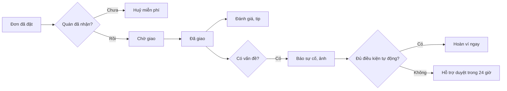

> **Mã:** DE06-TN05-PRD · **Trạng thái:** đã chốt · **Người viết:** Design · **SRS:** [SRS.md](SRS.md)

# PRD Huỷ đơn, đánh giá và báo sự cố (App đặt ship đồ ăn)

## 1. Bối cảnh và vấn đề

### 1.1 Bối cảnh

Tính năng này bao các điểm kết thúc của vòng đời đơn (xem [README](../../README.md)): khách huỷ khi đổi ý, đánh giá quán và tài xế sau khi nhận, cho tài xế tiền tip, và báo khi đồ ăn thiếu, sai, đổ vỡ. Cách xử lý sự cố quyết định khách có quay lại hay không; đánh giá giúp khách khác chọn quán (TN01).

### 1.2 Vấn đề

| **Vấn đề** | **Hệ quả** |
| --- | --- |
| Đặt nhầm nhưng không biết còn huỷ được không | Gọi hỗ trợ, hoặc để mặc rồi không nhận |
| Thiếu món phải chat với hỗ trợ, chờ lâu | Khách bực, đánh giá 1 sao cả quán lẫn app |
| Hoàn tiền lâu, không rõ hoàn bao nhiêu | Mất niềm tin |
| Đánh giá chung chung "ngon", "dở" | Quán không biết sửa gì |
| Khách đặt tiền mặt rồi không nhận | Tài xế, quán thiệt |

### 1.3 Mục tiêu

- ≥ 70% sự cố thiếu món, sai món được hoàn tiền tự động trong 5 phút.
- ≥ 35% đơn đã giao có đánh giá.
- Tỉ lệ khách đặt lại trong 30 ngày sau khi có sự cố được xử lý ≥ 60%.

## 2. Người dùng

| **Nhóm** | **Nhu cầu với tính năng này** |
| --- | --- |
| Khách đặt nhầm | Huỷ nhanh, không mất tiền |
| Khách nhận thiếu, sai món | Báo bằng vài chạm, hoàn tiền ngay |
| Khách hài lòng | Khen quán, tip tài xế dễ dàng |
| Quán | Nhận đánh giá cụ thể để cải thiện |

## 3. Phạm vi

### 3.1 Trong phạm vi (MVP)

- Khách huỷ đơn trước khi quán nhận; hướng dẫn khi không huỷ được nữa.
- Hoàn tiền về ví cho các trường hợp huỷ không do lỗi khách.
- Đánh giá quán (sao, nhãn, bình luận, ảnh) và tài xế (sao, nhãn).
- Tip tài xế bằng ví.
- Báo sự cố: thiếu món, sai món, đổ vỡ, chất lượng, không nhận được đơn; hoàn tiền tự động hoặc qua duyệt.
- Lịch sử đơn, chi tiết đơn, đặt lại.
- Khoá tiền mặt với khách nhiều lần không nhận.

### 3.2 Ngoài phạm vi

- Màn xử lý sự cố của nhân viên hỗ trợ (chỉ mô tả kết quả khách thấy).
- Quán trả lời đánh giá → phase sau.
- Chat trực tiếp với hỗ trợ trong app (dùng kênh hỗ trợ chung).
- Bồi thường bằng mã giảm giá.

## 4. Nguyên tắc sản phẩm

### 4.1 Tin khách trước, kiểm tra sau

Sự cố nhỏ có ảnh được hoàn tiền tự động; kiểm tra lạm dụng dựa trên lịch sử, không bắt mọi khách chờ.

### 4.2 Nói rõ còn huỷ được không

Nút huỷ chỉ xuất hiện khi huỷ được; khi không, nói vì sao và có lối tới hỗ trợ.

### 4.3 Đánh giá để cải thiện, không để trút giận

Nhãn cụ thể giúp quán biết sửa gì; đánh giá thấp có gợi ý báo sự cố để được hoàn tiền.

## 5. Quy tắc nghiệp vụ

| **Quy tắc** | **Giá trị** |
| --- | --- |
| Khách tự huỷ | Chỉ khi quán chưa nhận đơn; miễn phí |
| Hoàn tiền về ví | ≤ 5 phút |
| Đánh giá | Trong 7 ngày sau khi giao |
| Tip | 5.000, 10.000, 20.000 ₫ hoặc số khác ≤ 200.000 ₫; trong 24 giờ sau khi giao |
| Báo sự cố | Trong 2 giờ sau khi giao; 1 yêu cầu mỗi đơn |
| Hoàn tự động | Tổng hoàn ≤ 100.000 ₫ và khách có ≤ 2 sự cố được duyệt trong 30 ngày |
| Khoá tiền mặt | 2 lần không nhận đơn tiền mặt trong 90 ngày → chỉ dùng ví 30 ngày |

## 6. Luồng trải nghiệm

| **Bước** | **Giai đoạn** | **Trải nghiệm** | **Đầu ra** |
| --- | --- | --- | --- |
| 1 | Huỷ (nếu cần) | Nút huỷ khi còn chờ quán; lý do | Đơn huỷ, hoàn ví |
| 2 | Đánh giá | Sao, nhãn cho quán và tài xế; tip | Đánh giá |
| 3 | Sự cố | Chọn vấn đề, món, ảnh; thấy số tiền hoàn | Hoàn tiền |
| 4 | Đặt lại | Từ lịch sử đơn | Giỏ mới |

## 7. Use Cases, User Stories và Acceptance Criteria

### UC1. Huỷ đơn

#### US1.1 Huỷ khi quán chưa nhận

User Story: Là khách đặt nhầm, tôi muốn huỷ ngay khi quán chưa nhận để không mất tiền.

AC01: Đơn chờ quán xác nhận → nút "Huỷ đơn"; chọn lý do; huỷ ngay, hoàn ví.

AC02: Quán vừa nhận đúng lúc khách bấm huỷ → báo không huỷ được nữa.

#### US1.2 Khi không còn huỷ được

AC01: Quán đã nhận → không có nút huỷ; hiện "Quán đã bắt đầu chuẩn bị" và nút "Cần hỗ trợ".

### UC2. Đánh giá và tip

#### US2.1 Đánh giá quán, tài xế

AC01: Sau khi giao, màn đánh giá hiện tự động một lần; vào lại được từ chi tiết đơn trong 7 ngày.

AC02: Quán: 1–5 sao, nhãn theo số sao, bình luận ≤ 300 ký tự, ≤ 3 ảnh. Tài xế: 1–5 sao, nhãn.

AC03: Quán ≤ 2 sao → bắt buộc chọn ít nhất 1 nhãn; nhãn Thiếu món, Sai món → gợi ý báo sự cố.

#### US2.2 Tip tài xế

AC01: Chọn mức tip; trừ ví; tài xế nhận 100%.

AC02: Ví không đủ → báo; không ảnh hưởng đánh giá.

### UC3. Báo sự cố

#### US3.1 Thiếu, sai, đổ vỡ, chất lượng

User Story: Là khách nhận thiếu món, tôi muốn báo trong vài chạm và được hoàn tiền ngay.

AC01: Chọn vấn đề, chọn món và số lượng bị ảnh hưởng, chụp ảnh (bắt buộc).

AC02: Hiện số tiền hoàn trước khi gửi.

AC03: Đủ điều kiện → hoàn ví ngay, báo thành công; không đủ → hỗ trợ duyệt trong 24 giờ.

#### US3.2 Không nhận được đơn

AC01: Đơn báo đã giao nhưng khách không nhận → gửi yêu cầu; hỗ trợ đối chiếu ảnh, vị trí giao.

### UC4. Lịch sử và đặt lại

AC01: Lịch sử 6 tháng; mỗi đơn: quán, ngày, món, tổng, trạng thái.

AC02: "Đặt lại" thêm món còn bán vào giỏ (TN02).

## 8. Chỉ số theo dõi

| **Chỉ số** | **Định nghĩa** | **Mục tiêu MVP** |
| --- | --- | --- |
| Hoàn tự động | Sự cố hoàn tự động trong 5 phút / sự cố thiếu, sai món | ≥ 70% |
| Tỉ lệ đánh giá | Đơn có đánh giá / đơn đã giao | ≥ 35% |
| Tỉ lệ tip | Đơn có tip / đơn đã giao | Theo dõi |
| Tỉ lệ sự cố | Đơn có sự cố / đơn đã giao | ≤ 3% |
| Quay lại sau sự cố | Khách đặt lại trong 30 ngày sau sự cố được xử lý | ≥ 60% |
| Huỷ bởi khách | Đơn khách huỷ / tổng đơn | Theo dõi |

## 9. Phụ thuộc và rủi ro

| **Mục** | **Mô tả** | **Hướng xử lý** |
| --- | --- | --- |
| Lạm dụng hoàn tiền | Báo sự cố giả | Ngưỡng tự động theo lịch sử; ảnh bắt buộc; hỗ trợ duyệt khi vượt ngưỡng |
| Đánh giá ác ý | Quán bị đánh giá thấp không công bằng | Chỉ khách đã nhận đơn mới đánh giá; ẩn bình luận vi phạm theo báo cáo |
| Tranh chấp với quán | Quán không đồng ý bị trừ tiền | Quán khiếu nại trên web quản lý (ngoài phạm vi) |

## 10. Câu hỏi mở

> Mọi câu hỏi dưới đây đã được PO chốt ngày 20/11/2026; quyết định ghi sau mỗi câu và đã cập nhật vào SRS.

- Đơn tiền mặt có sự cố thì hoàn bằng gì? → **Đã chốt:** Hoàn vào ví của khách (SRS BR-53).
- Đánh giá tài xế có công khai? → **Đã chốt:** Không; chỉ dùng nội bộ. Đánh giá quán công khai với tên viết tắt (SRS BR-50).
- Khách huỷ sau khi quán nhận qua hỗ trợ có mất tiền? → **Đã chốt:** Do hỗ trợ quyết định theo từng trường hợp; app chỉ dẫn tới hỗ trợ (SRS BR-47).
- Ai chịu tiền bồi hoàn? → **Đã chốt:** Thiếu, sai, chất lượng → trừ vào tiền quán; đổ vỡ khi giao → nền tảng chịu (SRS BR-58).
