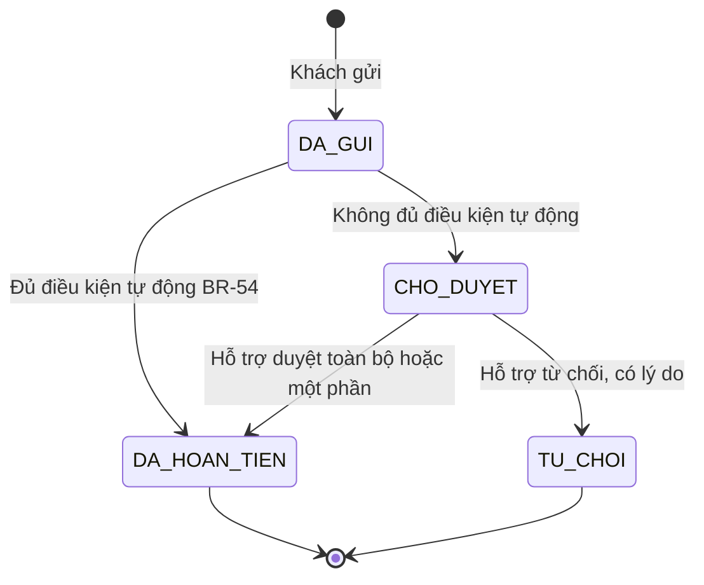
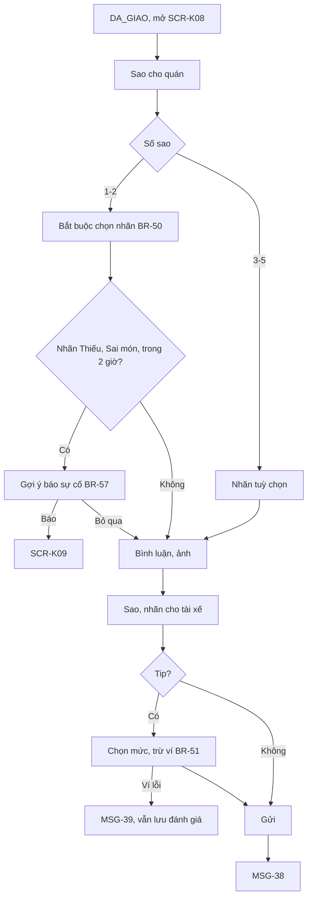
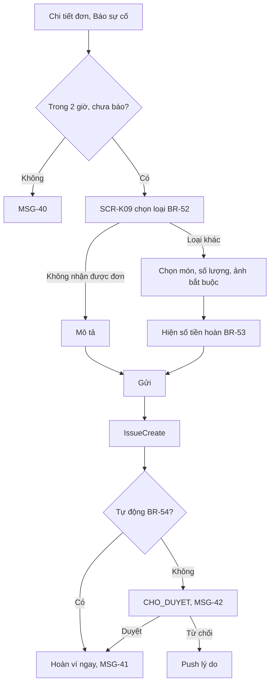
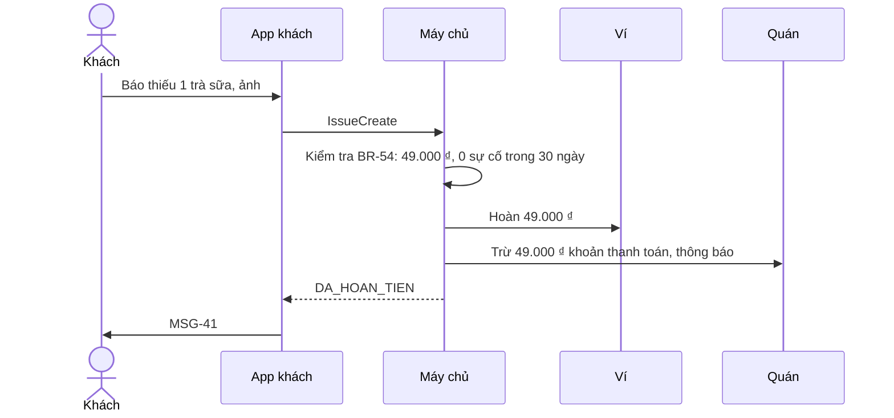

> **Mã:** DE06-TN05-SRS · **Trạng thái:** đã chốt · **Người viết:** Design · **PRD:** [PRD.md](PRD.md)

# UC-DE06-05 - Huỷ đơn, đánh giá và báo sự cố

> SRS này mô tả việc khách huỷ đơn, hoàn tiền, đánh giá, tip, báo sự cố sau khi giao và lịch sử đơn. Trạng thái đơn tham chiếu [README](../../README.md); giao đơn xem [SRS TN04](../TN04-tai-xe-giao-don/SRS.md).

## 1. Tổng quan

| **Mục** | **Nội dung** |
| --- | --- |
| Mục tiêu | Khách huỷ được khi còn kịp, được hoàn tiền nhanh, đánh giá cụ thể, báo sự cố và được bồi hoàn |
| Actor | Khách · App khách · Máy chủ · Ví liên kết · Nhân viên hỗ trợ (hệ thống nội bộ) · Quán, tài xế (nhận kết quả) |
| Phạm vi | Huỷ đơn, hoàn ví, đánh giá quán và tài xế, tip, báo sự cố, bồi hoàn tự động hoặc qua duyệt, lịch sử đơn, đặt lại, khoá tiền mặt |
| Ngoài phạm vi | Màn xử lý của nhân viên, quán trả lời đánh giá, chat hỗ trợ, mã giảm giá bồi thường |
| Nền tảng | App khách iOS / Android |

## 2. User Story

| **ID** | **As a** | **I want** | **So that** |
| --- | --- | --- | --- |
| US-21 | Khách | Huỷ đơn khi quán chưa nhận | Không mất tiền khi đặt nhầm |
| US-22 | Khách | Biết hoàn bao nhiêu, khi nào | Yên tâm |
| US-23 | Khách | Đánh giá bằng nhãn cụ thể | Quán biết cần sửa gì |
| US-24 | Khách | Tip tài xế | Cảm ơn tài xế |
| US-25 | Khách | Báo thiếu món có ảnh, được hoàn ngay | Không phải chờ hỗ trợ |
| US-26 | Khách | Đặt lại đơn cũ | Ăn lại món quen nhanh |

## 3. Business Rules

| **Mã** | **Quy tắc** |
| --- | --- |
| BR-47 | **Khách huỷ**: chỉ khi đơn `CHO_QUAN_XAC_NHAN` → huỷ ngay, miễn phí. Từ `DANG_CHUAN_BI` trở đi không có nút huỷ; hiện "Quán đã bắt đầu chuẩn bị" và nút "Cần hỗ trợ" mở kênh hỗ trợ; việc huỷ, tính tiền do hỗ trợ quyết định |
| BR-48 | **Lý do huỷ** bắt buộc: Đặt nhầm món · Đổi địa chỉ · Đổi phương thức thanh toán · Chờ quán lâu · Không còn nhu cầu · Khác (≤ 100 ký tự) |
| BR-49 | **Hoàn tiền về ví** ≤ 5 phút cho: khách huỷ hợp lệ, quán từ chối hoặc không phản hồi (TN03), hết món toàn bộ, bỏ món (phần tiền món), không có tài xế (TN04), sự cố được duyệt. Đơn tiền mặt chưa thu tiền thì không phát sinh hoàn (trừ bồi hoàn sự cố) |
| BR-50 | **Đánh giá**: trong 7 ngày sau `DA_GIAO`, 1 lần mỗi đơn, không sửa. Quán: 1–5 sao; nhãn 4–5 sao (Ngon, Đóng gói cẩn thận, Đúng món, Giá hợp lý), nhãn 1–3 sao (Món nguội, Thiếu món, Sai món, Đóng gói kém, Không hợp vệ sinh, Ít so với giá); bình luận ≤ 300 ký tự; ≤ 3 ảnh ≤ 10 MB. Tài xế: 1–5 sao; nhãn (Thân thiện, Giao nhanh, Cẩn thận / Thái độ chưa tốt, Giao chậm, Làm đổ món). Đánh giá quán công khai với tên viết tắt; đánh giá tài xế nội bộ |
| BR-51 | **Tip**: 5.000, 10.000, 20.000 ₫ hoặc số khác 1.000–200.000 ₫; chỉ bằng ví; trong 24 giờ sau `DA_GIAO`; 1 lần mỗi đơn; tài xế nhận 100% (TN04 BR-45), nhận push "Bạn được tip {x} ₫" |
| BR-52 | **Báo sự cố**: trong 2 giờ sau `DA_GIAO` (hoặc sau `GIAO_THAT_BAI` với loại "Không nhận được đơn"); 1 yêu cầu mỗi đơn. Loại: Thiếu món · Sai món · Món bị đổ vỡ · Chất lượng món (hỏng, có dị vật) · Không nhận được đơn. Với 4 loại đầu: chọn món và số lượng bị ảnh hưởng, ảnh 1–3 tấm bắt buộc. Mô tả ≤ 300 ký tự |
| BR-53 | **Số tiền bồi hoàn** = Σ (giá món + tuỳ chọn) × số lượng bị ảnh hưởng; mọi món bị ảnh hưởng ở loại Thiếu món, Sai món → thêm phí giao nếu cả đơn bị ảnh hưởng. Hoàn vào ví, kể cả đơn tiền mặt. "Không nhận được đơn" được duyệt → hoàn toàn bộ tổng đơn |
| BR-54 | **Tự động duyệt** khi: loại khác "Không nhận được đơn", số tiền ≤ 100.000 ₫, khách có ≤ 2 sự cố được duyệt trong 30 ngày, tài khoản không bị gắn cờ. Còn lại → `CHO_DUYET`, hỗ trợ trả lời ≤ 24 giờ |
| BR-55 | **Khoá tiền mặt**: 2 đơn tiền mặt `GIAO_THAT_BAI` trong 90 ngày → tài khoản chỉ được dùng ví trong 30 ngày (TN02 BR-16); hiện MSG-43 khi chọn thanh toán |
| BR-56 | **Lịch sử đơn**: 6 tháng gần nhất, mới nhất trước; tab Đang giao, Đã giao, Đã huỷ. "Đặt lại" thêm món còn bán với cùng tuỳ chọn vào giỏ (thay giỏ hiện tại theo TN01 BR-09); món, tuỳ chọn hết bị bỏ, MSG-05 (TN01) |
| BR-57 | **Gợi ý báo sự cố từ đánh giá**: chọn nhãn Thiếu món, Sai món khi còn trong 2 giờ → hiện "Bạn có muốn báo sự cố để được hoàn tiền?" → mở **SCR-K09** điền sẵn loại |
| BR-58 | **Ai chịu bồi hoàn**: Thiếu món, Sai món, Chất lượng → trừ vào khoản thanh toán cho quán; Món bị đổ vỡ → nền tảng chịu, ghi nhận vào chất lượng tài xế; Không nhận được đơn → hỗ trợ quyết định sau khi đối chiếu ảnh và vị trí giao |

## 4. Trạng thái

### 4.1 Vòng đời yêu cầu sự cố

### 4.2 Hành động khách theo trạng thái đơn

| **Trạng thái đơn** | **Huỷ** | **Đánh giá** | **Tip** | **Báo sự cố** | **Đặt lại** |
| --- | --- | --- | --- | --- | --- |
| `CHO_QUAN_XAC_NHAN` | Có | – | – | – | – |
| `DANG_CHUAN_BI`, `SAN_SANG`, `DANG_GIAO` | Cần hỗ trợ | – | – | – | – |
| `DA_GIAO` | – | 7 ngày | 24 giờ | 2 giờ | Có |
| `GIAO_THAT_BAI` | – | – | – | 2 giờ, chỉ "Không nhận được đơn" | Có |
| `DA_HUY` | – | – | – | – | Có |

## 5. Use Case

### UC-11 Huỷ đơn

| **Mục** | **Nội dung** |
| --- | --- |
| Tiền điều kiện | Đơn `CHO_QUAN_XAC_NHAN` |
| Hậu điều kiện thành công | Đơn `DA_HUY`; quán thấy đơn bị huỷ; hoàn ví nếu đã trả |
| Hậu điều kiện thất bại | Đơn giữ trạng thái; khách được dẫn tới hỗ trợ |

**Luồng chính**

| **Bước** | **Actor** | **Mô tả** |
| --- | --- | --- |
| 1 | Khách | Ở **SCR-K07** bấm "Huỷ đơn" |
| 2 | App | Bottom sheet lý do (BR-48), số tiền sẽ hoàn (nếu trả ví) |
| 3 | Khách | Chọn lý do, bấm "Xác nhận huỷ" |
| 4 | App | Gọi \[OrderCancel\] |
| 5 | Máy chủ | Kiểm tra trạng thái; huỷ; hoàn ví; báo quán (TN03 MSG-22) |
| 6 | App | MSG-35; **SCR-K07** hiện "Đã huỷ" và nút "Đặt lại" |

**Luồng lỗi**

| **Mã** | **Điều kiện** | **Xử lý** |
| --- | --- | --- |
| E1 | Quán vừa nhận đơn | MSG-36, nút "Cần hỗ trợ" |
| E2 | Lỗi mạng | MSG-44 |

### UC-12 Đánh giá và tip

| **Mục** | **Nội dung** |
| --- | --- |
| Tiền điều kiện | Đơn `DA_GIAO` trong 7 ngày |
| Hậu điều kiện thành công | Đánh giá được lưu; tip (nếu có) chuyển tới tài xế |
| Hậu điều kiện thất bại | Không lưu; khách đánh giá lại sau được |

**Luồng chính**

| **Bước** | **Actor** | **Mô tả** |
| --- | --- | --- |
| 1 | App | Đơn `DA_GIAO` → mở **SCR-K08** một lần (khách đóng được) |
| 2 | Khách | Chọn 5 sao cho quán, nhãn "Ngon", "Đóng gói cẩn thận" |
| 3 | Khách | Chọn 5 sao cho tài xế, tip 10.000 ₫ |
| 4 | Khách | Bấm "Gửi" |
| 5 | App | Gọi \[ReviewSubmit\] và \[TipSend\] |
| 6 | Máy chủ | Lưu đánh giá; trừ ví, chuyển tip; push tài xế |
| 7 | App | MSG-38 |

**Luồng thay thế**

| **Mã** | **Điều kiện** | **Xử lý** |
| --- | --- | --- |
| A1 | Đánh giá sau | Đóng **SCR-K08**; chi tiết đơn có nút "Đánh giá" trong 7 ngày |
| A2 | Chỉ tip, không đánh giá | Cho phép, trong 24 giờ |
| A3 | Đánh giá thấp có nhãn sự cố | BR-57 |

**Luồng lỗi**

| **Mã** | **Điều kiện** | **Xử lý** |
| --- | --- | --- |
| E1 | Ví không đủ khi tip | MSG-39; đánh giá vẫn được lưu |
| E2 | Quá 7 ngày | MSG-40 |
| E3 | Thiếu nhãn khi ≤ 2 sao | Lỗi inline "Chọn ít nhất 1 lý do" |

### UC-13 Báo sự cố

| **Mục** | **Nội dung** |
| --- | --- |
| Tiền điều kiện | Trong 2 giờ sau `DA_GIAO` (hoặc `GIAO_THAT_BAI` với loại Không nhận được đơn); đơn chưa có yêu cầu sự cố |
| Hậu điều kiện thành công | Yêu cầu `DA_HOAN_TIEN` hoặc `CHO_DUYET` |
| Hậu điều kiện thất bại | Không tạo yêu cầu |

**Luồng chính**

| **Bước** | **Actor** | **Mô tả** |
| --- | --- | --- |
| 1 | Khách | Mở chi tiết đơn → "Báo sự cố" |
| 2 | App | Mở **SCR-K09**, danh sách loại |
| 3 | Khách | Chọn "Thiếu món"; chọn "Trà sữa trân châu × 1"; chụp ảnh túi đồ ăn |
| 4 | App | Hiện "Bạn sẽ được hoàn 49.000 ₫ vào ví" |
| 5 | Khách | Bấm "Gửi" |
| 6 | App | Gọi \[IssueCreate\] |
| 7 | Máy chủ | Đủ điều kiện tự động → hoàn ví; trừ tiền quán (BR-58); báo quán |
| 8 | App | MSG-41 |

**Luồng thay thế**

| **Mã** | **Điều kiện** | **Xử lý** |
| --- | --- | --- |
| A1 | Không đủ điều kiện tự động | `CHO_DUYET`, MSG-42; kết quả qua push |
| A2 | Không nhận được đơn | Không cần chọn món, ảnh; luôn `CHO_DUYET` |
| A3 | Mở từ gợi ý ở đánh giá | Điền sẵn loại (BR-57) |

**Luồng lỗi**

| **Mã** | **Điều kiện** | **Xử lý** |
| --- | --- | --- |
| E1 | Quá 2 giờ, đã có yêu cầu | MSG-40 |
| E2 | Thiếu ảnh | Lỗi inline "Vui lòng chụp ít nhất 1 ảnh" |
| E3 | Lỗi mạng khi tải ảnh | MSG-44; giữ dữ liệu, cho gửi lại |

## 6. Điểm vào

| **Điểm vào** | **Dẫn tới** | **Ghi chú** |
| --- | --- | --- |
| Đơn vừa giao (MSG-32, TN04) | **SCR-K08** | Một lần |
| Tài khoản → Đơn hàng | **SCR-K10** | |
| Chi tiết đơn ở **SCR-K10** | Đánh giá, Báo sự cố, Đặt lại theo mục 4.2 | |
| Nút "Huỷ đơn" ở **SCR-K07** | UC-11 | |

## 7. Mô tả màn hình

### SCR-K08 Đánh giá & tip

| **#** | **Thành phần** | **Loại** | **Bắt buộc** | **Validate / hành vi** |
| --- | --- | --- | --- | --- |
| 1 | Quán | Header | – | Ảnh, tên, món đã đặt |
| 2 | Sao quán | Rating 1–5 | Có | |
| 3 | Nhãn quán | Chips nhiều chọn | Khi ≤ 2 sao | Bộ nhãn theo số sao (BR-50) |
| 4 | Bình luận | Textarea | Không | ≤ 300 ký tự |
| 5 | Ảnh | Upload | Không | ≤ 3 ảnh |
| 6 | Gợi ý báo sự cố | Info + Button | – | BR-57 |
| 7 | Sao, nhãn tài xế | Rating + Chips | Không | |
| 8 | Tip | Chips + Amount | Không | BR-51; hiện số dư ví |
| 9 | "Gửi" | Button | – | Disabled khi chưa chọn sao quán |

### SCR-K09 Báo sự cố

| **#** | **Thành phần** | **Loại** | **Bắt buộc** | **Validate / hành vi** |
| --- | --- | --- | --- | --- |
| 1 | Loại sự cố | Radio | Có | BR-52 |
| 2 | Món bị ảnh hưởng | Checklist + Stepper | Có (trừ Không nhận được đơn) | Số lượng ≤ số đã đặt |
| 3 | Ảnh | Camera / Upload | Có (trừ Không nhận được đơn) | 1–3 ảnh |
| 4 | Mô tả | Textarea | Không | ≤ 300 ký tự |
| 5 | Số tiền hoàn | Card | – | BR-53; "Hoàn vào ví" |
| 6 | "Gửi" | Button | – | |
| 7 | Kết quả | Overlay | – | MSG-41 hoặc MSG-42 |

### SCR-K10 Lịch sử đơn & chi tiết

| **#** | **Thành phần** | **Loại** | **Hành vi** |
| --- | --- | --- | --- |
| 1 | Tab | Tabs | Đang giao, Đã giao, Đã huỷ |
| 2 | Thẻ đơn | Card | Quán, ngày giờ, món chính "+{n} món", tổng, trạng thái |
| 3 | Chi tiết | Màn chi tiết | Món, phí, thanh toán, tài xế, ảnh giao, mốc thời gian, đánh giá đã gửi, yêu cầu sự cố (trạng thái 4.1, số tiền) |
| 4 | Hành động | Buttons | Theo mục 4.2 |

## 8. API

| **API** | **Request chính** | **Response chính** | **Timeout / retry** |
| --- | --- | --- | --- |
| \[OrderCancel\] | order_id, reason, note | status, refund_amount | 5s / 1 lần |
| \[ReviewSubmit\] | order_id, store_rating, store_tags, comment, photos, driver_rating, driver_tags | review_id | 10s / 1 lần |
| \[TipSend\] | order_id, amount, idempotency_key | status | 10s / gửi lại cùng key |
| \[IssueCreate\] | order_id, type, items, photos, description, idempotency_key | issue_id, status, refund_amount | 15s / gửi lại cùng key |
| \[OrderHistory\] | tab, cursor | Danh sách đơn | 5s / 1 lần |
| \[OrderDetail\] | order_id | Chi tiết, allowed_actions (mục 4.2) | 5s / 1 lần |
| \[Reorder\] | order_id | Giỏ mới, món bị bỏ | 5s / 1 lần |

**Map lỗi → thông báo**

| **Nhóm lỗi** | **Message** |
| --- | --- |
| Huỷ thành công | MSG-35 |
| Không còn huỷ được | MSG-36 |
| Hoàn tiền cho đơn bị huỷ không do khách | MSG-37 |
| Gửi đánh giá thành công | MSG-38 |
| Tip lỗi | MSG-39 |
| Quá hạn đánh giá, báo sự cố | MSG-40 |
| Hoàn tiền sự cố ngay | MSG-41 |
| Sự cố chờ duyệt | MSG-42 |
| Bị khoá tiền mặt | MSG-43 |
| Mất mạng | MSG-44 |

## 9. Danh sách thông báo

| **ID** | **Nơi hiện** | **Nội dung (VI)** |
| --- | --- | --- |
| MSG-35 | Toast | Đã huỷ đơn. {Nếu trả ví: {số tiền} ₫ đã được hoàn về ví} |
| MSG-36 | Popup | Quán đã bắt đầu chuẩn bị nên không thể huỷ trong ứng dụng. \[Cần hỗ trợ\] \[Đóng\] |
| MSG-37 | Push | Đơn {mã} đã huỷ ({lý do}). Đã hoàn {số tiền} ₫ về ví của bạn |
| MSG-38 | Toast | Cảm ơn bạn đã đánh giá! |
| MSG-39 | Toast | Chưa gửi được tip: ví không đủ số dư hoặc đang lỗi. Đánh giá của bạn đã được lưu |
| MSG-40 | Popup | Đã quá thời gian {đánh giá: 7 ngày / báo sự cố: 2 giờ} hoặc đơn đã có yêu cầu. Liên hệ hỗ trợ nếu cần |
| MSG-41 | Overlay | Đã hoàn {số tiền} ₫ vào ví. Xin lỗi vì trải nghiệm chưa tốt! |
| MSG-42 | Overlay | Đã gửi yêu cầu. Bộ phận hỗ trợ sẽ phản hồi trong 24 giờ |
| MSG-43 | Inline thanh toán | Tài khoản tạm thời chỉ dùng được ví đến {ngày} do có đơn tiền mặt không nhận |
| MSG-44 | Toast | Kết nối không ổn định, vui lòng thử lại |

## 10. Yêu cầu phi chức năng

| **Mục** | **Yêu cầu** |
| --- | --- |
| Hiệu năng | Hoàn ví tự động ≤ 5 phút (mục tiêu ≤ 1 phút); \[IssueCreate\] có ảnh ≤ 10 giây trên 4G |
| Tính đúng | Idempotency cho tip, sự cố; số tiền hoàn tính trên giá đã lưu lúc đặt |
| Bảo mật, riêng tư | Ảnh sự cố chỉ hỗ trợ và quán của đơn xem; đánh giá công khai dùng tên viết tắt |
| Chống lạm dụng | Đếm sự cố theo tài khoản, thiết bị, địa chỉ giao; vượt ngưỡng gắn cờ (BR-54) |
| Log / audit | Mọi lệnh hoàn tiền: lý do, số tiền, tự động hay ai duyệt; mọi thay đổi trạng thái sự cố |
| Tracking | Huỷ (lý do, kết quả), mở đánh giá, gửi đánh giá (số sao, nhãn), tip (mức), báo sự cố (loại, tự động hay duyệt, số tiền), đặt lại |
| Accessibility | Sao đánh giá chọn được bằng giọng đọc ("3 trên 5 sao"); nhãn là nút có tên; camera có lựa chọn tải ảnh từ thư viện |
